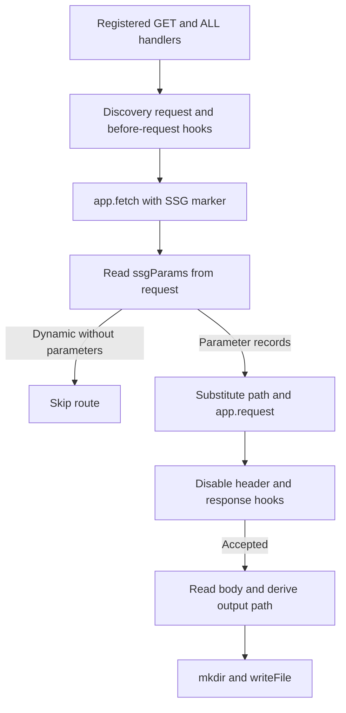

## Overview

The SSG helper executes registered application routes and writes their response bodies into files. `toSSG` coordinates route discovery, parameter expansion, response hooks and filesystem output, returning a success flag and generated paths. It uses ordinary Hono dispatch, so the HTML pipeline in [[Server Rendering]] also works during generation. Serving the resulting files afterward belongs to [[Runtime Adapters and Static Files]].

Sources: [src/helper/ssg/ssg.ts:243-289](repo://src/helper/ssg/ssg.ts#L243-L289), [src/helper/ssg/ssg.ts:420-469](repo://src/helper/ssg/ssg.ts#L420-L469), [src/helper/ssg/ssg.test.tsx:60-74](repo://src/helper/ssg/ssg.test.tsx#L60-L74), [src/middleware/serve-static/index.ts:76-124](repo://src/middleware/serve-static/index.ts#L76-L124)

## Entry points and options

The generic `toSSG(app, fs, options?)` requires a filesystem module implementing asynchronous `writeFile` and recursive `mkdir`. The Bun and Deno adapter versions accept only the app and options because they provide those operations. Bun delegates writes to `Bun.write` and supplies a no-op mkdir; Deno converts strings into UTF-8 bytes and delegates both file writing and directory creation to Deno APIs.

Sources: [src/helper/ssg/ssg.ts:34-37](repo://src/helper/ssg/ssg.ts#L34-L37), [src/helper/ssg/ssg.ts:341-368](repo://src/helper/ssg/ssg.ts#L341-L368), [src/adapter/bun/ssg.ts:5-26](repo://src/adapter/bun/ssg.ts#L5-L26), [src/adapter/deno/ssg.ts:9-27](repo://src/adapter/deno/ssg.ts#L9-L27)

| Option | Behavior |
| --- | --- |
| `dir` | Output directory; defaults to `./static` |
| `concurrency` | Passed to the request pool; `toSSG` defaults it to 2 |
| `extensionMap` | MIME-to-extension lookup supplied in place of the default map, before general MIME fallback |
| `plugins` | Ordered hook providers; when omitted, uses `defaultPlugin()` |
| Direct hook options | Legacy before-request, after-response and after-generate hooks; marked deprecated in favor of plugins |

Sources: [src/helper/ssg/ssg.ts:17-27](repo://src/helper/ssg/ssg.ts#L17-L27), [src/helper/ssg/ssg.ts:99-107](repo://src/helper/ssg/ssg.ts#L99-L107), [src/helper/ssg/ssg.ts:181-198](repo://src/helper/ssg/ssg.ts#L181-L198), [src/helper/ssg/ssg.ts:368-435](repo://src/helper/ssg/ssg.ts#L368-L435)

## Discover eligible routes

Discovery reads `app.routes`, retaining GET and ALL registrations whose target handler is not classified as middleware. It unwraps composed-handler metadata first; middleware classification is the function-arity check `handler.length > 1`. The route reduction does not deduplicate paths. Dynamic-route detection recognizes path segments starting with a colon or containing an asterisk, so a dynamic route needs explicit generation parameters before it yields output requests.

Sources: [src/helper/ssg/utils.ts:61-75](repo://src/helper/ssg/utils.ts#L61-L75), [src/utils/handler.ts:8-15](repo://src/utils/handler.ts#L8-L15), [src/helper/ssg/ssg.ts:243-251](repo://src/helper/ssg/ssg.ts#L243-L251)

For each eligible registration, `fetchRoutesContent` constructs a discovery request against `http://localhost`, applies the before-request hook and dispatches it with the SSG environment marker. The discovery response body is not the output. Instead, the request object is inspected for `ssgParams`; a static path without parameters receives a single empty parameter record, while a dynamic path without them is skipped. Consequently, an ordinary static handler can execute once for discovery and again for output.

Sources: [src/helper/ssg/ssg.ts:222-269](repo://src/helper/ssg/ssg.ts#L222-L269)



Sources: [src/helper/ssg/utils.ts:61-75](repo://src/helper/ssg/utils.ts#L61-L75), [src/helper/ssg/ssg.ts:222-289](repo://src/helper/ssg/ssg.ts#L222-L289), [src/helper/ssg/ssg.ts:310-334](repo://src/helper/ssg/ssg.ts#L310-L334)

## Expand dynamic parameters

`ssgParams` accepts an array of string-valued parameter records or a synchronous or asynchronous callback producing that array. When the incoming path is dynamic, it attaches the records to `c.req.raw` and returns `c.notFound()` to prevent subsequent handlers from executing during discovery. On a concrete path it simply continues. The repository tests register three concrete user IDs this way:

Sources: [src/helper/ssg/middleware.ts:24-48](repo://src/helper/ssg/middleware.ts#L24-L48), [src/helper/ssg/ssg.test.tsx:83-87](repo://src/helper/ssg/ssg.test.tsx#L83-L87)

```tsx
app.get(
  '/user/:user_id',
  ssgParams([{ user_id: '1' }, { user_id: '2' }, { user_id: '3' }]),
  (c) => c.html(<h1>{c.req.param('user_id')}</h1>)
)
```

Sources: [src/helper/ssg/ssg.test.tsx:83-87](repo://src/helper/ssg/ssg.test.tsx#L83-L87)

Each parameter record passes through `replaceUrlParam`, which replaces named colon parameters, including their optional or pattern suffixes. An empty value removes the matching segment. The generator requests the resulting path using the discovery request's method and headers, again with the SSG marker. The before-request hook runs on discovery, not separately for each concrete output request; output paths come from the original registered route and the parameter records.

Sources: [src/client/utils.ts:18-24](repo://src/client/utils.ts#L18-L24), [src/helper/ssg/ssg.ts:234-269](repo://src/helper/ssg/ssg.ts#L234-L269)

## Include or exclude responses

`isSSGContext` reads the environment marker. `disableSSG` returns the application's not-found response and adds `x-hono-disable-ssg` during generation, but continues for normal requests. `onlySSG` does the reverse availability check, returning not-found outside generation. Before response hooks run, the generator checks for the disable header and omits that response entirely. These controls affect generation or live availability without removing the route registration.

Sources: [src/helper/ssg/middleware.ts:56-83](repo://src/helper/ssg/middleware.ts#L56-L83), [src/helper/ssg/ssg.ts:270-280](repo://src/helper/ssg/ssg.ts#L270-L280)

The default plugin accepts only status 200. Supplying a plugin array replaces the implicit default, including when the array is empty. The experimental `redirectPlugin` transforms 301, 302, 303, 307 and 308 responses with Location headers into status-200 HTML containing a refresh target, canonical link and clickable destination. Place it before `defaultPlugin` so the default filter sees the transformed 200 response; reversing the order filters out the redirect before conversion can occur.

Sources: [src/helper/ssg/ssg.ts:368-375](repo://src/helper/ssg/ssg.ts#L368-L375), [src/helper/ssg/plugins.ts:11-72](repo://src/helper/ssg/plugins.ts#L11-L72)

## Compose lifecycle hooks

Hooks run sequentially within each phase. Before-request hooks pass their current Request to the next hook; after-response hooks similarly pass the current Response. Either phase can return false to stop processing that item. Direct legacy hooks are collected before plugin hooks, and plugins retain their supplied order. After-generate hooks receive the result, filesystem module and options, allowing follow-up work after generation has produced its result object.

Sources: [src/helper/ssg/ssg.ts:118-173](repo://src/helper/ssg/ssg.ts#L118-L173), [src/helper/ssg/ssg.ts:376-419](repo://src/helper/ssg/ssg.ts#L376-L419), [src/helper/ssg/ssg.ts:465-469](repo://src/helper/ssg/ssg.ts#L465-L469)

## Convert responses to files

Content-Type determines the extension after removing media-type parameters. If absent, the generator uses `text/plain`, explicitly accounting for the text-response optimization described in the source comments. The default extension map gives HTML, XML-family and YAML types explicit extensions; general MIME lookup follows, with `html` as the final fallback. Response content containing text or JSON in its content type is read as a string; other bodies are read as an array buffer.

Sources: [src/helper/ssg/ssg.ts:19-25](repo://src/helper/ssg/ssg.ts#L19-L25), [src/helper/ssg/ssg.ts:74-108](repo://src/helper/ssg/ssg.ts#L74-L108), [src/helper/ssg/ssg.ts:282-289](repo://src/helper/ssg/ssg.ts#L282-L289)

Output naming preserves a route that already ends in the chosen extension. The root path becomes `index.ext`, a trailing-slash path gains `index.ext`, and other paths gain `.ext`. Before writing, `ensureWithinOutDir` normalizes both paths and rejects an output outside the chosen directory. The writer recursively creates parent directories, caches created directory names, and writes strings directly or converts array buffers to byte arrays.

Sources: [src/helper/ssg/ssg.ts:50-71](repo://src/helper/ssg/ssg.ts#L50-L71), [src/helper/ssg/utils.ts:77-87](repo://src/helper/ssg/utils.ts#L77-L87), [src/helper/ssg/ssg.ts:309-334](repo://src/helper/ssg/ssg.ts#L309-L334)

## Completion and failure

On success, `toSSG` returns `success: true` and the written paths. Exceptions inside its generation phase become `success: false`, an empty files list and an Error object. The implementation does not remove files already written before failure, so that empty list is not a rollback guarantee. After-generate hooks run after this catch block and receive either result; a failure in those hooks can reject the call itself rather than being converted into the generation result.

Sources: [src/helper/ssg/ssg.ts:436-469](repo://src/helper/ssg/ssg.ts#L436-L469), [src/helper/ssg/ssg.ts:324-333](repo://src/helper/ssg/ssg.ts#L324-L333)
