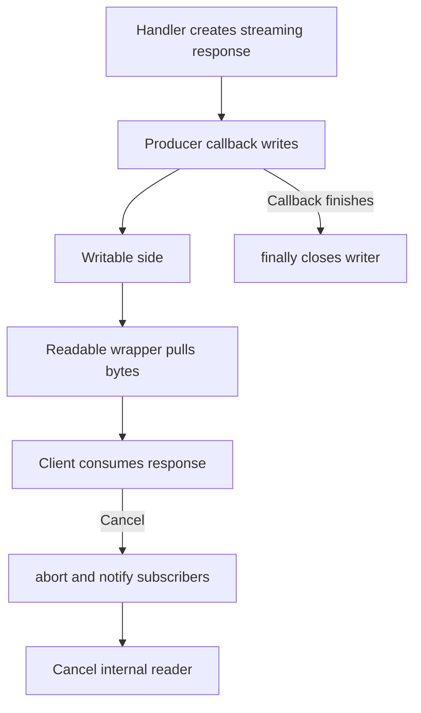

## Overview

Hono supports ongoing output through readable HTTP response bodies and runtime WebSocket upgrades. `stream`, `streamText` and `streamSSE` return a response while an asynchronous producer writes content. WebSocket helpers instead adapt runtime socket APIs to shared event handlers and `WSContext`. HTML suspense uses the rendering protocol in [[Server Rendering]]; platform event-to-request conversion is covered in [[Runtime Adapters and Static Files]].

Sources: [src/helper/streaming/stream.ts:7-44](repo://src/helper/streaming/stream.ts#L7-L44), [src/helper/streaming/text.ts:6-15](repo://src/helper/streaming/text.ts#L6-L15), [src/helper/streaming/sse.ts:72-100](repo://src/helper/streaming/sse.ts#L72-L100), [src/helper/websocket/index.ts:111-139](repo://src/helper/websocket/index.ts#L111-L139)

## Start an HTTP stream

`stream(c, callback, onError?)` creates a `TransformStream` and a `StreamingApi`, starts the callback asynchronously, and immediately returns `c.newResponse` around the readable side. It retains the context in a weak map for the stream's lifetime because the code accounts for Bun destroying the context after the request returns. An older-Bun compatibility branch forwards request-signal aborts to the stream.

Sources: [src/helper/streaming/stream.ts:7-44](repo://src/helper/streaming/stream.ts#L7-L44)

Choose `stream` when the caller should determine response headers. `streamText` sets plain-text content type, nosniff and chunked transfer encoding before delegating to `stream`. `streamSSE` creates the specialized event writer and sets event-stream, no-cache, keep-alive and chunked headers. These are concrete header changes, so downstream response transformations should be selected with the rules in [[HTTP and Observability Middleware]]; compression explicitly skips responses already marked with Transfer-Encoding.

Sources: [src/helper/streaming/text.ts:6-15](repo://src/helper/streaming/text.ts#L6-L15), [src/helper/streaming/sse.ts:72-100](repo://src/helper/streaming/sse.ts#L72-L100), [src/middleware/compress/index.ts:86-108](repo://src/middleware/compress/index.ts#L86-L108)

## Write, pipe and close

`StreamingApi.write` accepts strings or byte arrays, UTF-8 encodes strings, and awaits the stream writer. `writeln` adds a newline, and `sleep` returns a timer promise. `pipe` temporarily releases the writer lock, pipes another readable stream into the writable side without closing it, then reacquires the writer. This allows a callback to combine a source stream with later writes before the helper closes the response.

Sources: [src/utils/stream.ts:48-82](repo://src/utils/stream.ts#L48-L82)

The readable wrapper pulls from an internal reader. Canceling it calls `abort` unless normal closing has already begun. Abort sets `aborted` once and invokes subscribers, including cancellation of the internal reader; application code can add cleanup through `onAbort`. `close` sets `closed` and attempts to close the writer. The aborted and closed flags represent separate events rather than one combined completion state.

Sources: [src/utils/stream.ts:15-45](repo://src/utils/stream.ts#L15-L45), [src/utils/stream.ts:69-97](repo://src/utils/stream.ts#L69-L97)

Sources: [src/helper/streaming/stream.ts:12-44](repo://src/helper/streaming/stream.ts#L12-L44), [src/utils/stream.ts:21-45](repo://src/utils/stream.ts#L21-L45), [src/utils/stream.ts:48-97](repo://src/utils/stream.ts#L48-L97)

## Server-sent event framing

`writeSSE` accepts `data` plus optional `event`, `id` and `retry`. Data can be a string or promise, and rendering callbacks are resolved before framing. Each data line becomes its own `data:` line; optional metadata is added around those lines and the message ends with a blank line. Metadata containing carriage returns or newlines throws, preventing a value from creating extra SSE fields. Optional values are included through truthiness checks, so an empty ID or retry value zero is omitted by this implementation.

Sources: [src/helper/streaming/sse.ts:6-44](repo://src/helper/streaming/sse.ts#L6-L44)

The SSE callback and error callback both receive `SSEStreamingApi`, which extends the ordinary stream writer. A producer can therefore use raw writes or piping as well as framed event writes. The caller controls which events to emit and when the producer finishes; the helper does not define a replay store or reconnect cursor beyond serializing a supplied ID.

Sources: [src/helper/streaming/sse.ts:6-44](repo://src/helper/streaming/sse.ts#L6-L44), [src/helper/streaming/sse.ts:47-68](repo://src/helper/streaming/sse.ts#L47-L68), [src/utils/stream.ts:48-82](repo://src/utils/stream.ts#L48-L82)

## Failure after response creation

The generic stream catches callback errors, invokes `onError` for `Error` objects when supplied, otherwise logs, and always closes in finally. Undefined rejection reasons are ignored because cancellation can produce them. The writer's `write` and `close` methods themselves swallow writer failures; applications needing direct control over those errors must construct their own stream, as the comments specify. This differs from pre-response exceptions handled by the application dispatcher in [[Request Context and Middleware]].

Sources: [src/helper/streaming/stream.ts:26-41](repo://src/helper/streaming/stream.ts#L26-L41), [src/utils/stream.ts:48-75](repo://src/utils/stream.ts#L48-L75), [src/hono-base.ts:450-465](repo://src/hono-base.ts#L450-L465)

For SSE, a handled callback error first invokes `onError`, then emits an `error` event containing the exception message. Without a matching error callback it logs the error instead. Its finally block closes the stream. This is an in-stream error representation after the HTTP response has been created, rather than a new HTTP status response.

Sources: [src/helper/streaming/sse.ts:47-68](repo://src/helper/streaming/sse.ts#L47-L68), [src/helper/streaming/sse.ts:97-100](repo://src/helper/streaming/sse.ts#L97-L100)

## Shared WebSocket contract

`WSEvents` offers open, message, close and error callbacks, each receiving a `WSContext`. The context delegates send and close to the runtime and exposes its raw socket, URL, protocol and ready state. `defineWebSocketHelper` wraps a runtime-specific upgrade function. In middleware form it builds events from the HTTP context, returns the upgrade response if successful, and otherwise calls `next`; in direct form failure to upgrade throws.

Sources: [src/helper/websocket/index.ts:14-39](repo://src/helper/websocket/index.ts#L14-L39), [src/helper/websocket/index.ts:70-90](repo://src/helper/websocket/index.ts#L70-L90), [src/helper/websocket/index.ts:111-139](repo://src/helper/websocket/index.ts#L111-L139)

| Runtime | Upgrade and event wiring |
| --- | --- |
| Bun | Uses the server passed through bindings, calls `server.upgrade`, and exports a separate `websocket` handler object |
| Deno | Checks the upgrade header, calls `Deno.upgradeWebSocket`, attaches socket callbacks and returns its response |
| Cloudflare Workers | Creates a WebSocketPair, accepts the server socket and returns the client socket in a 101 response; no open callback |

Sources: [src/adapter/bun/websocket.ts:48-104](repo://src/adapter/bun/websocket.ts#L48-L104), [src/adapter/bun/server.ts:13-14](repo://src/adapter/bun/server.ts#L13-L14), [src/adapter/deno/websocket.ts:4-38](repo://src/adapter/deno/websocket.ts#L4-L38), [src/adapter/cloudflare-workers/websocket.ts:5-53](repo://src/adapter/cloudflare-workers/websocket.ts#L5-L53)

Bun stores event callbacks, request URL and the first requested subprotocol in upgrade data, and translates runtime messages into the shared message event. Its older `createBunWebSocket` factory is deprecated in favor of direct exports. Deno supplies the first requested subprotocol by default, with explicit upgrade options able to override it. The typed client's `$ws` method described in [[Validation and Typed Clients]] constructs the connection URL; server event wiring remains the adapter's responsibility.

Sources: [src/adapter/bun/websocket.ts:61-113](repo://src/adapter/bun/websocket.ts#L61-L113), [src/adapter/deno/websocket.ts:10-18](repo://src/adapter/deno/websocket.ts#L10-L18), [src/client/client.ts:187-211](repo://src/client/client.ts#L187-L211)
