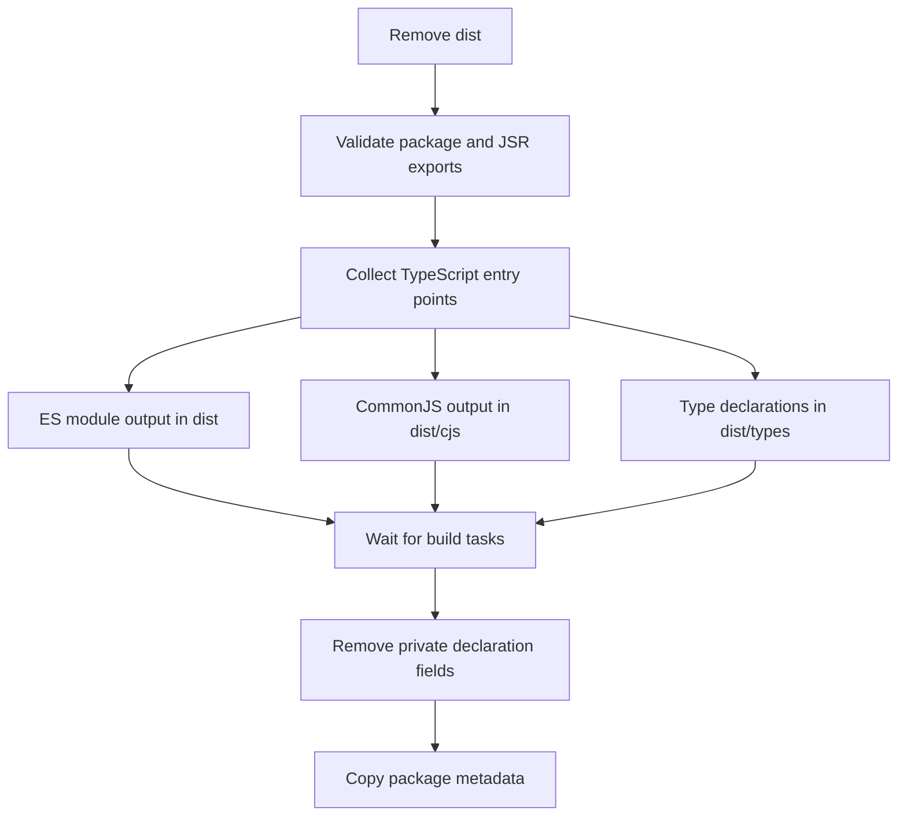

## Overview

Hono applications can be tested through `app.request` without starting a listening server. The `testClient` helper connects the typed client to that same in-process entry point. Framework development adds TypeScript checks, Vitest projects, native runtime suites and a distribution build. [[Quickstart]] covers creating an app and installing the checkout; this page explains how the repository verifies behavior and produces the package consumers import.

Sources: [src/hono-base.ts:499-517](repo://src/hono-base.ts#L499-L517), [src/helper/testing/index.ts:16-27](repo://src/helper/testing/index.ts#L16-L27), [package.json:13-36](repo://package.json#L13-L36), [build/build.ts:78-107](repo://build/build.ts#L78-L107)

## Exercise the application boundary

`app.request(input, requestInit?, env?, executionCtx?)` accepts a Request, string or URL and forwards the resulting request to `fetch`. A supplied Request is reused unless initialization overrides require constructing a new one. Relative paths become localhost URLs. Await the returned response before inspecting status, headers or body: the method's declared result allows either a direct Response or a promise. Explicit bindings and execution context travel through the same call, allowing tests to supply application dependencies.

Sources: [src/hono-base.ts:499-517](repo://src/hono-base.ts#L499-L517)

The source's minimal status test demonstrates that boundary:

Sources: [src/hono-base.ts:487-496](repo://src/hono-base.ts#L487-L496)

```ts
test('GET /hello is ok', async () => {
  const res = await app.request('/hello')
  expect(res.status).toBe(200)
})
```

Sources: [src/hono-base.ts:492-495](repo://src/hono-base.ts#L492-L495)

This path executes routing and middleware, but it does not construct a platform event or translate a platform-specific response. The Lambda handler, for example, performs request conversion before calling `app.fetch` and result conversion afterward. Tests of those conversions belong at the adapter boundary described in [[Runtime Adapters and Static Files]], whereas an application request test can focus directly on the Web response.

Sources: [src/hono-base.ts:499-517](repo://src/hono-base.ts#L499-L517), [src/adapter/aws-lambda/handler.ts:252-275](repo://src/adapter/aws-lambda/handler.ts#L252-L275)

## Use a typed test client

`testClient(app, env?, executionCtx?, options?)` builds `hc` with the fixed base URL `http://localhost` and a custom fetch function that invokes `app.request`. Its options omit the fetch override because transport is provided by the helper. The resulting client retains the application's route schema, so the serialization and endpoint method behavior from [[Validation and Typed Clients]] applies while requests stay inside the process.

Sources: [src/helper/testing/index.ts:13-27](repo://src/helper/testing/index.ts#L13-L27), [src/client/client.ts:53-128](repo://src/client/client.ts#L53-L128)

The helper's own test constructs a typed route and asserts its parsed output:

Sources: [src/helper/testing/index.test.ts:4-9](repo://src/helper/testing/index.test.ts#L4-L9)

```ts
const app = new Hono().get('/search', (c) => c.json({ hello: 'world' }))
const res = await testClient(app).search.$get()
expect(await res.json()).toEqual({ hello: 'world' })
```

Sources: [src/helper/testing/index.test.ts:6-8](repo://src/helper/testing/index.test.ts#L6-L8)

Additional tests supply typed bindings as the second argument and request headers in the fourth argument. `$url` remains available for URL assertions. The `$ws` test stubs the global WebSocket constructor; the helper's custom fetch does not itself replace WebSocket transport. Consequently, a successful `$ws` construction assertion is different from exercising a runtime's upgrade and event handling.

Sources: [src/helper/testing/index.test.ts:11-41](repo://src/helper/testing/index.test.ts#L11-L41), [src/helper/testing/index.ts:22-26](repo://src/helper/testing/index.ts#L22-L26), [src/client/client.ts:187-211](repo://src/client/client.ts#L187-L211)

## Run repository checks

The contribution guide requires `bun run test` to pass. That script first runs TypeScript with `tsconfig.spec.json`, then runs Vitest once. The spec configuration checks source files without emitting application output and includes Vitest globals; the shared TypeScript configuration enables strict checking. Watch mode invokes Vitest directly, so it does not include the separate TypeScript command from the full test script.

Sources: [docs/CONTRIBUTING.md:27-39](repo://docs/CONTRIBUTING.md#L27-L39), [package.json:14-15](repo://package.json#L14-L15), [tsconfig.spec.json:1-11](repo://tsconfig.spec.json#L1-L11), [tsconfig.base.json:1-15](repo://tsconfig.base.json#L1-L15)

| Command | Scope |
| --- | --- |
| `bun run test` | Type-check source tests, then run configured Vitest projects |
| `bun run test:watch` | Run Vitest in watch mode |
| `bun run test:deno` | Run Deno runtime tests and two Deno JSX configurations |
| `bun run test:bun` | Run Bun runtime tests with the repository JSX import source |
| `bun run test:all` | Run the main test script, then Deno and Bun suites |
| `bun run lint` | Check source, runtime tests, build tools, performance measures and benchmarks with ESLint |
| `bun run format` | Check formatting of JavaScript, TypeScript and TSX files in those areas |
| `bun run coverage` | Run Vitest with coverage enabled |

Sources: [package.json:14-33](repo://package.json#L14-L33)

## Select a test project

The root Vitest configuration discovers runtime project configurations and defines the `main` project over source, scripts and build tests. It excludes sandbox directories and case-test fixtures from that main project's discovery. Two additional JSX projects execute the DOM tests with different automatic JSX import sources: `jsx-runtime-default` uses `src/jsx`, and `jsx-runtime-dom` uses `src/jsx/dom`. This tests the same browser behavior through both entry points.

Sources: [vitest.config.ts:25-70](repo://vitest.config.ts#L25-L70)

Dedicated scripts select `fastly`, `node`, `workerd`, `lambda` and `lambda-edge` by project name. The Fastly configuration installs its Compute plugin, while Node and both Lambda configurations set `NAME` to `Node`. These project selections are separate from the native Bun and Deno commands. The CI Node job runs its selected project against Node 20, 22 and 24 in the checked-in matrix.

Sources: [package.json:16-22](repo://package.json#L16-L22), [runtime-tests/fastly/vitest.config.ts:1-10](repo://runtime-tests/fastly/vitest.config.ts#L1-L10), [runtime-tests/node/vitest.config.ts:1-11](repo://runtime-tests/node/vitest.config.ts#L1-L11), [runtime-tests/lambda/vitest.config.ts:1-11](repo://runtime-tests/lambda/vitest.config.ts#L1-L11), [runtime-tests/lambda-edge/vitest.config.ts:1-11](repo://runtime-tests/lambda-edge/vitest.config.ts#L1-L11), [.github/workflows/ci.yml:127-143](repo://.github/workflows/ci.yml#L127-L143)

Coverage is enabled in the root configuration with V8 and JSON, text and HTML reporters, writing under `coverage/raw/default`. Its exclusions include runtime-test sources, build entry code, test utilities, benchmarks, performance measures and compile-time-only type files. CI gathers coverage artifacts from its main, Bun and Deno jobs before submitting the combined directory; a single local report therefore has a different collection scope from that CI aggregation.

Sources: [vitest.config.ts:4-24](repo://vitest.config.ts#L4-L24), [.github/workflows/ci.yml:18-35](repo://.github/workflows/ci.yml#L18-L35)

## Build distributable files

`bun run build` removes `dist`, runs the Bun build script and copies the CommonJS package metadata into the CommonJS and type output directories. The package also defines `postbuild` as `publint`. At build startup, package and JSR exports are validated in both directions. Validation accepts exact entries or matching wildcard coverage and throws when an entry is missing from the counterpart, so export mismatches fail before transpilation begins.

Sources: [package.json:29-36](repo://package.json#L29-L36), [build/build.ts:20-26](repo://build/build.ts#L20-L26), [build/validate-exports.ts:1-37](repo://build/validate-exports.ts#L1-L37)



Sources: [package.json:29-36](repo://package.json#L29-L36), [build/build.ts:20-39](repo://build/build.ts#L20-L39), [build/build.ts:78-114](repo://build/build.ts#L78-L114), [tsconfig.build.json:1-18](repo://tsconfig.build.json#L1-L18)

The script scans TypeScript entry points while excluding test files and selected alternate entry files. Esbuild produces ESM and CommonJS outputs in parallel with declaration emission. The ESM resolver appends `.js` or `/index.js` to resolvable local imports and marks them external. Once these tasks complete, an AST-based pass removes private property declarations from generated declaration files. The root package export then maps import, require and types consumers to these separate output trees.

Sources: [build/build.ts:28-114](repo://build/build.ts#L28-L114), [build/remove-private-fields.ts:5-56](repo://build/remove-private-fields.ts#L5-L56), [package.json:38-43](repo://package.json#L38-L43)

## Match the CI development path

The main CI job installs locked dependencies, checks formatting, runs lint and EditorConfig validation, builds, and then runs the full test script. Runtime jobs for Fastly, Node, workerd and both Lambda variants also build before their selected tests. Following that order when changing package exports or generated declarations exercises the distribution boundary as well as source behavior; a passing in-process route assertion alone does not perform those build checks.

Sources: [.github/workflows/ci.yml:37-57](repo://.github/workflows/ci.yml#L37-L57), [.github/workflows/ci.yml:115-182](repo://.github/workflows/ci.yml#L115-L182), [src/hono-base.ts:499-517](repo://src/hono-base.ts#L499-L517)
