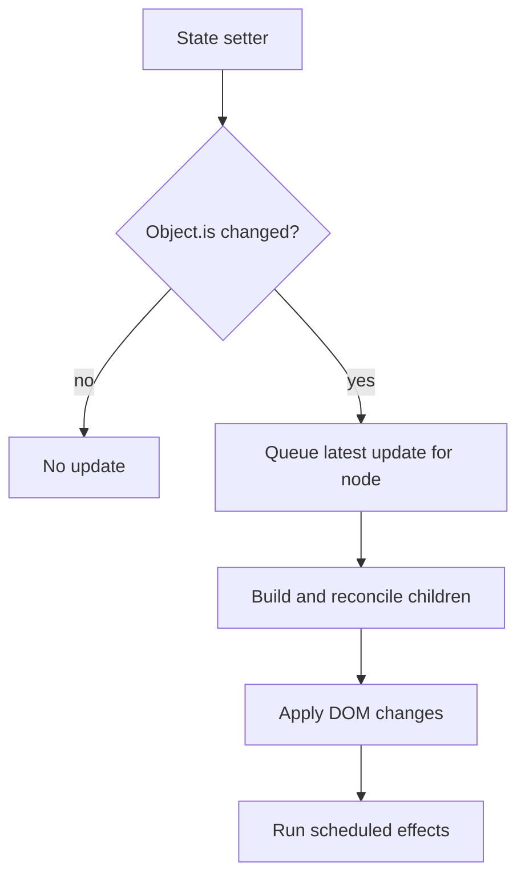

## Overview

The DOM renderer turns JSX into browser nodes and updates those nodes when component state changes. It shares JSX and hooks with [[HTML and Server Rendering]], but applies properties and event listeners to actual elements instead of serializing HTML. The public DOM entry exports render, state/effect hooks, context, Suspense, ErrorBoundary, portals, and synchronous flushing.

Sources: [src/jsx/dom/index.ts:39-57](repo://src/jsx/dom/index.ts#L39-L57), [src/jsx/dom/index.ts:85-125](repo://src/jsx/dom/index.ts#L85-L125), [src/jsx/dom/render.ts:164-207](repo://src/jsx/dom/render.ts#L164-L207)

## Mount and own a root

`render(jsxNode, container)` wraps the supplied content in a root node, builds its virtual children, applies them to a DocumentFragment, and replaces the container's children with that fragment. createRoot adds an owning object with render and unmount methods. Its first render installs an internal stateful component; later render calls update that component's state rather than rebuilding a separate root object.

Sources: [src/jsx/dom/render.ts:783-799](repo://src/jsx/dom/render.ts#L783-L799), [src/jsx/dom/client.ts:23-65](repo://src/jsx/dom/client.ts#L23-L65)

The root's unmount method sets its content to null and marks the root unusable for future renders, which throw Cannot update an unmounted root. Root options currently produce a warning when nonempty. hydrateRoot is explicitly equivalent to render in this implementation: it creates a root and calls render, so it does not implement a separate algorithm that attaches listeners to preserved server nodes.

Sources: [src/jsx/dom/client.ts:23-83](repo://src/jsx/dom/client.ts#L23-L83), [src/jsx/dom/render.ts:783-794](repo://src/jsx/dom/render.ts#L783-L794)

## Build and reconcile children

buildNode discards null, undefined, and boolean children, converts strings and numbers to text nodes, and initializes a hook stash for function components. Function invocation resets the hook index and pushes the current node on buildDataStack. A DOM_RENDERER override lets shared server components substitute their browser implementation. The stack is popped in finally after the component returns.

Sources: [src/jsx/dom/render.ts:274-291](repo://src/jsx/dom/render.ts#L274-L291), [src/jsx/dom/render.ts:667-703](repo://src/jsx/dom/render.ts#L667-L703)

During reconciliation, build flattens arrays and matches new children to old children. Text matches text; keyed elements match by both key and tag; unkeyed elements match by tag. Reused nodes retain their element and hook data while receiving new props. Unmatched old children enter a removal list. Memoized functions can skip rebuilding when their props comparison and saved context both permit it.

Sources: [src/jsx/dom/render.ts:497-606](repo://src/jsx/dom/render.ts#L497-L606)

The apply phase removes stale nodes, creates or updates text and elements, applies props recursively, and repositions existing elements where needed. It creates SVG and MathML elements through their namespace when selected. Portals use a special node pointing at an external container, so their children can participate in the component tree while their elements are applied elsewhere.

Sources: [src/jsx/dom/render.ts:387-458](repo://src/jsx/dom/render.ts#L387-L458), [src/jsx/dom/render.ts:687-700](repo://src/jsx/dom/render.ts#L687-L700), [src/jsx/dom/render.ts:815-825](repo://src/jsx/dom/render.ts#L815-L825)

## Apply properties and events

Event names are mapped from on-prefixed props, with aliases such as Change to Input and DoubleClick to DblClick, plus capture support. Changed listeners remove the previous function before installing the next; non-function event values throw. Style can be a string or object. Controlled values, checked inputs, selected options, and select values have specific DOM-property handling. Missing old attributes and listeners are removed during updates.

Sources: [src/jsx/dom/render.ts:19-22](repo://src/jsx/dom/render.ts#L19-L22), [src/jsx/dom/render.ts:115-155](repo://src/jsx/dom/render.ts#L115-L155), [src/jsx/dom/render.ts:164-271](repo://src/jsx/dom/render.ts#L164-L271), [src/jsx/dom/render.ts:437-441](repo://src/jsx/dom/render.ts#L437-L441)

Refs can be callbacks with cleanup or objects with current. The renderer records cleanup per element, clears removed refs, and invokes cleanup when nodes leave the tree. dangerouslySetInnerHTML assigns innerHTML directly. Those direct DOM operations have different behavior from server escaping, whose trust boundaries are detailed in [[HTML and Server Rendering]].

Sources: [src/jsx/dom/render.ts:187-197](repo://src/jsx/dom/render.ts#L187-L197), [src/jsx/dom/render.ts:250-269](repo://src/jsx/dom/render.ts#L250-L269), [src/jsx/dom/render.ts:341-361](repo://src/jsx/dom/render.ts#L341-L361)

## Update state and schedule work

useState stores values by the current node's hook index. Its setter accepts a value or updater function, compares with Object.is, and schedules work only when the value changes. Ordinary updates are queued through update; a newer pending update for the same node cancels the previous pending result. After a microtask, the latest update rebuilds and applies that node. Stable hook call order is required by this index-based storage.

Sources: [src/jsx/hooks/index.ts:182-208](repo://src/jsx/hooks/index.ts#L182-L208), [src/jsx/hooks/index.ts:237-243](repo://src/jsx/hooks/index.ts#L237-L243), [src/jsx/dom/render.ts:713-780](repo://src/jsx/dom/render.ts#L713-L780)

Sources: [src/jsx/hooks/index.ts:197-240](repo://src/jsx/hooks/index.ts#L197-L240), [src/jsx/dom/render.ts:713-780](repo://src/jsx/dom/render.ts#L713-L780), [src/jsx/dom/render.ts:462-480](repo://src/jsx/dom/render.ts#L462-L480)

flushSync collects nodes updated within its callback and immediately executes their latest queued updates. Transition hooks track pending work; view-transition hooks integrate document.startViewTransition when present and call through normally when absent. These mechanisms alter scheduling around the same state setters and reconciliation path rather than adding a second component model.

Sources: [src/jsx/dom/render.ts:801-813](repo://src/jsx/dom/render.ts#L801-L813), [src/jsx/hooks/index.ts:43-98](repo://src/jsx/hooks/index.ts#L43-L98), [src/jsx/hooks/index.ts:102-155](repo://src/jsx/hooks/index.ts#L102-L155)

## Run effects and reuse values

| Hook group | Implementation behavior |
| --- | --- |
| useReducer | Wraps useState with a reducer dispatch |
| useEffect / useLayoutEffect / useInsertionEffect | Stores dependency-aware callbacks and cleanup |
| useMemo / useCallback | Retains computed values or functions until dependencies change |
| useRef / createRef / forwardRef | Maintains or forwards a mutable current reference |
| useSyncExternalStore | Subscribes to snapshots; requires a server snapshot during string rendering |
| useId / useDebugValue | Memoizes an incremented identifier; debug value is a no-op |

Sources: [src/jsx/hooks/index.ts:245-315](repo://src/jsx/hooks/index.ts#L245-L315), [src/jsx/hooks/index.ts:318-329](repo://src/jsx/hooks/index.ts#L318-L329), [src/jsx/hooks/index.ts:348-424](repo://src/jsx/hooks/index.ts#L348-L424)

Dependency comparison checks array length and individual values. Changed effects run previous cleanup before recording the new effect. During application, insertion callbacks run before layout callbacks, while ordinary effect callbacks are deferred with requestAnimationFrame. Removing a component invokes its stored effect cleanups and removes queued updates. Outside a component build, state returns its initial value with a no-op setter and effects do nothing.

Sources: [src/jsx/hooks/index.ts:27-34](repo://src/jsx/hooks/index.ts#L27-L34), [src/jsx/hooks/index.ts:182-191](repo://src/jsx/hooks/index.ts#L182-L191), [src/jsx/hooks/index.ts:260-297](repo://src/jsx/hooks/index.ts#L260-L297), [src/jsx/dom/render.ts:341-361](repo://src/jsx/dom/render.ts#L341-L361), [src/jsx/dom/render.ts:462-480](repo://src/jsx/dom/render.ts#L462-L480)

## Preserve context and handle suspension

DOM providers insert internal push/pop operations around their children and pop on failure. Function nodes save active context values and restore them during local updates. The use hook caches promise resolution or rejection and throws a pending promise. Suspense handles that promise, returns its fallback, and schedules a retry when it settles; ErrorBoundary rethrows promises and handles ordinary errors with its callback and fallback.

Sources: [src/jsx/dom/context.ts:7-51](repo://src/jsx/dom/context.ts#L7-L51), [src/jsx/dom/render.ts:529-538](repo://src/jsx/dom/render.ts#L529-L538), [src/jsx/dom/render.ts:713-731](repo://src/jsx/dom/render.ts#L713-L731), [src/jsx/hooks/index.ts:332-346](repo://src/jsx/hooks/index.ts#L332-L346), [src/jsx/dom/components.ts:7-38](repo://src/jsx/dom/components.ts#L7-L38)

Form helpers expose the current FormContext, update action state after an asynchronous function resolves, and maintain optimistic values while registered actions are pending. The CSS DOM helper inserts generated rules into the matching style sheet and deduplicates inserted selectors. If the sheet is still missing after a deferred retry, it throws style sheet not found; include the corresponding Style component described in the server rendering page.

Sources: [src/jsx/dom/hooks/index.ts:24-90](repo://src/jsx/dom/hooks/index.ts#L24-L90), [src/jsx/dom/css.ts:77-124](repo://src/jsx/dom/css.ts#L77-L124)

## Use server compatibility entry points

The DOM server compatibility module's renderToString calls the element's toString and rejects asynchronous results. Its renderToReadableStream delegates to Hono's server streaming renderer, supporting onError while warning for other supplied options. These compatibility functions therefore have explicit limits; use the rendering and streaming contracts in [[HTML and Server Rendering]] when composing asynchronous page output.

Sources: [src/jsx/dom/server.ts:21-30](repo://src/jsx/dom/server.ts#L21-L30), [src/jsx/dom/server.ts:50-69](repo://src/jsx/dom/server.ts#L50-L69)

