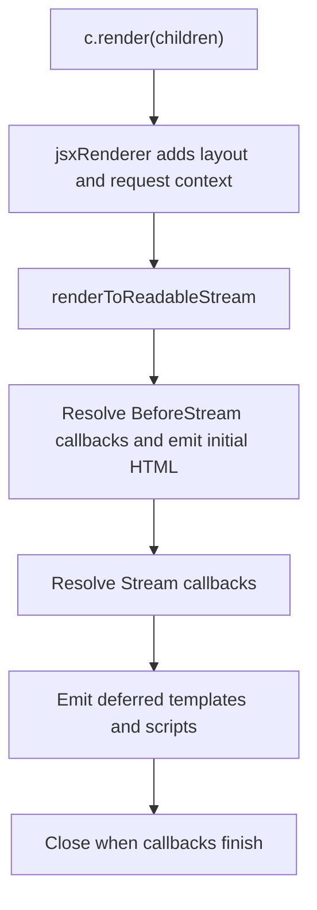

## Overview

Server rendering produces escaped HTML that a handler can return through the response helpers in [[Request and Context]]. Hono supports tagged templates, JSX nodes, request-aware layouts, CSS collection, and streamed Suspense output. These share escaped-string markers and rendering callbacks, letting asynchronous content participate in both complete-string and streaming responses. Browser tree updates have their own execution path in [[DOM Rendering]].

Sources: [src/helper/html/index.ts:11-57](repo://src/helper/html/index.ts#L11-L57), [src/utils/html.ts:6-21](repo://src/utils/html.ts#L6-L21), [src/middleware/jsx-renderer/index.ts:33-79](repo://src/middleware/jsx-renderer/index.ts#L33-L79), [src/jsx/dom/client.ts:23-65](repo://src/jsx/dom/client.ts#L23-L65)

## Escape template values

The html tagged template copies literal template segments and escapes interpolated strings. It flattens interpolated arrays, includes numbers, and skips booleans, null, and undefined. Values marked isEscaped are inserted without re-escaping, while promises are retained in the string buffer until resolution. Other values are converted to strings and escaped.

Sources: [src/helper/html/index.ts:11-57](repo://src/helper/html/index.ts#L11-L57)

The raw helper creates an escaped-marked String object without sanitizing its content. It is therefore an explicit trust boundary: values wrapped with raw bypass the normal escaping path. During asynchronous buffer resolution, escaped markers and callback lists are preserved, while ordinary resolved strings are escaped before concatenation. This allows trusted nested template output to compose without double escaping.

Sources: [src/utils/html.ts:40-87](repo://src/utils/html.ts#L40-L87), [src/helper/html/index.ts:26-46](repo://src/helper/html/index.ts#L26-L46)

## Render JSX nodes

JSX construction selects function nodes, specialized intrinsic components, or ordinary element nodes. A function component receives its props and children and may return a node, escaped value, number, null-like value, or promise. Ordinary string children are escaped. Fragment nodes render their children without an enclosing element, while memo wraps a component with a configurable props comparison.

Sources: [src/jsx/base.ts:108-128](repo://src/jsx/base.ts#L108-L128), [src/jsx/base.ts:254-301](repo://src/jsx/base.ts#L254-L301), [src/jsx/base.ts:304-351](repo://src/jsx/base.ts#L304-L351), [src/jsx/base.ts:383-419](repo://src/jsx/base.ts#L383-L419)

Element serialization validates tag names and skips invalid attribute names. It normalizes intrinsic and SVG attribute names, converts style objects, escapes string attributes, and emits recognized boolean attributes only when true. Event-handler functions and refs are omitted from server markup, while other function-valued props throw. dangerouslySetInnerHTML inserts raw content and throws if children were also supplied; void elements without children use a self-closing representation.

Sources: [src/jsx/base.ts:147-154](repo://src/jsx/base.ts#L147-L154), [src/jsx/base.ts:179-250](repo://src/jsx/base.ts#L179-L250)

## Install request-aware layouts

jsxRenderer obtains the current layout or Fragment, optionally installs a new layout, and sets a renderer on the context before continuing. When a handler calls `c.render`, the renderer combines the children with its component and wraps the result in RequestContext.Provider. The component receives the prior Layout and the request context, allowing nested layout composition without moving request dispatch into the component.

Sources: [src/middleware/jsx-renderer/index.ts:33-64](repo://src/middleware/jsx-renderer/index.ts#L33-L64), [src/middleware/jsx-renderer/index.ts:116-129](repo://src/middleware/jsx-renderer/index.ts#L116-L129)

The renderer prepends the HTML doctype by default. docType false suppresses it and a string replaces it. Options may be a function of the current context. Without streaming it returns `c.html`; stream true applies HTML, chunked transfer, and Identity content-encoding headers, while an object supplies custom stream headers. It then returns the readable stream through `c.body`.

Sources: [src/middleware/jsx-renderer/index.ts:33-79](repo://src/middleware/jsx-renderer/index.ts#L33-L79)

A component can call useRequestContext to retrieve the Hono context from that provider. Calling it outside the provider throws RequestContext is not provided. The source's example reads the request URL inside a component, so page-specific data can remain in components while the enclosing handler uses the same render entry point.

Sources: [src/middleware/jsx-renderer/index.ts:139-165](repo://src/middleware/jsx-renderer/index.ts#L139-L165)

```tsx
const RequestUrlBadge: FC = () => {
  const c = useRequestContext()
  return <b>{c.req.url}</b>
}
```

Sources: [src/middleware/jsx-renderer/index.ts:141-144](repo://src/middleware/jsx-renderer/index.ts#L141-L144)

## Isolate context across asynchronous rendering

JSX context uses a per-render WeakMap of provider value stacks. Rendering probes available AsyncLocalStorage implementations without a static node:async_hooks import, then runs each render inside its own store when available. Provider push and pop operations retain the same stack even when completion is deferred. This is separate from the explicit context-storage middleware described in [[Middleware and Diagnostics]].

Sources: [src/jsx/context.ts:15-66](repo://src/jsx/context.ts#L15-L66), [src/jsx/context.ts:161-189](repo://src/jsx/context.ts#L161-L189), [src/jsx/context.ts:213-250](repo://src/jsx/context.ts#L213-L250), [src/middleware/context-storage/index.ts:6-10](repo://src/middleware/context-storage/index.ts#L6-L10)

Without AsyncLocalStorage, the fallback store exists only during synchronous rendering. A useContext call after an await falls back to the context default instead of another request's provider value, and this degraded access can produce a one-time warning. Hono captures context at suspension points and restores it when resuming subtrees. Code relying on provider values across an ordinary asynchronous component boundary must account for the runtime capability stated by these branches.

Sources: [src/jsx/context.ts:69-106](repo://src/jsx/context.ts#L69-L106), [src/jsx/context.ts:150-211](repo://src/jsx/context.ts#L150-L211), [src/jsx/base.ts:268-282](repo://src/jsx/base.ts#L268-L282)

## Stream suspended HTML

Suspense renders children and detects promises, including promises thrown by the use hook. Pending content produces fallback markup plus callbacks for later resolution. A buffered rendering callback can replace the fallback directly; a streaming callback emits a template and script that replace the fallback in the browser. StreamingContext supplies a scriptNonce for generated script tags. Suspense and renderToReadableStream are marked experimental in their source.

Sources: [src/jsx/streaming.ts:18-85](repo://src/jsx/streaming.ts#L18-L85), [src/jsx/streaming.ts:87-149](repo://src/jsx/streaming.ts#L87-L149)



Sources: [src/middleware/jsx-renderer/index.ts:33-79](repo://src/middleware/jsx-renderer/index.ts#L33-L79), [src/jsx/streaming.ts:146-219](repo://src/jsx/streaming.ts#L146-L219)

The readable stream resolves BeforeStream callbacks, emits initial bytes, then processes Stream callbacks and any additional callbacks they introduce. It waits until all tracked callbacks resolve before closing. Cancellation suppresses later enqueue and close operations. Errors call the provided error callback, which defaults to console.trace; deferred callback failures are also logged and replaced with an empty contribution. Generic stream writer lifecycle is covered in [[Streaming and WebSockets]].

Sources: [src/jsx/streaming.ts:146-219](repo://src/jsx/streaming.ts#L146-L219)

ErrorBoundary supports a fallback or fallbackRender plus an onError callback. It captures render context for deferred failures, so fallback rendering can run in the appropriate provider scope. It handles synchronous errors and deferred child failures inside the rendering tree; application-level request errors still follow the middleware error path.

Sources: [src/jsx/components.ts:50-125](repo://src/jsx/components.ts#L50-L125), [src/jsx/components.ts:128-160](repo://src/jsx/components.ts#L128-L160), [src/compose.ts:49-59](repo://src/compose.ts#L49-L59)

## Collect generated CSS

The CSS helper exposes css, cx, keyframes, viewTransition, and Style through a default context, or an experimental createCssContext with a custom style id and class-name options. Generated class objects carry rendering callbacks. A per-tree WeakMap tracks pending and already-added styles; callbacks insert rules into an existing style element in buffered output or emit an append script for later streamed rules.

Sources: [src/helper/css/index.ts:63-146](repo://src/helper/css/index.ts#L63-L146), [src/helper/css/index.ts:169-227](repo://src/helper/css/index.ts#L169-L227)

Style accepts a nonce and records it for subsequent append scripts. External class names combined through cx are escaped before being marked safe. The same objects carry DOM renderer hooks for browser rendering. Applications using the nonce support in [[Security Middleware]] can pass the corresponding nonce into the rendering components that emit inline styles or scripts.

Sources: [src/helper/css/index.ts:111-121](repo://src/helper/css/index.ts#L111-L121), [src/helper/css/index.ts:149-166](repo://src/helper/css/index.ts#L149-L166), [src/helper/css/index.ts:192-206](repo://src/helper/css/index.ts#L192-L206), [src/middleware/secure-headers/secure-headers.ts:137-145](repo://src/middleware/secure-headers/secure-headers.ts#L137-L145)

