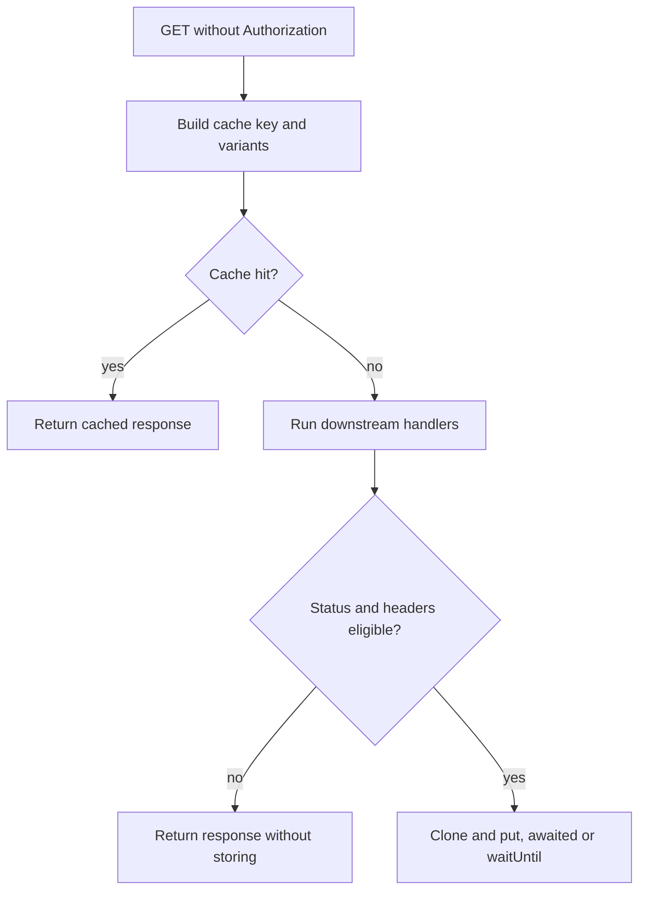

## Overview

HTTP middleware changes request routing, response representations, or cache behavior using the continuation rules in [[Middleware and Diagnostics]]. Most response transforms await downstream work before inspecting `c.res`; cache hits and redirects can return earlier. This catalogue also covers the negotiation and proxy helpers used inside handlers. File lookup and generated files are covered by [[Static Assets and Generation]].

Sources: [src/middleware/cache/index.ts:141-183](repo://src/middleware/cache/index.ts#L141-L183), [src/middleware/compress/index.ts:86-121](repo://src/middleware/compress/index.ts#L86-L121), [src/middleware/trailing-slash/index.ts:44-74](repo://src/middleware/trailing-slash/index.ts#L44-L74), [src/helper/proxy/index.ts:160-190](repo://src/helper/proxy/index.ts#L160-L190)

## Cache eligible responses

The cache middleware uses the runtime's `caches` API. When that API is absent at middleware creation, it returns a pass-through handler and either logs, invokes onCacheNotAvailable, or suppresses notification when that option is false. Cache-enabled requests must be GET and have no Authorization header. The key defaults to the full request URL; keyGenerator and a context-dependent cacheName can replace those choices.

Sources: [src/middleware/cache/index.ts:64-82](repo://src/middleware/cache/index.ts#L64-L82), [src/middleware/cache/index.ts:141-164](repo://src/middleware/cache/index.ts#L141-L164)

Configured vary headers become encoded request-header variants in the key. A hit returns a new response around the cached body. On a miss, downstream execution runs and only configured statuses, defaulting to 200, are eligible. The cache skips responses with private, no-store, or no-cache directives, Set-Cookie, or Vary fields not represented in its configured variants. A wildcard vary configuration is rejected.

Sources: [src/middleware/cache/index.ts:13-35](repo://src/middleware/cache/index.ts#L13-L35), [src/middleware/cache/index.ts:88-103](repo://src/middleware/cache/index.ts#L88-L103), [src/middleware/cache/index.ts:141-175](repo://src/middleware/cache/index.ts#L141-L175)

Cache-Control options append directives whose names the response has not already set, while Vary values are merged. The middleware clones the final response for storage. With wait true, it awaits cache.put; otherwise it passes the promise to `c.executionCtx.waitUntil`. This default requires a host execution context, whose availability is described in [[Request and Context]].

Sources: [src/middleware/cache/index.ts:105-139](repo://src/middleware/cache/index.ts#L105-L139), [src/middleware/cache/index.ts:177-183](repo://src/middleware/cache/index.ts#L177-L183)

Sources: [src/middleware/cache/index.ts:141-183](repo://src/middleware/cache/index.ts#L141-L183)

## Generate conditional responses

ETag middleware runs after the endpoint and reuses an existing ETag or generates one from a cloned response body. Its default generator uses SHA-1 through Web Crypto; a custom generator and weak tags are supported. If no generator or digest is available, it leaves the response alone. The digest helper reads the stream incrementally, combining the previous digest with each new chunk before hashing again.

Sources: [src/middleware/etag/index.ts:38-54](repo://src/middleware/etag/index.ts#L38-L54), [src/middleware/etag/index.ts:79-105](repo://src/middleware/etag/index.ts#L79-L105), [src/middleware/etag/digest.ts:1-43](repo://src/middleware/etag/digest.ts#L1-L43)

Matching If-None-Match values ignore the weak prefix. The wildcard branch requires a successful GET or HEAD response. A match replaces the body with an empty 304 response and retains only the configured headers, defaulting to cache-control, content-location, date, etag, expires, and vary. Otherwise the computed or existing ETag is set on the response.

Sources: [src/middleware/etag/index.ts:21-35](repo://src/middleware/etag/index.ts#L21-L35), [src/middleware/etag/index.ts:107-128](repo://src/middleware/etag/index.ts#L107-L128)

## Compress a representation

Compression selects gzip or deflate from Accept-Encoding quality values, with configurable encoding, content-type filter, and a default 1024-byte threshold. The size check uses Content-Length when present. It skips partial 206 responses, HEAD, already encoded or transfer-encoded responses, filtered content types, and Cache-Control no-transform. Missing accepted encoding or body also prevents compression.

Sources: [src/middleware/compress/index.ts:24-43](repo://src/middleware/compress/index.ts#L24-L43), [src/middleware/compress/index.ts:70-108](repo://src/middleware/compress/index.ts#L70-L108), [src/middleware/compress/index.ts:124-129](repo://src/middleware/compress/index.ts#L124-L129)

The transform pipes the response body through CompressionStream, removes Content-Length, and sets Content-Encoding. An existing strong ETag becomes weak because compressed bytes differ from the original representation. Because ETag, compression, and caching all inspect responses after downstream work, registration order determines which representation each outer middleware observes.

Sources: [src/middleware/compress/index.ts:110-121](repo://src/middleware/compress/index.ts#L110-L121), [src/compose.ts:49-69](repo://src/compose.ts#L49-L69)

## Normalize methods and paths

Method override skips GET. For other requests it reads a configured header, query parameter, or form field, defaulting to the form field `_method`. When an override exists it removes that control input, creates a new request with the selected method, and calls `app.fetch` again with the current bindings and available execution context. This is a new dispatch, so middleware may run again. Without an override it simply advances.

Sources: [src/middleware/method-override/index.ts:11-33](repo://src/middleware/method-override/index.ts#L11-L33), [src/middleware/method-override/index.ts:60-148](repo://src/middleware/method-override/index.ts#L60-L148)

Trailing-slash middleware supports trimming or appending and sends 301 redirects for GET and HEAD. By default the redirect happens only after a downstream 404; alwaysRedirect checks before downstream execution. Trimming preserves the root path, and appending has a skip predicate. These redirects complement the matching normalization in [[Routing and Dispatch]] by changing the client's URL rather than merely changing a match key.

Sources: [src/middleware/trailing-slash/index.ts:44-74](repo://src/middleware/trailing-slash/index.ts#L44-L74), [src/middleware/trailing-slash/index.ts:128-158](repo://src/middleware/trailing-slash/index.ts#L128-L158)

## Negotiate and format output

| Component | Configuration and result |
| --- | --- |
| `accepts` helper | Reads the selected Accept-style header, sorts by quality, chooses an exactly supported value, or returns the configured default; accepts a custom matcher |
| `prettyJSON` | Re-serializes JSON responses when the pretty query is present or force is enabled; defaults to two spaces |
| `poweredBy` | Sets X-Powered-By after downstream execution; serverName defaults to Hono |

Sources: [src/helper/accepts/accepts.ts:21-49](repo://src/helper/accepts/accepts.ts#L21-L49), [src/middleware/pretty-json/index.ts:46-56](repo://src/middleware/pretty-json/index.ts#L46-L56), [src/middleware/powered-by/index.ts:30-35](repo://src/middleware/powered-by/index.ts#L30-L35)

Language detection defaults to querystring, cookie, then header, using `lang`, `language`, and Accept-Language respectively. It normalizes against supported languages with optional case-insensitive matching and progressive truncation, then stores the result as `language`. Detection falls back to the configured language; successful detected values can be cached in a cookie. Invalid fallback membership, path index, or detector names fail configuration validation. Path-based detection is available by adding it to the configured order.

Sources: [src/middleware/language/language.ts:51-68](repo://src/middleware/language/language.ts#L51-L68), [src/middleware/language/language.ts:84-123](repo://src/middleware/language/language.ts#L84-L123), [src/middleware/language/language.ts:167-207](repo://src/middleware/language/language.ts#L167-L207), [src/middleware/language/language.ts:229-299](repo://src/middleware/language/language.ts#L229-L299)

## Forward an upstream response

The proxy helper constructs a Request from the input plus optional raw request and init overrides, removes Accept-Encoding, and calls customFetch or global fetch. When building from a raw request it removes fixed hop-by-hop headers and carries method, body, signal, and duplex information. Strict Connection processing additionally validates and removes named connection headers; the source recommends that mode only for trusted environments. Explicit init values are applied after the raw-request defaults.

Sources: [src/helper/proxy/index.ts:24-90](repo://src/helper/proxy/index.ts#L24-L90), [src/helper/proxy/index.ts:160-174](repo://src/helper/proxy/index.ts#L160-L174)

The returned response preserves status and body while removing fixed hop-by-hop response headers. If Content-Encoding was present, it also removes that header and Content-Length, whose value described compressed bytes. Header records with undefined values allow callers to omit credentials when forwarding. If earlier validation consumed the body, use the cached-body reconstruction explained in [[Request and Context]] before supplying a raw request to the proxy.

Sources: [src/helper/proxy/index.ts:93-112](repo://src/helper/proxy/index.ts#L93-L112), [src/helper/proxy/index.ts:123-149](repo://src/helper/proxy/index.ts#L123-L149), [src/helper/proxy/index.ts:174-190](repo://src/helper/proxy/index.ts#L174-L190), [src/request.ts:476-505](repo://src/request.ts#L476-L505)

