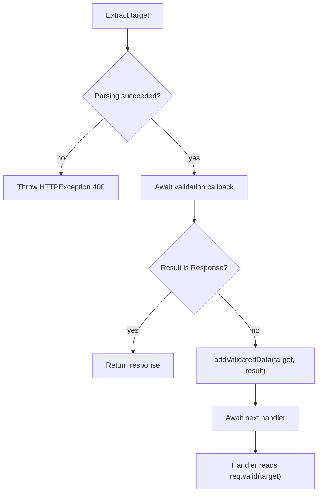

## Overview

The validator middleware turns one request target into data that later handlers retrieve through `c.req.valid`. It supplies extraction and control flow; the application's callback supplies the actual validation and transformation. Raw request access and caching are explained in [[Request and Context]]. Validation runs inside the same handler chain, so a returned response can reject the request before the endpoint executes.

Sources: [src/validator/validator.ts:89-170](repo://src/validator/validator.ts#L89-L170), [src/request.ts:339-354](repo://src/request.ts#L339-L354)

## Choose the target

| Target | Value passed to the callback |
| --- | --- |
| json | Parsed JSON when Content-Type matches the JSON expression |
| form | A null-prototype field record with repeated values collected |
| query | Single query values as strings; repeated values as arrays |
| param | Decoded path parameters for the active match |
| header | The request header record |
| cookie | Parsed cookie values |

Sources: [src/validator/validator.ts:89-160](repo://src/validator/validator.ts#L89-L160)

Each invocation starts with an empty object. JSON and form extraction are gated by Content-Type, so a missing or unsuitable type leaves that empty value for the callback. The middleware does not automatically reject an unsupported content type. If an endpoint requires a specific body shape, its callback must reject the empty object as appropriate. The tests explicitly show JSON sent without the expected content type reaching a pass-through validator without its original fields.

Sources: [src/validator/validator.ts:89-111](repo://src/validator/validator.ts#L89-L111), [src/validator/validator.test.ts:161-180](repo://src/validator/validator.test.ts#L161-L180)

## Parse JSON and forms

The JSON expression accepts application/json and its supported structured-suffix variants, case-insensitively, with media-type parameters. Matching requests use `c.req.json()`. A parse exception becomes an HTTPException with status 400 and the message Malformed JSON in request body. This happens before the callback, separating syntax errors from the application's checks on an otherwise parsed value.

Sources: [src/validator/validator.ts:24-26](repo://src/validator/validator.ts#L24-L26), [src/validator/validator.ts:93-104](repo://src/validator/validator.ts#L93-L104)

Forms accept multipart or URL-encoded content types. If formData is already cached, extraction reuses it. Otherwise it reads an array buffer, converts it with bufferToFormData, and stores the parsed form in the cache. Conversion failures become 400 exceptions whose messages start with Malformed FormData request. Repeated keys become arrays, and a key ending in `[]` starts as an array even when it has only one value; the key spelling is retained.

Sources: [src/validator/validator.ts:105-142](repo://src/validator/validator.ts#L105-L142)

Query extraction reads all query values, collapsing an array of length one to its sole string. That differs from always using `queries()` directly. A callback accepting a repeated query key must therefore handle both shapes. Header and cookie targets similarly expose parsed records without adding application-specific checks such as required names or allowed values.

Sources: [src/validator/validator.ts:144-159](repo://src/validator/validator.ts#L144-L159)

## Return transformed data or reject

The callback may be synchronous or asynchronous. The middleware awaits its result, returns it immediately if it is a Response, otherwise stores it under the target and awaits `next`. A transformation can therefore normalize strings into application values while leaving the raw request unchanged. Returning undefined also follows the storage-and-next branch; the runtime does not require a nonempty object.

Sources: [src/validator/validator.ts:14-22](repo://src/validator/validator.ts#L14-L22), [src/validator/validator.ts:162-170](repo://src/validator/validator.ts#L162-L170)



Sources: [src/validator/validator.ts:93-170](repo://src/validator/validator.ts#L93-L170), [src/request.ts:339-354](repo://src/request.ts#L339-L354)

The repository's pass-through JSON route demonstrates the storage boundary. It returns the extracted value unchanged, and the endpoint reads only the stored target. This example establishes plumbing rather than a schema policy: a production callback's constraints must be expressed in that callback or a schema library it invokes.

Sources: [src/validator/validator.test.ts:126-147](repo://src/validator/validator.test.ts#L126-L147), [src/validator/validator.test.ts:35-60](repo://src/validator/validator.test.ts#L35-L60)

```ts
app.post(
  '/post',
  validator('json', (value) => value),
  (c) => {
    return c.json(c.req.valid('json'))
  }
)
```

Sources: [src/validator/validator.test.ts:128-134](repo://src/validator/validator.test.ts#L128-L134)

A rejection can return a context response with an explicit status. The query test returns `c.text('Invalid!', 400)` when q is absent; requests with q reach the endpoint and return 200. Throwing an Error instead invokes the error handling described in [[Middleware and Diagnostics]]. A callback that uses a schema library can follow the test adapter's safeParse pattern: return a response on failure, and return parsed data on success.

Sources: [src/validator/validator.test.ts:35-60](repo://src/validator/validator.test.ts#L35-L60), [src/validator/validator.test.ts:66-116](repo://src/validator/validator.test.ts#L66-L116), [src/compose.ts:49-59](repo://src/compose.ts#L49-L59)

## Preserve input and output types

The validator distinguishes the client's input shape from the handler's output shape. Its generics derive `out` from non-response callback results and exclude Response or TypedResponse returns from that data type. Response returns contribute separately to the middleware's response type. For non-JSON targets, InferInput maps values to their wire representations while preserving supported literal unions and optional forms. JSON can use the declared input type or inferred output as its input shape.

Sources: [src/validator/validator.ts:46-88](repo://src/validator/validator.ts#L46-L88), [src/validator/validator.ts:175-185](repo://src/validator/validator.ts#L175-L185), [src/validator/utils.ts:9-69](repo://src/validator/utils.ts#L9-L69)

`HonoRequest.valid` selects its return type from the target in the accumulated output type; at runtime it only reads stored data. TypedResponse records data, status, and format for route schema inference, and the validator tests verify that both 400 and 200 responses appear in the resulting route schema. [[Typed Client]] consumes this distinction so callers can supply request data and narrow response outcomes without confusing validated server output with the transport input.

Sources: [src/request.ts:351-354](repo://src/request.ts#L351-L354), [src/types.ts:2632-2647](repo://src/types.ts#L2632-L2647), [src/types.ts:2720-2727](repo://src/types.ts#L2720-L2727), [src/validator/validator.test.ts:82-106](repo://src/validator/validator.test.ts#L82-L106)

## Compose validation stages

Different target validators can run consecutively because stored values are keyed by target. The tests attach JSON and form validators to the same route and read both targets afterward; content type determines which extractor supplies actual fields. Repeating a target replaces the stored value for that key. The type-level target restriction also excludes JSON and form for GET and HEAD, reflecting those methods' body restrictions in the validator interface.

Sources: [src/validator/validator.test.ts:401-440](repo://src/validator/validator.test.ts#L401-L440), [src/request.ts:339-341](repo://src/request.ts#L339-L341), [src/validator/validator.ts:9-12](repo://src/validator/validator.ts#L9-L12)

