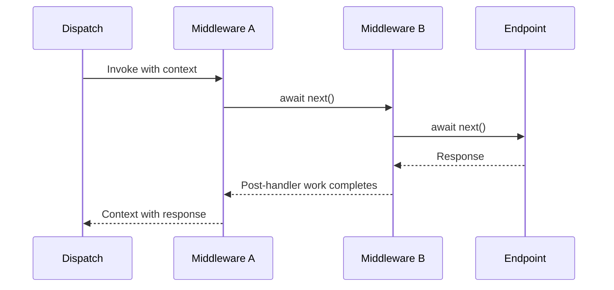

## Overview

Middleware uses the handler list produced by [[Routing and Dispatch]] to run work before and after downstream handlers. Each function receives a context and a `next` continuation. Returning a response can end the chain; awaiting `next()` lets downstream work finish before response inspection or modification. Context variables, headers, and finalization follow the rules in [[Request and Context]].

Sources: [src/compose.ts:32-70](repo://src/compose.ts#L32-L70), [src/compose.test.ts:17-57](repo://src/compose.test.ts#L17-L57)

## Follow the continuation

Composition starts at index zero and increments through matching handlers. Before invoking a handler it sets `c.req.routeIndex` to that handler's index. Calling `next` invokes the next dispatch recursively, so code after `await next()` runs as that recursion unwinds. Composition rejects a second dispatch to an already-visited index with `next() called multiple times`. A middleware function must not invoke its continuation twice.

Sources: [src/compose.ts:20-51](repo://src/compose.ts#L20-L51)

Sources: [src/compose.ts:32-70](repo://src/compose.ts#L32-L70), [src/compose.test.ts:17-57](repo://src/compose.test.ts#L17-L57)

When a handler returns a response, composition assigns it only if the context is not already finalized, or the response came from error handling. Therefore a middleware that wants to replace an already-finalized downstream response should explicitly assign `c.res`. Reaching the end of the handler list invokes the not-found handler only while the context remains unfinished; dispatch then checks that the completed chain actually finalized a response.

Sources: [src/compose.ts:61-70](repo://src/compose.ts#L61-L70), [src/context.ts:414-434](repo://src/context.ts#L414-L434), [src/hono-base.ts:450-465](repo://src/hono-base.ts#L450-L465)

## Handle errors

An Error thrown inside composition sets `c.error`, calls the configured error handler, and allows its returned response to replace an existing response. Non-Error thrown values are rethrown. The application's default error handler uses an exception's `getResponse` when available, otherwise logs the error and returns a 500 text response. Custom `app.onError` logic controls that conversion; middleware after `await next()` can inspect `c.error` after a downstream error was handled.

Sources: [src/compose.ts:49-69](repo://src/compose.ts#L49-L69), [src/hono-base.ts:35-42](repo://src/hono-base.ts#L35-L42), [src/hono-base.ts:271-274](repo://src/hono-base.ts#L271-L274), [src/context.ts:318-333](repo://src/context.ts#L318-L333)

`HTTPException` carries a status, optional response, message, and cause. Its `getResponse` uses the exception's status even when a response was supplied, preserving that response's body and headers. With no supplied response it builds one from the exception message. This is the mechanism used by several built-ins in [[Security Middleware]] to reject requests with explicit HTTP outcomes.

Sources: [src/http-exception.ts:14-18](repo://src/http-exception.ts#L14-L18), [src/http-exception.ts:46-77](repo://src/http-exception.ts#L46-L77), [src/middleware/basic-auth/index.ts:132-153](repo://src/middleware/basic-auth/index.ts#L132-L153)

## Package reusable handlers

`createMiddleware` returns the supplied middleware unchanged at runtime while retaining its environment, path, input, and response types. A factory groups those types with `createApp` and `createHandlers`. `createApp` merges default application options with per-call options and invokes an optional initialization hook; `createHandlers` returns the handler sequence with undefined entries removed. These helpers organize registration without creating a separate execution pipeline.

Sources: [src/helper/factory/index.ts:332-375](repo://src/helper/factory/index.ts#L332-L375)

Context storage makes the current context available to functions without an explicit context argument. The middleware runs `next` inside AsyncLocalStorage imported from `node:async_hooks`. `tryGetContext` returns undefined outside that storage scope, while `getContext` throws `Context is not available`. Its environment therefore needs that Node API or an appropriate runtime implementation.

Sources: [src/middleware/context-storage/index.ts:6-10](repo://src/middleware/context-storage/index.ts#L6-L10), [src/middleware/context-storage/index.ts:43-59](repo://src/middleware/context-storage/index.ts#L43-L59)

## Combine conditional policies

| Helper | Selection behavior |
| --- | --- |
| `some` | Tries alternatives until one completes successfully; false conditions continue and thrown failures are retained |
| `every` | Composes all supplied functions and throws when a condition returns false |
| `except` | Skips its middleware when a predicate or route-pattern condition matches |

Sources: [src/middleware/combine/index.ts:38-69](repo://src/middleware/combine/index.ts#L38-L69), [src/middleware/combine/index.ts:99-117](repo://src/middleware/combine/index.ts#L99-L117), [src/middleware/combine/index.ts:141-165](repo://src/middleware/combine/index.ts#L141-L165)

`some` tracks whether an alternative called the downstream continuation. If an error occurs after that call, it stops trying alternatives instead of running downstream work again. A true condition advances through the wrapped continuation when the context is unfinished. `every` preserves the surrounding route index for its internal handlers, and `except` compiles string patterns with TrieRouter. These details matter when combining authentication alternatives with other request policies.

Sources: [src/middleware/combine/index.ts:38-69](repo://src/middleware/combine/index.ts#L38-L69), [src/middleware/combine/index.ts:99-117](repo://src/middleware/combine/index.ts#L99-L117), [src/middleware/combine/index.ts:145-164](repo://src/middleware/combine/index.ts#L145-L164)

## Observe request execution

`logger` emits an incoming method/path message, records a start time, awaits downstream execution, then emits the outgoing status and elapsed time. It defaults to console.log but accepts a custom print function. The path is sliced from the URL and includes its query portion, so the source's logged value is broader than `c.req.path`.

Sources: [src/middleware/logger/index.ts:48-63](repo://src/middleware/logger/index.ts#L48-L63), [src/middleware/logger/index.ts:81-95](repo://src/middleware/logger/index.ts#L81-L95)

`requestId` accepts an incoming X-Request-Id by default, provided it is nonempty, no longer than 255 characters, and contains only the permitted word, hyphen, or equals characters. Otherwise it calls the generator, which defaults to crypto.randomUUID. It stores the value as `requestId` and sets the configured response header. An empty header name disables incoming-header lookup and response-header emission while retaining the context variable.

Sources: [src/middleware/request-id/request-id.ts:41-59](repo://src/middleware/request-id/request-id.ts#L41-L59)

`timing` initializes a metric record, starts a total timer by default, and appends Server-Timing after downstream work. It can disable output, end remaining timers automatically, and configure Timing-Allow-Origin. `setMetric` adds values or descriptions, `startTime` and `endTime` manage named timers, and `wrapTime` ends its timer in a finally block around a promise. Metric helpers warn and return when timing middleware has not initialized the context.

Sources: [src/middleware/timing/timing.ts:76-125](repo://src/middleware/timing/timing.ts#L76-L125), [src/middleware/timing/timing.ts:149-224](repo://src/middleware/timing/timing.ts#L149-L224), [src/middleware/timing/timing.ts:244-257](repo://src/middleware/timing/timing.ts#L244-L257)

## Bound response latency

`timeout(duration, exception)` races `next()` against a timer, clears the timer in finally, and defaults to an HTTPException with status 504 and message Gateway Timeout. An exception callback can derive the failure from the current context. The implementation does not abort downstream work: losing the race changes the response path, but the underlying operation needs its own cancellation mechanism if cancellation is required.

Sources: [src/middleware/timeout/index.ts:12-14](repo://src/middleware/timeout/index.ts#L12-L14), [src/middleware/timeout/index.ts:38-58](repo://src/middleware/timeout/index.ts#L38-L58)

