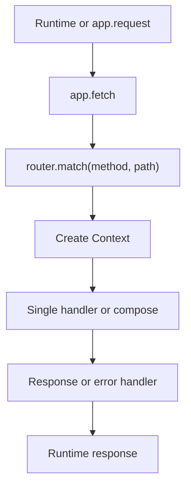

## Overview

Hono is a TypeScript web framework built around the Web Standards `Request` and `Response` objects. An application registers handlers, matches each incoming request, and returns a response through the same `fetch` interface across runtimes. The repository contains the framework itself, its routers, middleware, rendering systems, client, and runtime adapters. Start with [[Quickstart]] to exercise that interface with a minimal application.

Sources: [README.md:22-47](repo://README.md#L22-L47), [src/hono-base.ts:406-485](repo://src/hono-base.ts#L406-L485), [package.json:38-48](repo://package.json#L38-L48)

## Request systems

The central request path separates route registration from request execution. `Hono` configures a router; `HonoBase` registers handlers and dispatches requests; `Context` carries the request, bindings, and response state. Middleware participates in the same handler list as route endpoints, so ordering and finalization are part of the application contract.

Sources: [src/hono.ts:26-33](repo://src/hono.ts#L26-L33), [src/hono-base.ts:126-173](repo://src/hono-base.ts#L126-L173), [src/hono-base.ts:385-465](repo://src/hono-base.ts#L385-L465), [src/context.ts:293-369](repo://src/context.ts#L293-L369)

| Area | What it does | Page |
| --- | --- | --- |
| First application | Registers a route and exposes an app | [[Quickstart]] |
| Routing | Groups routes, selects a router, dispatches matches | [[Routing and Dispatch]] |
| Handler interface | Provides request access, bindings, and response state | [[Request and Context]] |
| Handler cooperation | Runs `next`, finalizes responses, and invokes error handlers | [[Middleware and Diagnostics]] |

Sources: [README.md:26-39](repo://README.md#L26-L39), [src/hono-base.ts:208-252](repo://src/hono-base.ts#L208-L252), [src/hono-base.ts:406-465](repo://src/hono-base.ts#L406-L465), [src/context.ts:293-406](repo://src/context.ts#L293-L406), [src/compose.ts:15-73](repo://src/compose.ts#L15-L73)

| Area | What it does | Page |
| --- | --- | --- |
| Access policies | Authenticates requests before continuing | [[Security Middleware]] |
| HTTP representations | Transforms responses such as compression | [[HTTP Middleware]] |
| Validation | Extracts a target, validates it, stores transformed data | [[Input Validation]] |
| Client calls | Maps typed property paths and methods to fetch calls | [[Typed Client]] |

Sources: [src/middleware/basic-auth/index.ts:80-145](repo://src/middleware/basic-auth/index.ts#L80-L145), [src/middleware/compress/index.ts:70-108](repo://src/middleware/compress/index.ts#L70-L108), [src/validator/validator.ts:89-170](repo://src/validator/validator.ts#L89-L170), [src/client/client.ts:161-232](repo://src/client/client.ts#L161-L232)

## Content and runtime systems

Content production has several entry points. Server rendering installs a renderer on the request context; browser rendering owns a DOM root; SSE returns a readable stream. Runtime adapters connect the resulting HTTP response to the host contract. Static generation also executes the application, then saves its responses through a supplied filesystem interface.

Sources: [src/middleware/jsx-renderer/index.ts:33-79](repo://src/middleware/jsx-renderer/index.ts#L33-L79), [src/middleware/jsx-renderer/index.ts:116-129](repo://src/middleware/jsx-renderer/index.ts#L116-L129), [src/jsx/dom/client.ts:23-65](repo://src/jsx/dom/client.ts#L23-L65), [src/helper/streaming/sse.ts:72-100](repo://src/helper/streaming/sse.ts#L72-L100), [src/adapter/aws-lambda/handler.ts:252-275](repo://src/adapter/aws-lambda/handler.ts#L252-L275), [src/helper/ssg/ssg.ts:368-435](repo://src/helper/ssg/ssg.ts#L368-L435)

| Area | What it does | Page |
| --- | --- | --- |
| Server HTML | Renders layouts and optionally streams HTML | [[HTML and Server Rendering]] |
| Browser UI | Creates, updates, and unmounts DOM roots | [[DOM Rendering]] |
| Long-lived output | Frames and writes event streams | [[Streaming and WebSockets]] |
| Host integration | Converts runtime events to requests and responses | [[Runtime Adapters]] |
| Generated content | Executes routes and writes output files | [[Static Assets and Generation]] |
| Verification | Sends in-process typed requests and runs repository checks | [[Testing and Development]] |

Sources: [src/middleware/jsx-renderer/index.ts:33-79](repo://src/middleware/jsx-renderer/index.ts#L33-L79), [src/jsx/dom/client.ts:23-83](repo://src/jsx/dom/client.ts#L23-L83), [src/helper/streaming/sse.ts:18-44](repo://src/helper/streaming/sse.ts#L18-L44), [src/adapter/aws-lambda/handler.ts:252-275](repo://src/adapter/aws-lambda/handler.ts#L252-L275), [src/helper/ssg/ssg.ts:318-333](repo://src/helper/ssg/ssg.ts#L318-L333), [src/helper/testing/index.ts:15-27](repo://src/helper/testing/index.ts#L15-L27), [package.json:13-36](repo://package.json#L13-L36)

## A request through the framework

Sources: [src/hono-base.ts:406-517](repo://src/hono-base.ts#L406-L517), [src/adapter/aws-lambda/handler.ts:252-275](repo://src/adapter/aws-lambda/handler.ts#L252-L275)

1. The host calls `app.fetch` directly or through the conversions in [[Runtime Adapters]]. An in-process request reaches the same entry through [[Testing and Development]].
2. Dispatch derives the path and asks the selected router for matches, as described in [[Routing and Dispatch]].
3. A new context receives the raw request, matches, bindings, and execution context; [[Request and Context]] explains that per-request boundary.
4. Dispatch invokes a single handler directly or composes multiple handlers. [[Middleware and Diagnostics]] explains how downstream execution returns through middleware.
5. The final response returns to the host. In the composed path, an unfinished context becomes an error instead of silently returning an absent response.

Sources: [src/hono-base.ts:406-517](repo://src/hono-base.ts#L406-L517), [src/adapter/aws-lambda/handler.ts:268-275](repo://src/adapter/aws-lambda/handler.ts#L268-L275)

## Design choices across the parts

The standard HTTP interface is the portability boundary: Hono's entry accepts a `Request`, and the Lambda adapter constructs one before invoking it. Platform-specific event conversion stays at the edge while routing and handlers consume the same objects. This makes the README's multi-runtime design concrete without requiring a separate handler implementation for every adapter.

Sources: [README.md:22-47](repo://README.md#L22-L47), [src/hono-base.ts:479-485](repo://src/hono-base.ts#L479-L485), [src/adapter/aws-lambda/handler.ts:268-275](repo://src/adapter/aws-lambda/handler.ts#L268-L275), [src/adapter/aws-lambda/handler.ts:318-342](repo://src/adapter/aws-lambda/handler.ts#L318-L342)

Router choice happens once for the default application. `SmartRouter` tries the configured candidates, continues only when a candidate reports an unsupported path, then replaces its own matching function with the successful router's bound method. Route registration must therefore finish before the first request. The default candidate order is `RegExpRouter`, then `TrieRouter`; this is a capability fallback rather than a retry on every request.

Sources: [src/hono.ts:26-33](repo://src/hono.ts#L26-L33), [src/router/smart-router/router.ts:13-68](repo://src/router/smart-router/router.ts#L13-L68)

The implementation avoids unnecessary work on short request paths. Dispatch explicitly bypasses composition for one handler, and `Context.req` creates its wrapper only when accessed. Applications still use the same public handler interface, while requests that need the middleware pipeline or request wrapper pay for those operations when they use them.

Sources: [src/hono-base.ts:429-450](repo://src/hono-base.ts#L429-L450), [src/context.ts:352-369](repo://src/context.ts#L352-L369)

Validation and client calls share route types, but their runtime responsibilities remain distinct. Validation awaits user code and stores its result only after rejection has been ruled out; the client serializes request arguments and delegates transport to fetch. Typed test clients connect these two paths by replacing the client's fetch with `app.request`, preserving serialization while avoiding a network listener.

Sources: [src/validator/validator.ts:162-170](repo://src/validator/validator.ts#L162-L170), [src/client/client.ts:53-128](repo://src/client/client.ts#L53-L128), [src/helper/testing/index.ts:15-27](repo://src/helper/testing/index.ts#L15-L27)
