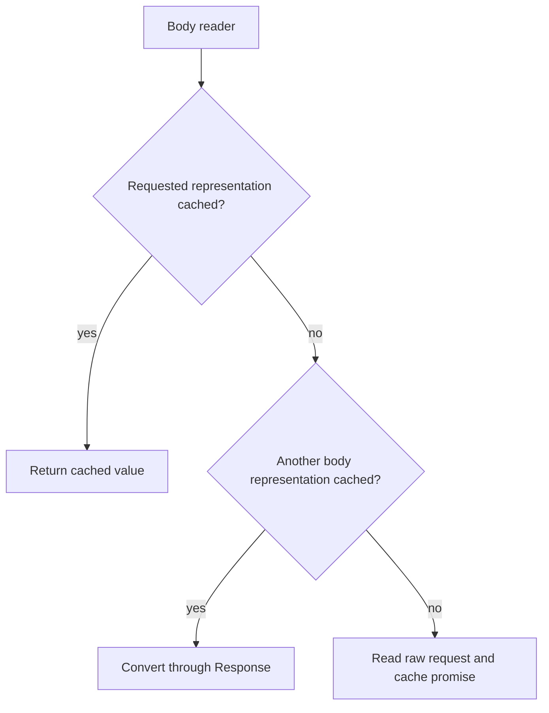

## Overview

A handler's context joins the incoming request, runtime bindings, per-request variables, and outgoing response. [[Routing and Dispatch]] creates this object after matching; `Context.req` lazily constructs a `HonoRequest` that can read the match parameters. The raw Web Request remains available, while context helpers add cached parsing and response preparation.

Sources: [src/hono-base.ts:418-427](repo://src/hono-base.ts#L418-L427), [src/context.ts:293-369](repo://src/context.ts#L293-L369), [src/request.ts:51-80](repo://src/request.ts#L51-L80)

## Read path, query, and headers

`c.req.path` is the path selected by dispatch; `url` and `method` read the raw request. `param(name)` resolves the active route's parameter map, using either direct values or a shared stash from the router. Percent-encoded values are decoded through the tolerant decoding helper. Calling `param()` returns the active match's available parameters. The route index is significant: composition changes it as execution advances.

Sources: [src/request.ts:94-128](repo://src/request.ts#L94-L128), [src/request.ts:369-390](repo://src/request.ts#L369-L390), [src/compose.ts:42-51](repo://src/compose.ts#L42-L51)

| Reader | Result |
| --- | --- |
| `query(name)` | A single query value or undefined |
| `query()` | A record of query values |
| `queries(name)` | All values for a repeated query key |
| `queries()` | A record whose values are string arrays |
| `header(name)` | A request header value or undefined |
| `header()` | A record built from the raw Headers object |
| `raw` | The original standard Request |

Sources: [src/request.ts:51-51](repo://src/request.ts#L51-L51), [src/request.ts:148-198](repo://src/request.ts#L148-L198)

## Consume a request body

Body readers share `bodyCache`. The first cached read stores the raw reader's promise. A subsequent read in the same representation reuses that entry; a different representation is produced through a new Response from the cached body. `json()` specifically obtains cached text and applies `JSON.parse`, while `bytes()` wraps a cached array buffer. Thus body caching preserves readable data across middleware, but a JSON parse can still fail and the JSON generic is not runtime validation.

Sources: [src/request.ts:220-255](repo://src/request.ts#L220-L255), [src/request.ts:269-302](repo://src/request.ts#L269-L302)

`text`, `arrayBuffer`, `bytes`, `blob`, and `formData` expose the corresponding representations. Read through these wrappers when later handlers need the same body. If code consumes `c.req.raw` directly, the wrapper cannot manufacture a cache after the fact. `cloneRawRequest` clones an unread body natively, reconstructs a consumed body from the first cached representation, or throws a 500 HTTPException if the body was consumed without caching.

Sources: [src/request.ts:269-330](repo://src/request.ts#L269-L330), [src/request.ts:476-505](repo://src/request.ts#L476-L505)

Sources: [src/request.ts:220-239](repo://src/request.ts#L220-L239)

## Parse form fields

`parseBody` recognizes multipart form data and URL-encoded bodies after normalizing the media type. Other media types produce an empty object. For forms it reads an array buffer, converts it to FormData, and caches that FormData for later reads. The result uses a null-prototype field record. With default options, repeated ordinary field names retain the last value; `all: true` collects repeated values, while names ending in `[]` always use an array.

Sources: [src/utils/body.ts:97-178](repo://src/utils/body.ts#L97-L178), [src/utils/body.ts:188-205](repo://src/utils/body.ts#L188-L205)

The `dot: true` option turns dotted names into nested objects and removes the original dotted field. Nested containers use null prototypes, and the nesting function rejects paths containing an intermediate `__proto__` segment. These options shape parsed fields; they do not enforce an application schema. [[Input Validation]] adds the explicit extraction, checking, and transformed-output step before handlers use `req.valid`.

Sources: [src/utils/body.ts:167-178](repo://src/utils/body.ts#L167-L178), [src/utils/body.ts:215-242](repo://src/utils/body.ts#L215-L242), [src/validator/validator.ts:162-170](repo://src/validator/validator.ts#L162-L170)

## Carry bindings and variables

The context receives bindings through its constructor and exposes them as `c.env`. It also stores the host execution object: `executionCtx` throws when none was supplied, and `event` requires an object with `respondWith`. Code needing background host work must therefore use the runtime contract documented in [[Runtime Adapters]], rather than assume every test or adapter provides a FetchEvent.

Sources: [src/context.ts:352-396](repo://src/context.ts#L352-L396)

`c.set(key, value)` initializes a Map on demand; `c.get(key)` returns the stored value or undefined. `c.var` creates a read-only typed record from that Map. These values belong to the request's context, so middleware can publish data for downstream handlers without altering runtime bindings. The context's generic environment carries the variable types, while absent runtime entries still return undefined.

Sources: [src/context.ts:546-602](repo://src/context.ts#L546-L602)

## Prepare and finalize responses

`c.header` sets, appends, or deletes response headers. Before a response exists it writes prepared headers; once the context is finalized it creates a new response wrapper before editing. `c.status` records a default status for subsequent response construction. `newResponse` starts from existing or prepared headers, merges initialization headers, then applies explicit helper headers; an explicit status wins over the prepared status.

Sources: [src/context.ts:515-531](repo://src/context.ts#L515-L531), [src/context.ts:604-641](repo://src/context.ts#L604-L641)

| Helper | Output behavior |
| --- | --- |
| `body` / `newResponse` | Builds a response from arbitrary body data and response options |
| `text` | Uses a native Response fast path when no other state needs merging |
| `json` | Serializes with JSON.stringify and defaults the JSON content type |
| `html` | Defaults the HTML content type and resolves escaped-string callbacks |
| `redirect` | Sets Location and defaults the status to 302 |
| `render` | Uses an installed renderer, falling back to HTML |

Sources: [src/context.ts:448-451](repo://src/context.ts#L448-L451), [src/context.ts:641-668](repo://src/context.ts#L641-L668), [src/context.ts:682-761](repo://src/context.ts#L682-L761)

Returning a helper result lets dispatch or composition use it as the response. Assigning `c.res` marks the context finalized. When replacing an existing response, the setter copies existing headers except Content-Type, and handles Set-Cookie as individual values. Merely reading `c.res` creates a default response if needed but does not set the finalized flag. This distinction explains why an otherwise unfinished middleware chain can still fail finalization.

Sources: [src/context.ts:403-434](repo://src/context.ts#L403-L434), [src/compose.ts:61-69](repo://src/compose.ts#L61-L69), [src/hono-base.ts:450-465](repo://src/hono-base.ts#L450-L465)

## Read and set cookies

The cookie helper reads the raw Cookie header. `getCookie` returns one value or a record; `getSignedCookie` asynchronously verifies signed values and its type distinguishes an absent cookie from a false verification result. The prefix option selects secure or host-prefixed names. `setCookie` and `setSignedCookie` append Set-Cookie headers, allowing multiple cookies to survive response construction.

Sources: [src/helper/cookie/index.ts:10-76](repo://src/helper/cookie/index.ts#L10-L76), [src/helper/cookie/index.ts:99-139](repo://src/helper/cookie/index.ts#L99-L139)

Cookie generation defaults the path to `/`. Secure-prefixed generation forces the secure flag; host-prefixed generation also forces path `/` and removes the domain option. `deleteCookie` reads the old value and writes an empty cookie with maxAge zero, returning the old value to the caller. Templates and layout renderers build on these same context response operations in [[HTML and Server Rendering]].

Sources: [src/helper/cookie/index.ts:78-97](repo://src/helper/cookie/index.ts#L78-L97), [src/helper/cookie/index.ts:104-145](repo://src/helper/cookie/index.ts#L104-L145), [src/context.ts:448-497](repo://src/context.ts#L448-L497)

