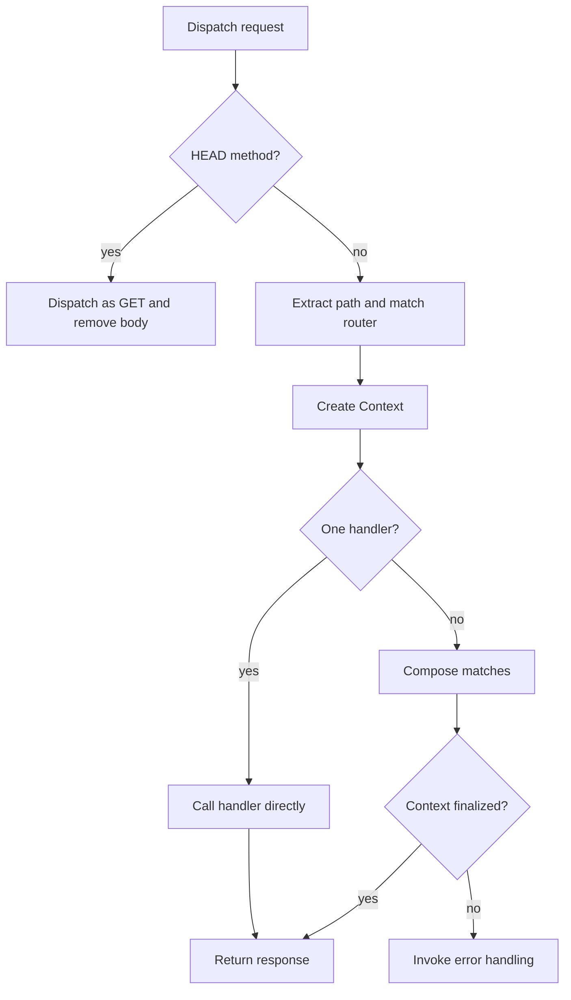

## Overview

Routing turns the registrations introduced in [[Quickstart]] into an ordered set of handlers for an HTTP method and path. `HonoBase` owns registration and dispatch, while a replaceable router implements matching. The result includes both handlers and their parameter mappings, allowing middleware and endpoints to share one request without losing the route metadata attached to each match.

Sources: [src/hono-base.ts:126-168](repo://src/hono-base.ts#L126-L168), [src/hono-base.ts:385-427](repo://src/hono-base.ts#L385-L427), [src/router.ts:67-98](repo://src/router.ts#L67-L98)

## Register routes and middleware

The method helpers cover GET, POST, PUT, DELETE, OPTIONS, PATCH, and `all`. Each handler supplied to a registration becomes its own router entry. `app.on` expands arrays of methods and paths, so it also accommodates methods outside the convenience helpers. `app.use` registers middleware under the special `ALL` method; when no path is supplied it uses `*`. Registrations normalize the method to uppercase and merge the application's base path into the route.

Sources: [src/router.ts:9-17](repo://src/router.ts#L9-L17), [src/hono-base.ts:126-168](repo://src/hono-base.ts#L126-L168), [src/hono-base.ts:385-397](repo://src/hono-base.ts#L385-L397)

Matching can return several handlers. The common router tests register a concrete `/api/abc` route followed by `/api/*`, and expect both in that order for `/api/abc`. Whether execution reaches a later match depends on the handler's use of `next`, described in [[Middleware and Diagnostics]]. A fallback wildcard is therefore another match in the chain, not an independent priority rule that always loses to a concrete route.

Sources: [src/router/common.case.test.ts:129-139](repo://src/router/common.case.test.ts#L129-L139), [src/compose.ts:42-68](repo://src/compose.ts#L42-L68)

| Pattern | Behavior demonstrated in the common tests |
| --- | --- |
| `/entry/:id` | Captures one path parameter |
| `/wild/*/card` | Matches an intervening wildcard segment |
| `/api/animals/:constructor?` | Allows the final parameter to be absent |
| `/post/:date{[0-9]+}/:title{[a-z]+}` | Restricts parameter values with expressions |
| `/api/*` | Matches paths beneath a prefix |

Sources: [src/router/common.case.test.ts:93-151](repo://src/router/common.case.test.ts#L93-L151)

## Group and mount applications

`basePath(path)` creates a clone that shares the router and route list, then changes the clone's registration prefix. It does not create an isolated registry. `route(path, app)` iterates the child application's existing routes and adds them under that prefix. Populate the child before attaching it: the operation copies the current route entries rather than installing a live reference to future child registrations.

Sources: [src/hono-base.ts:175-183](repo://src/hono-base.ts#L175-L183), [src/hono-base.ts:208-252](repo://src/hono-base.ts#L208-L252)

A child with a custom error handler gets a wrapper around each imported handler, preserving that error handling during composition. A child using the default error handler contributes its handler directly. The route metadata retains a base path as well as the full registered path, which supports inspection of nested applications without reconstructing registration history.

Sources: [src/hono-base.ts:218-230](repo://src/hono-base.ts#L218-L230), [src/hono-base.ts:385-397](repo://src/hono-base.ts#L385-L397)

`mount` is the bridge for an external request handler. By default it strips the mounted prefix from the incoming URL, constructs a replacement request, and passes bindings plus any available execution context to the mounted function. `optionHandler` changes those extra arguments; `replaceRequest` changes the request conversion, and `false` preserves the original request. A returned response ends the mounted handler; an absent result continues with `next`.

Sources: [src/hono-base.ts:328-382](repo://src/hono-base.ts#L328-L382)

## Select a router

The default `Hono` honors an explicit `options.router`; otherwise it configures `SmartRouter` with `RegExpRouter` followed by `TrieRouter`. On the first match, SmartRouter installs every pending route into a candidate and attempts matching. Only `UnsupportedPathError` triggers the next candidate. Other exceptions propagate, and exhaustion produces a fatal error. Success replaces SmartRouter's match function and makes subsequent route additions invalid.

Sources: [src/hono.ts:26-33](repo://src/hono.ts#L26-L33), [src/router/smart-router/router.ts:13-68](repo://src/router/smart-router/router.ts#L13-L68)

| Router or preset | Implementation boundary |
| --- | --- |
| `RegExpRouter` | Accumulates method/path data, builds matchers, then releases registration caches |
| `TrieRouter` | Inserts routes into a node tree and searches that tree |
| `LinearRouter` | Iterates stored routes and evaluates their path segments |
| `PatternRouter` | Builds per-route regular expressions and tests them in stored order |
| `hono/quick` | Installs SmartRouter with LinearRouter and TrieRouter |
| `hono/tiny` | Installs PatternRouter |

Sources: [src/router/reg-exp-router/router.ts:208-250](repo://src/router/reg-exp-router/router.ts#L208-L250), [src/router/trie-router/router.ts:13-27](repo://src/router/trie-router/router.ts#L13-L27), [src/router/linear-router/router.ts:15-69](repo://src/router/linear-router/router.ts#L15-L69), [src/router/pattern-router/router.ts:12-59](repo://src/router/pattern-router/router.ts#L12-L59), [src/preset/quick.ts:18-23](repo://src/preset/quick.ts#L18-L23), [src/preset/tiny.ts:16-19](repo://src/preset/tiny.ts#L16-L19)

A custom router implements `name`, `add(method, path, handler)`, and `match(method, path)`. Match results may carry direct parameter maps or indices into a shared parameter stash. [[Request and Context]] describes the consumer of those two forms. The quick and tiny constructors explicitly assign their own routers after calling the base constructor, unlike the default constructor's `options.router` fallback.

Sources: [src/router.ts:29-98](repo://src/router.ts#L29-L98), [src/preset/quick.ts:18-23](repo://src/preset/quick.ts#L18-L23), [src/preset/tiny.ts:16-19](repo://src/preset/tiny.ts#L16-L19), [src/hono.ts:26-33](repo://src/hono.ts#L26-L33)

## Derive the request path

Strict mode defaults to true. In that mode an optional `getPath` replaces the normal path extractor. With `strict: false`, the constructor selects `getPathNoStrict`, which removes a final slash except at the root; this branch takes precedence over a supplied custom extractor. The normal extractor excludes the query and fragment and handles percent-encoded paths. Matching behavior still belongs to the selected router, so the path normalization option alone does not define every router's pattern semantics.

Sources: [src/hono-base.ts:170-173](repo://src/hono-base.ts#L170-L173), [src/utils/url.ts:106-145](repo://src/utils/url.ts#L106-L145), [src/router/pattern-router/router.ts:33-58](repo://src/router/pattern-router/router.ts#L33-L58)

## Dispatch matched handlers

HEAD requests are dispatched using GET matching, then wrapped in a response with a null body. For other methods, dispatch derives the path, matches it, and constructs a context with the matches and runtime values. One matched handler runs directly. Multiple matches, or no matches, enter composition with the configured error and not-found handlers. The composed path requires finalization before it returns.

Sources: [src/hono-base.ts:406-465](repo://src/hono-base.ts#L406-L465)

Sources: [src/hono-base.ts:406-465](repo://src/hono-base.ts#L406-L465)

## Inspect the active route

The route helper exposes `matchedRoutes(c)`, `routePath(c, index)`, and `baseRoutePath(c, index)`. The default index follows `c.req.routeIndex`, while an explicit negative index reads from the end. `basePath(c, index)` resolves a parameterized base against the actual request path and caches the result per context. These distinguish a registered pattern from the concrete URL that matched it, which is useful when diagnosing grouped routes.

Sources: [src/helper/route/index.ts:32-83](repo://src/helper/route/index.ts#L32-L83), [src/helper/route/index.ts:106-140](repo://src/helper/route/index.ts#L106-L140)

