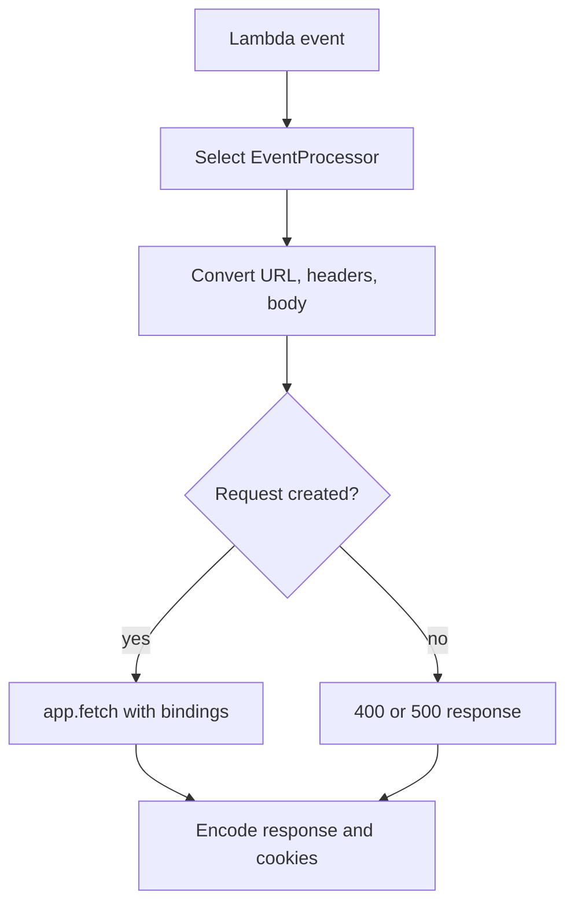

## Overview

The runtime boundary supplies a Web Request, bindings, and sometimes an execution context to app.fetch. Hosts that already speak this interface can call it directly; event-based hosts need request and response conversion. The adapter determines which host data reaches c.env, so the access rules in [[Request and Context]] depend on this entry point.

Sources: [src/hono-base.ts:479-485](repo://src/hono-base.ts#L479-L485), [src/adapter/aws-lambda/handler.ts:252-275](repo://src/adapter/aws-lambda/handler.ts#L252-L275), [src/context.ts:352-396](repo://src/context.ts#L352-L396)

## Connect a Fetch-compatible host

The workerd test application exports the app directly. Deno tests pass app.fetch to Deno.serve, and Bun tests use it as Bun.serve's fetch property. Node runtime tests import serve and createAdaptorServer from the separate @hono/node-server package. These entry points preserve the route definitions introduced in [[Quickstart]] while choosing the host's listener or exported handler.

Sources: [runtime-tests/workerd/index.ts:1-30](repo://runtime-tests/workerd/index.ts#L1-L30), [runtime-tests/deno/stream.test.ts:12-26](repo://runtime-tests/deno/stream.test.ts#L12-L26), [runtime-tests/bun/index.test.tsx:387-397](repo://runtime-tests/bun/index.test.tsx#L387-L397), [runtime-tests/node/index.test.ts:1-15](repo://runtime-tests/node/index.test.ts#L1-L15)

| Adapter | Incoming contract | Data forwarded to Hono |
| --- | --- | --- |
| Vercel handle | Request | Calls app.fetch with the request |
| Netlify handle | Request and context | Places context in bindings |
| Cloudflare Pages handle | EventContext | Merges environment with eventContext and forwards execution methods |
| Service worker handle | FetchEvent | Uses empty bindings and passes the event as execution context |
| AWS Lambda handle | Lambda event and context | Converts the event and supplies event, requestContext, lambdaContext |
| Lambda@Edge handle | CloudFront event, context, callback | Converts the request and exposes CloudFront record fields and a callback wrapper |

Sources: [src/adapter/vercel/handler.ts:4-8](repo://src/adapter/vercel/handler.ts#L4-L8), [src/adapter/netlify/handler.ts:4-10](repo://src/adapter/netlify/handler.ts#L4-L10), [src/adapter/cloudflare-pages/handler.ts:32-46](repo://src/adapter/cloudflare-pages/handler.ts#L32-L46), [src/adapter/service-worker/handler.ts:18-36](repo://src/adapter/service-worker/handler.ts#L18-L36), [src/adapter/aws-lambda/handler.ts:252-275](repo://src/adapter/aws-lambda/handler.ts#L252-L275), [src/adapter/lambda-edge/handler.ts:116-147](repo://src/adapter/lambda-edge/handler.ts#L116-L147)

## Integrate Pages and service workers

Pages handle supplies waitUntil, passThroughOnException, and an empty props object as execution context. Its bindings include the original eventContext, which retains Pages-specific data. handleMiddleware instead creates a Context around one Hono middleware: calling next invokes the Pages execution context's next and stores its response. An explicit middleware response wins; an HTTPException supplies its response, while another captured Error is rethrown.

Sources: [src/adapter/cloudflare-pages/handler.ts:12-46](repo://src/adapter/cloudflare-pages/handler.ts#L12-L46), [src/adapter/cloudflare-pages/handler.ts:49-102](repo://src/adapter/cloudflare-pages/handler.ts#L49-L102)

The service-worker fire helper registers a fetch event listener using handle. handle calls respondWith around app.fetch, then optionally falls back to a fetch function when Hono returns 404. With no options argument, that function defaults to the global fetch bound to globalThis. Supplying an options object without a fetch function disables that fallback because the default object is only used for an omitted argument.

Sources: [src/adapter/service-worker/index.ts:28-36](repo://src/adapter/service-worker/index.ts#L28-L36), [src/adapter/service-worker/handler.ts:18-36](repo://src/adapter/service-worker/handler.ts#L18-L36)

## Translate Lambda events

The buffered Lambda handle chooses an EventProcessor before creating the request. Selection checks ALB first, API Gateway v2 next, then Lattice v2, and otherwise uses API Gateway v1. A v2 match requires both rawPath and requestContext.http: a v1 event with a custom-domain rawPath must still use the v1 conversion. Lattice recognition uses requestContext.serviceArn; ALB recognition uses requestContext.elb.

Sources: [src/adapter/aws-lambda/handler.ts:252-255](repo://src/adapter/aws-lambda/handler.ts#L252-L255), [src/adapter/aws-lambda/handler.ts:625-658](repo://src/adapter/aws-lambda/handler.ts#L625-L658)

The processor constructs an HTTPS URL from the event's domain, path, and query, builds Headers, and decodes a base64 body when indicated. It computes body byte length before constructing the Request. Buffered handle catches request-construction failures: TypeError becomes a 400 Invalid request response, and other failures become a 500 Internal Server Error. Successful requests receive the original event, derived requestContext, and lambdaContext through bindings.

Sources: [src/adapter/aws-lambda/handler.ts:252-275](repo://src/adapter/aws-lambda/handler.ts#L252-L275), [src/adapter/aws-lambda/handler.ts:295-342](repo://src/adapter/aws-lambda/handler.ts#L295-L342)

Sources: [src/adapter/aws-lambda/handler.ts:252-275](repo://src/adapter/aws-lambda/handler.ts#L252-L275), [src/adapter/aws-lambda/handler.ts:318-401](repo://src/adapter/aws-lambda/handler.ts#L318-L401)

Response conversion consumes the body as text or base64 and returns statusCode, isBase64Encoded, and event-specific headers. The default content-type predicate treats selected text formats and JSON/XML media types as text; other types are binary. A non-identity Content-Encoding also forces binary handling. The isContentTypeBinary option replaces the content-type predicate, allowing the buffered adapter's classification to match an application response.

Sources: [src/adapter/aws-lambda/handler.ts:239-250](repo://src/adapter/aws-lambda/handler.ts#L239-L250), [src/adapter/aws-lambda/handler.ts:344-385](repo://src/adapter/aws-lambda/handler.ts#L344-L385), [src/adapter/aws-lambda/handler.ts:660-674](repo://src/adapter/aws-lambda/handler.ts#L660-L674)

Cookie representation follows the event format: v2 returns a cookies array, v1 uses multiValueHeaders, and ALB preserves multiple cookies only when multi-value headers are enabled. Without that ALB mode, only the first cookie becomes set-cookie. Lattice writes a set-cookie array in headers. These differences occur after handlers use the ordinary context cookie helpers.

Sources: [src/adapter/aws-lambda/handler.ts:388-439](repo://src/adapter/aws-lambda/handler.ts#L388-L439), [src/adapter/aws-lambda/handler.ts:494-499](repo://src/adapter/aws-lambda/handler.ts#L494-L499), [src/adapter/aws-lambda/handler.ts:572-580](repo://src/adapter/aws-lambda/handler.ts#L572-L580), [src/adapter/aws-lambda/handler.ts:615-620](repo://src/adapter/aws-lambda/handler.ts#L615-L620)

## Stream Lambda and convert CloudFront responses

streamHandle uses the host awslambda.streamifyResponse API. It forwards bindings named event, requestContext, and context; the last name differs from buffered handle's lambdaContext. Response status, headers, and cookies initialize HttpResponseStream, then a reader forwards body chunks to the writable stream. Failures are logged and write Internal Server Error, and finally always ends the stream. Application-level streaming callbacks remain covered by [[Streaming and WebSockets]].

Sources: [src/adapter/aws-lambda/handler.ts:126-193](repo://src/adapter/aws-lambda/handler.ts#L126-L193), [src/helper/streaming/stream.ts:26-44](repo://src/helper/streaming/stream.ts#L26-L44)

Lambda@Edge reconstructs a Request from Records[0].cf.request, using its host header or distribution domain and omitting bodies for GET and HEAD. Its callback wrapper remembers the first callback result or error while forwarding calls. After app.fetch, a captured error is thrown; a captured result takes precedence over converting Hono's Response. Conversion produces CloudFront's string status, header arrays, and optional base64 body encoding.

Sources: [src/adapter/lambda-edge/handler.ts:116-162](repo://src/adapter/lambda-edge/handler.ts#L116-L162), [src/adapter/lambda-edge/handler.ts:164-218](repo://src/adapter/lambda-edge/handler.ts#L164-L218)

## Read environment and connection information

The adapter helper env chooses an environment source from a supplied runtime key or getRuntimeKey. Node, Bun, and edge-light use process.env; Deno uses Deno.env.toObject; workerd uses c.env; fastly and other return empty objects. Detection first tests known navigator.userAgent prefixes, then EdgeRuntime, fastly, and process.release.name. It does not merge every possible environment source into one object.

Sources: [src/helper/adapter/index.ts:10-90](repo://src/helper/adapter/index.ts#L10-L90)

getConnInfo is runtime-specific. Bun calls server.requestIP, requires the server in bindings, and returns an empty remote object when the host has no address. Deno reads remoteAddr from bindings. Workers and Pages read cf-connecting-ip; Vercel reads x-real-ip; Netlify uses context.ip; Lambda@Edge uses the original CloudFront clientIp. Import the implementation corresponding to the host that supplies these values.

Sources: [src/adapter/bun/conninfo.ts:10-43](repo://src/adapter/bun/conninfo.ts#L10-L43), [src/adapter/deno/conninfo.ts:8-17](repo://src/adapter/deno/conninfo.ts#L8-L17), [src/adapter/cloudflare-workers/conninfo.ts:3-7](repo://src/adapter/cloudflare-workers/conninfo.ts#L3-L7), [src/adapter/cloudflare-pages/conninfo.ts:22-26](repo://src/adapter/cloudflare-pages/conninfo.ts#L22-L26), [src/adapter/vercel/conninfo.ts:3-8](repo://src/adapter/vercel/conninfo.ts#L3-L8), [src/adapter/netlify/conninfo.ts:53-57](repo://src/adapter/netlify/conninfo.ts#L53-L57), [src/adapter/lambda-edge/conninfo.ts:11-15](repo://src/adapter/lambda-edge/conninfo.ts#L11-L15)

Lambda connection information checks requestContext.identity.sourceIp, then requestContext.http.sourceIp, then the final comma-separated x-forwarded-for entry. Thus its result depends on both the event source and the bindings installed by handle. Socket upgrades similarly require their runtime's server or native APIs, as detailed in [[Streaming and WebSockets]].

Sources: [src/adapter/aws-lambda/conninfo.ts:45-73](repo://src/adapter/aws-lambda/conninfo.ts#L45-L73), [src/adapter/bun/websocket.ts:48-74](repo://src/adapter/bun/websocket.ts#L48-L74), [src/adapter/deno/websocket.ts:4-17](repo://src/adapter/deno/websocket.ts#L4-L17)

