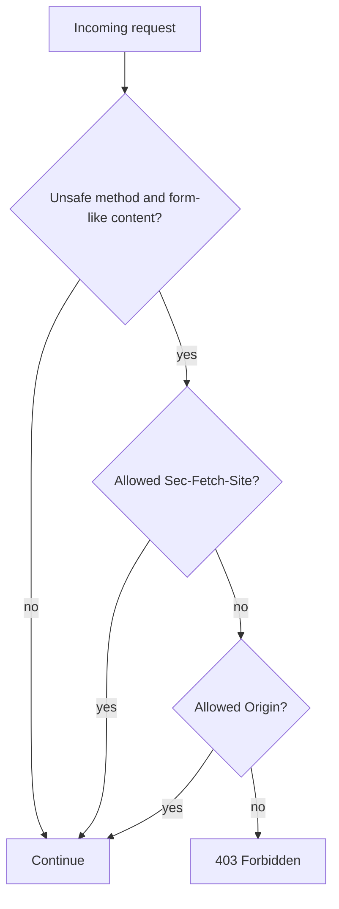

## Overview

Security middleware participates in the continuation and error model described in [[Middleware and Diagnostics]]. Authentication checks credentials before allowing downstream work; origin policies inspect browser request metadata; response policies set headers; body limits reject oversized input. These controls have different scopes, so select the middleware whose implemented checks match the route's requirements.

Sources: [src/middleware/basic-auth/index.ts:105-153](repo://src/middleware/basic-auth/index.ts#L105-L153), [src/middleware/csrf/index.ts:138-150](repo://src/middleware/csrf/index.ts#L138-L150), [src/middleware/secure-headers/secure-headers.ts:215-228](repo://src/middleware/secure-headers/secure-headers.ts#L215-L228), [src/middleware/body-limit/index.ts:50-109](repo://src/middleware/body-limit/index.ts#L50-L109)

## Choose an authentication mechanism

| Middleware | Credential source and verification | Success |
| --- | --- | --- |
| `basicAuth` | Parsed Basic credentials; configured users or verifyUser callback | Optional onAuthSuccess, then next |
| `bearerAuth` | Configurable header and prefix; static token(s) or verifyToken callback | Calls next |
| `jwt` | Bearer header, falling back to configured cookie; secret/key and required algorithm | Stores jwtPayload, then next |
| `jwk` | Bearer header, falling back to cookie; keys and/or JWKS URI with allowed algorithms | Stores jwtPayload, then next |

Sources: [src/middleware/basic-auth/index.ts:80-129](repo://src/middleware/basic-auth/index.ts#L80-L129), [src/middleware/bearer-auth/index.ts:156-220](repo://src/middleware/bearer-auth/index.ts#L156-L220), [src/middleware/jwt/jwt.ts:53-74](repo://src/middleware/jwt/jwt.ts#L53-L74), [src/middleware/jwt/jwt.ts:76-157](repo://src/middleware/jwt/jwt.ts#L76-L157), [src/middleware/jwk/jwk.ts:48-116](repo://src/middleware/jwk/jwk.ts#L48-L116), [src/middleware/jwk/jwk.ts:133-166](repo://src/middleware/jwk/jwk.ts#L133-L166)

Basic authentication requires either username/password options or a verifier. Static comparisons use the timingSafeEqual helper for both fields. Failed authentication throws a 401 HTTPException with a Basic challenge; the realm and invalid-user message are configurable, and an object message becomes JSON. The success callback runs before the continuation, allowing it to publish request variables using [[Request and Context]].

Sources: [src/middleware/basic-auth/index.ts:80-153](repo://src/middleware/basic-auth/index.ts#L80-L153)

Bearer authentication requires a token configuration or verifier. A missing header produces 401; malformed prefix/token syntax produces 400; a failed comparison produces 401. The prefix is case-insensitive and may be empty, while the header name and each failure's message/challenge can be configured. The token array path succeeds on the first timing-safe match.

Sources: [src/middleware/bearer-auth/index.ts:104-154](repo://src/middleware/bearer-auth/index.ts#L104-L154), [src/middleware/bearer-auth/index.ts:156-220](repo://src/middleware/bearer-auth/index.ts#L156-L220)

## Verify signed tokens

JWT middleware checks for a secret, explicit algorithm, and Web Crypto importKey support at creation. When a header is present, it must contain two whitespace-separated parts beginning with Bearer; an invalid header does not fall back to a cookie. Cookie configuration can select an ordinary or signed cookie. Missing tokens and verification failures become 401 responses, with the original verification error retained as the exception cause.

Sources: [src/middleware/jwt/jwt.ts:53-152](repo://src/middleware/jwt/jwt.ts#L53-L152)

The verifier checks the token algorithm against the configured one, then validates present nbf, exp, and iat claims by default. Issuer and audience checks apply when configured. It verifies the signature before returning the payload. `decode` only parses header and payload; it does not perform that signature check. The exported sign/verify/decode functions therefore serve different operations and should not be treated as interchangeable authentication steps.

Sources: [src/utils/jwt/jwt.ts:96-187](repo://src/utils/jwt/jwt.ts#L96-L187), [src/utils/jwt/jwt.ts:264-279](repo://src/utils/jwt/jwt.ts#L264-L279), [src/middleware/jwt/jwt.ts:175-178](repo://src/middleware/jwt/jwt.ts#L175-L178)

JWK middleware accepts key lists and URI providers that can depend on the context. Verification requires kid, rejects symmetric algorithms, enforces the allowed algorithm list, fetches and merges remote keys when configured, and selects a matching key. A key's declared algorithm must match the token. `allow_anon` permits a missing token, not a failed verification. Plain Error failures from JWKS retrieval propagate; token verification failures become 401 exceptions.

Sources: [src/middleware/jwk/jwk.ts:118-166](repo://src/middleware/jwk/jwk.ts#L118-L166), [src/utils/jwt/jwt.ts:197-261](repo://src/utils/jwt/jwt.ts#L197-L261)

## Apply CORS response policy

CORS defaults to wildcard origin and GET, HEAD, PUT, POST, DELETE, and PATCH methods. Origin selection supports a string, array, or callback; methods also support a callback. The middleware sets an allowed-origin header only when its selector returns a value. It can additionally emit credentials and exposed-header settings. A disallowed origin does not itself produce an authentication rejection: ordinary requests still reach `next`.

Sources: [src/middleware/cors/index.ts:63-112](repo://src/middleware/cors/index.ts#L63-L112), [src/middleware/cors/index.ts:149-156](repo://src/middleware/cors/index.ts#L149-L156)

OPTIONS requests return 204 directly, with configured methods, optional max age, and allowed headers. When no explicit allowed-header list exists, the request's Access-Control-Request-Headers supplies that list. The implementation removes content headers for this empty response and adds relevant Vary values. Registering CORS before middleware that terminates a preflight lets this branch execute.

Sources: [src/middleware/cors/index.ts:114-156](repo://src/middleware/cors/index.ts#L114-L156), [src/compose.ts:42-51](repo://src/compose.ts#L42-L51)

## Check form request origins

CSRF middleware checks methods other than GET and HEAD when the content type is URL-encoded, multipart, or text/plain; a missing content type is treated as text/plain. It rejects with 403 only when both the Sec-Fetch-Site policy and Origin policy fail. Defaults accept same-origin fetch metadata or an Origin matching the request URL's origin. Missing or unrecognized fetch metadata fails that side of the check, and a missing Origin fails the origin side.

Sources: [src/middleware/csrf/index.ts:28-30](repo://src/middleware/csrf/index.ts#L28-L30), [src/middleware/csrf/index.ts:94-150](repo://src/middleware/csrf/index.ts#L94-L150)

Sources: [src/middleware/csrf/index.ts:138-150](repo://src/middleware/csrf/index.ts#L138-L150)

## Set browser security headers

`secureHeaders` merges defaults with options, allowing mapped headers to be disabled or replaced with strings. Defaults include same-origin resource/opener policies, no-referrer, HSTS, nosniff, SAMEORIGIN framing, and removal of X-Powered-By; cross-origin embedder policy is disabled by default. CSP, report-only CSP, permissions policy, and reporting endpoints are configurable rather than implied by those defaults.

Sources: [src/middleware/secure-headers/secure-headers.ts:94-124](repo://src/middleware/secure-headers/secure-headers.ts#L94-L124), [src/middleware/secure-headers/secure-headers.ts:179-238](repo://src/middleware/secure-headers/secure-headers.ts#L179-L238)

CSP callback values are evaluated before downstream execution so a nonce can be embedded in rendered output. The exported NONCE helper creates 16 random bytes, base64-encodes them, caches the result as secureHeadersNonce, and returns its CSP nonce expression. Headers are applied after downstream work. This ordering connects the policy to [[HTML and Server Rendering]] without requiring the renderer to generate a second nonce.

Sources: [src/middleware/secure-headers/secure-headers.ts:131-145](repo://src/middleware/secure-headers/secure-headers.ts#L131-L145), [src/middleware/secure-headers/secure-headers.ts:215-228](repo://src/middleware/secure-headers/secure-headers.ts#L215-L228)

## Restrict addresses and body sizes

IP restriction accepts a runtime connection-info function or a function returning an address. Rules can be static addresses, CIDR ranges, wildcard, or predicates. Deny rules run first. A matching allow rule proceeds, an empty allow list permits otherwise-unblocked addresses, and a nonempty unmatched allow list blocks. Missing or invalid addresses produce 403; a custom rejection callback handles deny and unmatched-allow cases. [[Runtime Adapters]] supplies the platform-specific connection information.

Sources: [src/middleware/ip-restriction/index.ts:82-119](repo://src/middleware/ip-restriction/index.ts#L82-L119), [src/middleware/ip-restriction/index.ts:218-279](repo://src/middleware/ip-restriction/index.ts#L218-L279)

Body limiting uses maxSize and an optional error callback, defaulting to 413. A bodyless request proceeds immediately. With only Content-Length, the implementation trusts the declared size. With Transfer-Encoding or no length, it reads chunks before invoking the endpoint, rejects overflow, and replaces the raw request with a replayable stream of accepted chunks. Place this check before body consumers; [[Input Validation]] then validates the accepted content's meaning.

Sources: [src/middleware/body-limit/index.ts:50-111](repo://src/middleware/body-limit/index.ts#L50-L111)

