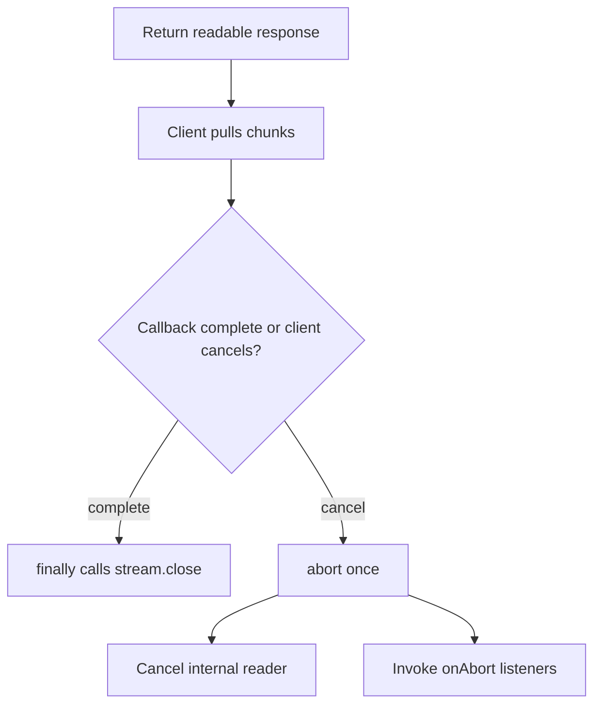

## Overview

Streaming helpers return a Response whose body is written asynchronously after the handler returns. WebSocket helpers instead negotiate a runtime upgrade and deliver later events through WSContext. Both extend the ordinary HTTP entry point, but their lifecycle belongs to stream callbacks or socket listeners. [[HTML and Server Rendering]] covers JSX-specific streaming callbacks; this page covers byte/text streams, SSE framing, and connection events.

Sources: [src/helper/streaming/stream.ts:7-45](repo://src/helper/streaming/stream.ts#L7-L45), [src/helper/websocket/index.ts:14-39](repo://src/helper/websocket/index.ts#L14-L39), [src/helper/websocket/index.ts:111-140](repo://src/helper/websocket/index.ts#L111-L140)

## Select a response stream

| Helper | Behavior |
| --- | --- |
| stream | Creates a TransformStream and returns its readable side through c.newResponse |
| streamText | Adds text/plain, nosniff, and chunked transfer headers before calling stream |
| streamSSE | Uses SSEStreamingApi and sets event-stream, no-cache, keep-alive, and chunked headers |

Sources: [src/helper/streaming/stream.ts:7-45](repo://src/helper/streaming/stream.ts#L7-L45), [src/helper/streaming/text.ts:6-15](repo://src/helper/streaming/text.ts#L6-L15), [src/helper/streaming/sse.ts:72-100](repo://src/helper/streaming/sse.ts#L72-L100)

The generic stream helper starts an asynchronous callback runner and immediately returns the response. Its finally block closes the stream after the callback finishes or fails. A WeakMap keeps the context reachable through the response's readable stream because the source notes a Bun lifecycle issue. The compatibility branch also forwards request aborts into the stream for Bun versions selected by the cached version detector.

Sources: [src/helper/streaming/stream.ts:5-45](repo://src/helper/streaming/stream.ts#L5-L45), [src/helper/streaming/utils.ts:1-11](repo://src/helper/streaming/utils.ts#L1-L11)

## Write and pipe data

StreamingApi owns a writable-stream writer and a TextEncoder. write accepts strings or bytes and awaits the writer; writeln appends a newline; sleep delays callback progress. pipe releases the writer lock, pipes a supplied ReadableStream without closing the destination, then reacquires the writer. Await these operations to preserve the intended sequence of chunks.

Sources: [src/utils/stream.ts:21-24](repo://src/utils/stream.ts#L21-L24), [src/utils/stream.ts:48-82](repo://src/utils/stream.ts#L48-L82)

write and close deliberately swallow writer exceptions. close marks the stream closed before awaiting writer.close. Callback failures have a separate path: generic stream invokes onError for an Error when supplied, ignores an undefined cancellation reason, and logs other failures. Because the callback runner is detached from request dispatch, its error callback is the relevant place to handle failures after the response has been returned.

Sources: [src/utils/stream.ts:48-76](repo://src/utils/stream.ts#L48-L76), [src/helper/streaming/stream.ts:26-44](repo://src/helper/streaming/stream.ts#L26-L44)

## Handle cancellation and cleanup

The exposed readable stream pulls from an internal reader. Cancellation calls abort unless the stream already closed. abort marks the instance once and invokes subscribers; its initial subscriber cancels the internal reader so pending writes can unblock. Additional onAbort callbacks let an application release its own resources. Those callbacks are invoked without awaiting their returned promises, so they do not form an awaited shutdown barrier.

Sources: [src/utils/stream.ts:21-46](repo://src/utils/stream.ts#L21-L46), [src/utils/stream.ts:84-97](repo://src/utils/stream.ts#L84-L97)

Sources: [src/helper/streaming/stream.ts:26-44](repo://src/helper/streaming/stream.ts#L26-L44), [src/utils/stream.ts:26-45](repo://src/utils/stream.ts#L26-L45), [src/utils/stream.ts:69-97](repo://src/utils/stream.ts#L69-L97)

## Frame server-sent events

writeSSE accepts data plus optional event, id, and retry. Data may be a promise and is resolved before framing. Each newline-separated data line gets its own data prefix, fields are joined with newlines, and a blank line ends the message. Event, id, and retry reject carriage returns or newlines. Optional fields are included by truthiness checks, so an empty id or zero retry is omitted.

Sources: [src/helper/streaming/sse.ts:6-44](repo://src/helper/streaming/sse.ts#L6-L44)

The SSE runner catches callback errors, calls the provided onError for an Error, then writes an error event containing the error message. Without that callback it logs the failure. It closes in finally. The tests verify multiline data, generated headers, and notification of reader cancellation, giving concrete coverage of framing and abort behavior rather than only checking the response status.

Sources: [src/helper/streaming/sse.ts:47-68](repo://src/helper/streaming/sse.ts#L47-L68), [src/helper/streaming/sse.test.tsx:13-76](repo://src/helper/streaming/sse.test.tsx#L13-L76)

## Create WebSocket event handlers

WSEvents defines optional open, message, close, and error callbacks receiving an event and WSContext. The context delegates send and close to the adapter and exposes the raw socket, URL, protocol, and readyState. Its send contract accepts strings, ArrayBuffer, or Uint8Array with an optional compression setting; adapters decide how that setting maps to their native API.

Sources: [src/helper/websocket/index.ts:14-19](repo://src/helper/websocket/index.ts#L14-L19), [src/helper/websocket/index.ts:50-91](repo://src/helper/websocket/index.ts#L50-L91)

defineWebSocketHelper supports middleware factories and direct upgrades. The factory awaits event creation and the adapter handler; an absent upgrade result continues to the next HTTP handler. The direct form throws Failed to upgrade WebSocket for an absent result. Its typed output format is ws, which makes the socket method described in [[Typed Client]] available on matching routes.

Sources: [src/helper/websocket/index.ts:24-39](repo://src/helper/websocket/index.ts#L24-L39), [src/helper/websocket/index.ts:111-140](repo://src/helper/websocket/index.ts#L111-L140), [src/client/types.ts:112-118](repo://src/client/types.ts#L112-L118)

## Connect runtime socket implementations

Bun's upgradeWebSocket retrieves the server from bindings, either as env.server or env itself, and calls server.upgrade with event handlers, URL, and the first requested subprotocol in socket data. Missing server data throws a TypeError. A successful upgrade returns an empty Response marker. The separately exported websocket object must receive the host's open, close, and message events to forward them to those stored handlers. createBunWebSocket is deprecated in favor of the direct exports.

Sources: [src/adapter/bun/server.ts:13-14](repo://src/adapter/bun/server.ts#L13-L14), [src/adapter/bun/websocket.ts:48-113](repo://src/adapter/bun/websocket.ts#L48-L113)

Deno checks the Upgrade header, selects the first requested subprotocol unless options override it, and delegates to Deno.upgradeWebSocket. It binds all four event types to one WSContext and returns the native upgrade response. Cloudflare Workers creates a WebSocketPair, accepts the server side, and returns a 101 response carrying the client socket. That adapter deliberately omits onOpen because the host does not support the open event.

Sources: [src/adapter/deno/websocket.ts:4-38](repo://src/adapter/deno/websocket.ts#L4-L38), [src/adapter/cloudflare-workers/websocket.ts:5-53](repo://src/adapter/cloudflare-workers/websocket.ts#L5-L53)

The adapters differ in event and protocol details: Bun normalizes binary message objects to their buffer and forwards compression to native send, while Deno and Workers send directly on their socket objects. Choose the adapter for the actual host rather than assuming identical native capabilities. [[Runtime Adapters]] describes how that host supplies the request, bindings, and execution context in the first place.

Sources: [src/adapter/bun/websocket.ts:33-45](repo://src/adapter/bun/websocket.ts#L33-L45), [src/adapter/bun/websocket.ts:95-103](repo://src/adapter/bun/websocket.ts#L95-L103), [src/adapter/deno/websocket.ts:20-35](repo://src/adapter/deno/websocket.ts#L20-L35), [src/adapter/cloudflare-workers/websocket.ts:21-44](repo://src/adapter/cloudflare-workers/websocket.ts#L21-L44)

