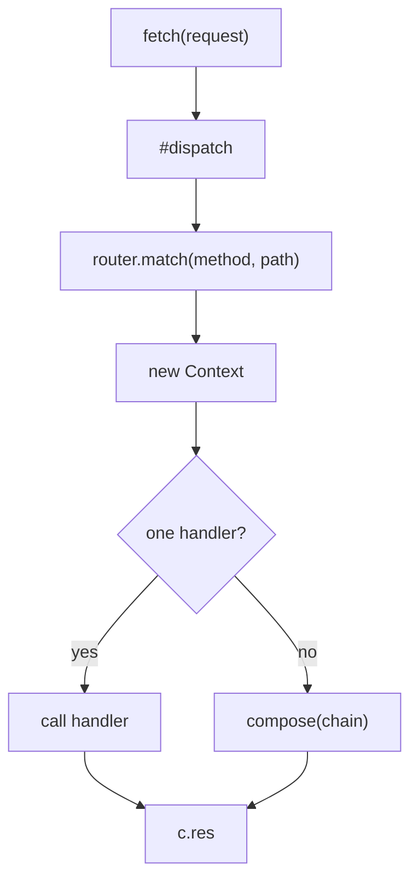

## Overview

Hono is a web framework built on Web Standards. A handler receives a `Request` and returns a `Response`, so one app runs unchanged on Cloudflare Workers, Deno, Bun, Vercel, AWS Lambda and Node.js. Runtime-specific code sits in small adapters instead of in the core.

Sources: [README.md:22-22](repo://README.md#L22-L22)

The app object is the `Hono` class. Its base, `HonoBase`, owns the routes, the error and not-found handlers and the `fetch()` entry point. The subclass in `src/hono.ts` only chooses the default router: when the caller passes no `router` option, it builds a `SmartRouter` over a `RegExpRouter` and a `TrieRouter`.

Sources: [src/hono.ts:16-33](repo://src/hono.ts#L16-L33), [src/hono-base.ts:98-124](repo://src/hono-base.ts#L98-L124)

## Parts

| Area | What it does | Page |
| --- | --- | --- |
| App | Registers handlers by method and path, groups and mounts other apps | [[App and Routing]] |
| Dispatch | Turns one `Request` into one `Response` through the matched chain | [[Request Dispatch]] |
| Routers | Match a method and path to handlers; five implementations | [[Routers]] |
| Context | The `c` object: env, variables, response helpers | [[Context]] |
| Request Object | `c.req`: path parameters, query, headers, body readers | [[Request Object]] |
| Validation | `validator()` middleware that parses and checks input | [[Validation]] |
| Type Inference | Carries paths, schemas and responses in types | [[Type Inference]] |
| Typed Client | `hc()`: a typed `fetch` wrapper built from the app's schema | [[Typed Client]] |
| Middleware | Built-in middleware, one page per kind | [[Authentication Middleware]], [[Security Middleware]], [[Response Middleware]], [[Diagnostics Middleware]] |
| Runtime Adapters | Entry points and utilities per runtime | [[Runtime Adapters]] |
| Helpers | Cookies, streaming, SSG, testing and other helpers | [[Request and Connection Helpers]], [[Response and Application Helpers]] |
| JSX | `hono/jsx` for server HTML and the `hono/jsx/dom` renderer | [[JSX Rendering]] |

Sources: [src/hono-base.ts:98-124](repo://src/hono-base.ts#L98-L124), [src/router.ts:29-52](repo://src/router.ts#L29-L52), [src/index.ts:1-53](repo://src/index.ts#L1-L53), [src/client/client.ts:133-137](repo://src/client/client.ts#L133-L137)

## Main flow

A request enters `fetch()`, which calls `#dispatch`. The router matches the method and path, `#dispatch` creates a `Context`, and the matched handlers run as one chain. A single matched handler is called directly; several are passed to `compose`.

Sources: [src/hono-base.ts:406-450](repo://src/hono-base.ts#L406-L450)

Sources: [src/hono-base.ts:406-466](repo://src/hono-base.ts#L406-L466), [src/hono-base.ts:479-485](repo://src/hono-base.ts#L479-L485)

The match is computed once per request and stored on the `Context`, so the handlers read the matched route list from `c.req` without a second lookup. The matching algorithms are in [[Routers]], and the chain's ordering rules are in [[Request Dispatch]].

Sources: [src/hono-base.ts:418-427](repo://src/hono-base.ts#L418-L427), [src/context.ts:352-363](repo://src/context.ts#L352-L363)

## Design decisions

The router is an interface with two methods, `add` and `match`, so the app does not depend on how routes are matched. The presets choose different implementations. `Hono` in `src/hono.ts` uses `SmartRouter` over `RegExpRouter` and `TrieRouter`; `src/preset/quick.ts` uses `LinearRouter` and `TrieRouter`; `src/preset/tiny.ts` uses only `PatternRouter`, which keeps the code smallest.

Sources: [src/router.ts:29-52](repo://src/router.ts#L29-L52), [src/hono.ts:26-33](repo://src/hono.ts#L26-L33), [src/preset/quick.ts:18-23](repo://src/preset/quick.ts#L18-L23), [src/preset/tiny.ts:16-19](repo://src/preset/tiny.ts#L16-L19)

Middleware and handlers share one chain. Each `next()` call moves to the next index, and calling `next()` twice throws, so a handler cannot run the rest of the chain twice.

Sources: [src/compose.ts:15-73](repo://src/compose.ts#L15-L73)

A handler's error does not escape the chain: `compose` passes it to the error handler and keeps the response it returns, while non-`Error` values are rethrown. The default handler answers `500` for an unhandled error and `404` for an unmatched route.

Sources: [src/compose.ts:49-60](repo://src/compose.ts#L49-L60), [src/hono-base.ts:31-42](repo://src/hono-base.ts#L31-L42)
