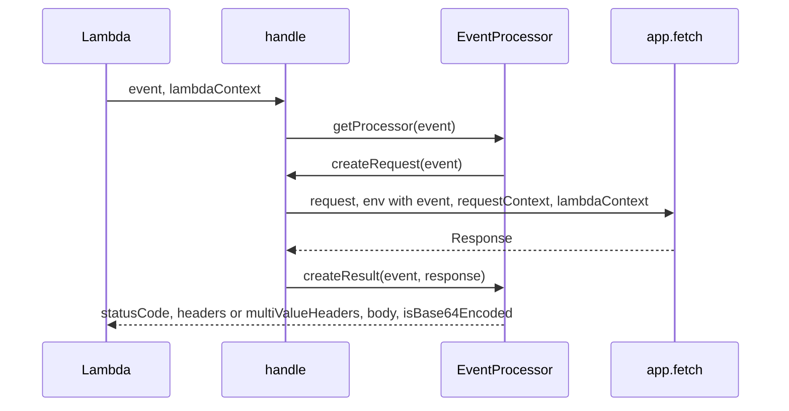

## Overview

AWS Lambda does not call a `fetch` function. It invokes a handler with a JSON event whose shape depends on what triggered it, and expects a JSON result back. `hono/aws-lambda` converts each supported event into a standard `Request`, passes it to `app.fetch`, and converts the `Response` into the result format of the same trigger: API Gateway REST APIs (v1 events), HTTP APIs and Lambda Function URLs (v2 events), Application Load Balancers and VPC Lattice. `streamHandle` sends the response through Lambda's response streaming instead. `hono/lambda-edge` does the same for CloudFront's Lambda@Edge events. The other runtimes are on [[Runtime Adapters]].

Sources: [src/adapter/aws-lambda/handler.ts:23-114](repo://src/adapter/aws-lambda/handler.ts#L23-L114), [src/adapter/aws-lambda/handler.ts:197-276](repo://src/adapter/aws-lambda/handler.ts#L197-L276), [src/adapter/lambda-edge/handler.ts:116-147](repo://src/adapter/lambda-edge/handler.ts#L116-L147)

```ts
import { Hono } from 'hono'
import { handle } from 'hono/aws-lambda'

const app = new Hono()

app.get('/', (c) => c.text('Hello from Lambda'))
app.get('/json', (c) => c.json({ message: 'Hello JSON' }))

export const handler = handle(app)
```

Sources: [src/adapter/aws-lambda/handler.ts:209-222](repo://src/adapter/aws-lambda/handler.ts#L209-L222)

## handle



Sources: [src/adapter/aws-lambda/handler.ts:239-276](repo://src/adapter/aws-lambda/handler.ts#L239-L276)

`handle(app, { isContentTypeBinary })` picks the processor for the event, builds the request, and calls `app.fetch` with bindings `{ event, requestContext, lambdaContext }`, so handlers reach the raw event as `c.env.event` and the API Gateway request context as `c.env.requestContext`. When building the request fails, a `TypeError` produces a 400 `Invalid request` result and other errors a 500, both logged.

Sources: [src/adapter/aws-lambda/handler.ts:252-275](repo://src/adapter/aws-lambda/handler.ts#L252-L275), [src/adapter/aws-lambda/handler.ts:116-124](repo://src/adapter/aws-lambda/handler.ts#L116-L124)

## Choosing a processor

`getProcessor` inspects the event:

Sources: [src/adapter/aws-lambda/handler.ts:625-658](repo://src/adapter/aws-lambda/handler.ts#L625-L658)

| Test | Processor |
| --- | --- |
| `requestContext` has `elb` | `ALBProcessor` |
| The event has `rawPath` and `requestContext` has `http` | `EventV2Processor` |
| `requestContext` has `serviceArn` | `LatticeV2Processor` |
| Anything else | `EventV1Processor` |

Sources: [src/adapter/aws-lambda/handler.ts:625-658](repo://src/adapter/aws-lambda/handler.ts#L625-L658)

The comment on the v2 test explains why `rawPath` alone is not enough: a REST API event behind a custom-domain base path mapping also carries `rawPath`, while every v2 event has `requestContext.http`.

Sources: [src/adapter/aws-lambda/handler.ts:646-651](repo://src/adapter/aws-lambda/handler.ts#L646-L651)

## Building the request

All processors share `EventProcessor.createRequest`. The URL is `https://` plus the domain name, plus the path and the query string. The domain comes from `requestContext.domainName`, else from the `host` header, else from the multi-value `host` header. A body is decoded from base64 when `isBase64Encoded` is set and encoded as UTF-8 otherwise, and `content-length` is set from its byte length.

Sources: [src/adapter/aws-lambda/handler.ts:278-342](repo://src/adapter/aws-lambda/handler.ts#L278-L342)

The processors differ in where they find each part:

Sources: [src/adapter/aws-lambda/handler.ts:404-439](repo://src/adapter/aws-lambda/handler.ts#L404-L439), [src/adapter/aws-lambda/handler.ts:443-499](repo://src/adapter/aws-lambda/handler.ts#L443-L499), [src/adapter/aws-lambda/handler.ts:503-580](repo://src/adapter/aws-lambda/handler.ts#L503-L580), [src/adapter/aws-lambda/handler.ts:584-621](repo://src/adapter/aws-lambda/handler.ts#L584-L621)

| | Path, method | Query string | Headers | Request cookies |
| --- | --- | --- | --- | --- |
| v1 (REST API) | `path`, `httpMethod` | Rebuilt from `multiValueQueryStringParameters` or `queryStringParameters`, re-encoded | `multiValueHeaders` appended, then `headers` not already present | In the headers |
| v2 (HTTP API, Function URL) | `rawPath`, `requestContext.http.method` | `rawQueryString` as given | `headers` | `cookies` joined into `Cookie` |
| ALB | `path`, `httpMethod` | Rebuilt from the multi-value or single-value parameters, not re-encoded | `multiValueHeaders` joined with `; `, else `headers` | `cookie` header |
| VPC Lattice | `path`, `method` | none | Every value of each header | In the headers |

Sources: [src/adapter/aws-lambda/handler.ts:404-439](repo://src/adapter/aws-lambda/handler.ts#L404-L439), [src/adapter/aws-lambda/handler.ts:443-499](repo://src/adapter/aws-lambda/handler.ts#L443-L499), [src/adapter/aws-lambda/handler.ts:503-580](repo://src/adapter/aws-lambda/handler.ts#L503-L580), [src/adapter/aws-lambda/handler.ts:584-621](repo://src/adapter/aws-lambda/handler.ts#L584-L621)

The v1 processor re-encodes query values because, as its comment says, API Gateway passes them decoded. The ALB processor checks the multi-value parameters first; its comment describes events from the Serverless Framework that contain both, where only the multi-value form keeps repeated keys. Header values with non-ASCII characters are URI-encoded by `sanitizeHeaderValue` in the v1, ALB and Lattice processors, since a `Headers` object rejects them.

Sources: [src/adapter/aws-lambda/handler.ts:13-21](repo://src/adapter/aws-lambda/handler.ts#L13-L21), [src/adapter/aws-lambda/handler.ts:452-468](repo://src/adapter/aws-lambda/handler.ts#L452-L468), [src/adapter/aws-lambda/handler.ts:534-558](repo://src/adapter/aws-lambda/handler.ts#L534-L558)

## Building the result

### Body encoding

`createResult` decides whether to base64-encode the body. `defaultIsContentTypeBinary` treats everything as binary except `text/plain`, `text/html`, `text/css`, `text/javascript`, `text/csv` and any `/json`, `+json`, `/xml` or `+xml` type. A response with a `Content-Encoding` other than `identity`, such as one from the compress middleware, is always encoded. Text bodies are sent as they are.

Sources: [src/adapter/aws-lambda/handler.ts:344-359](repo://src/adapter/aws-lambda/handler.ts#L344-L359), [src/adapter/aws-lambda/handler.ts:666-674](repo://src/adapter/aws-lambda/handler.ts#L666-L674)

`isContentTypeBinary` replaces the content-type test. The handler's documentation shows extending the default:

Sources: [src/adapter/aws-lambda/handler.ts:224-237](repo://src/adapter/aws-lambda/handler.ts#L224-L237)

```js
import { handle, defaultIsContentTypeBinary } from 'hono/aws-lambda'
export const handler = handle(app, {
  isContentTypeBinary: (contentType) => {
    if (defaultIsContentTypeBinary(contentType)) {
      // default logic same as prior to v4.8.4
      return true
    }
    return contentType.startsWith('image/') || contentType === 'application/pdf'
  }
})
```

Sources: [src/adapter/aws-lambda/handler.ts:224-237](repo://src/adapter/aws-lambda/handler.ts#L224-L237)

### Headers and cookies

The result uses `multiValueHeaders` when the event did, and `headers` otherwise. `Set-Cookie` headers are taken out first and placed where each trigger expects them: the `cookies` array for v2, `multiValueHeaders['set-cookie']` for v1, the multi-value or first single value for ALB, and a `set-cookie` array in `headers` for Lattice.

Sources: [src/adapter/aws-lambda/handler.ts:361-401](repo://src/adapter/aws-lambda/handler.ts#L361-L401), [src/adapter/aws-lambda/handler.ts:423-425](repo://src/adapter/aws-lambda/handler.ts#L423-L425), [src/adapter/aws-lambda/handler.ts:494-498](repo://src/adapter/aws-lambda/handler.ts#L494-L498), [src/adapter/aws-lambda/handler.ts:572-579](repo://src/adapter/aws-lambda/handler.ts#L572-L579), [src/adapter/aws-lambda/handler.ts:615-620](repo://src/adapter/aws-lambda/handler.ts#L615-L620)

With an ALB without multi-value headers, only the first cookie survives, because a single-value header map has room for one.

Sources: [src/adapter/aws-lambda/handler.ts:572-579](repo://src/adapter/aws-lambda/handler.ts#L572-L579)

## streamHandle

`streamHandle(app)` wraps the handler in the runtime's `awslambda.streamifyResponse`. It builds the request the same way, calls `app.fetch` with `{ event, requestContext, context }`, note `context` rather than `lambdaContext`, and writes the status, headers and cookies as `HttpResponseStream` metadata before copying the body chunk by chunk to the response stream. Bodies are streamed as bytes, so no base64 step applies. Any error writes `Internal Server Error` to the stream.

Sources: [src/adapter/aws-lambda/handler.ts:126-193](repo://src/adapter/aws-lambda/handler.ts#L126-L193)

This is the adapter to use with the streaming helpers on [[Streaming and Server-Sent Events]], since `handle` waits for the whole body before returning.

Sources: [src/adapter/aws-lambda/handler.ts:359-359](repo://src/adapter/aws-lambda/handler.ts#L359-L359)

## getConnInfo

`getConnInfo(c)` from `hono/aws-lambda` reads the client address from `c.env.requestContext`: `identity.sourceIp` for v1 events, `http.sourceIp` for v2 events, and for ALB the last entry of `X-Forwarded-For`, where the comment notes the load balancer appends the client's address.

Sources: [src/adapter/aws-lambda/conninfo.ts:45-73](repo://src/adapter/aws-lambda/conninfo.ts#L45-L73)

## Lambda@Edge

`handle(app)` from `hono/lambda-edge` takes a CloudFront event and reads the first record. The request URL is built from the `host` header, or the distribution's domain name, plus `uri` and `querystring`; every header value is appended. A body is used only for methods other than `GET` and `HEAD`, decoded from base64 when CloudFront marks it so.

Sources: [src/adapter/lambda-edge/handler.ts:116-128](repo://src/adapter/lambda-edge/handler.ts#L116-L128), [src/adapter/lambda-edge/handler.ts:164-212](repo://src/adapter/lambda-edge/handler.ts#L164-L212)

The bindings carry `event`, `context`, `config`, `request`, `response` and a `callback`. A handler that wants CloudFront to continue with a modified request, instead of answering, calls `c.env.callback(null, request)`; the first such call wins, its error is thrown, and its result is returned in place of the Hono response.

Sources: [src/adapter/lambda-edge/handler.ts:124-147](repo://src/adapter/lambda-edge/handler.ts#L124-L147)

Otherwise the response becomes a CloudFront result: the status as a string, headers as lower-case `{ key, value }` lists, and the body as text or base64 with `bodyEncoding: 'base64'`. The binary test here also treats `image/svg+xml` as text. `getConnInfo` from `hono/lambda-edge` returns the request's `clientIp`.

Sources: [src/adapter/lambda-edge/handler.ts:105-114](repo://src/adapter/lambda-edge/handler.ts#L105-L114), [src/adapter/lambda-edge/handler.ts:149-162](repo://src/adapter/lambda-edge/handler.ts#L149-L162), [src/adapter/lambda-edge/handler.ts:214-218](repo://src/adapter/lambda-edge/handler.ts#L214-L218), [src/adapter/lambda-edge/conninfo.ts:11-15](repo://src/adapter/lambda-edge/conninfo.ts#L11-L15)
