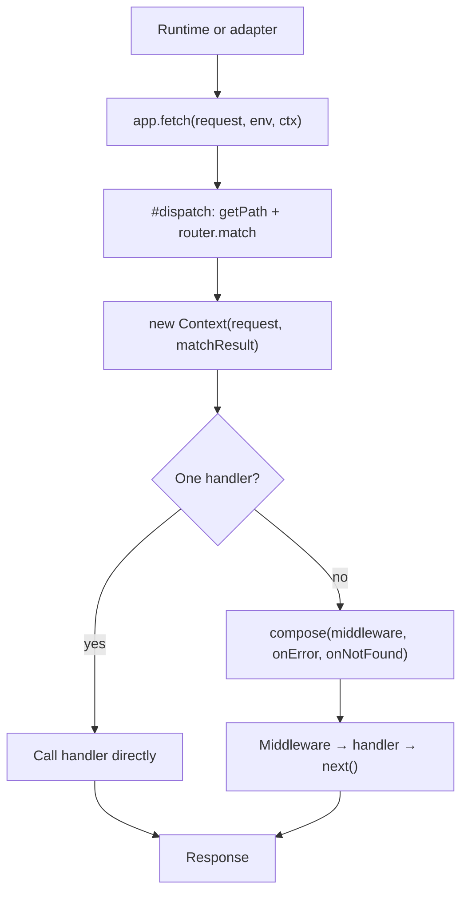

## Overview

Hono is a web framework built on Web Standards. An application is an object with a `fetch(request)` method that takes a standard `Request` and returns a standard `Response`, so the same app runs on Cloudflare Workers, Deno, Bun, AWS Lambda, Vercel, Netlify, Node.js and any other runtime that speaks the Fetch API. The package entry point exports the `Hono` class, the `Context` class and the types handlers are written against.

Sources: [src/index.ts:1-53](repo://src/index.ts#L1-L53), [README.md:22-34](repo://README.md#L22-L34)

The smallest app registers one route and exports the app. The runtime calls `app.fetch` for every request.

Sources: [src/hono-base.ts:479-485](repo://src/hono-base.ts#L479-L485)

```ts
import { Hono } from 'hono'
const app = new Hono()

app.get('/', (c) => c.text('Hono!'))

export default app
```

Sources: [src/index.ts:1-15](repo://src/index.ts#L1-L15)

## Parts of the framework

Each area below lives under `src/` and is published as its own subpath export of the `hono` package, such as `hono/cors` or `hono/jsx`.

Sources: [package.json:38-67](repo://package.json#L38-L67)

| Area | What it does | Page |
| --- | --- | --- |
| App and routes | `Hono` class: `get`, `post`, `use`, `route`, `basePath`, `mount` | [[Application and Routing]] |
| Dispatch | `fetch` → router → `Context` → middleware chain → `Response`, errors and 404 | [[Request Lifecycle and Error Handling]] |
| Context | What a handler receives: variables, headers, `c.text`, `c.json`, `c.html` | [[Context and Responses]] |
| Request | `c.req`: params, query, headers, body parsing, validated data | [[HonoRequest]] |
| Routers | The `Router` interface, SmartRouter, TrieRouter, LinearRouter, PatternRouter | [[Routers]] |
| Default router | The regular-expression router used first by default | [[RegExpRouter]] |
| Validation | `validator()` middleware and `c.req.valid()` | [[Validation]] |
| Types | Env, Schema and typed responses tracked by the type system | [[Typed Routes and Schemas]] |
| RPC client | `hc` typed client and `testClient` | [[RPC Client]] |
| Auth middleware | basic-auth, bearer-auth, jwt, jwk | [[Authentication Middleware]] |
| JWT | Signing and verifying tokens with Web Crypto | [[JWT Utilities]] |
| Security middleware | cors, csrf, secure-headers, ip-restriction, body-limit | [[Security Middleware]] |
| Response middleware | compress, etag, cache, pretty-json, serve-static | [[Response Middleware]] |
| Logging middleware | logger, timing, request-id, powered-by | [[Logging and Timing Middleware]] |
| Control middleware | combine, method-override, trailing-slash, timeout, language, context-storage | [[Request Control Middleware]] |
| JSX on the server | `hono/jsx`, streaming, `html` helper, jsx-renderer | [[JSX Server Rendering]] |
| JSX in the browser | `hono/jsx/dom` and hooks | [[JSX DOM Runtime and Hooks]] |
| CSS | `hono/css` scoped class names | [[CSS Helper]] |
| Streaming | `stream`, `streamText`, `streamSSE` | [[Streaming and Server-Sent Events]] |
| Cookies | `getCookie`, `setCookie`, signed cookies | [[Cookies]] |
| WebSocket | `upgradeWebSocket` across runtimes | [[WebSocket Helper]] |
| SSG | `toSSG` writes an app's routes to files | [[Static Site Generation]] |
| Proxy and negotiation | `proxy` and `accepts` helpers | [[Proxy and Content Negotiation]] |
| Introspection | `hono/route` and `hono/dev` | [[Route Introspection]] |
| Adapters | Per-runtime `handle`, `serveStatic`, `getConnInfo` | [[Runtime Adapters]] |
| AWS | API Gateway, ALB, Lambda URL and CloudFront events | [[AWS Lambda and Lambda@Edge]] |
| Repository | Build, tests, benchmarks | [[Building and Testing Hono]] |

Sources: [package.json:38-67](repo://package.json#L38-L67)

## Main request flow



Sources: [src/hono-base.ts:406-485](repo://src/hono-base.ts#L406-L485), [src/compose.ts:15-73](repo://src/compose.ts#L15-L73)

1. A runtime calls `app.fetch` directly, or an adapter such as the Vercel `handle` converts the platform's input and calls it: see [[Runtime Adapters]] and [[AWS Lambda and Lambda@Edge]].
2. `fetch` hands the request to the private `#dispatch`, which computes the path and asks the router for the matching handlers: see [[Request Lifecycle and Error Handling]], and [[Routers]] for how a match is found.
3. `#dispatch` builds a `Context` holding the raw request, the match result, the bindings and the execution context: see [[Context and Responses]]. The `HonoRequest` behind `c.req` is created only when a handler first reads it: see [[HonoRequest]].
4. With a single matched handler the app calls it directly; otherwise `compose` runs middleware and handlers in order, each continuing with `await next()`: see [[Request Lifecycle and Error Handling]].
5. The handler returns a `Response`, usually through a Context helper such as `c.json`; errors go to the app's error handler and unmatched paths to its not-found handler.

Sources: [src/adapter/vercel/handler.ts:4-8](repo://src/adapter/vercel/handler.ts#L4-L8), [src/hono-base.ts:406-485](repo://src/hono-base.ts#L406-L485), [src/context.ts:352-369](repo://src/context.ts#L352-L369)

## Design decisions

### Web Standards only

The app's whole contract with a runtime is `fetch: (request: Request, Env?, executionCtx?) => Response | Promise<Response>`. Nothing in the core reads a platform object: bindings and the execution context arrive as plain arguments, which is why an adapter can be as short as one call to `app.fetch`.

Sources: [src/hono-base.ts:479-485](repo://src/hono-base.ts#L479-L485), [src/adapter/vercel/handler.ts:4-8](repo://src/adapter/vercel/handler.ts#L4-L8)

### Pluggable routers

`HonoBase` holds no router of its own; its constructor comment says to inherit the class and set `router` in the constructor. The default `Hono` class sets a `SmartRouter` that tries `RegExpRouter` first and falls back to `TrieRouter` for paths the first cannot compile, unless `options.router` names another. The `hono/tiny` preset uses `PatternRouter` alone, and `hono/quick` uses `SmartRouter` over `LinearRouter` and `TrieRouter`. The README states the reason for the tiny preset: it keeps the bundle under 12kB.

Sources: [src/hono-base.ts:114-118](repo://src/hono-base.ts#L114-L118), [src/hono.ts:16-34](repo://src/hono.ts#L16-L34), [src/preset/tiny.ts:11-20](repo://src/preset/tiny.ts#L11-L20), [src/preset/quick.ts:13-24](repo://src/preset/quick.ts#L13-L24), [README.md:40-44](repo://README.md#L40-L44)

### Do work only when it is needed

`#dispatch` skips `compose` when a route has only one handler, and `Context` builds its `HonoRequest` lazily with `this.#req ??= new HonoRequest(...)`. `SmartRouter` decides on its router at the first match and then replaces its own `match` with the chosen router's.

Sources: [src/hono-base.ts:429-448](repo://src/hono-base.ts#L429-L448), [src/context.ts:366-369](repo://src/context.ts#L366-L369), [src/router/smart-router/router.ts:21-61](repo://src/router/smart-router/router.ts#L21-L61)

### Routes tracked in types

`Hono` takes three type parameters: the environment `E` (bindings and variables), the schema `S` that every route registration extends, and the `BasePath`. Methods such as `route` and `basePath` return a `Hono` whose schema and base path are merged at the type level, which is what the RPC client reads: see [[Typed Routes and Schemas]] and [[RPC Client]].

Sources: [src/hono-base.ts:98-112](repo://src/hono-base.ts#L98-L112), [src/hono-base.ts:208-253](repo://src/hono-base.ts#L208-L253)

### No runtime dependencies

`package.json` declares `devDependencies` only, and each feature is a separate entry in `exports`, so an app's bundle contains only the modules it imports. The package is an ES module with a CommonJS build beside it.

Sources: [package.json:1-12](repo://package.json#L1-L12), [package.json:668-699](repo://package.json#L668-L699)
