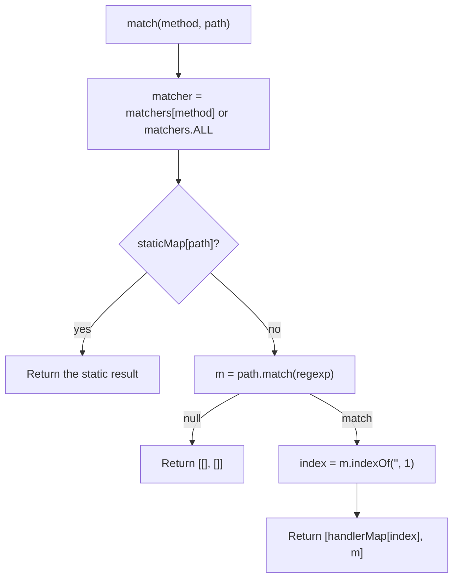

## Overview

`RegExpRouter` is the router the default `Hono` class tries first. Instead of looping over routes or walking a tree per request, it compiles all routes of a method into one regular expression the first time `match` is called, and answers static paths from a plain object. One `RegExp.prototype.match` call finds the route and captures every parameter at once. The price is that some route sets cannot be expressed as one expression; for those it throws `UnsupportedPathError`, and the `SmartRouter` described on [[Routers]] falls back to `TrieRouter`.

Sources: [src/router/reg-exp-router/router.ts:122-130](repo://src/router/reg-exp-router/router.ts#L122-L130), [src/router/reg-exp-router/matcher.ts:10-33](repo://src/router/reg-exp-router/matcher.ts#L10-L33), [src/hono.ts:26-33](repo://src/hono.ts#L26-L33)

## Registering routes

### Per-method handler lists

`add` does not build anything yet. It keeps two maps, `#middleware` for paths ending in `*` and `#routes` for the rest, each keyed by method and then path. The value for a path is the full list of `[handler, paramCount]` pairs that must run for it, in registration order. The first time a method appears, both maps get a copy of everything registered under `ALL`, so an `ALL` route registered earlier still applies to that method.

Sources: [src/router/reg-exp-router/router.ts:132-147](repo://src/router/reg-exp-router/router.ts#L132-L147)

### Wildcard paths

A path ending in `*` (with `/*` normalized to `*`) is turned into a regular expression by `buildWildcardRegExp`: `/api/*` becomes `^/api(?:|/.*)$`, and `*` alone becomes an empty expression that matches everything. The handler is then appended to every already-registered middleware path and route path the expression matches, in every method it applies to. A new middleware path starts with the handlers of the most specific existing middleware path that covers it, found by `findMiddleware`, which tries keys from longest to shortest.

Sources: [src/router/reg-exp-router/router.ts:19-32](repo://src/router/reg-exp-router/router.ts#L19-L32), [src/router/reg-exp-router/router.ts:105-120](repo://src/router/reg-exp-router/router.ts#L105-L120), [src/router/reg-exp-router/router.ts:149-187](repo://src/router/reg-exp-router/router.ts#L149-L187)

### Other paths

A path without a trailing `*` is first expanded for an optional parameter. Each resulting path gets a list that starts with the handlers of the matching middleware, then the handler itself with its parameter count. For the shorter variants of an optional path the count is reduced, so the handler does not expect the missing parameter.

Sources: [src/router/reg-exp-router/router.ts:189-204](repo://src/router/reg-exp-router/router.ts#L189-L204)

Because middleware is merged into each route's list at registration, a route's list is already the exact chain of handlers that must run for it. Matching only has to find the route.

Sources: [src/router/reg-exp-router/router.ts:153-203](repo://src/router/reg-exp-router/router.ts#L153-L203)

## Building the matchers

### When the build happens

`match` starts out as the shared `match` function from `matcher.ts`. Its first call runs `buildAllMatchers`, which builds one matcher per method, sets `#middleware` and `#routes` to `undefined` and clears the wildcard cache, then replaces `this.match` with a closure over the matchers. Any later `add` throws the "matcher is already built" error.

Sources: [src/router/reg-exp-router/matcher.ts:10-33](repo://src/router/reg-exp-router/matcher.ts#L10-L33), [src/router/reg-exp-router/router.ts:206-222](repo://src/router/reg-exp-router/router.ts#L206-L222)

A method with no routes of its own gets `null`, and `match` uses the `ALL` matcher for it. A method with its own routes gets a matcher built from its own lists, which already include the `ALL` handlers copied in at registration.

Sources: [src/router/reg-exp-router/router.ts:224-251](repo://src/router/reg-exp-router/router.ts#L224-L251)

### Static and dynamic paths

`buildMatcherFromPreprocessedRoutes` splits the paths. A path with no `*` and no `/:` is static: its handlers go into a `staticMap` keyed by the exact path, with empty parameters. Dynamic paths are numbered and inserted into a `Trie`, sorted by length. Static paths are inserted too, after the dynamic ones, but only to check for conflicts.

Sources: [src/router/reg-exp-router/router.ts:34-80](repo://src/router/reg-exp-router/router.ts#L34-L80)

### The trie and its expression

`Trie.insert` tokenizes a path into single characters, `:label` or `:label{pattern}` tokens and a trailing `/*`, protecting `{...}` groups while it splits. Each `Node` child is keyed by a character or by the regular expression of a parameter: `[^/]+` for a plain label, the given pattern for a constrained one, `(?:|/.*)` for a trailing wildcard and `.*` for a bare `*`. A parameter node gets a variable index the first time it is created.

Sources: [src/router/reg-exp-router/trie.ts:10-47](repo://src/router/reg-exp-router/trie.ts#L10-L47), [src/router/reg-exp-router/node.ts:1-11](repo://src/router/reg-exp-router/node.ts#L1-L11), [src/router/reg-exp-router/node.ts:50-133](repo://src/router/reg-exp-router/node.ts#L50-L133)

`buildRegExpStr` turns the tree into nested alternations. Children are ordered literal characters first, then constrained patterns, then plain labels, then wildcards. A parameter child is written as `(pattern)@varIndex`, and a node where a route ends adds `#routeIndex` as its first alternative.

Sources: [src/router/reg-exp-router/node.ts:13-43](repo://src/router/reg-exp-router/node.ts#L13-L43), [src/router/reg-exp-router/node.ts:135-161](repo://src/router/reg-exp-router/node.ts#L135-L161)

`Trie.buildRegExp` then rewrites the markers while counting capture groups. Each `#routeIndex` becomes an empty capture group `$()`, recorded in `indexReplacementMap` under its capture number. Each `@varIndex` is removed and recorded in `paramReplacementMap` as the capture number of the group before it. A trailing `.*$` is dropped. The result is anchored with `^`.

Sources: [src/router/reg-exp-router/trie.ts:49-73](repo://src/router/reg-exp-router/trie.ts#L49-L73)

Finally each handler's parameter map is rewritten from variable indexes to capture numbers, and the handler lists are re-indexed by the capture number of their route's `$()` marker. The matcher is the triple `[regexp, handlerMap, staticMap]`.

Sources: [src/router/reg-exp-router/router.ts:82-103](repo://src/router/reg-exp-router/router.ts#L82-L103)

## Matching a request

Sources: [src/router/reg-exp-router/matcher.ts:14-33](repo://src/router/reg-exp-router/matcher.ts#L14-L33)

The route is identified by position: the only empty string among the captures is the `$()` group of the route that matched, since parameter captures such as `[^/]+` cannot be empty. The match array itself is returned as the parameter stash, so each handler's map points straight into it. This is the first result shape on [[Routers]].

Sources: [src/router/reg-exp-router/matcher.ts:22-29](repo://src/router/reg-exp-router/matcher.ts#L22-L29), [src/router.ts:66-98](repo://src/router.ts#L66-L98)

For `*` followed by `/users/:id`, a request to `/users/me` returns both handlers, with `id` mapped to capture 1 of a stash that starts `["/users/me", "me", ""]`.

Sources: [src/router/reg-exp-router/router.ts:149-203](repo://src/router/reg-exp-router/router.ts#L149-L203)

## Unsupported route sets

A single regular expression returns one alternative, so `Node.insert` throws its private `PATH_ERROR` whenever two routes could match the same path, and the build turns it into `UnsupportedPathError`:

Sources: [src/router/reg-exp-router/node.ts:57-133](repo://src/router/reg-exp-router/node.ts#L57-L133), [src/router/reg-exp-router/router.ts:60-65](repo://src/router/reg-exp-router/router.ts#L60-L65)

- two routes end at the same node, such as `/users/:id` and `/users/:name`;
- a parameter is added where another child that is not a wildcard already exists, such as `/users/:id{[0-9]+}` next to `/users/:name`;
- a literal is added where a parameter already exists, such as `/users/me` next to `/users/:id`, including when the literal comes from a static path checked after the dynamic ones;
- a constrained pattern is `.*`, or contains a capturing group other than one whole `(a|b)` group, which is rewritten to `(?:a|b)`.

Sources: [src/router/reg-exp-router/node.ts:57-133](repo://src/router/reg-exp-router/node.ts#L57-L133), [src/router/reg-exp-router/router.ts:60-65](repo://src/router/reg-exp-router/router.ts#L60-L65)

Under the default `SmartRouter`, any of these makes the whole app use `TrieRouter`, which returns every matching route. Used directly, `RegExpRouter` throws from the first `match`.

Sources: [src/router/smart-router/router.ts:32-50](repo://src/router/smart-router/router.ts#L32-L50)

## PreparedRegExpRouter

`PreparedRegExpRouter` skips the build at runtime. `buildInitParams({ paths })` registers every path under `ALL` in a `RegExpRouter` subclass, builds the matchers, records for each path which handler lists and static entries it belongs to (the relocate map), and empties the lists. `serializeInitParams` turns the result into JavaScript source, embedding each `RegExp` literal, so a build step can write it into the bundle.

Sources: [src/router/reg-exp-router/prepared-router.ts:95-165](repo://src/router/reg-exp-router/prepared-router.ts#L95-L165)

At runtime `new PreparedRegExpRouter(matchers, relocateMap)` already has its expressions. `add` only pushes each handler into the lists the relocate map names, creating a method's matcher from the `ALL` one on first use, and adds `*` handlers to every list. A path that was not prepared throws `Path ... is not registered`. `match` is the same function as in `RegExpRouter`, with `buildAllMatchers` returning the prepared matchers.

Sources: [src/router/reg-exp-router/prepared-router.ts:9-93](repo://src/router/reg-exp-router/prepared-router.ts#L9-L93)

All three are exported from `hono/router/reg-exp-router`.

Sources: [src/router/reg-exp-router/index.ts:1-7](repo://src/router/reg-exp-router/index.ts#L1-L7)
