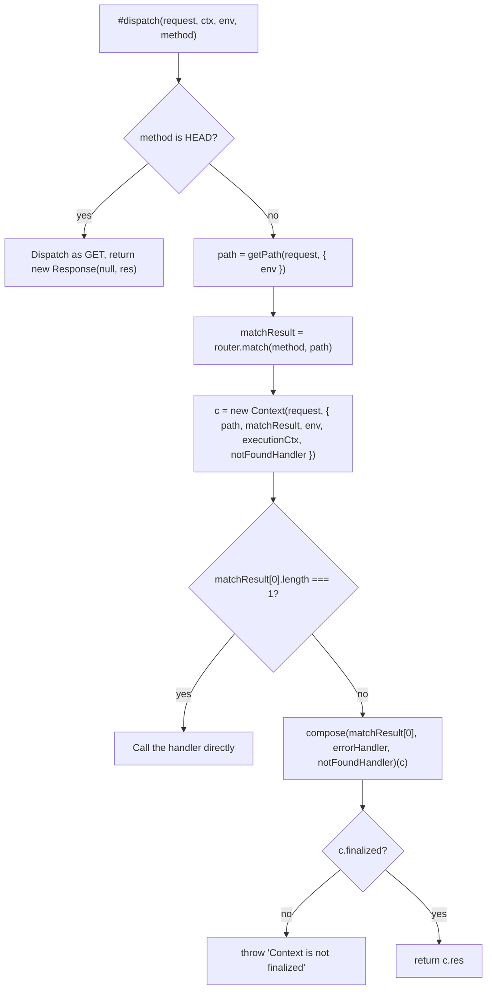
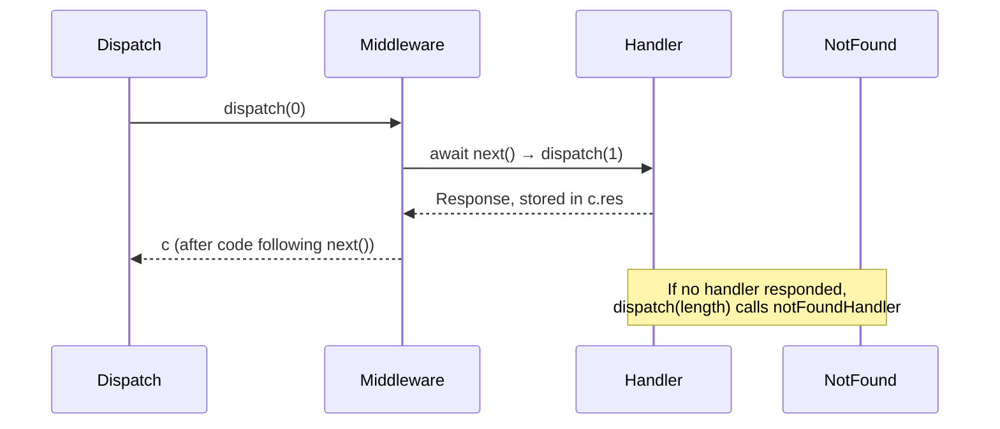

## Overview

Every request enters an app through `fetch`, and `fetch` hands it to the private `#dispatch` method in `src/hono-base.ts`. `#dispatch` asks the router for the handlers that match, wraps the request in a `Context`, runs the handlers, and turns whatever they return or throw into one `Response`. This page follows that path and the rules it enforces: the order handlers run in, what `next()` does, when the not-found handler answers, and where errors go. The table the router matches against is built as [[Application and Routing]] describes; the `Context` API a handler uses is on [[Context and Responses]].

Sources: [src/hono-base.ts:406-466](repo://src/hono-base.ts#L406-L466)

## Entry points

`fetch(request, env, executionCtx)` is the entry point a runtime calls. It passes the bindings and the execution context through unchanged and uses `request.method` as the method to route.

Sources: [src/hono-base.ts:479-485](repo://src/hono-base.ts#L479-L485)

`request(input, init, env, executionCtx)` is a testing convenience over `fetch`. A `Request` is used as it is, or rebuilt with `init` when one is given; a string or `URL` without an `http://` or `https://` scheme is resolved against `http://localhost`.

Sources: [src/hono-base.ts:499-517](repo://src/hono-base.ts#L499-L517)

`fire()` registers a global `fetch` event listener for Service Worker style runtimes and answers each event with `#dispatch`, passing the event itself as the execution context. It is deprecated in favour of `fire` from `hono/service-worker`, covered on [[Runtime Adapters]].

Sources: [src/hono-base.ts:519-542](repo://src/hono-base.ts#L519-L542)

## Dispatch



Sources: [src/hono-base.ts:406-466](repo://src/hono-base.ts#L406-L466)

A `HEAD` request is dispatched again as `GET`, and the result is copied into a new `Response` with a `null` body, keeping status and headers. An app therefore never registers `HEAD` routes: its `GET` routes answer them.

Sources: [src/hono-base.ts:412-416](repo://src/hono-base.ts#L412-L416)

The path comes from the app's `getPath`, which receives the bindings as well as the request. `router.match` returns a result whose first element lists every matching `[handler, route]` pair with its parameters, in registration order; the `Context` keeps it so `c.req.param()` can read the parameters later, as [[HonoRequest]] explains.

Sources: [src/hono-base.ts:418-427](repo://src/hono-base.ts#L418-L427), [src/context.ts:352-369](repo://src/context.ts#L352-L369)

## The single-handler fast path

The code comments "Do not `compose` if it has only one handler". When exactly one handler matched, `#dispatch` calls it with a `next` that sets `c.res` to the not-found response, and then:

Sources: [src/hono-base.ts:429-448](repo://src/hono-base.ts#L429-L448)

- a thrown error goes to `#handleError`;
- a promise is awaited: its value is returned if it is a response, otherwise `c.res` when the context was finalized, otherwise the not-found handler's response; a rejection goes to `#handleError`;
- a synchronous value is returned as it is, or the not-found response when it is `undefined` or `null`.

Sources: [src/hono-base.ts:429-448](repo://src/hono-base.ts#L429-L448)

Because the router always returns middleware registered with `use('*')` as well, an app with any global middleware takes the composed path for every request.

Sources: [src/hono-base.ts:156-168](repo://src/hono-base.ts#L156-L168)

## Middleware composition

### The onion

`compose` in `src/compose.ts` is based on `koa-compose`. It returns a function that runs `dispatch(0)`; `dispatch(i)` calls handler `i` with the context and a `next` that is `() => dispatch(i + 1)`. Code before `await next()` runs on the way in, code after it runs on the way out, in reverse order.

Sources: [src/compose.ts:4-26](repo://src/compose.ts#L4-L26), [src/compose.ts:42-56](repo://src/compose.ts#L42-L56)



Sources: [src/compose.ts:32-71](repo://src/compose.ts#L32-L71)

### The rules dispatch keeps

`dispatch` remembers the highest index it has run. Calling `next()` twice from the same handler reaches an index that is not higher and throws `next() called multiple times`.

Sources: [src/compose.ts:32-36](repo://src/compose.ts#L32-L36)

Before calling handler `i` it sets `context.req.routeIndex = i`, so `c.req.param()` returns the parameters of the route that handler was registered on, not those of the last matching route.

Sources: [src/compose.ts:42-44](repo://src/compose.ts#L42-L44)

Past the last handler, `dispatch` calls the outer `next` if the composed function received one. That is how a wrapped chain, such as a sub-app handler wrapped by `route()`, continues into the parent's chain. Without an outer `next`, and when no handler has finalized the context, it calls the not-found handler.

Sources: [src/compose.ts:45-65](repo://src/compose.ts#L45-L65)

A handler's return value is stored in `context.res` only when the context is not finalized yet, or when it came from the error handler. A middleware that returns a response after `await next()` therefore does not replace the response a later handler already set; to change it, the middleware assigns `c.res` itself.

Sources: [src/compose.ts:67-71](repo://src/compose.ts#L67-L71)

### Assigning c.res

Setting `c.res` marks the context finalized. When a response already exists, the new one is copied and receives every header of the old one except `content-type`, with `set-cookie` values appended one by one. Headers that middleware set before `next()` thus survive a handler returning a fresh `Response`.

Sources: [src/context.ts:403-434](repo://src/context.ts#L403-L434)

### The finalized check

After the composed chain resolves, `#dispatch` checks `context.finalized`. A chain where no handler returned a response, assigned `c.res`, or reached the not-found handler throws `Context is not finalized. Did you forget to return a Response object or `await next()`?`, and that error goes to the error handler like any other.

Sources: [src/hono-base.ts:450-465](repo://src/hono-base.ts#L450-L465)

## Errors

### Where an error is caught

Inside `compose`, an `Error` thrown by handler `i` is caught at that level when an error handler was given: the error is stored on `context.error`, the error handler's response becomes the result, and the call to `next()` in handler `i - 1` resolves normally. Middleware that wraps the failing handler can therefore read `c.error` and `c.res` after `await next()`. A thrown value that is not an `Error` is re-thrown.

Sources: [src/compose.ts:48-62](repo://src/compose.ts#L48-L62), [src/context.ts:318-333](repo://src/context.ts#L318-L333)

Errors that escape the chain, and every error on the fast path, reach `#handleError`. It calls the app's error handler for an `Error` and re-throws anything else, so a thrown string rejects `fetch` itself.

Sources: [src/hono-base.ts:399-404](repo://src/hono-base.ts#L399-L404)

### The default error handler

The default handler checks for a `getResponse` method. An error that has one, such as `HTTPException`, answers with that response through `c.newResponse`, so headers already set on the context are kept. Any other error is logged with `console.error` and answered with `Internal Server Error` and status 500. `app.onError` replaces this handler.

Sources: [src/hono-base.ts:35-42](repo://src/hono-base.ts#L35-L42)

### HTTPException

`HTTPException` carries a status, defaulting to 500, and optionally a message, a cause and a ready `Response`. `getResponse()` returns a copy of that response with the exception's status, or a plain response whose body is the message.

Sources: [src/http-exception.ts:46-77](repo://src/http-exception.ts#L46-L77)

```ts
import { HTTPException } from 'hono/http-exception'

app.post('/auth', async (c, next) => {
  // authentication
  if (authorized === false) {
    throw new HTTPException(401, { message: 'Custom error message' })
  }
  await next()
})
```

Sources: [src/http-exception.ts:31-44](repo://src/http-exception.ts#L31-L44)

### Sub-app error handlers

When `app.route()` copies routes from a sub-app with its own error handler, it wraps each handler as `compose([], subApp.errorHandler)(c, () => handler(c, next))`. The empty chain goes straight to the outer `next`, which runs the original handler, so an error it throws is caught by the sub-app's handler instead of the parent's. Sub-apps without a custom handler are copied unwrapped and share the parent's.

Sources: [src/hono-base.ts:218-229](repo://src/hono-base.ts#L218-L229), [src/compose.ts:45-62](repo://src/compose.ts#L45-L62)

## Not found

The not-found handler answers in three places: the `next` given to a lone handler, the end of a composed chain that never finalized, and `c.notFound()` called by a handler. The default returns `404 Not Found` as text; `app.notFound` replaces it. A `Context` built without one, outside an app, returns an empty response.

Sources: [src/hono-base.ts:31-33](repo://src/hono-base.ts#L31-L33), [src/hono-base.ts:429-448](repo://src/hono-base.ts#L429-L448), [src/compose.ts:61-65](repo://src/compose.ts#L61-L65), [src/context.ts:776-779](repo://src/context.ts#L776-L779)
