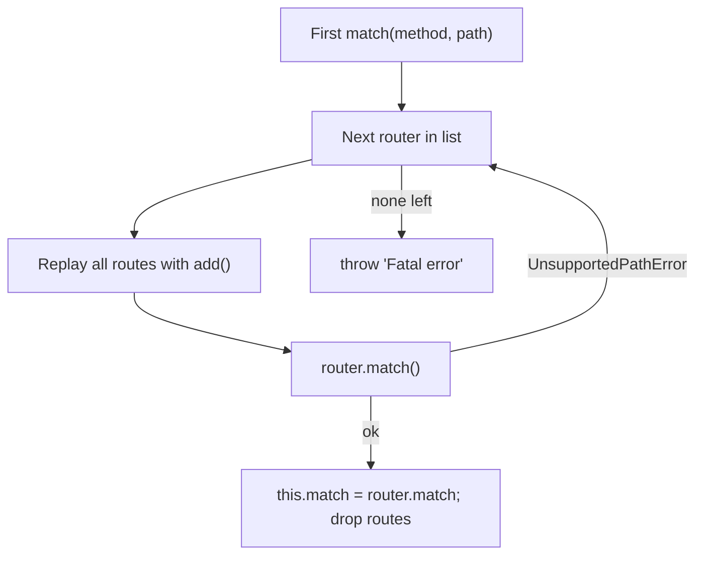

## Overview

A router stores the routes an app registers and, for each request, returns every handler whose method and path match. Hono keeps routers behind one small interface so an app can choose the trade-off it wants between registration cost, match speed, bundle size and supported path syntax. The app passes each route to `router.add` as it is registered, as [[Application and Routing]] describes, and calls `router.match` once per request, as [[Request Lifecycle and Error Handling]] traces. This page covers the interface, the path syntax, and every router except `RegExpRouter`, which has its own page: [[RegExpRouter]].

Sources: [src/router.ts:24-52](repo://src/router.ts#L24-L52), [src/hono-base.ts:385-397](repo://src/hono-base.ts#L385-L397)

## The Router interface

### Members

Without its comments, the interface is three members:

Sources: [src/router.ts:24-52](repo://src/router.ts#L24-L52)

```ts
export interface Router<T> {
  name: string
  add(method: string, path: string, handler: T): void
  match(method: string, path: string): Result<T>
}
```

Sources: [src/router.ts:24-52](repo://src/router.ts#L24-L52)

The app stores `[handler, routeRecord]` as `T`. Methods arrive upper-cased; a route registered with `use()` or `all()` has the method `ALL` (`METHOD_NAME_ALL`), which every router treats as matching any request method. A router that cannot represent a path throws `UnsupportedPathError`; a router whose matcher is already built and cannot accept more routes throws an error with the message `Can not add a route since the matcher is already built.`

Sources: [src/router.ts:5-22](repo://src/router.ts#L5-L22), [src/router.ts:96-103](repo://src/router.ts#L96-L103)

### The result shape

`match` returns one of two shapes. Both list every matching handler in registration order, so middleware registered before a handler runs before it.

Sources: [src/router.ts:53-98](repo://src/router.ts#L53-L98)

| Shape | Used by | Parameter entry |
| --- | --- | --- |
| `[[handler, paramIndexMap][], paramStash]` | `RegExpRouter` | Each name maps to an index into `paramStash`, the array of captured values shared by all handlers. |
| `[[handler, params][]]` | `TrieRouter`, `LinearRouter`, `PatternRouter` | Each name maps to its value. |

Sources: [src/router.ts:53-98](repo://src/router.ts#L53-L98)

`HonoRequest` handles both: when the second element exists it looks values up in the stash, otherwise it uses the entry directly, as [[HonoRequest]] shows.

Sources: [src/request.ts:126-128](repo://src/request.ts#L126-L128)

## Path syntax

| Syntax | Meaning |
| --- | --- |
| `/posts/:id` | A named parameter matching one segment. |
| `/posts/:id{[0-9]+}` | A parameter restricted by a regular expression. |
| `/posts/:id?` | An optional last parameter: registers `/posts` and `/posts/:id`. |
| `/static/*` | A wildcard: also matches `/static` itself. |
| `*` | Every path; what `use()` registers by default. |

Sources: [src/utils/url.ts:50-77](repo://src/utils/url.ts#L50-L77), [src/utils/url.ts:171-206](repo://src/utils/url.ts#L171-L206), [src/router/trie-router/node.ts:136-143](repo://src/router/trie-router/node.ts#L136-L143)

Optional parameters are expanded before a route is stored. `checkOptionalParameter` returns `null` unless the path ends with `?` and holds a `:`; otherwise it returns each prefix up to and including each optional segment, so `/api/animals/:type?` becomes `/api/animals` and `/api/animals/:type`. `TrieRouter` and `LinearRouter` insert every returned path.

Sources: [src/utils/url.ts:171-206](repo://src/utils/url.ts#L171-L206), [src/router/trie-router/router.ts:13-23](repo://src/router/trie-router/router.ts#L13-L23)

`getPattern` turns one segment into a pattern and caches it. A plain `:id` becomes `[label, 'id', true]`, which matches any segment. A `:id{...}` becomes a regular expression anchored at the start; when the next segment is a literal, the expression gets a look-ahead for `/next`, so a pattern that can contain `/` stops before the following literal.

Sources: [src/utils/url.ts:50-77](repo://src/utils/url.ts#L50-L77)

## SmartRouter

`SmartRouter` holds a list of routers and picks one at the first request. Until then `add` only records each route. On the first `match` it replays every recorded route into the first router and calls its `match`; if that throws `UnsupportedPathError`, it moves to the next router. The first router that succeeds becomes the only one: `SmartRouter` binds its own `match` to that router's, drops the route list, and sets its name to `SmartRouter + <name>`. `activeRouter` returns the chosen router and throws before one is chosen.

Sources: [src/router/smart-router/router.ts:4-70](repo://src/router/smart-router/router.ts#L4-L70)



Sources: [src/router/smart-router/router.ts:21-61](repo://src/router/smart-router/router.ts#L21-L61)

Because the routes are dropped, adding a route after the first request throws the "matcher is already built" error. The default `Hono` uses `SmartRouter` over `RegExpRouter` and `TrieRouter`, so apps get `RegExpRouter` when every path compiles and `TrieRouter` otherwise.

Sources: [src/router/smart-router/router.ts:13-19](repo://src/router/smart-router/router.ts#L13-L19), [src/hono.ts:26-33](repo://src/hono.ts#L26-L33)

## TrieRouter

`TrieRouter` stores routes in a tree of `Node`s keyed by path segment, and supports every path the syntax allows. `insert` splits the path with `splitRoutingPath`, which keeps `{...}` groups intact even if they contain `/`, walks or creates one child per segment, records parameter patterns on the parent, and stores the handler on the last node with the parameter names it can expect and a `score` equal to its insertion order.

Sources: [src/router/trie-router/router.ts:1-28](repo://src/router/trie-router/router.ts#L1-L28), [src/router/trie-router/node.ts:44-85](repo://src/router/trie-router/node.ts#L44-L85), [src/utils/url.ts:16-48](repo://src/utils/url.ts#L16-L48)

`search` walks the request path segment by segment, keeping the set of nodes that could still match. At each node it follows the literal child, the wildcard child, and every parameter pattern; a regular-expression pattern is tested against the rest of the path, so it can span segments. A node whose handler matches the request method, or `ALL`, contributes its handler with the parameters collected so far. After the walk the handlers are sorted by `score`, which restores registration order across the different branches.

Sources: [src/router/trie-router/node.ts:87-112](repo://src/router/trie-router/node.ts#L87-L112), [src/router/trie-router/node.ts:114-230](repo://src/router/trie-router/node.ts#L114-L230), [src/router/trie-router/node.ts:237-243](repo://src/router/trie-router/node.ts#L237-L243)

## LinearRouter

`LinearRouter` does no work when a route is added: `add` pushes `[method, path, handler]` onto an array, after expanding optional parameters. `match` loops over every route and tests it with string operations:

Sources: [src/router/linear-router/router.ts:15-23](repo://src/router/linear-router/router.ts#L15-L23), [src/router/linear-router/router.ts:25-143](repo://src/router/linear-router/router.ts#L25-L143)

- `*` and `/*` match everything.
- Paths with neither `*` nor `:` match by equality, with or without one trailing slash.
- Paths with `*` and no `:` match each literal part in order.
- Paths with `:` and no `*` are split into parts and parameters are read segment by segment; `:name{pattern}` is tested with a regular expression built at match time.
- Paths with both `:` and `*` throw `UnsupportedPathError`.

Sources: [src/router/linear-router/router.ts:15-23](repo://src/router/linear-router/router.ts#L15-L23), [src/router/linear-router/router.ts:25-143](repo://src/router/linear-router/router.ts#L25-L143)

The `hono/quick` preset puts it first in a `SmartRouter` with `TrieRouter` behind it, so a path `LinearRouter` cannot handle falls back to the trie.

Sources: [src/preset/quick.ts:13-24](repo://src/preset/quick.ts#L13-L24)

## PatternRouter

`PatternRouter` compiles each route into its own regular expression when it is added. Parameters become named groups (`/(?<id>[^/]+)` or the given pattern), `/*` in the middle becomes one segment, a trailing `*` leaves the expression open-ended, and other routes end with `/?$`. An optional last parameter adds the route a second time without that segment. `match` runs each expression whose method matches and takes the parameters from `match.groups`. An expression that fails to compile throws `UnsupportedPathError`.

Sources: [src/router/pattern-router/router.ts:8-60](repo://src/router/pattern-router/router.ts#L8-L60)

The `hono/tiny` preset uses it alone, without a `SmartRouter`; the README gives the preset's size as under 12kB.

Sources: [src/preset/tiny.ts:11-20](repo://src/preset/tiny.ts#L11-L20), [README.md:40-44](repo://README.md#L40-L44)

## Choosing a router

| Router | Work at `add` | Work at `match` | Unsupported | Used by |
| --- | --- | --- | --- | --- |
| `SmartRouter` | Records the route | First call picks a router | Depends on its list | `hono`, `hono/quick` |
| `RegExpRouter` | Records the route and the middleware it inherits; builds one expression per method at first match | One regular expression test | Some ambiguous patterns | `hono` (first choice) |
| `TrieRouter` | Inserts into the tree | Tree walk | None | `hono` and `hono/quick` (fallback) |
| `LinearRouter` | Pushes to an array | Loop over every route | `:` and `*` in one path | `hono/quick` (first choice) |
| `PatternRouter` | Compiles one expression | Loop over every expression | Paths that do not compile | `hono/tiny` |

Sources: [src/hono.ts:26-33](repo://src/hono.ts#L26-L33), [src/preset/quick.ts:13-24](repo://src/preset/quick.ts#L13-L24), [src/preset/tiny.ts:11-20](repo://src/preset/tiny.ts#L11-L20), [src/router/linear-router/router.ts:15-23](repo://src/router/linear-router/router.ts#L15-L23), [src/router/pattern-router/router.ts:12-42](repo://src/router/pattern-router/router.ts#L12-L42)

Any router can be passed as `new Hono({ router })`; each is importable from its own subpath such as `hono/router/trie-router`. `getRouterName(app)` from `hono/dev` reports which router an app ended up with, as [[Route Introspection]] describes.

Sources: [src/hono-base.ts:46-65](repo://src/hono-base.ts#L46-L65), [src/router/trie-router/index.ts:1-6](repo://src/router/trie-router/index.ts#L1-L6)
