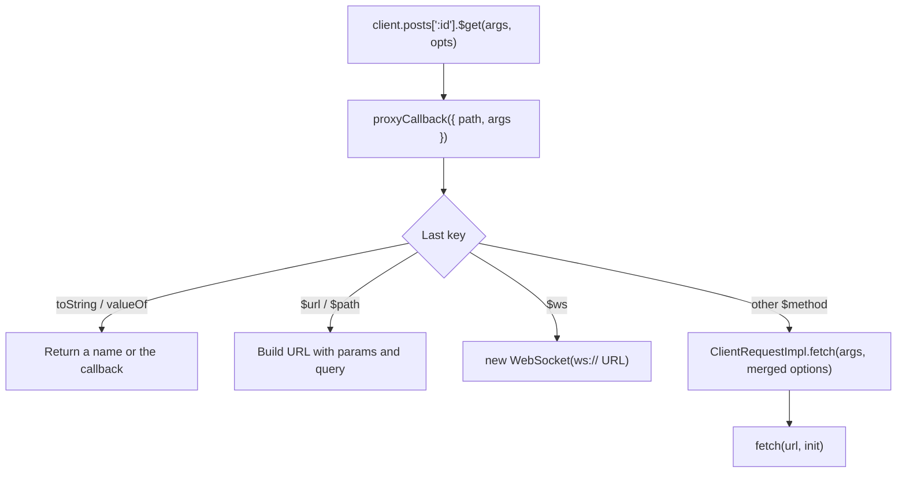

## Overview

`hc` from `hono/client` turns an app's type into a client object. Property access spells the path, a `$method` call sends the request, and the arguments and responses are typed from the schema the server's routes built, as [[Typed Routes and Schemas]] explains. At runtime the client knows nothing about the server: it is a `Proxy` that collects property names into a URL and calls `fetch`. Only the type parameter connects the two programs.

Sources: [src/client/client.ts:133-232](repo://src/client/client.ts#L133-L232), [src/client/types.ts:294-318](repo://src/client/types.ts#L294-L318)

```ts
// server
const route = app.get('/posts/:id', (c) => c.json({ id: c.req.param('id') }))
export type AppType = typeof route

// client
import { hc } from 'hono/client'
const client = hc<AppType>('http://localhost:8787')
const res = await client.posts[':id'].$get({ param: { id: '1' } })
const data = await res.json() // { id: string }
```

Sources: [src/client/types.ts:67-80](repo://src/client/types.ts#L67-L80), [src/client/types.ts:294-309](repo://src/client/types.ts#L294-L309)

## From schema to object type

`Client<T, Prefix>` reads the schema `S` from the app type and maps each path key through `PathToChain`. The path is split on `/` into nested properties; the last segment holds a `ClientRequest` for that path, and an empty last segment, the root `/`, becomes the property `index`. A `:id` segment stays as the property name `':id'`.

Sources: [src/client/types.ts:294-318](repo://src/client/types.ts#L294-L318)

`ClientRequest` has one function per `$method` in the endpoint, plus `$url` and `$path`, plus `$ws` when the `GET` endpoint's output format is `ws`. A route registered with `all` appears as `$all` in the schema and is expanded into every standard method. The arguments parameter is required when the endpoint's input has required keys and optional otherwise.

Sources: [src/client/types.ts:8-26](repo://src/client/types.ts#L8-L26), [src/client/types.ts:67-118](repo://src/client/types.ts#L67-L118)

The result is a `ClientResponse<T, U, F>`: a `Response` whose `status` is the status literal, whose `ok` is `true` for success statuses and `false` for the rest, and whose `json()` returns `T` for a JSON endpoint or `never` for a text endpoint. Because the schema holds one member per status, a response can be narrowed by checking `res.ok` or `res.status`.

Sources: [src/client/types.ts:120-154](repo://src/client/types.ts#L120-L154)

## The proxy

`createProxy` wraps a no-op function in a `Proxy`. Every string property access returns a new proxy with the key appended to the path; `then` returns `undefined`, so the proxy is not mistaken for a promise when awaited. Calling a proxy hands the collected path and arguments to the callback `hc` supplied.

Sources: [src/client/client.ts:15-31](repo://src/client/client.ts#L15-L31)



Sources: [src/client/client.ts:137-232](repo://src/client/client.ts#L137-L232)

The callback pops a final key that starts with `$` as the method and joins the rest with `/` onto the base URL. `toString()` and `valueOf()` are handled first so a proxy can be printed; `.name.toString()` returns the path segment before `name`.

Sources: [src/client/client.ts:137-170](repo://src/client/client.ts#L137-L170)

## Sending a request

`ClientRequestImpl.fetch(args, options)` turns the typed argument object into a request:

Sources: [src/client/client.ts:53-118](repo://src/client/client.ts#L53-L118), [src/client/utils.ts:18-44](repo://src/client/utils.ts#L18-L44)

| Argument | Becomes |
| --- | --- |
| `param` | Substituted into `:name` segments of the URL, including `:name{pattern}` and `:name?`; an empty value removes the segment. |
| `query` | A query string, built by `buildSearchParams`; arrays become repeated keys and `undefined` values are skipped. |
| `json` | A `JSON.stringify` body with `Content-Type: application/json`. |
| `form` | A `FormData` body; arrays append one entry per item and `undefined` values are skipped. |
| `header` | Request headers. |
| `cookie` | A `Cookie` header of serialized `key=value` pairs with `path=/`. |

Sources: [src/client/client.ts:53-118](repo://src/client/client.ts#L53-L118), [src/client/utils.ts:18-44](repo://src/client/utils.ts#L18-L44)

A trailing `/index` is removed from the URL, or replaced with `/` when it directly follows the host. The body is dropped for `GET` and `HEAD`. The request goes to `options.fetch` when given, otherwise the global `fetch`, with the URL as a string; the comment says this is for testing with MSW and node-fetch.

Sources: [src/client/client.ts:110-129](repo://src/client/client.ts#L110-L129), [src/client/utils.ts:55-60](repo://src/client/utils.ts#L55-L60)

## Options

| Option | Effect |
| --- | --- |
| `fetch` | A replacement `fetch`, or an app's `request` method. |
| `headers` | An object, or a function returning one or a promise of one, evaluated per request. |
| `init` | A `RequestInit` spread last, so it can override method, headers and body. |
| `buildSearchParams` | A custom query serializer, such as bracket notation for arrays. |
| `webSocket` | A factory used by `$ws` instead of `new WebSocket`. |

Sources: [src/client/types.ts:30-65](repo://src/client/types.ts#L30-L65)

Options given to `hc` and options given to one call are deep-merged, with the call's winning. When both have `headers`, the merged value is an async function that evaluates both and spreads the call's headers over the client's.

Sources: [src/client/client.ts:217-230](repo://src/client/client.ts#L217-L230), [src/client/utils.ts:62-82](repo://src/client/utils.ts#L62-L82)

## URLs and WebSockets

`$url(args)` returns a `URL` with `param` and `query` applied, and `$path(args)` returns the same without the base URL's origin and prefix. Their types are precise: when the base URL is a string literal, `$url` returns a `TypedURL` whose `pathname`, `host` and `href` are literal types with literal parameter values filled in.

Sources: [src/client/client.ts:171-186](repo://src/client/client.ts#L171-L186), [src/client/types.ts:156-230](repo://src/client/types.ts#L156-L230)

`$ws(args)` replaces `http` with `ws` in the URL, applies `param` and `query`, and opens a WebSocket with `options.webSocket` or the global constructor. The server side is on [[WebSocket Helper]].

Sources: [src/client/client.ts:187-212](repo://src/client/client.ts#L187-L212)

## Type helpers

| Helper | Gives |
| --- | --- |
| `InferRequestType<typeof client.posts.$post>` | The argument object the call accepts. |
| `InferResponseType<typeof fn, Status?>` | The output type, optionally for one status. |
| `ApplyGlobalResponse<typeof app, Def>` | An app type whose every endpoint also has the responses in `Def`, such as a 500 from `onError`. |
| `PickResponseByStatusCode<typeof app, 200>` | An app type with only the endpoints of that status, for clients whose `fetch` handles errors centrally. |

Sources: [src/client/types.ts:251-279](repo://src/client/types.ts#L251-L279), [src/client/types.ts:332-393](repo://src/client/types.ts#L332-L393)

## parseResponse

`parseResponse(client.posts.$get())` awaits the call and returns the parsed body. It reads the body unless the response has none or its status is 101, 204, 205 or 304, as JSON when the content type is JSON (including `+json` types) and as text otherwise. A response that is not `ok` throws a `DetailedError` with `statusCode` and `detail: { data, statusText }`. The return type keeps only the non-error responses of the call. The comment says the code is a reduced version of the `fetch-result-please` package.

Sources: [src/client/utils.ts:84-114](repo://src/client/utils.ts#L84-L114), [src/client/fetch-result-please.ts:1-95](repo://src/client/fetch-result-please.ts#L1-L95)

## testClient

`testClient(app, env, executionCtx, options)` from `hono/testing` is `hc` with base URL `http://localhost` and a `fetch` that calls `app.request(input, init, env, executionCtx)`. Tests get the typed client without starting a server, and requests go through the full dispatch described on [[Request Lifecycle and Error Handling]].

Sources: [src/helper/testing/index.ts:14-27](repo://src/helper/testing/index.ts#L14-L27)
