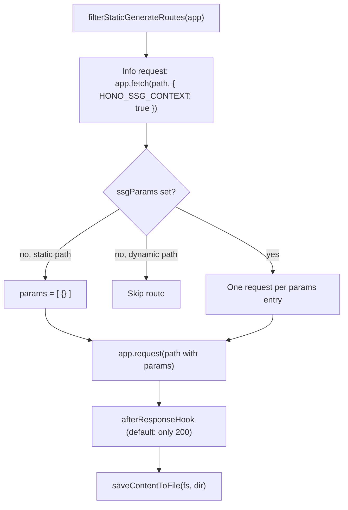

## Overview

`hono/ssg` turns an app into a folder of files. `toSSG(app, fs, options)` lists the app's `GET` routes, requests each one through the app itself, as a test would with `app.request`, and writes every successful response to a file named after its path and content type. Dynamic routes such as `/posts/:id` are generated once per parameter set that an `ssgParams` middleware supplies. Nothing in the app has to change to be generated: the same handlers serve live requests and build-time requests, and middleware can tell the two apart.

Sources: [src/helper/ssg/ssg.ts:205-302](repo://src/helper/ssg/ssg.ts#L205-L302), [src/helper/ssg/ssg.ts:368-470](repo://src/helper/ssg/ssg.ts#L368-L470)

```ts
import { toSSG } from 'hono/bun'
import { ssgParams } from 'hono/ssg'

app.get('/', (c) => c.html('<h1>Home</h1>'))
app.get(
  '/posts/:id',
  ssgParams(async () => (await getPosts()).map((p) => ({ id: p.id }))),
  (c) => c.html(`<h1>Post ${c.req.param('id')}</h1>`)
)

const result = await toSSG(app, { dir: './static' })
```

Sources: [src/adapter/bun/ssg.ts:25-27](repo://src/adapter/bun/ssg.ts#L25-L27), [src/helper/ssg/middleware.ts:43-49](repo://src/helper/ssg/middleware.ts#L43-L49)

## The generation flow

### Steps at a glance



Sources: [src/helper/ssg/ssg.ts:205-302](repo://src/helper/ssg/ssg.ts#L205-L302)

### Choosing routes

`filterStaticGenerateRoutes` keeps the entries of `app.routes` whose method is `GET` or `ALL` and whose handler is not a middleware, judged by `isMiddleware` on the original handler behind any `route()` wrapper: a function that declares more than one parameter, `(c, next)`, counts as middleware. A path is dynamic when a segment starts with `:` or contains `*`.

Sources: [src/helper/ssg/utils.ts:61-75](repo://src/helper/ssg/utils.ts#L61-L75), [src/utils/handler.ts:8-15](repo://src/utils/handler.ts#L8-L15)

### The info request

For each route, a first request is sent to `http://localhost` plus the route path, after the `beforeRequestHook`s, which may replace it or return `false` to skip the route. It goes through `app.fetch` with bindings `{ HONO_SSG_CONTEXT: true }`.

Sources: [src/helper/ssg/ssg.ts:222-243](repo://src/helper/ssg/ssg.ts#L222-L243), [src/helper/ssg/middleware.ts:5-6](repo://src/helper/ssg/middleware.ts#L5-L6)

`ssgParams(params)` reacts to this request. When the request path is still the dynamic pattern, it stores the parameter list, an array or the result of a function of the Context, on the raw request and answers `c.notFound()` so the handler does not run with a literal `:id`. Afterwards, a static path with no parameters is requested once; a dynamic path with none is skipped.

Sources: [src/helper/ssg/middleware.ts:24-49](repo://src/helper/ssg/middleware.ts#L24-L49), [src/helper/ssg/ssg.ts:245-251](repo://src/helper/ssg/ssg.ts#L245-L251)

### The content requests

For each parameter set, the parameters are substituted into the path with the RPC client's `replaceUrlParam` and the page is requested with `app.request`, with the info request's method and headers and the same SSG bindings. A response carrying the `x-hono-disable-ssg` header is dropped. The `afterResponseHook`s may replace the response or return `false` to drop it.

Sources: [src/helper/ssg/ssg.ts:253-281](repo://src/helper/ssg/ssg.ts#L253-L281)

The MIME type comes from `Content-Type`, defaulting to `text/plain`; the comment explains this matches `c.text()` on Bun, which omits the header for speed. Text and JSON responses are read as text, anything else as bytes.

Sources: [src/helper/ssg/ssg.ts:19-25](repo://src/helper/ssg/ssg.ts#L19-L25), [src/helper/ssg/ssg.ts:74-88](repo://src/helper/ssg/ssg.ts#L74-L88), [src/helper/ssg/ssg.ts:282-289](repo://src/helper/ssg/ssg.ts#L282-L289)

All requests share one pool from `createPool`, limiting how many run at once to `concurrency`, 2 by default.

Sources: [src/helper/ssg/ssg.ts:17-17](repo://src/helper/ssg/ssg.ts#L17-L17), [src/helper/ssg/ssg.ts:222-223](repo://src/helper/ssg/ssg.ts#L222-L223), [src/utils/concurrent.ts:1-55](repo://src/utils/concurrent.ts#L1-L55)

## Writing files

### File names

`generateFilePath` picks the extension from the MIME type through `extensionMap`, by default `html`, `xml` for the XML, Atom and RSS types, and `yaml`, then through the MIME table, then `html`:

Sources: [src/helper/ssg/ssg.ts:50-72](repo://src/helper/ssg/ssg.ts#L50-L72), [src/helper/ssg/ssg.ts:90-108](repo://src/helper/ssg/ssg.ts#L90-L108)

| Path | File |
| --- | --- |
| `/` | `index.html` |
| `/about/` | `about/index.html` |
| `/about` | `about.html` |
| `/feed.xml` (served as XML) | `feed.xml` |

Sources: [src/helper/ssg/ssg.ts:50-72](repo://src/helper/ssg/ssg.ts#L50-L72), [src/helper/ssg/ssg.ts:90-108](repo://src/helper/ssg/ssg.ts#L90-L108)

Every path is joined under `dir`, `./static` by default, and `ensureWithinOutDir` throws `Path traversal detected` for any file that would land outside it, such as one produced from a parameter containing `..`.

Sources: [src/helper/ssg/ssg.ts:27-27](repo://src/helper/ssg/ssg.ts#L27-L27), [src/helper/ssg/utils.ts:50-55](repo://src/helper/ssg/utils.ts#L50-L55), [src/helper/ssg/utils.ts:77-87](repo://src/helper/ssg/utils.ts#L77-L87)

### The file system module

`toSSG` writes through a `FileSystemModule` with `writeFile(path, data)` and `mkdir(path, { recursive })`. Each directory is created once. `hono/bun` and `hono/deno` export `toSSG(app, options)` wrappers with their own modules: Bun's writes with `Bun.write`, which creates directories itself, so its `mkdir` does nothing; Deno's uses `Deno.writeFile` and `Deno.mkdir`.

Sources: [src/helper/ssg/ssg.ts:34-37](repo://src/helper/ssg/ssg.ts#L34-L37), [src/helper/ssg/ssg.ts:309-334](repo://src/helper/ssg/ssg.ts#L309-L334), [src/adapter/bun/ssg.ts:1-27](repo://src/adapter/bun/ssg.ts#L1-L27), [src/adapter/deno/ssg.ts:1-27](repo://src/adapter/deno/ssg.ts#L1-L27)

### The result

`toSSG` resolves to `{ success, files, error? }`. Any error while fetching or writing makes `success` false with an empty file list; it does not reject. `afterGenerateHook`s run last with the result, the file system module and the options, whether or not generation succeeded.

Sources: [src/helper/ssg/ssg.ts:44-48](repo://src/helper/ssg/ssg.ts#L44-L48), [src/helper/ssg/ssg.ts:436-470](repo://src/helper/ssg/ssg.ts#L436-L470)

## Hooks and plugins

Hooks come from the options and from `plugins`, each an object with any of the three hook kinds. Option hooks run first, then plugin hooks in order; each hook receives the previous one's result.

Sources: [src/helper/ssg/ssg.ts:110-179](repo://src/helper/ssg/ssg.ts#L110-L179), [src/helper/ssg/ssg.ts:368-419](repo://src/helper/ssg/ssg.ts#L368-L419)

| Plugin | Does |
| --- | --- |
| `defaultPlugin()` | Drops every response whose status is not 200. Used when `plugins` is not given. |
| `redirectPlugin()` | Turns 301, 302, 303, 307 and 308 responses into an HTML page with a meta refresh and a canonical link to `Location`. |

Sources: [src/helper/ssg/plugins.ts:11-72](repo://src/helper/ssg/plugins.ts#L11-L72)

Passing `plugins` replaces the default, so `plugins: [redirectPlugin()]` alone would keep error pages; adding `defaultPlugin()` after it keeps the 200 filter while letting redirects through.

Sources: [src/helper/ssg/ssg.ts:372-372](repo://src/helper/ssg/ssg.ts#L372-L372)

## Routes that behave differently during generation

The SSG bindings let middleware branch on the build:

Sources: [src/helper/ssg/middleware.ts:51-83](repo://src/helper/ssg/middleware.ts#L51-L83)

| Middleware | During generation | Live requests |
| --- | --- | --- |
| `isSSGContext(c)` | `true` | `false` |
| `disableSSG()` | Answers 404 with `x-hono-disable-ssg`, so no file is written | Continues |
| `onlySSG()` | Continues | Answers 404 |

Sources: [src/helper/ssg/middleware.ts:51-83](repo://src/helper/ssg/middleware.ts#L51-L83)

Because generation goes through the normal dispatch on [[Request Lifecycle and Error Handling]], app middleware such as a `jsxRenderer` from [[JSX Server Rendering]] applies to generated pages as it does to live ones.

Sources: [src/helper/ssg/ssg.ts:243-243](repo://src/helper/ssg/ssg.ts#L243-L243), [src/helper/ssg/ssg.ts:265-269](repo://src/helper/ssg/ssg.ts#L265-L269)
