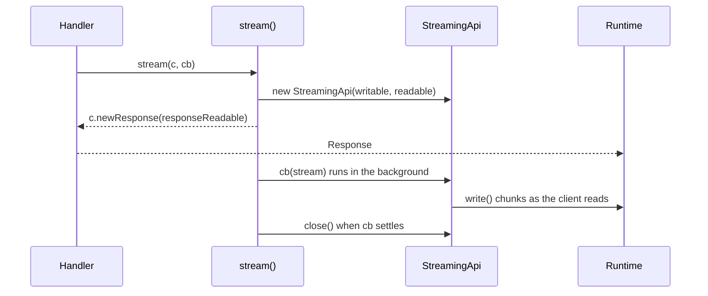

## Overview

`hono/streaming` lets a handler return a response at once and write its body over time. Each helper creates a `TransformStream`, wraps its writable side in a `StreamingApi` object, starts the handler's callback without awaiting it, and returns a `Response` whose body is the readable side. The callback writes text or bytes as it produces them; the stream closes when the callback finishes. `streamText` adds plain-text headers and `streamSSE` adds Server-Sent Events headers and a `writeSSE` method. Streaming HTML from JSX uses a different mechanism, `renderToReadableStream`, described on [[JSX Server Rendering]].

Sources: [src/helper/streaming/stream.ts:7-45](repo://src/helper/streaming/stream.ts#L7-L45), [src/helper/streaming/index.ts:1-9](repo://src/helper/streaming/index.ts#L1-L9)

| Helper | Headers it sets | Stream object |
| --- | --- | --- |
| `stream(c, cb, onError?)` | none | `StreamingApi` |
| `streamText(c, cb, onError?)` | `Content-Type: text/plain; charset=UTF-8`, `X-Content-Type-Options: nosniff`, `Transfer-Encoding: chunked` | `StreamingApi` |
| `streamSSE(c, cb, onError?)` | `Content-Type: text/event-stream`, `Cache-Control: no-cache`, `Connection: keep-alive`, `Transfer-Encoding: chunked` | `SSEStreamingApi` |

Sources: [src/helper/streaming/text.ts:6-15](repo://src/helper/streaming/text.ts#L6-L15), [src/helper/streaming/sse.ts:72-100](repo://src/helper/streaming/sse.ts#L72-L100)

```ts
import { streamSSE } from 'hono/streaming'

app.get('/events', (c) =>
  streamSSE(c, async (stream) => {
    let id = 0
    while (!stream.aborted) {
      await stream.writeSSE({ event: 'tick', data: new Date().toISOString(), id: String(id++) })
      await stream.sleep(1000)
    }
  })
)
```

Sources: [src/helper/streaming/sse.ts:13-45](repo://src/helper/streaming/sse.ts#L13-L45), [src/utils/stream.ts:65-67](repo://src/utils/stream.ts#L65-L67)

## How a streaming response is built



Sources: [src/helper/streaming/stream.ts:7-45](repo://src/helper/streaming/stream.ts#L7-L45), [src/utils/stream.ts:21-46](repo://src/utils/stream.ts#L21-L46)

The response is built with `c.newResponse`, so headers set on the Context before the call, or by the helper, are included, and the status set with `c.status()` applies. The callback starts in an async block that is not awaited; the handler returns immediately.

Sources: [src/helper/streaming/stream.ts:26-44](repo://src/helper/streaming/stream.ts#L26-L44), [src/context.ts:604-641](repo://src/context.ts#L604-L641)

Each helper stores the Context in a `WeakMap` keyed by the response stream. The comment explains that Bun destroys the Context when the request returns, so it is held until streaming ends.

Sources: [src/helper/streaming/stream.ts:5-5](repo://src/helper/streaming/stream.ts#L5-L5), [src/helper/streaming/stream.ts:24-25](repo://src/helper/streaming/stream.ts#L24-L25)

## The StreamingApi

| Member | Does |
| --- | --- |
| `write(input)` | Encodes a string as UTF-8, or takes a `Uint8Array`, and writes it. |
| `writeln(input)` | Writes the string followed by `\n`. |
| `sleep(ms)` | Resolves after `ms` milliseconds. |
| `pipe(body)` | Pipes a `ReadableStream` into the response without closing it, then takes the writer back. |
| `onAbort(listener)` | Registers a function to run when the client disconnects. |
| `abort()` | Runs the abort listeners once and sets `aborted`. |
| `close()` | Closes the writer and sets `closed`. |
| `aborted`, `closed` | Flags for loops to check. |

Sources: [src/utils/stream.ts:6-98](repo://src/utils/stream.ts#L6-L98)

`write` and `close` swallow errors; the comments say to create a stream directly for error handling. Writes after the client has gone therefore do not throw, which is why a long-running loop should check `stream.aborted`.

Sources: [src/utils/stream.ts:48-76](repo://src/utils/stream.ts#L48-L76)

## Client disconnects

The response body is a `ReadableStream` that pulls from the transform stream's readable side. When the runtime cancels it because the client disconnected, `cancel` calls `abort()` unless the stream is already closed. The first abort listener, registered by the constructor, cancels the internal reader; the comment notes this keeps a pending `writeSSE` from blocking forever.

Sources: [src/utils/stream.ts:26-46](repo://src/utils/stream.ts#L26-L46), [src/utils/stream.ts:84-97](repo://src/utils/stream.ts#L84-L97)

Bun before 1.1.27 did not cancel the stream on disconnect. On those versions, detected by `isOldBunVersion` from `Bun.version` once, the helpers listen to the request's `abort` signal instead.

Sources: [src/helper/streaming/stream.ts:15-22](repo://src/helper/streaming/stream.ts#L15-L22), [src/helper/streaming/utils.ts:1-11](repo://src/helper/streaming/utils.ts#L1-L11)

## Server-Sent Events

`writeSSE({ data, event, id, retry })` writes one event. `data` may be a string or a promise, including an escaped string from JSX or `html`, whose callbacks are resolved first. Multi-line data becomes one `data:` line per line, and the event ends with a blank line:

Sources: [src/helper/streaming/sse.ts:6-45](repo://src/helper/streaming/sse.ts#L6-L45)

```text
event: tick
data: first line
data: second line
id: 7
```

Sources: [src/helper/streaming/sse.ts:6-45](repo://src/helper/streaming/sse.ts#L6-L45)

`event`, `id` and `retry` must not contain a carriage return or a newline; `writeSSE` throws if one does, which would otherwise let a value inject extra fields.

Sources: [src/helper/streaming/sse.ts:27-31](repo://src/helper/streaming/sse.ts#L27-L31)

## Errors

The stream has already been returned when the callback runs, so its errors cannot reach the app's error handler from [[Request Lifecycle and Error Handling]]. The helpers handle them themselves and always close the stream afterwards:

Sources: [src/helper/streaming/stream.ts:26-42](repo://src/helper/streaming/stream.ts#L26-L42), [src/helper/streaming/sse.ts:47-68](repo://src/helper/streaming/sse.ts#L47-L68)

| Helper | `Error` with `onError` | Other thrown value |
| --- | --- | --- |
| `stream`, `streamText` | `onError(e, stream)` runs, and can write a final message | Logged with `console.error`; `undefined`, from a cancelled pipe, is ignored |
| `streamSSE` | `onError(e, stream)` runs, then an `event: error` with the message is written | Logged with `console.error` |

Sources: [src/helper/streaming/stream.ts:26-42](repo://src/helper/streaming/stream.ts#L26-L42), [src/helper/streaming/sse.ts:47-68](repo://src/helper/streaming/sse.ts#L47-L68)

Without `onError`, an `Error` is logged as well. Response middleware that buffers bodies, such as `etag`, reads the whole stream; `compress` leaves responses with `Transfer-Encoding` alone, as [[Response Middleware]] notes.

Sources: [src/helper/streaming/stream.ts:34-38](repo://src/helper/streaming/stream.ts#L34-L38), [src/middleware/compress/index.ts:92-102](repo://src/middleware/compress/index.ts#L92-L102), [src/middleware/etag/index.ts:89-105](repo://src/middleware/etag/index.ts#L89-L105)
