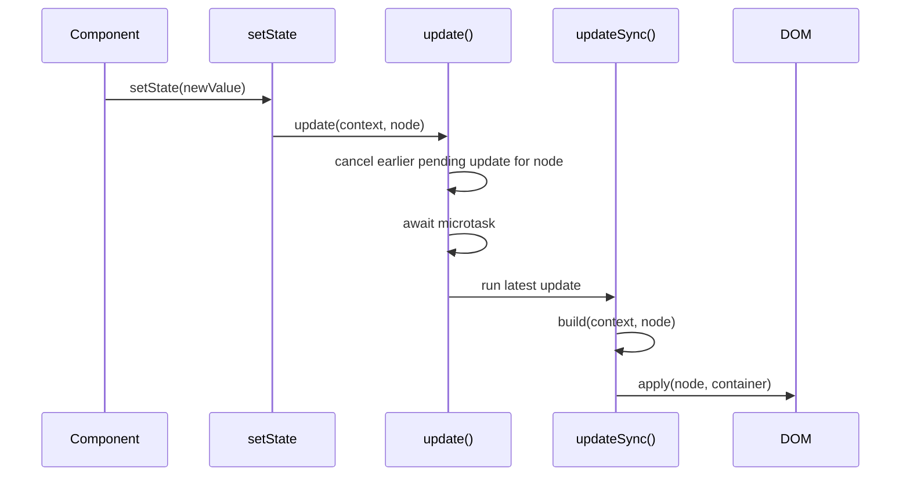

## Overview

`hono/jsx/dom` runs the same JSX components in the browser. Where the server renderer in [[JSX Server Rendering]] turns a tree into a string once, the DOM runtime keeps a virtual tree of node objects, renders it into real DOM elements, and re-renders the parts whose state changed. Hooks such as `useState` and `useEffect` store their data on those node objects. Components written against `hono/jsx` work on both sides because the server-side hooks return their initial values when there is no DOM build in progress.

Sources: [src/jsx/dom/index.ts:1-39](repo://src/jsx/dom/index.ts#L1-L39), [src/jsx/hooks/index.ts:182-192](repo://src/jsx/hooks/index.ts#L182-L192)

The runtime is published as several entry points: `hono/jsx/dom` (render and the React-style API), `hono/jsx/dom/jsx-runtime` for `jsxImportSource`, `hono/jsx/dom/client` (`createRoot`, `hydrateRoot`), `hono/jsx/dom/server` (`renderToString`, `renderToReadableStream`) and `hono/jsx/dom/css`.

Sources: [package.json:179-208](repo://package.json#L179-L208)

## Mounting

### render and createRoot

`render(jsxNode, container)` wraps the node in a fragment node and calls `renderNode`. `renderNode` builds the whole virtual tree with a fresh render context marked as a top-level render, applies it into a `DocumentFragment`, rewrites the stored containers from the fragment to the target, and calls `container.replaceChildren(fragment)`, so the first paint is one DOM operation.

Sources: [src/jsx/dom/render.ts:783-799](repo://src/jsx/dom/render.ts#L783-L799), [src/jsx/dom/render.ts:706-711](repo://src/jsx/dom/render.ts#L706-L711)

`createRoot(element)` from `hono/jsx/dom/client` returns a `Root` with `render` and `unmount`. The first `render` mounts a wrapper component that keeps the JSX in `useState`; later calls set that state, so re-rendering a root goes through the normal update path. `unmount` renders `null` and makes further `render` calls throw. `hydrateRoot` is `createRoot` followed by `render`: it re-renders the server HTML rather than attaching to it.

Sources: [src/jsx/dom/client.ts:23-84](repo://src/jsx/dom/client.ts#L23-L84)

### Virtual nodes

A virtual node is either a text node `{ t, d }` (text and a dirty flag) or a `NodeObject`: the JSX node's `tag`, `props` and `key`, plus short-named fields for the virtual children (`vC`), children to remove (`vR`), the next sibling (`nN`), the container (`c`), the real element (`e`), the previous props (`pP`), and a stash. For a function component the stash holds the current hook index, the arrays of hook data, the context values seen at build time, and the nearest error boundary.

Sources: [src/jsx/dom/render.ts:41-80](repo://src/jsx/dom/render.ts#L41-L80)

`buildNode` converts a child into a virtual node: `null`, `undefined` and booleans give nothing, strings and numbers give text nodes, function components get an empty stash, and `svg` and `math` elements wrap their children in a namespace context so descendants are created with `createElementNS`.

Sources: [src/jsx/dom/render.ts:667-704](repo://src/jsx/dom/render.ts#L667-L704)

## Build: reconciling children

`build(context, node)` computes a node's new virtual children. For a function component, `invokeTag` resets the hook index, pushes `[context, node]` on `buildDataStack` (which is how hooks find the component being rendered), merges `defaultProps`, and calls the component. Elements use their `props.children`.

Sources: [src/jsx/dom/render.ts:274-291](repo://src/jsx/dom/render.ts#L274-L291), [src/jsx/dom/render.ts:497-506](repo://src/jsx/dom/render.ts#L497-L506)

Each new child is matched against the old children: a text node with any text node, a keyed node with the same key and tag, and an unkeyed node with the first old node of the same tag. A matched node is reused: its props are swapped in (keeping the old ones in `pP`) and changed text is marked dirty. A reused component is skipped (`s = true`) when it is not forced and either it is the same memoized element, or its `memo` comparison says the props are equal, and the context values it saw did not change. Unmatched old children are collected in `vR` for removal, and `nN` links each child to the next so insertion points can be found later.

Sources: [src/jsx/dom/render.ts:513-609](repo://src/jsx/dom/render.ts#L513-L609)

## Apply: writing to the DOM

### Placing elements

`applyNodeObject` flattens components and fragments into the list of real children, removes the nodes in `vR` (running effect cleanups and ref cleanups), and then walks the list. New elements are created, text nodes updated when dirty, and each element is moved only if it is not already at the expected position; a swapped neighbour is moved to the end instead, which keeps swaps cheap.

Sources: [src/jsx/dom/render.ts:293-362](repo://src/jsx/dom/render.ts#L293-L362), [src/jsx/dom/render.ts:387-458](repo://src/jsx/dom/render.ts#L387-L458)

### Props and events

`applyProps` diffs the new props against the previous ones:

Sources: [src/jsx/dom/render.ts:115-133](repo://src/jsx/dom/render.ts#L115-L133), [src/jsx/dom/render.ts:164-272](repo://src/jsx/dom/render.ts#L164-L272)

- `onClick`, `onInput`, `onClickCapture` and similar become `addEventListener` calls, with the capture flag from the `Capture` suffix; `onChange` maps to `input` and `onDoubleClick` to `dblclick`. The old listener is removed first, and a non-function handler throws.
- `ref` accepts a callback (whose return value is the cleanup) or an object whose `current` is set.
- `style` accepts a string or an object; `dangerouslySetInnerHTML` sets `innerHTML`.
- `value` on inputs and textareas, `checked` and `selected` are also set as properties; a `select`'s value is applied after its options exist.
- Other values become attributes: `false`, `null` and `undefined` remove them, `true` sets an empty value.

Sources: [src/jsx/dom/render.ts:115-133](repo://src/jsx/dom/render.ts#L115-L133), [src/jsx/dom/render.ts:164-272](repo://src/jsx/dom/render.ts#L164-L272)

### Effects

After placing children, the effects collected from the components are run in order: `useInsertionEffect` callbacks during the walk, `useLayoutEffect` callbacks right after, and `useEffect` callbacks in a `requestAnimationFrame`.

Sources: [src/jsx/dom/render.ts:459-480](repo://src/jsx/dom/render.ts#L459-L480)

## Updates

Sources: [src/jsx/hooks/index.ts:182-243](repo://src/jsx/hooks/index.ts#L182-L243), [src/jsx/dom/render.ts:713-781](repo://src/jsx/dom/render.ts#L713-L781)

`update(context, node)` schedules a re-render of one component. A second update for the same node before the first ran cancels the first, so several `setState` calls in a row cause one render. The update waits one microtask, then runs `updateSync`, through an update hook when one is set (view transitions use this). `updateSync` restores the context values the component saw, rebuilds it, and applies it into its container, unless the render is a low-priority transition that hit an error.

Sources: [src/jsx/dom/render.ts:713-781](repo://src/jsx/dom/render.ts#L713-L781)

`flushSync(callback)` collects the updates scheduled inside the callback and runs them immediately instead of after the microtask. `createPortal(children, container)` returns a node that renders its children into another element.

Sources: [src/jsx/dom/render.ts:801-825](repo://src/jsx/dom/render.ts#L801-L825)

## Hooks

### State and memoisation

Every hook reads the node on top of `buildDataStack` and takes the next slot from its hook index, so hooks must be called in the same order on every render. Outside a DOM build (on the server) each hook returns a harmless default.

Sources: [src/jsx/hooks/index.ts:8-12](repo://src/jsx/hooks/index.ts#L8-L12), [src/jsx/hooks/index.ts:182-243](repo://src/jsx/hooks/index.ts#L182-L243)

| Hook | Behaviour |
| --- | --- |
| `useState` | Stores `[value, setter]`; the setter skips the update when `Object.is` says the value is unchanged |
| `useReducer` | `useState` with a setter that applies the reducer |
| `useEffect`, `useLayoutEffect`, `useInsertionEffect` | Store an effect when the dependencies changed, running the previous cleanup first |
| `useCallback`, `useMemo` | Keep the previous function or value until the dependencies change |
| `useRef`, `createRef`, `forwardRef`, `useImperativeHandle` | Ref objects and ref forwarding |
| `useId` | A `:r…:` identifier, stable for the component |
| `use` | Returns a resolved promise's value, or throws the promise for `Suspense` |
| `useSyncExternalStore` | Subscribes in an effect; requires `getServerSnapshot` on the server |
| `useFormStatus`, `useActionState`, `useOptimistic` | Form action state from `hono/jsx/dom/hooks` |

Sources: [src/jsx/hooks/index.ts:245-330](repo://src/jsx/hooks/index.ts#L245-L330), [src/jsx/hooks/index.ts:332-425](repo://src/jsx/hooks/index.ts#L332-L425), [src/jsx/dom/hooks/index.ts:41-91](repo://src/jsx/dom/hooks/index.ts#L41-L91)

### Transitions

`startTransition` and the function returned by `useTransition` push a pending marker while the callback runs, so state set inside it schedules a low-priority update; `useTransition`'s boolean is true while that update is rendering. An error thrown by an async transition callback is rethrown on the next render. `useDeferredValue` returns the old value first and schedules the new one. `startViewTransition` wraps the update in `document.startViewTransition` when the browser has it, and `useViewTransition` reports whether a view transition is running.

Sources: [src/jsx/hooks/index.ts:36-99](repo://src/jsx/hooks/index.ts#L36-L99), [src/jsx/hooks/index.ts:101-176](repo://src/jsx/hooks/index.ts#L101-L176)

## Forms and document metadata

On the client, `form` with a function `action` listens for `submit`, prevents the default, calls the action with the form's `FormData`, and provides the pending state through `FormContext`, which `useFormStatus` reads. `input` and `button` handle `formAction` the same way. `title`, `meta`, `link`, `script` and `style` are written into `document.head`, de-duplicated against the elements already there.

Sources: [src/jsx/dom/intrinsic-element/components.ts:319-386](repo://src/jsx/dom/intrinsic-element/components.ts#L319-L386), [src/jsx/dom/intrinsic-element/components.ts:58-90](repo://src/jsx/dom/intrinsic-element/components.ts#L58-L90)

`Suspense` and `ErrorBoundary` imported from `hono/jsx` switch to their DOM implementations here. When a component throws during `build`, the error is passed to the nearest boundary's handler; the fallback it returns is built in place of the boundary's children, and a retry function lets the boundary render the children again later.

Sources: [src/jsx/dom/render.ts:610-665](repo://src/jsx/dom/render.ts#L610-L665), [src/jsx/streaming.ts:138-138](repo://src/jsx/streaming.ts#L138-L138)
