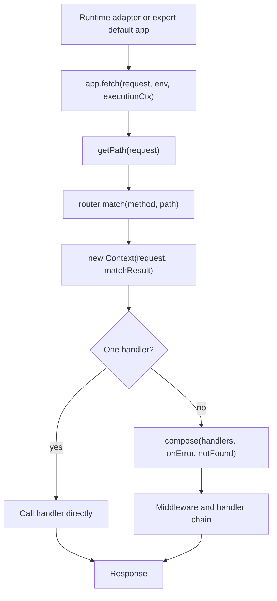

## Overview

Hono is a small web framework built on Web Standards. An application is a `Hono` object whose `fetch` method takes a standard `Request` and returns a standard `Response`, so the same application runs on Cloudflare Workers, Fastly Compute, Deno, Bun, Vercel, AWS Lambda, Lambda@Edge and Node.js. The package entry point exports the `Hono` class together with the `Context` class and the types handlers and middleware are written against.

Sources: [README.md:22-47](repo://README.md#L22-L47), [src/index.ts:1-53](repo://src/index.ts#L1-L53)

The repository holds the core (application, context, request, composition), five routers, a type layer that feeds a typed RPC client, a JSX runtime for the server and the browser, built-in middleware, helpers, and adapters for each runtime. Each one is published as its own subpath export of the `hono` package, such as `hono/tiny`, `hono/quick` or `hono/basic-auth`.

Sources: [package.json:1-60](repo://package.json#L1-L60)

## Parts of the framework

| Area | What it does | Page |
| --- | --- | --- |
| First steps | Write, test and export a first app | [[Quickstart]] |
| Application | Registers routes, groups sub-apps, mounts foreign apps | [[Application and Routing API]] |
| Lifecycle | Turns a `Request` into a `Response` through composed middleware and error handlers | [[Request Lifecycle and Middleware]] |
| Context | The object every handler receives: variables, headers, response helpers, renderer | [[Context]] |
| Request | Path parameters, query, headers, body parsing, validated data | [[HonoRequest]] |
| Routing | The `Router` interface, `SmartRouter`, `LinearRouter`, `PatternRouter`, presets | [[Router Interface and SmartRouter]] |
| Routing | One compiled regular expression per method | [[RegExpRouter]] |
| Routing | A tree of path segments that accepts every route | [[TrieRouter]] |
| Types | The `validator` middleware and `c.req.valid` | [[Validator]] |
| Types | `Env`, `Schema`, `TypedResponse`, the factory helper | [[Route Types and Factory]] |
| Types | `hc`, the typed client built from an app's type | [[RPC Client]] |
| JSX | Server rendering of JSX to HTML and the `jsxRenderer` middleware | [[JSX Server Rendering]] |
| JSX | Async components, `Suspense`, `ErrorBoundary`, streamed HTML | [[JSX Streaming and Suspense]] |
| JSX | The browser runtime and hooks | [[JSX DOM Runtime]] |
| JSX | `html` tagged templates and the `css` helper | [[html and css Helpers]] |
| Middleware | `basicAuth`, `bearerAuth` | [[Authentication Middleware]] |
| Middleware | Token signing and the `jwt` and `jwk` middleware | [[JWT and JWK]] |
| Middleware | `cors`, `csrf`, `secureHeaders`, `ipRestriction`, `bodyLimit` | [[Security Middleware]] |
| Middleware | `compress`, `etag`, `cache`, `logger`, `timing` and others | [[Response and Observability Middleware]] |
| Middleware | `combine`, `methodOverride`, trailing slashes, `timeout`, `contextStorage` | [[Request Control Middleware]] |
| Middleware | `Accept` header parsing and `languageDetector` | [[Content Negotiation]] |
| Middleware | `serveStatic` and its runtime back ends | [[Serving Static Files]] |
| Helpers | Plain and signed cookies | [[Cookies]] |
| Helpers | `stream`, `streamText`, `streamSSE` | [[Streaming and Server-Sent Events]] |
| Helpers | `upgradeWebSocket` per runtime | [[WebSockets]] |
| Helpers | `toSSG`, writing an app out as files | [[Static Site Generation]] |
| Helpers | `proxy`, forwarding a request to another server | [[Proxy Helper]] |
| Adapters | Workers, Pages, Deno, Bun, Netlify, Vercel, service workers, connection info | [[Runtime Adapters]] |
| Adapters | API Gateway, ALB, Lambda URLs and CloudFront events | [[AWS Lambda and Lambda@Edge]] |

Sources: [src/index.ts:1-53](repo://src/index.ts#L1-L53), [src/hono-base.ts:98-173](repo://src/hono-base.ts#L98-L173)

## Main request flow

Sources: [src/hono-base.ts:406-485](repo://src/hono-base.ts#L406-L485)

1. A runtime calls `app.fetch` with the request, the environment bindings and the execution context, either directly or through an adapter: see [[Runtime Adapters]] and [[AWS Lambda and Lambda@Edge]].
2. `getPath` cuts the path out of the URL, honouring the `strict` and `getPath` options described in [[Application and Routing API]].
3. The router returns every handler and middleware that matches the method and path, with their parameters: see [[Router Interface and SmartRouter]].
4. A `Context` is built around the request and the match result; [[Context]] and [[HonoRequest]] describe what it offers.
5. With one match the handler is called directly; otherwise `compose` runs the chain in onion order with `next()`, and errors and unmatched requests go to `onError` and `notFound`: see [[Request Lifecycle and Middleware]].

Sources: [src/hono-base.ts:406-466](repo://src/hono-base.ts#L406-L466), [src/compose.ts:14-73](repo://src/compose.ts#L14-L73)

## Design decisions

**Only Web Standard APIs.** The application's whole interface is `fetch(request, env, executionCtx)` returning a `Response`. Nothing in the core reads a runtime's own request type, which is why adapters such as the Vercel one are a single call to `app.fetch`. The README states the aim: zero dependencies and only the Web Standard API.

Sources: [src/hono-base.ts:468-485](repo://src/hono-base.ts#L468-L485), [src/adapter/vercel/handler.ts:1-8](repo://src/adapter/vercel/handler.ts#L1-L8), [README.md:43-45](repo://README.md#L43-L45)

**The router is pluggable, and the default picks one at the first request.** `HonoBase` has no router of its own: a comment calls it "like an abstract class". The default `Hono` sets a `SmartRouter` over `RegExpRouter` and `TrieRouter`, and the `router` option replaces it. [[Router Interface and SmartRouter]] explains how `SmartRouter` keeps the first router that accepts every registered route.

Sources: [src/hono-base.ts:114-118](repo://src/hono-base.ts#L114-L118), [src/hono.ts:16-34](repo://src/hono.ts#L16-L34)

**Presets trade speed for size.** `hono/tiny` uses `PatternRouter` alone, and `hono/quick` uses a `SmartRouter` over `LinearRouter` and `TrieRouter`, which register routes without building a large matcher first. The README says the tiny preset is under 12 kB.

Sources: [src/preset/tiny.ts:1-20](repo://src/preset/tiny.ts#L1-L20), [src/preset/quick.ts:1-24](repo://src/preset/quick.ts#L1-L24), [README.md:43-44](repo://README.md#L43-L44)

**Types travel through generics.** `Hono` carries an `Env` type, a `Schema` type and a base path type. Each route registration returns the app with a wider schema, and `route()` merges a sub-app's schema under its path. The [[RPC Client]] reads that schema to type its calls, as [[Route Types and Factory]] explains.

Sources: [src/hono.ts:16-20](repo://src/hono.ts#L16-L20), [src/hono-base.ts:208-232](repo://src/hono-base.ts#L208-L232)
