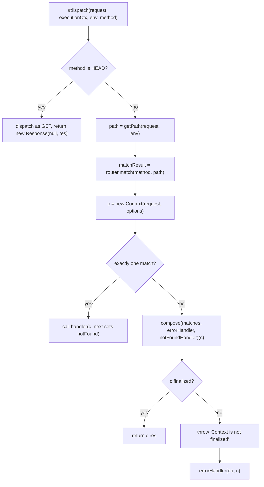

## Overview

Every request enters a Hono application through `fetch` and leaves it as one `Response`. In between, `#dispatch` asks the router for every handler that matches, wraps the request in a `Context`, and runs the matched handlers either directly or through `compose`, the onion-model runner adapted from `koa-compose`. This page traces that path and the error and not-found handling around it. How routes got into the router is covered in [[Application and Routing API]]; the methods handlers call on `c` are in [[Context]] and [[HonoRequest]].

Sources: [src/hono-base.ts:406-485](repo://src/hono-base.ts#L406-L485), [src/compose.ts:4-15](repo://src/compose.ts#L4-L15)

## Entry points

`fetch(request, env, executionCtx)` is the entry point a runtime calls. It forwards the request, the execution context, the bindings and `request.method` to `#dispatch`.

Sources: [src/hono-base.ts:468-485](repo://src/hono-base.ts#L468-L485)

`request(input, requestInit, env, executionCtx)` is the same call for tests. A `Request` is used as is, or rebuilt with `requestInit` when one is given. A string or `URL` that starts with `http://` or `https://` is used as the URL; anything else is treated as a path and prefixed with `http://localhost`.

Sources: [src/hono-base.ts:487-517](repo://src/hono-base.ts#L487-L517)

`fire()` registers a global `fetch` event listener and answers each event with `event.respondWith(dispatch(...))`, passing the event itself as the execution context. It is deprecated in favour of `fire` from `hono/service-worker`, covered in [[Runtime Adapters]].

Sources: [src/hono-base.ts:519-542](repo://src/hono-base.ts#L519-L542)

## Dispatch

### Matching and the context



Sources: [src/hono-base.ts:406-466](repo://src/hono-base.ts#L406-L466)

1. A `HEAD` request is dispatched again as `GET`, and the result is copied into a new `Response` with a `null` body, so `HEAD` routes never need to be registered.
2. `getPath` extracts the routing path, and `router.match(method, path)` returns the matched handlers, each paired with its `RouterRoute` record and parameters.
3. The `Context` receives the path, the match result, the bindings, the execution context and the app's not-found handler. It builds its `HonoRequest` lazily on first access to `c.req`.

Sources: [src/hono-base.ts:412-427](repo://src/hono-base.ts#L412-L427), [src/context.ts:352-369](repo://src/context.ts#L352-L369)

### Single-handler fast path

When the router returns exactly one handler, `#dispatch` skips `compose`. It calls the handler with a `next` that sets `c.res` to the not-found response. If the handler returns a promise, the resolved value is used; when it resolves to nothing, `c.res` is used if the context was finalized, and the not-found handler runs otherwise. A synchronous throw or a rejected promise goes to `#handleError`.

Sources: [src/hono-base.ts:429-448](repo://src/hono-base.ts#L429-L448)

### The composed chain

With several matches, `compose(matchResult[0], this.errorHandler, this.#notFoundHandler)` builds one function and `#dispatch` awaits it. When the chain ends without a finalized context, `#dispatch` throws `Context is not finalized. Did you forget to return a Response object or await next()?`, and that error goes to the error handler like any other.

Sources: [src/hono-base.ts:450-466](repo://src/hono-base.ts#L450-L466)

## compose and next

`compose` returns a function of `(context, next)`. Each call starts at index 0 and calls `dispatch(i)`, which picks the handler at position `i`, records `i` in `context.req.routeIndex`, and calls it with `context` and a `next` that is `() => dispatch(i + 1)`. Once the list runs out, the outer `next`, if one was passed, runs as the last handler.

Sources: [src/compose.ts:15-47](repo://src/compose.ts#L15-L47)

```ts
async function dispatch(i: number): Promise<Context> {
  if (i <= index) {
    throw new Error('next() called multiple times')
  }
  index = i

  let res
  let isError = false
  let handler

  if (middleware[i]) {
    handler = middleware[i][0][0]
    context.req.routeIndex = i
  } else {
    handler = (i === middleware.length && next) || undefined
  }
```

Sources: [src/compose.ts:32-47](repo://src/compose.ts#L32-L47)

Code a middleware runs before `await next()` happens on the way in; code after it happens once every later handler has returned, so the response is in `c.res` and can be changed. Calling `next` twice from the same middleware throws `next() called multiple times`, because the shared `index` already reached that position.

Sources: [src/compose.ts:32-36](repo://src/compose.ts#L32-L36), [src/compose.ts:49-51](repo://src/compose.ts#L49-L51)

A handler's return value becomes `context.res` only while the context is not finalized yet, or when it came from the error handler. Assigning `c.res` finalizes the context and merges the headers of the previous response into the new one, as [[Context]] describes. This is why middleware that returns a response early stops the chain: nothing after it is called, and its response is kept.

Sources: [src/compose.ts:67-70](repo://src/compose.ts#L67-L70), [src/context.ts:409-434](repo://src/context.ts#L409-L434)

When no handler is left and the context is still not finalized, `dispatch` calls the not-found handler and uses its response. That is how a request whose only matches are middleware (a `use('*')` logger, say) still answers 404.

Sources: [src/compose.ts:60-66](repo://src/compose.ts#L60-L66)

## Errors

### Where an error is caught

`dispatch` catches an exception from each handler it calls. If the error is an `Error` and an error handler was given, it stores the error in `context.error`, calls the error handler, and marks the result so it replaces `c.res` even when the context was finalized. Any other thrown value is rethrown. Because the catch happens at the level of the handler that threw, an outer middleware's `await next()` returns normally after an error, and the middleware can read `c.error`.

Sources: [src/compose.ts:49-59](repo://src/compose.ts#L49-L59), [src/context.ts:318-333](repo://src/context.ts#L318-L333)

`#handleError` in `HonoBase` handles what escapes `compose` or the fast path: an `Error` goes to the app's error handler, and anything else is thrown to the runtime.

Sources: [src/hono-base.ts:399-404](repo://src/hono-base.ts#L399-L404)

### Default handlers

The default error handler checks for a `getResponse` method on the error. An `HTTPException` has one, so its response is returned through `c.newResponse`, which keeps headers the context already prepared. Every other error is logged with `console.error` and answered with `Internal Server Error` and status 500. The default not-found handler answers `404 Not Found`.

Sources: [src/hono-base.ts:31-42](repo://src/hono-base.ts#L31-L42)

`app.onError(handler)` and `app.notFound(handler)` replace the two defaults. A sub-app mounted with `route` keeps its own `onError` for its routes, as [[Application and Routing API]] explains.

Sources: [src/hono-base.ts:255-294](repo://src/hono-base.ts#L255-L294), [src/hono-base.ts:219-229](repo://src/hono-base.ts#L219-L229)

### HTTPException

`HTTPException` is the error for failures that should become a specific HTTP response, such as a failed login. Its constructor takes a status (500 by default) and options: `message`, `cause`, and `res`, a ready-made response. `getResponse` returns a copy of `res` with the exception's status when one was given, and otherwise a response whose body is the message.

Sources: [src/http-exception.ts:14-78](repo://src/http-exception.ts#L14-L78)

```ts
import { HTTPException } from 'hono/http-exception'

app.post('/auth', async (c, next) => {
  if (!authorized) {
    throw new HTTPException(401, { message: 'Custom error message' })
  }
  await next()
})
```

Sources: [src/http-exception.ts:14-78](repo://src/http-exception.ts#L14-L78)

The built-in middleware throws `HTTPException` for its own refusals: `basicAuth`, `bearerAuth`, `bodyLimit`, `csrf`, `timeout` and the JWT middleware import it, as [[Authentication Middleware]] and [[Security Middleware]] show. A custom `onError` can test `err instanceof HTTPException` and call `err.getResponse()` to keep those responses.

Sources: [src/middleware/basic-auth/index.ts:1-12](repo://src/middleware/basic-auth/index.ts#L1-L12), [src/middleware/timeout/index.ts:1-10](repo://src/middleware/timeout/index.ts#L1-L10), [src/http-exception.ts:61-78](repo://src/http-exception.ts#L61-L78)
