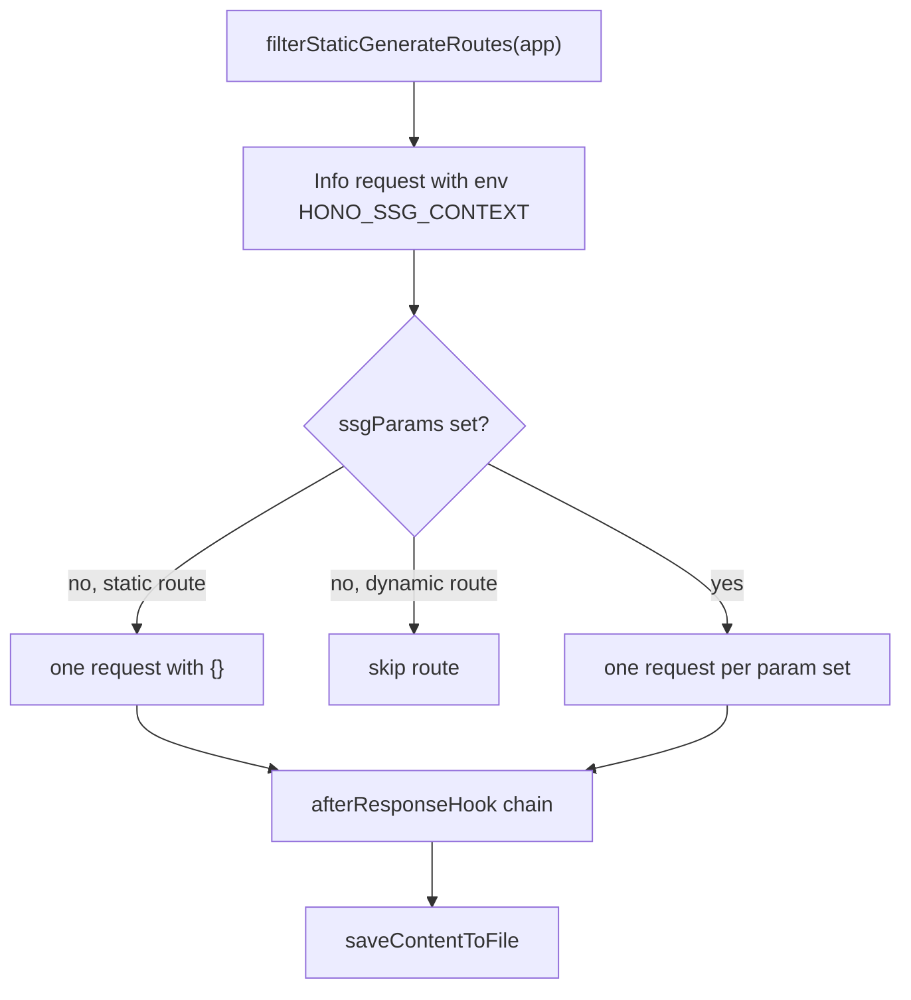

## Overview

`toSSG` turns a Hono app into files without a server. It walks `app.routes`, sends each `GET` route a request through the app itself, and writes every successful response to an output directory, choosing the file name from the route path and the response's content type. Dynamic routes become one file per parameter set declared with the `ssgParams` middleware. The generic implementation in `hono/ssg` writes through a small file-system interface; `hono/bun` and `hono/deno` provide ready-made `toSSG` functions bound to their runtime's file APIs.

Sources: [src/helper/ssg/ssg.ts:368-470](repo://src/helper/ssg/ssg.ts#L368-L470), [src/adapter/bun/ssg.ts:1-27](repo://src/adapter/bun/ssg.ts#L1-L27), [src/adapter/deno/ssg.ts:1-27](repo://src/adapter/deno/ssg.ts#L1-L27)

```ts
import { toSSG } from 'hono/bun'

const result = await toSSG(app, { dir: './static' })
console.log(result.success, result.files)
```

Sources: [src/adapter/bun/ssg.ts:20-27](repo://src/adapter/bun/ssg.ts#L20-L27), [src/helper/ssg/ssg.ts:39-48](repo://src/helper/ssg/ssg.ts#L39-L48)

## Generation flow

### Pipeline



Sources: [src/helper/ssg/ssg.ts:205-302](repo://src/helper/ssg/ssg.ts#L205-L302)

### Choosing routes

`filterStaticGenerateRoutes` keeps registered routes whose method is `GET` or `ALL` and whose handler is not middleware, judged by `isMiddleware` on the original handler (more than one declared parameter means it takes `next`). Middleware such as `ssgParams` therefore never produces a file of its own.

Sources: [src/helper/ssg/utils.ts:57-71](repo://src/helper/ssg/utils.ts#L57-L71), [src/utils/handler.ts:8-15](repo://src/utils/handler.ts#L8-L15)

### The info request

For each route, `fetchRoutesContent` builds a request to `http://localhost` plus the route path, passes it through the before-request hooks, and calls `app.fetch` with the env `{ HONO_SSG_CONTEXT: true }`. This first request only collects information. If an `ssgParams` middleware ran, it attached the parameter list to the raw request. Without parameters, a dynamic route (one with a `:param` or `*` segment) is skipped, and a static route gets a single empty parameter set.

Sources: [src/helper/ssg/ssg.ts:222-251](repo://src/helper/ssg/ssg.ts#L222-L251), [src/helper/ssg/utils.ts:73-75](repo://src/helper/ssg/utils.ts#L73-L75)

### The content requests

For each parameter set, the parameters are substituted into the path with the client's `replaceUrlParam`, and `app.request` is called with the same method and headers and the SSG env. A response carrying `x-hono-disable-ssg` is dropped. The after-response hooks may replace or drop the response. The MIME type is the `Content-Type` without parameters, or `text/plain` when it is missing; a source comment explains that Bun omits the header for text responses by default. Bodies whose type contains `text` or `json` are read as text, others as bytes.

Sources: [src/helper/ssg/ssg.ts:253-296](repo://src/helper/ssg/ssg.ts#L253-L296), [src/helper/ssg/ssg.ts:19-25](repo://src/helper/ssg/ssg.ts#L19-L25), [src/helper/ssg/ssg.ts:74-88](repo://src/helper/ssg/ssg.ts#L74-L88)

All requests go through a pool from `utils/concurrent` that runs at most `concurrency` of them at once, 2 by default; a call that finds the pool full is retried on a later timer tick.

Sources: [src/helper/ssg/ssg.ts:17-17](repo://src/helper/ssg/ssg.ts#L17-L17), [src/helper/ssg/ssg.ts:222-223](repo://src/helper/ssg/ssg.ts#L222-L223), [src/utils/concurrent.ts:1-55](repo://src/utils/concurrent.ts#L1-L55)

## SSG middleware

| Middleware | Effect |
| --- | --- |
| `ssgParams(params)` | On a dynamic path, stores the parameter list (an array, or a function of the context, possibly async) on the request and answers with `c.notFound()`, so the handler does not run during the info request |
| `disableSSG()` | During generation, marks the response with `x-hono-disable-ssg` and returns not found, so the route is left out |
| `onlySSG()` | Outside generation, returns not found, so the route exists only in the static output |
| `isSSGContext(c)` | True when `c.env` carries `HONO_SSG_CONTEXT` |

Sources: [src/helper/ssg/middleware.ts:1-83](repo://src/helper/ssg/middleware.ts#L1-L83)

```ts
import { ssgParams } from 'hono/ssg'

app.get(
  '/posts/:id',
  ssgParams(async () => (await getPosts()).map((p) => ({ id: p.id }))),
  (c) => c.html(renderPost(c.req.param('id')))
)
```

Sources: [src/helper/ssg/middleware.ts:40-49](repo://src/helper/ssg/middleware.ts#L40-L49)

## File names

`generateFilePath` derives the extension from the MIME type: first the `extensionMap` option or the default map (`text/html` → `html`, XML and feed types → `xml`, `application/yaml` → `yaml`), then the general MIME table, then `html`. A route already ending in that extension keeps its path, `/` becomes `index.ext`, a path ending in `/` gets `index.ext` inside it, and any other path gets `.ext` appended. So `/about` with HTML becomes `about.html`, and `/feed.xml` stays `feed.xml`.

Sources: [src/helper/ssg/ssg.ts:50-72](repo://src/helper/ssg/ssg.ts#L50-L72), [src/helper/ssg/ssg.ts:90-108](repo://src/helper/ssg/ssg.ts#L90-L108)

Paths are joined with `joinPaths`, which normalises separators and resolves `.` and `..`. `ensureWithinOutDir` then throws `Path traversal detected` when the result lies outside the output directory, which protects against parameter values containing `..`.

Sources: [src/helper/ssg/utils.ts:6-55](repo://src/helper/ssg/utils.ts#L6-L55), [src/helper/ssg/utils.ts:77-87](repo://src/helper/ssg/utils.ts#L77-L87)

`saveContentToFile` creates each directory once with `mkdir({ recursive: true })` and writes strings as is and binary content as a `Uint8Array`.

Sources: [src/helper/ssg/ssg.ts:309-334](repo://src/helper/ssg/ssg.ts#L309-L334)

## Hooks and plugins

`toSSG` accepts three kinds of hooks, each as one function or an array, from its options and from `plugins`:

Sources: [src/helper/ssg/ssg.ts:110-198](repo://src/helper/ssg/ssg.ts#L110-L198)

- `beforeRequestHook(req)` may return a changed request, or `false` to skip the route.
- `afterResponseHook(res)` may return a changed response, or `false` to skip writing it.
- `afterGenerateHook(result, fsModule, options)` runs once at the end, also after a failure.

Sources: [src/helper/ssg/ssg.ts:110-198](repo://src/helper/ssg/ssg.ts#L110-L198)

Hooks of one kind run in sequence, options first, then plugins in order; a `false` stops the chain.

Sources: [src/helper/ssg/ssg.ts:110-198](repo://src/helper/ssg/ssg.ts#L110-L198), [src/helper/ssg/ssg.ts:368-419](repo://src/helper/ssg/ssg.ts#L368-L419)

When no `plugins` option is given, `defaultPlugin()` is used, which drops every response whose status is not 200. Passing `plugins` replaces it, so a custom list usually includes `defaultPlugin()`. `redirectPlugin()` turns 301, 302, 303, 307 and 308 responses into a 200 HTML page with a meta refresh, a canonical link and `noindex`, so redirects survive as static files.

Sources: [src/helper/ssg/plugins.ts:1-72](repo://src/helper/ssg/plugins.ts#L1-L72), [src/helper/ssg/ssg.ts:372-372](repo://src/helper/ssg/ssg.ts#L372-L372)

## Result and file systems

`toSSG` resolves to `{ success, files }`, or `{ success: false, files: [], error }` when any request, hook or write failed; it does not throw. The file system is any object with `writeFile(path, data)` and `mkdir(path, { recursive })`. `bunFileSystemModule` writes with `Bun.write` and has a no-op `mkdir`, and `denoFileSystemModule` uses `Deno.writeFile` and `Deno.mkdir`.

Sources: [src/helper/ssg/ssg.ts:29-48](repo://src/helper/ssg/ssg.ts#L29-L48), [src/helper/ssg/ssg.ts:450-470](repo://src/helper/ssg/ssg.ts#L450-L470), [src/adapter/bun/ssg.ts:5-18](repo://src/adapter/bun/ssg.ts#L5-L18), [src/adapter/deno/ssg.ts:1-18](repo://src/adapter/deno/ssg.ts#L1-L18)
