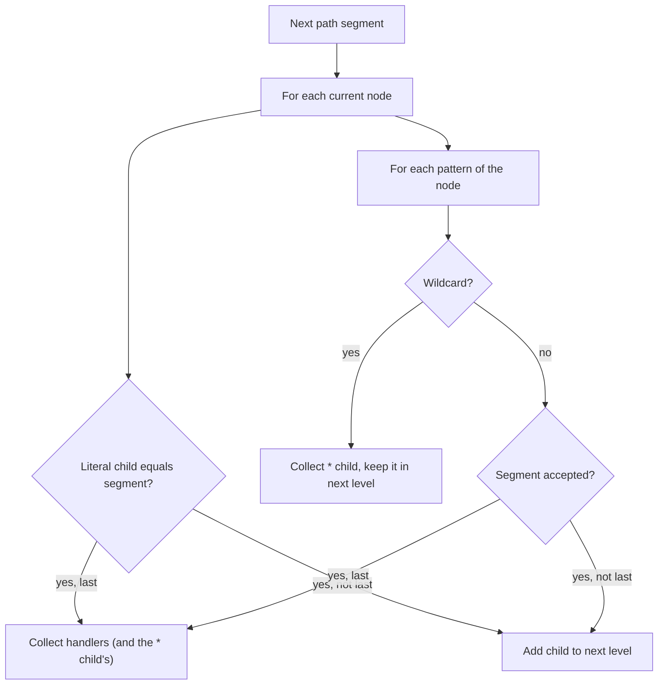

## Overview

`TrieRouter` stores routes in a tree with one level per path segment and walks that tree for each request. It has no compilation step and no restriction on how routes may overlap, so it accepts every route set: that is why the default `Hono` lists it after [[RegExpRouter]] inside a `SmartRouter`, as the fallback for routes the regular expression cannot represent. The `hono/quick` preset pairs it with `LinearRouter` for the same reason, and the `combine` middleware uses it on its own. [[Router Interface and SmartRouter]] covers the router contract and the path syntax.

Sources: [src/router/trie-router/router.ts:1-28](repo://src/router/trie-router/router.ts#L1-L28), [src/hono.ts:26-33](repo://src/hono.ts#L26-L33), [src/preset/quick.ts:16-23](repo://src/preset/quick.ts#L16-L23), [src/middleware/combine/index.ts:1-10](repo://src/middleware/combine/index.ts#L1-L10)

`TrieRouter` itself is a thin wrapper: `add` expands optional parameters with `checkOptionalParameter` and inserts each resulting path into a root `Node`, and `match` calls `search` on it. The tree logic lives in `Node`.

Sources: [src/router/trie-router/router.ts:5-28](repo://src/router/trie-router/router.ts#L5-L28)

## Node structure

Each `Node` holds:

Sources: [src/router/trie-router/node.ts:6-42](repo://src/router/trie-router/node.ts#L6-L42)

- `#children`, a map from a segment key to the child node: a literal segment, `*`, or the pattern key of a parameter.
- `#patterns`, the parameter and wildcard patterns among its children, in insertion order.
- `#methods`, a list of records from method to a handler set `{ handler, possibleKeys, score }`, one record per route ending at this node.
- `#params`, the parameters captured on the way to the node during the current search.

Sources: [src/router/trie-router/node.ts:6-42](repo://src/router/trie-router/node.ts#L6-L42)

## Insertion

`insert(method, path, handler)` increments the root's `#order` counter, splits the path with `splitRoutingPath` (which keeps `{...}` expressions intact even when they contain `/`), and walks the segments. For each segment, `getPattern` decides what it is: `*` stays `*`; `:name` becomes `[label, name, true]`; `:name{re}` becomes `[key, name, RegExp]`, where the expression gets a lookahead on the next segment when that segment is a literal. The child key is the pattern's first element for a parameter, or the segment itself otherwise.

Sources: [src/router/trie-router/node.ts:44-74](repo://src/router/trie-router/node.ts#L44-L74), [src/utils/url.ts:16-77](repo://src/utils/url.ts#L16-L77)

An existing child is reused; otherwise a new node is created and, for a parameter or wildcard, the pattern is appended to the parent's `#patterns`. Each parameter name met on the way is collected in `possibleKeys`. At the last segment, the node gets a new methods record holding the handler, the de-duplicated `possibleKeys`, and `score`, the order counter at insertion time.

Sources: [src/router/trie-router/node.ts:59-85](repo://src/router/trie-router/node.ts#L59-L85)

```ts
curNode.#methods.push({
  [method]: {
    handler,
    possibleKeys: possibleKeys.filter((v, i, a) => a.indexOf(v) === i),
    score: this.#order,
  },
})
```

Sources: [src/router/trie-router/node.ts:59-85](repo://src/router/trie-router/node.ts#L59-L85)

Nothing in insertion can fail: any combination of literals, parameters and wildcards at one level simply produces more children. Where RegExpRouter must reject a literal and a parameter at the same position, TrieRouter keeps both and explores both at search time.

Sources: [src/router/trie-router/node.ts:59-74](repo://src/router/trie-router/node.ts#L59-L74), [src/router/reg-exp-router/node.ts:94-124](repo://src/router/reg-exp-router/node.ts#L94-L124)

## Search

### Walking the levels

`search(method, path)` splits the request path on `/` and keeps a list of current nodes, starting with the root. For each segment it builds the next list from every current node:

Sources: [src/router/trie-router/node.ts:114-230](repo://src/router/trie-router/node.ts#L114-L230)

1. A literal child equal to the segment is followed. On the last segment its handlers are collected, together with those of its `*` child, so `/hello/*` also matches `/hello`.
2. A `*` pattern collects the wildcard child's handlers and keeps that child in the list, so the wildcard can swallow further segments.
3. A plain parameter matches any non-empty segment; a constrained one matches when its expression accepts the segment. The captured value is stored under the name in a copy of the parameters so far, then the child is collected on the last segment or kept for the next one.

Sources: [src/router/trie-router/node.ts:114-230](repo://src/router/trie-router/node.ts#L114-L230)



Sources: [src/router/trie-router/node.ts:127-235](repo://src/router/trie-router/node.ts#L127-L235)

### Constrained parameters across slashes

A constrained parameter is tested against the rest of the path from the current segment, not only the segment, so `/js/:filename{[a-z]+.js}` can match `/js/chunk/123.js`. The router computes each segment's offset in the path once, the first time it needs one. When the expression matches, the handlers are collected immediately, and those of a following `*` child too when the match consumed the whole remainder. If the child has children of its own, it is queued in `curNodesQueue` and rejoins the current node list at a later segment.

Sources: [src/router/trie-router/node.ts:165-210](repo://src/router/trie-router/node.ts#L165-L210)

### Parameters for each handler

`#pushHandlerSets` adds every handler set of a node that is registered for the request method or for `ALL`. When parameters were captured, it fills `handlerSet.params` with each of the set's `possibleKeys`, choosing between the values captured at the node and those carried from the parents. Each matched handler therefore gets only the parameters its own route declared.

Sources: [src/router/trie-router/node.ts:87-112](repo://src/router/trie-router/node.ts#L87-L112)

## Result order

Handlers are collected in the order the tree is walked, which is not the order they were registered: a wildcard middleware is found at a shallower level than the route it wraps. When more than one handler was found, `search` sorts the sets by `score`, restoring registration order, which is the order `compose` must run them in as [[Request Lifecycle and Middleware]] describes.

Sources: [src/router/trie-router/node.ts:237-244](repo://src/router/trie-router/node.ts#L237-L244)

The result uses the second `Result` shape, `[[handler, params][]]`, with a parameter object per handler and no param stash.

Sources: [src/router/trie-router/node.ts:243-244](repo://src/router/trie-router/node.ts#L243-L244), [src/router.ts:53-58](repo://src/router.ts#L53-L58)
