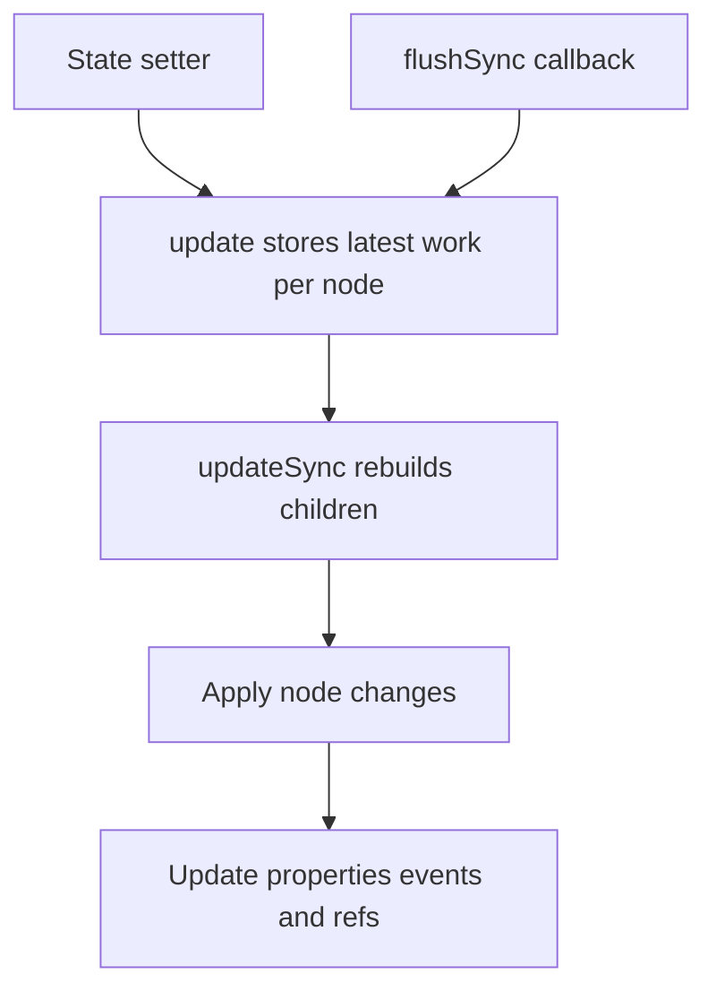

## Overview

The DOM renderer builds and updates browser nodes from Hono JSX. The `hono/jsx/dom` entry exports rendering, hooks, component context, Suspense, ErrorBoundary, portals, and synchronous flushing. Root objects are available through `hono/jsx/dom/client`. [[HTML and JSX Rendering]] describes producing HTML on the server; this page follows the browser lifecycle, where state changes schedule a component build and apply changes to actual elements.

Sources: [src/jsx/dom/index.ts:33-39](repo://src/jsx/dom/index.ts#L33-L39), [src/jsx/dom/index.ts:85-125](repo://src/jsx/dom/index.ts#L85-L125), [src/jsx/dom/client.ts:23-65](repo://src/jsx/dom/client.ts#L23-L65), [src/jsx/dom/render.ts:713-780](repo://src/jsx/dom/render.ts#L713-L780)

## Choose a rendering entry

`render(jsxNode, container)` wraps the child in a root node and calls `renderNode`. The latter builds the tree, applies it to a document fragment, transfers its container references, and replaces the container's children. This entry renders the supplied tree in one operation. `createRoot` instead returns an object with `render` and `unmount`, retaining an internal state setter to update the root's content across calls.

Sources: [src/jsx/dom/render.ts:783-799](repo://src/jsx/dom/render.ts#L783-L799), [src/jsx/dom/client.ts:23-65](repo://src/jsx/dom/client.ts#L23-L65)

The first root render constructs a wrapper component whose state is the supplied JSX. Later renders use that component's setter. Unmount passes null to the setter and marks the root unusable; rendering after unmount throws `Cannot update an unmounted root`. Nonempty root options currently emit a warning because options are unsupported. These are explicit lifecycle constraints on the root object rather than DOM reconciliation settings.

Sources: [src/jsx/dom/client.ts:23-65](repo://src/jsx/dom/client.ts#L23-L65)

`hydrateRoot` creates a root, renders the supplied child, and returns it. The source documents hydration here as equivalent to rendering. It does not introduce a separate hydration algorithm that preserves an existing server tree by matching it. When deciding whether to use this entry, account for the render path's `replaceChildren` operation rather than assuming the behavior of another package with a similarly named API.

Sources: [src/jsx/dom/client.ts:68-84](repo://src/jsx/dom/client.ts#L68-L84), [src/jsx/dom/render.ts:783-794](repo://src/jsx/dom/render.ts#L783-L794)

## Follow a state update

Sources: [src/jsx/hooks/index.ts:182-241](repo://src/jsx/hooks/index.ts#L182-L241), [src/jsx/dom/render.ts:713-780](repo://src/jsx/dom/render.ts#L713-L780), [src/jsx/dom/render.ts:164-206](repo://src/jsx/dom/render.ts#L164-L206), [src/jsx/dom/render.ts:801-813](repo://src/jsx/dom/render.ts#L801-L813)

`useState` stores hook data on the current component node. Its setter accepts a value or updater, compares with `Object.is`, and schedules an update when the value changes. Outside a DOM build it returns the initial state and a no-op setter. Hook storage is indexed as the component runs, so component execution supplies the sequence used to retrieve prior state. `useReducer` builds on that state operation.

Sources: [src/jsx/hooks/index.ts:182-260](repo://src/jsx/hooks/index.ts#L182-L260)

Updates are stored by node in a WeakMap. A newer update resolves an existing pending call with undefined and replaces its work; the comment explicitly says only the last call should execute. Outside a synchronous flush, processing yields through a resolved promise before taking the latest entry. `flushSync` collects touched nodes while its callback runs and executes their latest pending operations before returning. A configured transition hook can wrap the actual synchronous rebuild.

Sources: [src/jsx/dom/render.ts:734-780](repo://src/jsx/dom/render.ts#L734-L780), [src/jsx/dom/render.ts:801-813](repo://src/jsx/dom/render.ts#L801-L813)

## Reconcile children and properties

The build stage invokes components, normalizes children, and compares them with prior virtual children. Keyed children are looked up by key and tag, while unkeyed children are matched by tag. Existing node data can be carried into the next child before rebuilding it. Keys therefore participate in identity during updates rather than becoming ordinary element attributes. DOM application then updates the selected element's properties and descendants.

Sources: [src/jsx/dom/render.ts:497-575](repo://src/jsx/dom/render.ts#L497-L575), [src/jsx/dom/index.ts:41-57](repo://src/jsx/dom/index.ts#L41-L57)

Event props map to event names and capture flags. Changed handlers remove the old listener and add the new one; non-function event values throw. Refs can be callbacks with cleanup or objects whose `current` property is assigned and later cleared. Styles accept either CSS text or an object applied through style properties. Form values have special branches for select, input, and textarea. Invalid attribute names are handled through DOM exceptions, which the comment identifies as a performance choice compared with upfront server validation.

Sources: [src/jsx/dom/render.ts:119-162](repo://src/jsx/dom/render.ts#L119-L162), [src/jsx/dom/render.ts:164-268](repo://src/jsx/dom/render.ts#L164-L268)

## Use hooks and component context

Effect hooks share dependency-indexed storage and run previous cleanup when dependencies change. Callback and memo hooks reuse stored values while dependencies remain equal; refs retain a mutable object per hook position. `use` caches settled promise results and throws a pending promise, or a cached rejection, to the rendering boundary. `useSyncExternalStore` has a separate server branch that requires `getServerSnapshot`. These concrete branches explain why browser lifecycle hooks and server stringification do not behave identically.

Sources: [src/jsx/hooks/index.ts:262-315](repo://src/jsx/hooks/index.ts#L262-L315), [src/jsx/hooks/index.ts:318-362](repo://src/jsx/hooks/index.ts#L318-L362), [src/jsx/hooks/index.ts:397-415](repo://src/jsx/hooks/index.ts#L397-L415)

DOM context providers insert internal operations around their children to push and pop the provided value, with an error handler to balance the stack on failure. `createContext` initializes the default value, makes the context its own Provider, and registers it among global contexts. The update path restores captured context values around rebuilding a node. Server request isolation is covered by [[HTML and JSX Rendering]]; the DOM path uses the component tree's current provider stack.

Sources: [src/jsx/dom/context.ts:7-52](repo://src/jsx/dom/context.ts#L7-L52), [src/jsx/dom/render.ts:713-731](repo://src/jsx/dom/render.ts#L713-L731)

## Handle pending actions and rendering failures

The DOM hooks module supplies `useFormStatus`, `useOptimistic`, and `useActionState`. Form status comes from a context containing pending state and submitted data. Action registration tracks promises in a shared set. Optimistic state is associated with that work and action state coordinates asynchronous updates. These hooks are exported from the DOM entry alongside Suspense and ErrorBoundary, whose component handlers intercept suspended promises or errors and provide fallback/retry behavior.

Sources: [src/jsx/dom/hooks/index.ts:20-91](repo://src/jsx/dom/hooks/index.ts#L20-L91), [src/jsx/dom/index.ts:108-114](repo://src/jsx/dom/index.ts#L108-L114), [src/jsx/dom/components.ts:1-39](repo://src/jsx/dom/components.ts#L1-L39)

## Bridge to server output and CSS

The DOM server module offers `renderToString` and `renderToReadableStream`. String rendering throws if the element stringifies asynchronously and warns on supplied options. Stream rendering delegates to Hono's server stream renderer and supports only `onError` from its options, warning about the rest. Its type lists more compatibility options than the implementation currently supports. [[HTML and JSX Rendering]] owns the underlying escaped-content and Suspense stream behavior.

Sources: [src/jsx/dom/server.ts:21-65](repo://src/jsx/dom/server.ts#L21-L65)

DOM CSS shares class-generation primitives with the server CSS helper. It locates a stylesheet by the configured style element ID and tracks added styles, then inserts rules as classes are used. If a stylesheet is not available immediately it retries through a promise and throws when still missing. This browser rule-insertion path complements the server's generated style element rather than serializing another full HTTP response.

Sources: [src/jsx/dom/css.ts:13-25](repo://src/jsx/dom/css.ts#L13-L25), [src/jsx/dom/css.ts:77-114](repo://src/jsx/dom/css.ts#L77-L114)
