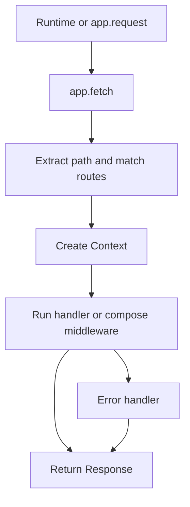

## Overview

Hono is a web framework built around the standard `Request` and `Response` interfaces. An application registers handlers, receives a request through `fetch`, matches its method and path, and returns a response. The package entry exports the application, context, and handler types; optional features have separate entry points. [[Quickstart]] follows the smallest application from registration to an in-process request, while the pages below explain the boundaries that become useful as the application grows.

Sources: [src/index.ts:1-53](repo://src/index.ts#L1-L53), [src/hono-base.ts:385-427](repo://src/hono-base.ts#L385-L427), [src/hono-base.ts:479-517](repo://src/hono-base.ts#L479-L517)

## Parts of the framework

| Area | What it does | Page |
| --- | --- | --- |
| First application | Registers a handler and exports the app | [[Quickstart]] |
| Routing | Registers, groups, mounts, and matches handlers | [[Routing and Application Composition]] |
| Request state | Reads inputs and builds responses on one context | [[Request and Context]] |
| Handler execution | Chains middleware and recovers handler errors | [[Middleware and Errors]] |
| Admission policies | Checks credentials, origins, and body limits | [[Security Middleware]] |
| HTTP processing | Logs requests and transforms or caches responses | [[HTTP Middleware]] |
| Validation | Parses targets and stores callback output | [[Request Validation]] |
| Client calls | Builds requests from route-shaped proxies | [[Typed Client]] |
| Server rendering | Escapes templates and installs JSX layouts | [[HTML and JSX Rendering]] |
| Browser rendering | Exposes DOM rendering and hydration | [[JSX DOM]] |
| Streaming | Writes incremental bodies and SSE messages | [[Streaming Responses]] |
| Sockets | Wraps runtime upgrades and socket operations | [[WebSockets]] |
| Runtime integration | Converts platform events and passes bindings | [[Runtime Adapters]] |
| File output | Serves assets and exports static generation helpers | [[Static Files and Generation]] |
| Verification | Connects a typed client to in-process requests | [[Testing and Development]] |

Sources: [src/index.ts:6-48](repo://src/index.ts#L6-L48), [src/hono-base.ts:126-172](repo://src/hono-base.ts#L126-L172), [src/compose.ts:32-70](repo://src/compose.ts#L32-L70), [src/middleware/body-limit/index.ts:45-111](repo://src/middleware/body-limit/index.ts#L45-L111), [src/middleware/logger/index.ts:81-95](repo://src/middleware/logger/index.ts#L81-L95), [src/validator/validator.ts:144-170](repo://src/validator/validator.ts#L144-L170), [src/client/client.ts:161-185](repo://src/client/client.ts#L161-L185), [src/middleware/jsx-renderer/index.ts:33-80](repo://src/middleware/jsx-renderer/index.ts#L33-L80), [src/jsx/dom/client.ts:23-84](repo://src/jsx/dom/client.ts#L23-L84), [src/helper/streaming/sse.ts:18-44](repo://src/helper/streaming/sse.ts#L18-L44), [src/helper/websocket/index.ts:43-89](repo://src/helper/websocket/index.ts#L43-L89), [src/adapter/cloudflare-pages/handler.ts:32-46](repo://src/adapter/cloudflare-pages/handler.ts#L32-L46), [src/helper/ssg/index.ts:1-14](repo://src/helper/ssg/index.ts#L1-L14), [src/helper/testing/index.ts:15-27](repo://src/helper/testing/index.ts#L15-L27)

## The request flow

Sources: [src/hono-base.ts:399-465](repo://src/hono-base.ts#L399-L465), [src/hono-base.ts:479-517](repo://src/hono-base.ts#L479-L517)

1. The runtime provides a request and optional environment and execution context. [[Runtime Adapters]] explains how platform-specific events are converted before `app.fetch` sees them.
2. Dispatch extracts a path and asks the configured router for matching handlers. [[Routing and Application Composition]] explains registration and the router's first-match initialization.
3. Dispatch constructs one context containing the request, match metadata, environment, execution context, and not-found handler. [[Request and Context]] explains how those values become available to handlers.
4. A single match runs directly; a list of matches uses composition. [[Middleware and Errors]] explains the continuation, finalization, and error paths.
5. Dispatch returns the resulting response. Streaming bodies follow the same response boundary; [[Streaming Responses]] explains how their producers continue writing after that response is created.

Sources: [src/adapter/cloudflare-pages/handler.ts:32-46](repo://src/adapter/cloudflare-pages/handler.ts#L32-L46), [src/hono-base.ts:406-465](repo://src/hono-base.ts#L406-L465), [src/helper/streaming/stream.ts:7-45](repo://src/helper/streaming/stream.ts#L7-L45)

## Decisions shared across systems

The central runtime interface accepts a standard request and returns a standard response, which lets both adapters and tests use the same dispatch path. `app.request` converts a relative path to a localhost URL and delegates to `fetch`; the testing helper supplies that operation as the typed client's fetch implementation. [[Testing and Development]] uses this seam to exercise routes without opening a listener. Platform bindings still enter explicitly through the environment argument rather than being built into route matching.

Sources: [src/hono-base.ts:479-517](repo://src/hono-base.ts#L479-L517), [src/helper/testing/index.ts:15-27](repo://src/helper/testing/index.ts#L15-L27), [src/adapter/cloudflare-pages/handler.ts:32-46](repo://src/adapter/cloudflare-pages/handler.ts#L32-L46)

Routing has a construction phase and a request phase. The default `Hono` uses `SmartRouter` with `RegExpRouter` followed by `TrieRouter`. SmartRouter first tries to register the entire route set with one candidate and match the incoming request. It falls back only on `UnsupportedPathError`, then replaces its own match method with the selected router's bound method. This avoids repeating router selection on later requests; [[Routing and Application Composition]] explains the resulting restriction on late registration.

Sources: [src/hono.ts:26-32](repo://src/hono.ts#L26-L32), [src/router/smart-router/router.ts:13-60](repo://src/router/smart-router/router.ts#L13-L60)

The dispatcher deliberately avoids `compose` when only one handler matches, as its inline comment states. For a chain, composition awaits each handler and updates the context response when a handler produces one. That shared response is what middleware can observe while unwinding. [[Middleware and Errors]] follows the guarantee that `next` advances once, and [[HTTP Middleware]] shows consumers that measure elapsed time or modify the downstream response.

Sources: [src/hono-base.ts:429-465](repo://src/hono-base.ts#L429-L465), [src/compose.ts:32-70](repo://src/compose.ts#L32-L70)

Request wrappers and mutable request state are allocated when used. `Context.req` creates `HonoRequest` lazily, and the variable map is created on the first `set`. Response construction also has a direct text-response path when no prepared headers, explicit status, arguments, or finalized response require the general builder. These branches keep simple handlers small while [[Request and Context]] exposes richer behavior through the same context interface.

Sources: [src/context.ts:352-368](repo://src/context.ts#L352-L368), [src/context.ts:546-556](repo://src/context.ts#L546-L556), [src/context.ts:682-694](repo://src/context.ts#L682-L694)

Validation separates transport parsing from application decisions. The middleware extracts one target, awaits the supplied callback, and either returns its response or stores its output before continuing. [[Request Validation]] owns that server boundary; [[Typed Client]] describes how the route schema carries input and response types into callers. Type parameters describe the interface, while the callback is the code that accepts, rejects, or transforms the actual value.

Sources: [src/validator/validator.ts:64-88](repo://src/validator/validator.ts#L64-L88), [src/validator/validator.ts:89-103](repo://src/validator/validator.ts#L89-L103), [src/validator/validator.ts:144-170](repo://src/validator/validator.ts#L144-L170), [src/client/client.ts:132-136](repo://src/client/client.ts#L132-L136)
