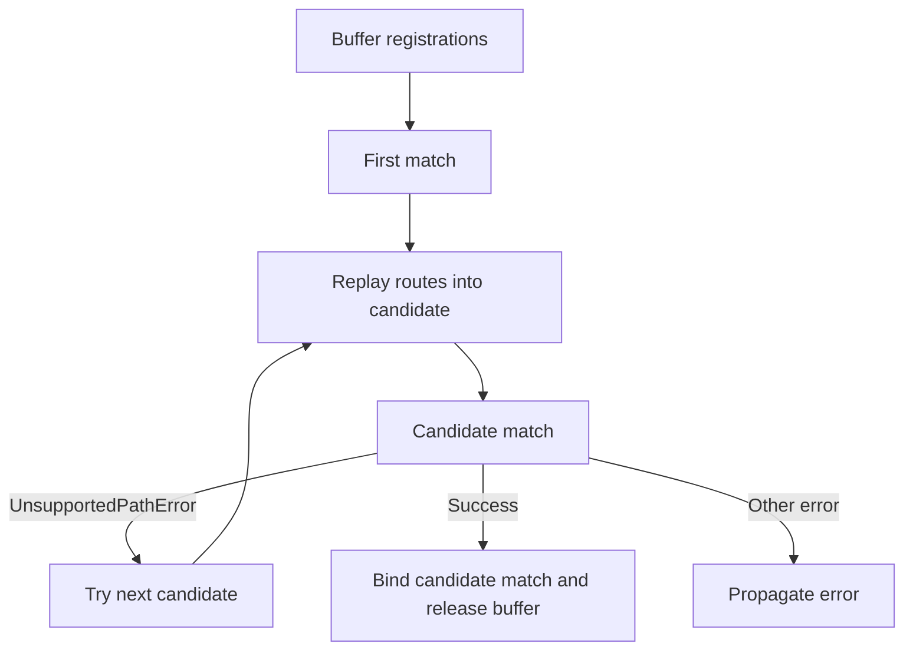

## Overview

Routing turns application construction into the handler list used for each request. The `Hono` class installs a router on `HonoBase`; base registration stores both the executable handler and route metadata. Dispatch extracts the incoming path, matches it with the method, and passes the result into a context. [[Quickstart]] introduces the first registration; this page explains how larger route sets, sub-applications, and router choices change that flow.

Sources: [src/hono.ts:16-33](repo://src/hono.ts#L16-L33), [src/hono-base.ts:385-427](repo://src/hono-base.ts#L385-L427)

## Register handlers in order

`get`, `post`, `put`, `delete`, `options`, and `patch` are installed from the method list, with `all` added alongside them. A string first argument updates the current registration path; each following handler is registered at that path. A handler-only call uses the current path. Each registration normalizes the method to uppercase, merges the application's base path, calls `router.add`, and appends the same route metadata to `app.routes`.

Sources: [src/router.ts:9-17](repo://src/router.ts#L9-L17), [src/hono-base.ts:126-140](repo://src/hono-base.ts#L126-L140), [src/hono-base.ts:385-397](repo://src/hono-base.ts#L385-L397)

`on` accepts a method or method array and a path or path array, registering the handlers for each combination. `use` registers the `ALL` method; without an explicit path it selects `*`. Middleware therefore participates in routing rather than living in a separate global execution list. A matching route can have several handlers, and continuation determines which later handler actually runs. [[Middleware and Errors]] owns those execution rules.

Sources: [src/hono-base.ts:143-168](repo://src/hono-base.ts#L143-L168), [src/compose.ts:42-51](repo://src/compose.ts#L42-L51)

## Match paths and parameters

A router's public contract is `name`, `add(method, path, handler)`, and `match(method, path)`. Its result contains handler-specific parameter maps, either with actual values or indices into a separate parameter stash. This allows dispatch to use one result shape across the router implementations. [[Request and Context]] explains how `HonoRequest.param` decodes the selected handler's parameters without exposing the router's storage representation.

Sources: [src/router.ts:29-98](repo://src/router.ts#L29-L98), [src/request.ts:102-128](repo://src/request.ts#L102-L128)

Patterns include literal paths, named parameters, trailing optional parameters, wildcards, and parameter regular expressions. The implementations handle these differently: TrieRouter expands optional paths before insertion; PatternRouter builds regular expressions with named groups and accepts an optional final slash. LinearRouter walks its registrations and tests literals, wildcards, and parameter patterns. A custom router's supported patterns and slash behavior therefore matter beyond the common registration interface.

Sources: [src/router/trie-router/router.ts:13-26](repo://src/router/trie-router/router.ts#L13-L26), [src/router/pattern-router/router.ts:12-58](repo://src/router/pattern-router/router.ts#L12-L58), [src/router/linear-router/router.ts:15-100](repo://src/router/linear-router/router.ts#L15-L100)

At the application level, `strict` defaults to true. The constructor uses the supplied `getPath` or the normal path extractor in strict mode; `strict: false` selects `getPathNoStrict` instead. A custom `getPath` receives the request and an options object containing the environment during dispatch. The custom extractor is not selected by the non-strict branch, so configure those options with that precedence in mind.

Sources: [src/hono-base.ts:44-86](repo://src/hono-base.ts#L44-L86), [src/hono-base.ts:170-173](repo://src/hono-base.ts#L170-L173), [src/hono-base.ts:418-419](repo://src/hono-base.ts#L418-L419)

## Choose and initialize a router

| Application or router | Construction and request behavior |
| --- | --- |
| Default `Hono` | Uses the supplied router or SmartRouter with RegExpRouter, then TrieRouter |
| `hono/quick` | Installs SmartRouter with LinearRouter, then TrieRouter |
| `hono/tiny` | Installs PatternRouter |
| RegExpRouter | Builds matchers on first match, then uses a static lookup or compiled regular expression |
| TrieRouter | Inserts route segments into nodes and searches the tree |
| PatternRouter | Tests registered regular expressions in order |
| LinearRouter | Walks registered method/path entries |

Sources: [src/hono.ts:26-32](repo://src/hono.ts#L26-L32), [src/preset/quick.ts:18-23](repo://src/preset/quick.ts#L18-L23), [src/preset/tiny.ts:16-19](repo://src/preset/tiny.ts#L16-L19), [src/router/reg-exp-router/matcher.ts:10-32](repo://src/router/reg-exp-router/matcher.ts#L10-L32), [src/router/trie-router/router.ts:13-26](repo://src/router/trie-router/router.ts#L13-L26), [src/router/pattern-router/router.ts:44-58](repo://src/router/pattern-router/router.ts#L44-L58), [src/router/linear-router/router.ts:25-40](repo://src/router/linear-router/router.ts#L25-L40)

SmartRouter buffers registrations until the first request. It tries each candidate with the complete route list and asks that candidate to match. `UnsupportedPathError` moves selection to the next router; any other exception propagates. On success, it binds the selected router's match method, releases the registrations, and updates its name. `activeRouter` is unavailable before that choice. Complete registration before dispatch: its `add` method rejects once the buffer is gone.

Sources: [src/router/smart-router/router.ts:13-69](repo://src/router/smart-router/router.ts#L13-L69)

Sources: [src/router/smart-router/router.ts:13-60](repo://src/router/smart-router/router.ts#L13-L60)

## Group applications and share prefixes

`basePath` creates a clone that shares the router and route array, then sets a merged prefix on that clone. Registrations through the returned object therefore affect the shared application while using its prefix. The clone also copies the current error and not-found handlers. This operation is a registration view over shared routing state rather than an independent routing container.

Sources: [src/hono-base.ts:175-183](repo://src/hono-base.ts#L175-L183), [src/hono-base.ts:247-252](repo://src/hono-base.ts#L247-L252)

`route(path, app)` iterates the child application's existing routes and adds them through a prefixed registration view. Define child routes before grouping: the method copies the entries present during that iteration. If the child has its own error handler, the parent wraps each copied handler with composition using that child handler. The parent still owns dispatch and its not-found behavior. Route metadata records the merged base path for later inspection.

Sources: [src/hono-base.ts:208-231](repo://src/hono-base.ts#L208-L231), [src/hono-base.ts:385-397](repo://src/hono-base.ts#L385-L397)

## Mount a request handler

`mount` integrates a handler that accepts a standard request. By default it removes the mounted prefix from the request URL and passes environment and execution context as extra arguments. `optionHandler` replaces those extra arguments, while `replaceRequest` can supply a custom transformation or be `false` to retain the original request. The mount registers an `ALL` wildcard handler; a truthy response ends that branch, and an absent response continues downstream.

Sources: [src/hono-base.ts:328-382](repo://src/hono-base.ts#L328-L382)

## Dispatch and HEAD behavior

Dispatch handles HEAD by recursively dispatching as GET and creating a response with a null body from that result. Other requests use the extracted path and request method, create a context, and run either the direct handler branch or composed branch. The single-handler optimization and the finalization check operate after matching; [[Middleware and Errors]] explains their failure behavior, and [[Request and Context]] describes the state supplied to the matched handlers.

Sources: [src/hono-base.ts:406-465](repo://src/hono-base.ts#L406-L465)
