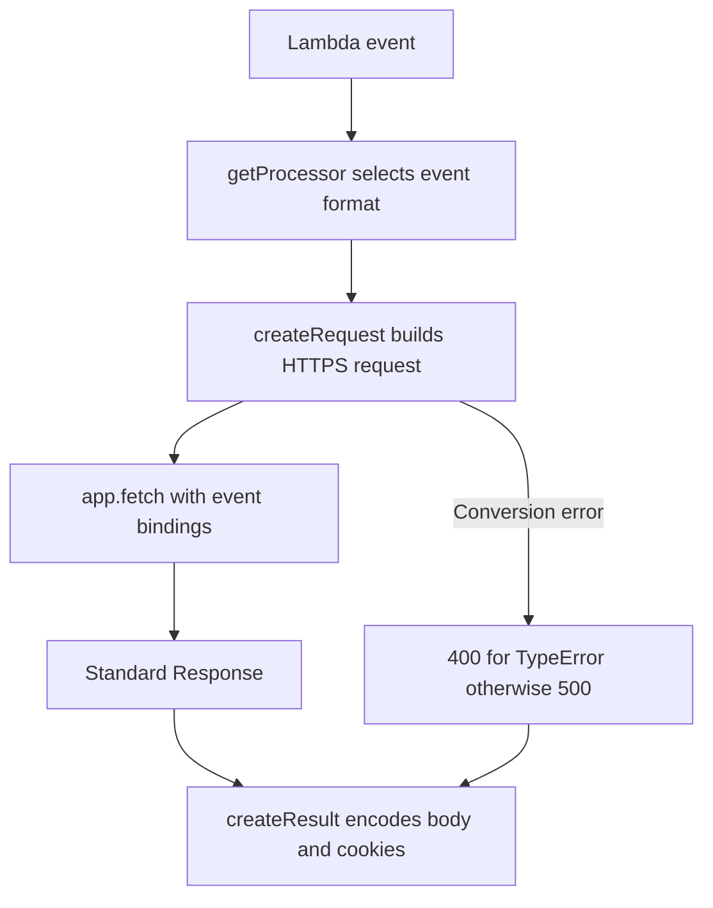

## Overview

The application boundary is `app.fetch(request, env, executionCtx)`. Runtime adapters either pass a standard request through or translate a platform event into one, then return a response in that platform's format. [[Hono Architecture]] describes this common dispatch path. The values passed as bindings and execution context are integration-specific; [[Request and Context]] explains how handlers access them once dispatch has created the context.

Sources: [src/hono-base.ts:479-485](repo://src/hono-base.ts#L479-L485), [src/adapter/cloudflare-pages/handler.ts:32-46](repo://src/adapter/cloudflare-pages/handler.ts#L32-L46), [src/adapter/aws-lambda/handler.ts:250-275](repo://src/adapter/aws-lambda/handler.ts#L250-L275)

## Choose an entry point

| Integration | Entry and forwarded state |
| --- | --- |
| Standard fetch runtime | Calls `app.fetch` with a Request and optional bindings/context |
| Cloudflare Pages | `handle(app)` forwards event request, merged environment/eventContext, waitUntil, and passThroughOnException |
| Vercel | `handle(app)` forwards the request to `app.fetch` |
| Netlify | `handle(app)` forwards the request and stores the platform context under bindings `context` |
| AWS Lambda | `handle(app)` converts supported events, exposes event/requestContext/lambdaContext bindings, and serializes the result |
| Lambda@Edge | `handle(app)` converts the first CloudFront record and exposes event, callback, config, request, and response bindings |
| Service Worker | `handle(app)` invokes respondWith and can fetch a fallback for application 404 responses |
| Bun and Deno helper entries | Export static-file, generation, WebSocket, and connection-information helpers |

Sources: [src/hono-base.ts:479-485](repo://src/hono-base.ts#L479-L485), [src/adapter/cloudflare-pages/handler.ts:32-46](repo://src/adapter/cloudflare-pages/handler.ts#L32-L46), [src/adapter/vercel/handler.ts:4-8](repo://src/adapter/vercel/handler.ts#L4-L8), [src/adapter/netlify/handler.ts:4-10](repo://src/adapter/netlify/handler.ts#L4-L10), [src/adapter/aws-lambda/handler.ts:250-275](repo://src/adapter/aws-lambda/handler.ts#L250-L275), [src/adapter/lambda-edge/handler.ts:124-146](repo://src/adapter/lambda-edge/handler.ts#L124-L146), [src/adapter/service-worker/handler.ts:18-37](repo://src/adapter/service-worker/handler.ts#L18-L37), [src/adapter/bun/index.ts:6-11](repo://src/adapter/bun/index.ts#L6-L11), [src/adapter/deno/index.ts:6-9](repo://src/adapter/deno/index.ts#L6-L9)

A runtime accepting a fetch callback can use the application directly. The Deno runtime tests pass `app.fetch` to `Deno.serve`. The Node runtime test passes another application's fetch callback to `serve` with a port and hostname. These tests demonstrate the callback boundary used by the integrations; they do not require Hono's core dispatcher to create its own listener. [[Quickstart]] provides the smaller in-process version of that boundary.

Sources: [runtime-tests/deno/stream.test.ts:13-21](repo://runtime-tests/deno/stream.test.ts#L13-L21), [runtime-tests/node/index.test.ts:216-229](repo://runtime-tests/node/index.test.ts#L216-L229), [src/hono-base.ts:479-485](repo://src/hono-base.ts#L479-L485)

## Follow a Lambda event

Sources: [src/adapter/aws-lambda/handler.ts:250-275](repo://src/adapter/aws-lambda/handler.ts#L250-L275), [src/adapter/aws-lambda/handler.ts:318-385](repo://src/adapter/aws-lambda/handler.ts#L318-L385), [src/adapter/aws-lambda/handler.ts:625-657](repo://src/adapter/aws-lambda/handler.ts#L625-L657)

Processor selection checks ALB first, API Gateway v2 second, then Lattice v2, with the v1 processor as fallback. The v2 test requires both `rawPath` and an `http` request-context field. Its comment explains why `rawPath` alone is insufficient: a v1 event with a custom-domain base mapping may also contain it. The chosen processor provides method, path, headers, cookies, and query representation for request construction.

Sources: [src/adapter/aws-lambda/handler.ts:278-289](repo://src/adapter/aws-lambda/handler.ts#L278-L289), [src/adapter/aws-lambda/handler.ts:625-657](repo://src/adapter/aws-lambda/handler.ts#L625-L657)

`createRequest` builds an HTTPS URL from the selected domain, path, and query. It decodes a base64 event body or UTF-8 encodes a textual body and sets content length to the byte count. The handler catches conversion errors before application dispatch, returning an invalid-request 400 for TypeError or a generic 500 otherwise. Successful dispatch receives event, requestContext, and lambdaContext as bindings. They are not a supplied `ExecutionContext` object in this adapter.

Sources: [src/adapter/aws-lambda/handler.ts:250-275](repo://src/adapter/aws-lambda/handler.ts#L250-L275), [src/adapter/aws-lambda/handler.ts:301-341](repo://src/adapter/aws-lambda/handler.ts#L301-L341)

Result conversion consumes the response as text or an array buffer encoded as base64. Binary classification uses a replaceable content-type function, then considers non-identity content encoding. It produces a status code, body, encoding flag, and ordinary or multi-value header container based on the event. Cookies are removed from the response header collection and delegated to the processor's cookie representation; v2 places them in the result's cookies array.

Sources: [src/adapter/aws-lambda/handler.ts:344-425](repo://src/adapter/aws-lambda/handler.ts#L344-L425), [src/adapter/aws-lambda/handler.ts:660-674](repo://src/adapter/aws-lambda/handler.ts#L660-L674)

## Stream Lambda output

`streamHandle` uses the runtime's `awslambda.streamifyResponse`. It builds a request, calls the application with event/requestContext/context bindings, extracts headers and cookies, and initializes `HttpResponseStream` metadata. It reads response body chunks and writes them into the Node writable stream. Its local catch logs a processing error and writes `Internal Server Error`; finally it ends the output stream. This platform bridge consumes the readable body produced by [[Streaming Responses]].

Sources: [src/adapter/aws-lambda/handler.ts:126-193](repo://src/adapter/aws-lambda/handler.ts#L126-L193)

## Convert CloudFront requests

Lambda@Edge handles the first record's CloudFront request. The handler exposes a wrapped callback that remembers its first result or error while forwarding to a supplied platform callback. A callback error is thrown; a callback result takes precedence over converting the application's response. Otherwise response conversion uses string status, CloudFront header arrays, and base64 when content type or encoding requires it. Incoming GET/HEAD requests omit body data; other bodies can decode base64 and receive a byte-accurate content length.

Sources: [src/adapter/lambda-edge/handler.ts:124-195](repo://src/adapter/lambda-edge/handler.ts#L124-L195), [src/adapter/lambda-edge/handler.ts:198-218](repo://src/adapter/lambda-edge/handler.ts#L198-L218)

## Integrate Pages and Service Worker middleware

Pages' `handleMiddleware` constructs a context around one middleware and uses `eventContext.next` as its downstream operation. It records Error instances, returns a directly supplied response first, converts HTTPException through `getResponse`, and rethrows other recorded errors. Its `serveStatic` delegates to `env.ASSETS.fetch` and translates an asset 404 into the context's not-found handler. [[Static Files and Generation]] explains the other asset-serving implementations.

Sources: [src/adapter/cloudflare-pages/handler.ts:49-101](repo://src/adapter/cloudflare-pages/handler.ts#L49-L101), [src/adapter/cloudflare-pages/handler.ts:114-123](repo://src/adapter/cloudflare-pages/handler.ts#L114-L123)

The Service Worker handler passes the event as execution context and invokes `respondWith`. Its default fallback fetch is bound to globalThis because the comment states that Service Worker fetch needs the binding. With a configured fetch fallback, a Hono 404 is replaced by that fetch result; omitting that fallback in a supplied options object leaves the Hono response. The adapter entry also exports `fire` for registering its fetch-event listener.

Sources: [src/adapter/service-worker/handler.ts:18-37](repo://src/adapter/service-worker/handler.ts#L18-L37), [src/adapter/service-worker/index.ts:28-36](repo://src/adapter/service-worker/index.ts#L28-L36)

## Access runtime environment and connection data

`getRuntimeKey` checks known navigator user agents, EdgeRuntime, Fastly's global, and Node's process release before returning `other`. `env(c, runtime)` selects process environment for Bun, Node, and edge-light; Deno.env for Deno; context bindings for workerd; and an empty object for Fastly or other. This helper chooses one source based on runtime rather than merging every source with context bindings.

Sources: [src/helper/adapter/index.ts:8-40](repo://src/helper/adapter/index.ts#L8-L40), [src/helper/adapter/index.ts:43-90](repo://src/helper/adapter/index.ts#L43-L90)

Connection helpers return `remote` information for policies such as the address checks in [[Security Middleware]]. Bun uses the supplied server's requestIP method and returns an empty remote object when the method yields no address. Deno reads `remoteAddr` from bindings. Cloudflare Workers reads `cf-connecting-ip`. Supply the environment shape that the selected helper expects; [[WebSockets]] describes the same Bun server dependency for upgrades.

Sources: [src/helper/conninfo/types.ts:35-45](repo://src/helper/conninfo/types.ts#L35-L45), [src/adapter/bun/conninfo.ts:10-43](repo://src/adapter/bun/conninfo.ts#L10-L43), [src/adapter/deno/conninfo.ts:8-17](repo://src/adapter/deno/conninfo.ts#L8-L17), [src/adapter/cloudflare-workers/conninfo.ts:3-7](repo://src/adapter/cloudflare-workers/conninfo.ts#L3-L7)
