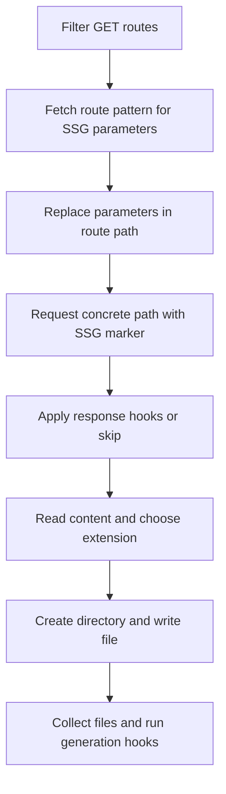

## Overview

Hono supports two file-oriented flows: resolve an incoming path to an existing asset, or execute application routes and write their responses as files. Runtime wrappers supply asset readers and filesystem writers while shared helpers own resolution and generation. [[Runtime Adapters]] explains the platform entry points. [[HTTP Middleware]] owns response caching and compression applied around asset responses; this page explains asset selection and the generation pipeline itself.

Sources: [src/middleware/serve-static/index.ts:32-48](repo://src/middleware/serve-static/index.ts#L32-L48), [src/adapter/bun/serve-static.ts:8-32](repo://src/adapter/bun/serve-static.ts#L8-L32), [src/helper/ssg/ssg.ts:34-37](repo://src/helper/ssg/ssg.ts#L34-L37), [src/helper/ssg/ssg.ts:430-469](repo://src/helper/ssg/ssg.ts#L430-L469)

## Resolve an asset request

The shared static middleware is designed for a wrapper that supplies `getContent`, optionally a runtime join operation and directory check. It defaults the root to `./`. If a response is already finalized it continues without serving another asset. A configured `path` selects a fixed filename; otherwise it decodes the request path and rejects dot segments, repeated separators, or backslashes through its not-found callback and continuation branch.

Sources: [src/middleware/serve-static/index.ts:32-79](repo://src/middleware/serve-static/index.ts#L32-L79)

After optional `rewriteRequestPath`, it joins the filename under the root. A detected directory appends `index.html`. If `getContent` returns a Response, the middleware wraps its body and metadata through `c.newResponse`; ordinary data receives a MIME type from custom mappings or the default MIME resolver, with application/octet-stream as fallback. A found data asset runs `onFound` and returns a body response; a missing asset runs `onNotFound` and continues to later handlers.

Sources: [src/middleware/serve-static/index.ts:76-125](repo://src/middleware/serve-static/index.ts#L76-L125)

## Choose an asset reader

| Wrapper | Asset source and behavior |
| --- | --- |
| Bun `serveStatic` | Uses Bun.file, existence checks, node path joining, and asynchronous stat for directories |
| Deno `serveStatic` | Opens a file and returns its readable stream; lstat checks directories and missing files fall through |
| Workers legacy `serveStatic` | Resolves KV assets with a manifest and namespace, falling back to `env.__STATIC_CONTENT` |
| Pages `serveStatic` | Delegates to `env.ASSETS.fetch`, translating 404 to the context not-found handler |

Sources: [src/adapter/bun/serve-static.ts:8-32](repo://src/adapter/bun/serve-static.ts#L8-L32), [src/adapter/deno/serve-static.ts:8-42](repo://src/adapter/deno/serve-static.ts#L8-L42), [src/adapter/cloudflare-workers/serve-static.ts:21-42](repo://src/adapter/cloudflare-workers/serve-static.ts#L21-L42), [src/adapter/cloudflare-pages/handler.ts:114-123](repo://src/adapter/cloudflare-pages/handler.ts#L114-L123)

The Workers KV wrapper is marked deprecated in the source, and its module variant delegates to it. The deprecation comment directs users toward Cloudflare Static Assets. This documents the status of those repository exports; platform deployment configuration remains outside this helper's implementation. Deno's reader logs failures other than NotFound before returning null, while Bun's directory check suppresses stat errors and lets content lookup determine whether anything can be served.

Sources: [src/adapter/cloudflare-workers/serve-static.ts:12-20](repo://src/adapter/cloudflare-workers/serve-static.ts#L12-L20), [src/adapter/cloudflare-workers/serve-static-module.ts:1-12](repo://src/adapter/cloudflare-workers/serve-static-module.ts#L1-L12), [src/adapter/deno/serve-static.ts:12-33](repo://src/adapter/deno/serve-static.ts#L12-L33), [src/adapter/bun/serve-static.ts:12-23](repo://src/adapter/bun/serve-static.ts#L12-L23)

## Serve precompressed variants

With `precompressed` enabled, eligible data assets can use sidecar files. The middleware checks exact comma-separated Accept-Encoding tokens in fixed order: br with `.br`, zstd with `.zst`, then gzip with `.gz`. It uses the first available requested variant, sets content encoding, and appends Vary: Accept-Encoding. This path does not parse quality weights. It runs for unknown MIME types or types matching the compressible-type expression, while preserving the original asset's MIME type.

Sources: [src/middleware/serve-static/index.ts:23-28](repo://src/middleware/serve-static/index.ts#L23-L28), [src/middleware/serve-static/index.ts:92-119](repo://src/middleware/serve-static/index.ts#L92-L119)

## Enumerate routes for generation

`toSSG` accepts an application, a filesystem module with `writeFile` and recursive `mkdir`, and optional settings. Defaults are output directory `./static` and concurrency 2. Runtime wrappers supply those filesystem operations; Bun's wrapper writes through Bun.write and has a no-op mkdir. The generation APIs and filesystem interface are marked experimental. Route filtering selects GET or ALL registrations whose underlying handler is not classified as middleware. It retains each selected registration for discovery.

Sources: [src/helper/ssg/ssg.ts:17-37](repo://src/helper/ssg/ssg.ts#L17-L37), [src/helper/ssg/ssg.ts:363-372](repo://src/helper/ssg/ssg.ts#L363-L372), [src/helper/ssg/ssg.ts:420-435](repo://src/helper/ssg/ssg.ts#L420-L435), [src/adapter/bun/ssg.ts:13-27](repo://src/adapter/bun/ssg.ts#L13-L27), [src/helper/ssg/utils.ts:61-75](repo://src/helper/ssg/utils.ts#L61-L75)

Discovery fetches the registered route pattern under localhost with the SSG environment marker. `ssgParams` detects a dynamic path, attaches an array of parameter objects to the raw discovery request, and returns not-found to prevent the final handler running on the pattern itself. Dynamic routes without parameter data are skipped; static routes receive one empty parameter set. Each expanded path is then requested through the application, with the marker still present.

Sources: [src/helper/ssg/ssg.ts:222-269](repo://src/helper/ssg/ssg.ts#L222-L269), [src/helper/ssg/middleware.ts:43-49](repo://src/helper/ssg/middleware.ts#L43-L49)

Sources: [src/helper/ssg/ssg.ts:222-289](repo://src/helper/ssg/ssg.ts#L222-L289), [src/helper/ssg/ssg.ts:310-334](repo://src/helper/ssg/ssg.ts#L310-L334), [src/helper/ssg/ssg.ts:430-469](repo://src/helper/ssg/ssg.ts#L430-L469)

## Control generation through middleware

`isSSGContext` reads the SSG marker from bindings. `disableSSG` returns not-found with the disable header only during generation; ordinary requests continue. `onlySSG` does the reverse, returning not-found outside generation. The generation pipeline checks the disable header before response hooks and skips that output. These controls let the same routing and rendering code serve runtime requests and generation requests with explicitly different availability.

Sources: [src/helper/ssg/middleware.ts:56-83](repo://src/helper/ssg/middleware.ts#L56-L83), [src/helper/ssg/ssg.ts:264-281](repo://src/helper/ssg/ssg.ts#L264-L281)

## Order plugins and hooks

Plugins can provide before-request, after-response, and after-generation hooks, each as one function or an array. Request and response hooks run sequentially, carry a replacement object forward, and stop when a hook returns false. `toSSG` uses the default plugin only when `plugins` is absent; supplying a plugin array replaces that default selection. Legacy top-level hook options are still collected before plugin hooks but are marked deprecated in the options interface.

Sources: [src/helper/ssg/ssg.ts:110-173](repo://src/helper/ssg/ssg.ts#L110-L173), [src/helper/ssg/ssg.ts:175-198](repo://src/helper/ssg/ssg.ts#L175-L198), [src/helper/ssg/ssg.ts:368-419](repo://src/helper/ssg/ssg.ts#L368-L419)

The default plugin skips every response whose status is not 200. `redirectPlugin` converts supported redirects with a Location header into status-200 HTML redirect pages. Place it before the default plugin, as the source examples state, so the redirect is transformed before the non-200 filter runs. [[HTML and JSX Rendering]] explains the escaped template helper used to generate that redirect document.

Sources: [src/helper/ssg/plugins.ts:11-35](repo://src/helper/ssg/plugins.ts#L11-L35), [src/helper/ssg/plugins.ts:38-72](repo://src/helper/ssg/plugins.ts#L38-L72)

## Write output and inspect failures

File naming preserves an existing matching extension, maps `/` to `index.extension`, maps trailing-slash routes to a directory index, and otherwise appends the extension. MIME type chooses that extension through an optional map or default mappings and MIME lookup. The output path is checked for containment. Response content is read as text when its content type includes text or JSON and otherwise as an array buffer; writing converts buffers to Uint8Array and creates directories as needed.

Sources: [src/helper/ssg/ssg.ts:50-108](repo://src/helper/ssg/ssg.ts#L50-L108), [src/helper/ssg/ssg.ts:310-334](repo://src/helper/ssg/ssg.ts#L310-L334)

Generation collects file paths into a successful result. Discovery or write failures caught by the main generation block become a failed result with an empty file list and an Error. This is not a rollback of files already written. After-generation hooks run after that catch and receive the result, filesystem module, and options; an exception from those hooks is outside the main conversion-to-result catch. Inspect `success`, `files`, and `error` when deciding whether the generated output is ready.

Sources: [src/helper/ssg/ssg.ts:436-469](repo://src/helper/ssg/ssg.ts#L436-L469)
