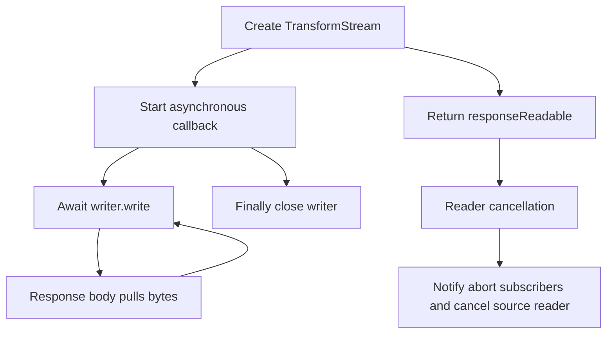

## Overview

Streaming helpers return a response whose body is produced by an asynchronous callback. `stream` supplies a byte-oriented API, `streamText` adds text headers, and `streamSSE` formats server-sent events. All use a TransformStream and the shared `StreamingApi`. [[Request and Context]] describes the response boundary; these helpers keep producing its body after creating that response. JSX callback streaming belongs to [[HTML and JSX Rendering]], while a bidirectional upgrade belongs to [[WebSockets]].

Sources: [src/helper/streaming/stream.ts:7-45](repo://src/helper/streaming/stream.ts#L7-L45), [src/helper/streaming/text.ts:6-15](repo://src/helper/streaming/text.ts#L6-L15), [src/helper/streaming/sse.ts:72-100](repo://src/helper/streaming/sse.ts#L72-L100), [src/utils/stream.ts:21-45](repo://src/utils/stream.ts#L21-L45)

## Select the response helper

| Helper | Callback interface | Headers installed by the helper |
| --- | --- | --- |
| `stream` | `StreamingApi` | Uses the context response builder without adding a format |
| `streamText` | `StreamingApi` | Plain UTF-8 text, nosniff, chunked transfer |
| `streamSSE` | `SSEStreamingApi` | Event stream, no-cache, keep-alive, chunked transfer |

Sources: [src/helper/streaming/stream.ts:7-14](repo://src/helper/streaming/stream.ts#L7-L14), [src/helper/streaming/stream.ts:44-45](repo://src/helper/streaming/stream.ts#L44-L45), [src/helper/streaming/text.ts:6-15](repo://src/helper/streaming/text.ts#L6-L15), [src/helper/streaming/sse.ts:72-99](repo://src/helper/streaming/sse.ts#L72-L99)

`stream` creates the transform, obtains a writer through `StreamingApi`, and starts an asynchronous task that awaits the producer callback. It returns `c.newResponse(stream.responseReadable)` immediately. The producer's finally block closes the stream. A WeakMap holds the context with the readable stream; the source comment explains that Bun can otherwise destroy the context when the request is returned. Streaming thus has a response lifetime and a producer lifetime that overlap but end at different moments.

Sources: [src/helper/streaming/stream.ts:5-45](repo://src/helper/streaming/stream.ts#L5-L45)

## Write and pipe data

`write` accepts a string or Uint8Array. Strings are UTF-8 encoded, then the method awaits the writer's write and returns the streaming API. `writeln` adds a newline before writing. Await these operations when sequencing output: their implementations await the underlying writer rather than appending to an independent string buffer. `sleep` returns a timer promise for producers that intentionally space their output.

Sources: [src/utils/stream.ts:48-67](repo://src/utils/stream.ts#L48-L67)

`pipe` temporarily releases the current writer lock, pipes a readable stream into the writable side with `preventClose: true`, and reacquires the writer. This lets a producer append more content after a successful pipe without automatically ending the response. `close` marks `closed` and attempts writer closure. Write and close errors are intentionally swallowed by this API; comments direct callers needing those errors to create their own stream.

Sources: [src/utils/stream.ts:48-82](repo://src/utils/stream.ts#L48-L82)



Sources: [src/helper/streaming/stream.ts:12-44](repo://src/helper/streaming/stream.ts#L12-L44), [src/utils/stream.ts:21-57](repo://src/utils/stream.ts#L21-L57), [src/utils/stream.ts:69-97](repo://src/utils/stream.ts#L69-L97)

## Format server-sent events

`writeSSE` accepts required `data` plus optional `event`, `id`, and `retry`. Data may be a string or promise of a string and is resolved through the HTML callback utility before formatting. Newline-separated data becomes one `data:` line per input line. Event, ID, and retry fields are checked for carriage return or newline characters. Present truthy fields are joined with newlines, and a blank line terminates each message.

Sources: [src/helper/streaming/sse.ts:6-44](repo://src/helper/streaming/sse.ts#L6-L44)

The SSE test emits five messages, each with a multiline body, event name, and incrementing ID. It reads response chunks and checks that the body contains separate data lines and the terminating blank line. This verifies formatting independently of a browser EventSource connection. [[Testing and Development]] describes the same in-process response-reading approach for route-level checks.

Sources: [src/helper/streaming/sse.test.tsx:13-52](repo://src/helper/streaming/sse.test.tsx#L13-L52)

```ts
let id = 0
const maxIterations = 5

while (id < maxIterations) {
  const message = `Message\nIt is ${id}`
  await stream.writeSSE({ data: message, event: 'time-update', id: String(id++) })
  await stream.sleep(10)
}
```

Sources: [src/helper/streaming/sse.test.tsx:18-25](repo://src/helper/streaming/sse.test.tsx#L18-L25)

## Cancel and clean up

The response readable wraps the transform's reader. Pull reads and forwards a chunk or closes when done. Cancelling that response invokes `abort` unless normal closure has already marked the API closed. Abort is idempotent: it sets `aborted` once and invokes registered subscribers. An internal subscriber cancels the source reader, which the comments connect to preventing indefinitely blocked SSE writes after disconnection. Application code can register additional cleanup through `onAbort`.

Sources: [src/utils/stream.ts:21-45](repo://src/utils/stream.ts#L21-L45), [src/utils/stream.ts:84-97](repo://src/utils/stream.ts#L84-L97)

Both stream and SSE helpers attach a raw request abort listener for the old-Bun detection path, aborting when the API has not closed. The implementation's detector matches version prefixes 1.1, 1.0, and 0, and memoizes its result. The test simulates Bun 1.1.0, supplies an AbortController-backed request, aborts it, and verifies that a registered subscriber runs. Normal response-reader cancellation is tested separately.

Sources: [src/helper/streaming/stream.ts:15-22](repo://src/helper/streaming/stream.ts#L15-L22), [src/helper/streaming/sse.ts:80-87](repo://src/helper/streaming/sse.ts#L80-L87), [src/helper/streaming/utils.ts:1-11](repo://src/helper/streaming/utils.ts#L1-L11), [src/helper/streaming/sse.test.tsx:55-107](repo://src/helper/streaming/sse.test.tsx#L55-L107)

## Handle producer failures

The generic producer wrapper ignores an undefined rejection, which its comment associates with cancellation through pipeTo. An Error is sent to the optional `onError(error, stream)` callback; other failures or Errors without that callback are logged. Closure still runs in finally. Because this callback executes in the background task after the response is constructed, its failure handling is local to the streaming wrapper rather than a new route response returned through application error recovery.

Sources: [src/helper/streaming/stream.ts:26-44](repo://src/helper/streaming/stream.ts#L26-L44)

The SSE wrapper differs: when an Error has an error callback, it awaits the callback and then writes an SSE message with event `error` and the error's message. Otherwise it logs the failure. It also closes in finally. Errors thrown by `write` itself are swallowed by the shared API, so the error callback is primarily for failures thrown by the producer or its awaited work. [[HTTP Middleware]] documents response transformations whose body access or transfer-encoding checks matter when wrapping these responses.

Sources: [src/helper/streaming/sse.ts:47-67](repo://src/helper/streaming/sse.ts#L47-L67), [src/utils/stream.ts:48-57](repo://src/utils/stream.ts#L48-L57), [src/middleware/compress/index.ts:91-107](repo://src/middleware/compress/index.ts#L91-L107)
