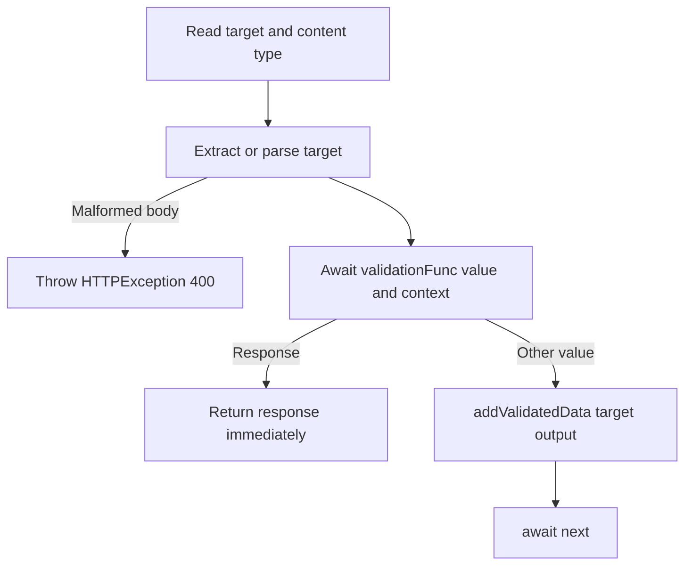

## Overview

The `validator` middleware converts one request target into application data. It extracts transport values, awaits a callback, and either returns the callback's response or stores the callback's output for the next handler. It does not impose a validation schema of its own. [[Request and Context]] describes raw parsing and accessors; this page explains the acceptance boundary built on those operations and the input/output types later consumed by [[Typed Client]].

Sources: [src/validator/validator.ts:85-103](repo://src/validator/validator.ts#L85-L103), [src/validator/validator.ts:144-170](repo://src/validator/validator.ts#L144-L170)

## Choose a target

| Target | Value delivered to the callback |
| --- | --- |
| `json` | Parsed JSON when the content type matches; otherwise the initial empty object |
| `form` | Form fields when multipart or URL-encoded content type matches; otherwise the initial empty object |
| `query` | Query object with one string for a single value or an array for repeated values |
| `param` | The route's decoded parameter object |
| `header` | The request header object |
| `cookie` | The parsed cookie object |

Sources: [src/validator/validator.ts:89-160](repo://src/validator/validator.ts#L89-L160)

The JSON media-type expression accepts application/json and application subtypes ending in +json, with supported parameters, case-insensitively. Form parsing recognizes multipart/form-data and application/x-www-form-urlencoded. A missing or mismatched content type skips parsing but still invokes the callback with the initial empty object. A body containing JSON text therefore needs the matching header to reach the callback as parsed JSON; absence of the header is not itself an automatic rejection.

Sources: [src/validator/validator.ts:24-26](repo://src/validator/validator.ts#L24-L26), [src/validator/validator.ts:89-111](repo://src/validator/validator.ts#L89-L111), [src/validator/validator.test.ts:161-168](repo://src/validator/validator.test.ts#L161-L168)

## Trace the middleware flow



Sources: [src/validator/validator.ts:89-125](repo://src/validator/validator.ts#L89-L125), [src/validator/validator.ts:144-170](repo://src/validator/validator.ts#L144-L170)

JSON parsing uses the request wrapper's JSON reader. A parsing exception becomes HTTPException 400 with `Malformed JSON in request body`. Form parsing reuses cached form data when present; otherwise it reads an array buffer, calls `bufferToFormData`, and caches the result. Parsing failures become HTTPException 400 with a `Malformed FormData request.` message and available error detail. These failures occur before the validation callback and enter the recovery path described in [[Middleware and Errors]].

Sources: [src/validator/validator.ts:94-127](repo://src/validator/validator.ts#L94-L127)

Form collection uses an object with no prototype. Keys ending in `[]` accumulate into arrays; repeated ordinary keys also accumulate, with the first value promoted to an array on repetition. The validator does not apply the dotted-key nesting option from `parseBody`. Query extraction similarly preserves multiplicity, reducing one-element arrays to their single value. The callback must handle the actual scalar-or-array shape when its acceptance rule depends on a field being singular.

Sources: [src/validator/validator.ts:129-149](repo://src/validator/validator.ts#L129-L149), [src/utils/body.ts:167-178](repo://src/utils/body.ts#L167-L178)

## Decide acceptance in the callback

The callback receives the extracted value and context and may be synchronous or asynchronous. Returning a `Response` stops this middleware before validated-data storage and continuation. Returning another value makes that value the target's validated output. This includes transformations: the handler receives the callback's result, not an untouched copy of the transport object. An undefined return is also stored, so a successful callback should return the data the endpoint expects when it will call `valid`.

Sources: [src/validator/validator.ts:14-22](repo://src/validator/validator.ts#L14-L22), [src/validator/validator.ts:162-170](repo://src/validator/validator.ts#L162-L170), [src/request.ts:339-353](repo://src/request.ts#L339-L353)

The JSON test demonstrates an identity callback followed by a handler reading `c.req.valid('json')`. This accepts whatever JSON value was parsed; application-specific checks belong inside that callback. A separate query test returns a 400 text response when `q` is absent, showing that validation failure can use ordinary response helpers and participate in the route's response schema.

Sources: [src/validator/validator.test.ts:66-80](repo://src/validator/validator.test.ts#L66-L80), [src/validator/validator.test.ts:126-146](repo://src/validator/validator.test.ts#L126-L146)

```ts
app.post(
  '/post',
  validator('json', (value) => value),
  (c) => {
    return c.json(c.req.valid('json'))
  }
)
```

Sources: [src/validator/validator.test.ts:128-134](repo://src/validator/validator.test.ts#L128-L134)

## Retrieve validated values

`addValidatedData` stores the value under the selected target in `HonoRequest`. `valid(target)` retrieves that slot and exposes the output type associated with that target. It performs no parsing or callback invocation. Put the validator before the consuming handler in the route's handler list so storage occurs before access. Multiple target validators can populate separate slots; storing another value for the same target replaces that slot.

Sources: [src/request.ts:53-80](repo://src/request.ts#L53-L80), [src/request.ts:339-353](repo://src/request.ts#L339-L353), [src/validator/validator.ts:168-170](repo://src/validator/validator.ts#L168-L170), [src/compose.ts:42-51](repo://src/compose.ts#L42-L51)

## Preserve input and response types

Validator generics distinguish transport input from callback output. JSON can infer its input from the callback output when an explicit input type is unknown; other targets use `InferInput`. That utility preserves literal string unions and optional unions, while ordinary query values become string-or-array inputs, form values become form values or arrays, and parameters, headers, and cookies become strings. The callback's transformed result remains the downstream output type.

Sources: [src/validator/validator.ts:64-88](repo://src/validator/validator.ts#L64-L88), [src/validator/utils.ts:9-44](repo://src/validator/utils.ts#L9-L44), [src/validator/utils.ts:59-69](repo://src/validator/utils.ts#L59-L69)

The response extraction types retain response branches returned by the callback, including asynchronous branches, and exclude ordinary data from the middleware response type. Conversely, output extraction excludes Response and TypedResponse branches. This lets a route describe both an early validation response and a successful endpoint response. The query test asserts exactly that union with 400 `Invalid!` and 200 `Valid!` branches; [[Typed Client]] explains how callers inspect those status-dependent results.

Sources: [src/validator/validator.ts:28-44](repo://src/validator/validator.ts#L28-L44), [src/validator/validator.ts:174-185](repo://src/validator/validator.ts#L174-L185), [src/validator/validator.test.ts:82-106](repo://src/validator/validator.test.ts#L82-L106)

GET and HEAD exclude `json` and `form` from the generic target selection because their requests must not have body content, as the source comment states. Other methods allow all validation targets. This restriction is part of the typed interface; the runtime middleware still follows its explicit target switch and content-type branches. Keep transport construction and callback checks aligned with that interface when adding a route.

Sources: [src/validator/validator.ts:9-12](repo://src/validator/validator.ts#L9-L12), [src/validator/validator.ts:46-60](repo://src/validator/validator.ts#L46-L60), [src/validator/validator.ts:89-111](repo://src/validator/validator.ts#L89-L111)
