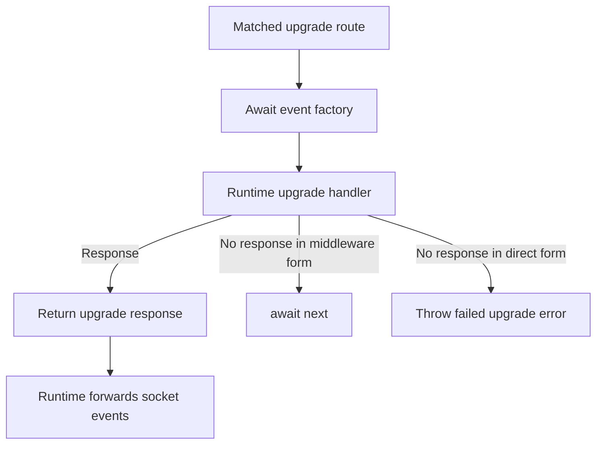

## Overview

Hono's WebSocket helpers adapt runtime upgrade operations to a shared event and socket interface. A route supplies an event factory; the runtime helper upgrades the raw request and forwards socket callbacks through `WSContext`. The HTTP application still selects the route, following [[Routing and Application Composition]], but later messages use the runtime socket callbacks. [[Runtime Adapters]] covers the surrounding fetch integration, and [[Typed Client]] covers creation of client socket URLs.

Sources: [src/helper/websocket/index.ts:14-39](repo://src/helper/websocket/index.ts#L14-L39), [src/helper/websocket/index.ts:111-139](repo://src/helper/websocket/index.ts#L111-L139), [src/adapter/deno/websocket.ts:4-38](repo://src/adapter/deno/websocket.ts#L4-L38)

## Supply events and control a socket

The shared `WSEvents` interface offers `onOpen`, `onMessage`, `onClose`, and `onError`. Each callback receives its event plus a socket context. Message data is typed as string, Blob, or ArrayBufferLike. `WSContext` exposes `send`, `close`, `raw`, `readyState`, `url`, `protocol`, and binary type `arraybuffer`. Send forwards a source plus options, defaulting options to an empty object; close delegates its code and reason to the runtime implementation.

Sources: [src/helper/websocket/index.ts:14-18](repo://src/helper/websocket/index.ts#L14-L18), [src/helper/websocket/index.ts:45-98](repo://src/helper/websocket/index.ts#L45-L98)

The context constructor normalizes a supplied URL to a URL object or null and protocol to its supplied value or null. Ready state is read through the initialization object, allowing an adapter to provide a getter over the underlying socket. The raw socket remains available when the common interface is insufficient. Bun's wrapper supplies send compression, while Deno and Cloudflare delegate send directly to their native socket method.

Sources: [src/helper/websocket/index.ts:70-90](repo://src/helper/websocket/index.ts#L70-L90), [src/adapter/bun/websocket.ts:33-45](repo://src/adapter/bun/websocket.ts#L33-L45), [src/adapter/deno/websocket.ts:20-31](repo://src/adapter/deno/websocket.ts#L20-L31), [src/adapter/cloudflare-workers/websocket.ts:21-32](repo://src/adapter/cloudflare-workers/websocket.ts#L21-L32)

## Understand the two helper forms

`defineWebSocketHelper` wraps the runtime-specific upgrade handler. With an event factory as the first argument, it returns middleware, awaits the factory with the Hono context, then attempts the upgrade. A returned response ends the branch; no response continues through `next`. The event factory can therefore be asynchronous and can read the same request inputs as any other route handler, using the accessors described in [[Request and Context]].

Sources: [src/helper/websocket/index.ts:111-128](repo://src/helper/websocket/index.ts#L111-L128)

With a context and an already-created events object, the helper directly attempts the upgrade and returns a promise of its response. In this form, an absent upgrade response throws `Failed to upgrade WebSocket`. The distinction matters for a non-upgrade request: middleware form can fall through to another handler, while direct form treats the failed upgrade as an error. The typed result declares WebSocket output format for client inference.

Sources: [src/helper/websocket/index.ts:24-39](repo://src/helper/websocket/index.ts#L24-L39), [src/helper/websocket/index.ts:129-139](repo://src/helper/websocket/index.ts#L129-L139)

Sources: [src/helper/websocket/index.ts:119-137](repo://src/helper/websocket/index.ts#L119-L137), [src/adapter/deno/websocket.ts:15-37](repo://src/adapter/deno/websocket.ts#L15-L37)

## Select the runtime implementation

| Runtime | Upgrade mechanism | Event integration |
| --- | --- | --- |
| Bun | Server `upgrade` with callback data | Exported `websocket` object handles open, close, and message |
| Deno | `Deno.upgradeWebSocket` | Assigns native open, message, close, and error handlers |
| Cloudflare Workers | `WebSocketPair` and 101 response | Adds close, message, and error listeners; no open event |

Sources: [src/adapter/bun/websocket.ts:48-104](repo://src/adapter/bun/websocket.ts#L48-L104), [src/adapter/deno/websocket.ts:4-38](repo://src/adapter/deno/websocket.ts#L4-L38), [src/adapter/cloudflare-workers/websocket.ts:10-53](repo://src/adapter/cloudflare-workers/websocket.ts#L10-L53)

For Bun, the helper retrieves the server from `c.env.server` when present, or from `c.env` itself. Missing server data throws a TypeError explaining that env must include fetch's second argument. The upgrade stores events, request URL, and the first requested subprotocol in socket data. A successful server upgrade returns a placeholder response; a failed upgrade returns no response. Both the route's upgrade helper and the exported server callback object are needed to connect request and socket phases.

Sources: [src/adapter/bun/server.ts:13-14](repo://src/adapter/bun/server.ts#L13-L14), [src/adapter/bun/websocket.ts:48-74](repo://src/adapter/bun/websocket.ts#L48-L74), [src/adapter/bun/websocket.ts:76-104](repo://src/adapter/bun/websocket.ts#L76-L104)

Bun forwards each event through a new wrapper around the native socket. Binary messages are normalized to their buffer, while text remains text. Close creates a CloseEvent with code and reason. The older `createBunWebSocket` factory simply returns the exported upgrade and callback objects and is deprecated in favor of direct imports from `hono/bun`. This implementation has no onError dispatch member in its server callback object.

Sources: [src/adapter/bun/websocket.ts:76-113](repo://src/adapter/bun/websocket.ts#L76-L113)

Deno first checks that the Upgrade header equals `websocket`. It chooses the first requested subprotocol as a default, then spreads caller upgrade options over that choice. The source comment connects the echoed subprotocol to browser acceptance of the connection. It creates one WSContext with live ready-state access, wires the four native callback properties, and returns Deno's response. A non-WebSocket request returns no response from this adapter.

Sources: [src/adapter/deno/websocket.ts:4-38](repo://src/adapter/deno/websocket.ts#L4-L38)

Cloudflare likewise checks the Upgrade header, creates a client/server pair, wraps the server socket, and installs message, close, and error listeners. It calls the server's optional accept operation and returns status 101 with the client endpoint in the runtime's response extension. Its event type explicitly omits onOpen, matching the implementation comment that Workers does not support that event. It does not contain the Deno adapter's requested-subprotocol echo branch.

Sources: [src/adapter/cloudflare-workers/websocket.ts:5-53](repo://src/adapter/cloudflare-workers/websocket.ts#L5-L53)

## Connect typed callers

The shared upgrade interface declares output format `ws`. The typed client exposes `$ws` for GET endpoints with that format, substitutes supplied path parameters, converts the base protocol, and appends repeated query values. It then invokes a configured WebSocket factory or the global constructor. HTTP headers and request init from ordinary client calls are not part of that construction branch; the server's event factory still receives the original upgrade request context for its own route logic.

Sources: [src/helper/websocket/index.ts:24-39](repo://src/helper/websocket/index.ts#L24-L39), [src/client/types.ts:112-118](repo://src/client/types.ts#L112-L118), [src/client/client.ts:187-212](repo://src/client/client.ts#L187-L212), [src/helper/websocket/index.ts:119-123](repo://src/helper/websocket/index.ts#L119-L123)
