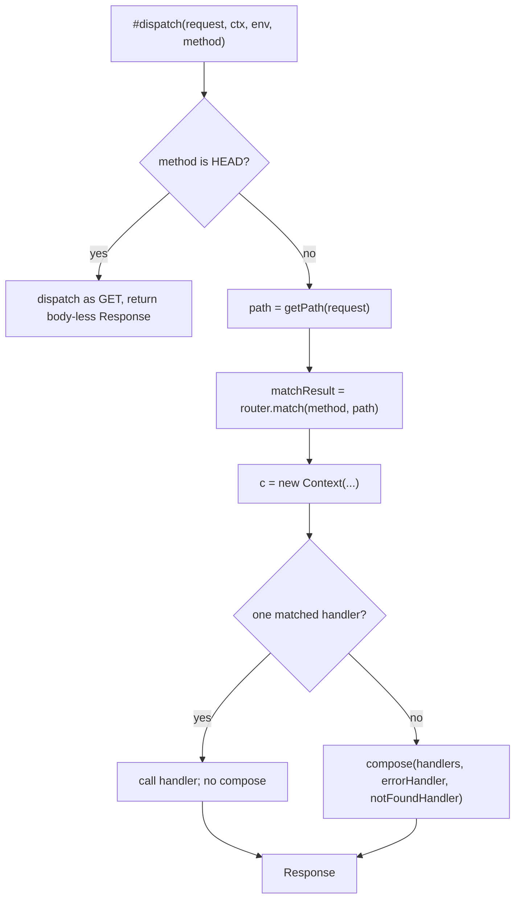

## Overview

`HonoBase` in `src/hono-base.ts` is the class every `Hono` variant extends. It does two jobs: it records routes into a router while the app is being built, and it turns a `Request` into a `Response` when `fetch` is called. It has no router of its own; subclasses such as the default `Hono` assign `this.router` in their constructor (see [[Routers and Router Selection]]).

Sources: [src/hono-base.ts:98-124](repo://src/hono-base.ts#L98-L124), [src/hono.ts:26-33](repo://src/hono.ts#L26-L33)

## Registering routes

The constructor builds the registration methods as closures over the instance. For each name in `METHODS` plus `all`, `this[method]` is a function taking either `(path, ...handlers)` or `(...handlers)`. A string first argument is stored in the private `#path`; otherwise the first handler is added at the stored `#path`. That is why `app.get('/a', h1).post(h2)` registers `h2` at `/a`.

Sources: [src/hono-base.ts:126-141](repo://src/hono-base.ts#L126-L141)

`on` loops over every path and method given and upper-cases the method. `use` registers its handlers under the method `ALL`, with path `'*'` when no path is given.

Sources: [src/hono-base.ts:143-168](repo://src/hono-base.ts#L143-L168)

All three end in `#addRoute`, which upper-cases the method, joins the app's base path to the route path with `mergePath`, creates a `RouterRoute` record and does two things: `router.add(method, path, [handler, r])` and `routes.push(r)`. The router keeps a `[handler, route]` pair so the matched route is available at request time; `app.routes` keeps the list in registration order.

Sources: [src/hono-base.ts:385-397](repo://src/hono-base.ts#L385-L397), [src/utils/url.ts:158-169](repo://src/utils/url.ts#L158-L169)

## Composing apps

`basePath(path)` calls `#clone`, which builds a new instance sharing the same `router`, `routes`, error handler and not-found handler, then sets its `_basePath` to the merged path. Routes added through the clone are prefixed but land in the shared router.

Sources: [src/hono-base.ts:175-184](repo://src/hono-base.ts#L175-L184), [src/hono-base.ts:247-253](repo://src/hono-base.ts#L247-L253)

`route(path, app)` takes a clone at `path` and re-adds each of `app.routes`. If the sub-app still has the default error handler its handlers are added as is. Otherwise each handler is wrapped so the sub-app's `errorHandler` handles exceptions via `compose([], app.errorHandler)`, and the wrapper stores the original in `COMPOSED_HANDLER`.

Sources: [src/hono-base.ts:208-232](repo://src/hono-base.ts#L208-L232), [src/utils/constants.ts:1-4](repo://src/utils/constants.ts#L1-L4)

`mount(path, handler, options)` registers one `ALL` route at `path/*` whose middleware calls a foreign `(request, ...args) => Response` function. Unless `replaceRequest` is given, the request is rewritten with the mount prefix removed from the path. The arguments passed after the request default to `[c.env, executionContext]`; an `optionHandler` can supply its own. If the foreign handler returns nothing, `next()` is called.

Sources: [src/hono-base.ts:328-383](repo://src/hono-base.ts#L328-L383)

## Dispatching a request

### From fetch to Context

`fetch` and `request` are instance properties. `fetch(request, env, executionCtx)` calls the private `#dispatch(request, executionCtx, env, request.method)`. `request(input, init, env, executionCtx)` builds a `Request` first, prefixing relative paths with `http://localhost`.

Sources: [src/hono-base.ts:479-517](repo://src/hono-base.ts#L479-L517)



Sources: [src/hono-base.ts:406-466](repo://src/hono-base.ts#L406-L466)

A `HEAD` request is re-dispatched as `GET`, and the result is wrapped in a `Response` with a `null` body. Otherwise the path comes from `this.getPath`: `getPath` in `src/utils/url.ts` slices the path out of `request.url` and decodes it only if it contains `%`; with `strict: false` the constructor uses `getPathNoStrict`, which also drops a trailing slash.

Sources: [src/hono-base.ts:412-419](repo://src/hono-base.ts#L412-L419), [src/utils/url.ts:106-146](repo://src/utils/url.ts#L106-L146), [src/hono-base.ts:170-173](repo://src/hono-base.ts#L170-L173)

`router.match` returns the handlers of every matching route in registration order, with their parameters. A `Context` is created with the request, path, match result, env, execution context and the not-found handler. See [[Context and Responses]].

Sources: [src/hono-base.ts:418-428](repo://src/hono-base.ts#L418-L428)

### Single-handler fast path

When exactly one handler matched, `compose` is skipped. The handler is called with a `next` that sets `c.res` to the not-found handler's result. A synchronous throw goes to `#handleError`. If the handler returns a promise, a resolved falsy value yields `c.res` when `c.finalized` is true and the not-found response otherwise; a rejection goes to `#handleError`. A synchronous return value of `undefined` also becomes the not-found response.

Sources: [src/hono-base.ts:429-448](repo://src/hono-base.ts#L429-L448)

### Composed chain

With two or more handlers, `compose(matchResult[0], errorHandler, notFoundHandler)` builds the chain and the result is awaited. If the context is not finalized afterwards, dispatch throws `Context is not finalized. Did you forget to return a Response object or `await next()`?`, which is then routed to `#handleError`. Otherwise `context.res` is the answer.

Sources: [src/hono-base.ts:450-465](repo://src/hono-base.ts#L450-L465)

## The compose chain

`compose` is based on `koa-compose`. The returned function keeps a closure `index` and calls `dispatch(0)`. `dispatch(i)` throws `next() called multiple times` if `i <= index`. For each position it picks the handler `middleware[i][0][0]` and records `context.req.routeIndex = i`, so `c.req.param()` reads the parameters of the right route. Past the last position the handler is the outer `next`, if one was given.

Sources: [src/compose.ts:20-48](repo://src/compose.ts#L20-L48)

The handler is called with `(context, () => dispatch(i + 1))`. A thrown `Error` is stored in `context.error`, passed to `onError`, and its result marks the dispatch as an error; non-`Error` throws, or a missing `onError`, are rethrown. If there is no handler and the context is not finalized, `onNotFound` supplies the response. A returned response is assigned to `context.res` only when the context is not yet finalized or the result came from `onError`.

Sources: [src/compose.ts:49-72](repo://src/compose.ts#L49-L72)

Because the later handlers run inside `await next()`, code after `next()` in a middleware sees the finished response, and a middleware that returns without calling `next()` ends the chain.

Sources: [src/compose.ts:51-52](repo://src/compose.ts#L51-L52)

## Error and not-found handling

The default `notFoundHandler` returns `c.text('404 Not Found', 404)`. The default `errorHandler` checks whether the error has a `getResponse` function and, if so, returns a response built from it; otherwise it logs the error with `console.error` and returns `Internal Server Error` with status 500. `onError` and `notFound` replace the instance's handlers. `#handleError` calls `errorHandler` only for `Error` instances and rethrows anything else.

Sources: [src/hono-base.ts:31-42](repo://src/hono-base.ts#L31-L42), [src/hono-base.ts:271-294](repo://src/hono-base.ts#L271-L294), [src/hono-base.ts:399-404](repo://src/hono-base.ts#L399-L404)

`HTTPException` extends `Error` with a `status` (default 500), an optional `res` and a `cause`. `getResponse()` returns a new `Response` using the exception's status: it reuses the body and headers of `res` when one was given, otherwise it uses the message as the body.

Sources: [src/http-exception.ts:46-78](repo://src/http-exception.ts#L46-L78)

```ts
app.post('/auth', async (c, next) => {
  if (authorized === false) {
    throw new HTTPException(401, { message: 'Custom error message' })
  }
  await next()
})
```

Sources: [src/http-exception.ts:46-78](repo://src/http-exception.ts#L46-L78), [src/http-exception.ts:27-42](repo://src/http-exception.ts#L27-L42)

## Service worker entry

`fire()` is deprecated in favour of `fire` from `hono/service-worker`. It adds a global `fetch` listener that calls `#dispatch` with the event as the execution context. See [[Platform Adapters and Connection Info]].

Sources: [src/hono-base.ts:519-542](repo://src/hono-base.ts#L519-L542)
