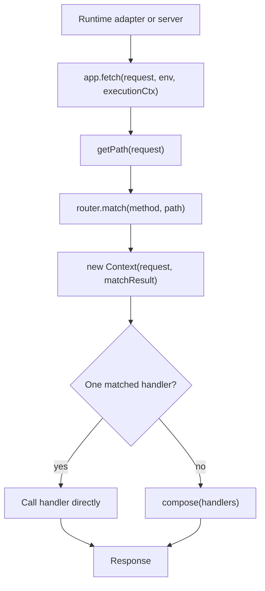

## Overview

Hono is a small web framework built only on Web Standard APIs (`Request`, `Response`, `Headers`, `URL`). Because an app is just a function from `Request` to `Response`, the same code runs on Cloudflare Workers, Fastly Compute, Deno, Bun, Vercel, AWS Lambda, Lambda@Edge and Node.js. The package has zero dependencies.

Sources: [README.md:22-34](repo://README.md#L22-L34), [README.md:36-46](repo://README.md#L36-L46)

An app is an instance of `Hono`, exported from the package root together with the `Context` class and the main types.

Sources: [src/index.ts:17-53](repo://src/index.ts#L17-L53)

## Parts of the framework

| Area | What it does | Page |
| --- | --- | --- |
| Getting started | Create an app, add routes and middleware, test it | [[Quickstart]] |
| Dispatch | Registers routes and turns each `Request` into a `Response` | [[Application and Request Dispatch]] |
| Context | The per-request object handlers use to build responses | [[Context and Responses]] |
| Request and validation | Param, query, header and body access; the `validator` middleware | [[Request Parsing and Validation]] |
| Types | Typed environment, path params and route schema | [[Type System and Typed Routes]] |
| Routers | The interchangeable route matchers and how one is chosen | [[Routers and Router Selection]] |
| Router internals | How the regular-expression and trie matchers work | [[RegExpRouter and TrieRouter Internals]] |
| Security middleware | Auth, CORS, CSRF, secure headers, IP rules, body limits | [[Authentication and Security Middleware]] |
| Other middleware | Compression, caching, logging, request ids and more | [[Response, Observability and Utility Middleware]] |
| Static files | `serveStatic` and its per-runtime wrappers | [[Serving Static Files]] |
| Adapters | Entry points for Lambda, Pages, Vercel, Netlify, service workers | [[Platform Adapters and Connection Info]] |
| WebSocket | Runtime-neutral upgrade helper | [[WebSocket Support]] |
| RPC client | `hc`, a typed client built from the app type | [[RPC Client (hc)]] |
| JSX | Server rendering and DOM rendering with hooks | [[JSX Server Rendering]], [[JSX DOM Rendering and Hooks]] |
| Streaming | `stream`, `streamText`, `streamSSE` | [[Streaming Helpers]] |
| SSG | Generate static files from an app | [[Static Site Generation]] |
| Helpers | cookie, accepts, html, css, factory, route, proxy, testing, dev | [[Built-in Helpers Catalogue]] |
| Build | Package build, exports and test layout | [[Build, Exports and Testing]] |

Sources: [src/hono-base.ts:98-173](repo://src/hono-base.ts#L98-L173), [package.json:6-30](repo://package.json#L6-L30)

## Main request flow

Sources: [src/hono-base.ts:406-485](repo://src/hono-base.ts#L406-L485)

1. The runtime, or a function in [[Platform Adapters and Connection Info]], calls `app.fetch` with a standard `Request`, the environment bindings and an execution context. `fetch` forwards to a private `#dispatch`. See [[Application and Request Dispatch]].
2. `getPath` extracts the path and `router.match(method, path)` returns every matching handler in registration order. See [[Routers and Router Selection]].
3. A `Context` is built from the request and match result. See [[Context and Responses]].
4. When exactly one handler matched, it is called directly. Otherwise `compose` runs the handlers as nested middleware, each calling `next()`. Errors go to the error handler and an unmatched request goes to the not-found handler.

Sources: [src/hono-base.ts:418-465](repo://src/hono-base.ts#L418-L465), [src/compose.ts:15-73](repo://src/compose.ts#L15-L73)

## Design decisions

**Only Web Standards.** Handlers receive a `Context` that wraps a standard `Request` and builds standard `Response` objects; adapters translate platform events into this shape, so core code never imports a runtime API.

Sources: [src/context.ts:1-12](repo://src/context.ts#L1-L12), [src/adapter/vercel/handler.ts:1-8](repo://src/adapter/vercel/handler.ts#L1-L8)

**The router is a pluggable interface.** `HonoBase` is "like an abstract class and does not have a router": a subclass assigns `this.router` in its constructor. The default `Hono` uses a `SmartRouter` over `RegExpRouter` and `TrieRouter`; the `hono/quick` preset swaps in `LinearRouter` and `hono/tiny` uses `PatternRouter`. A custom router can also be passed in `HonoOptions`.

Sources: [src/hono-base.ts:114-118](repo://src/hono-base.ts#L114-L118), [src/hono.ts:26-33](repo://src/hono.ts#L26-L33), [src/preset/quick.ts:1-20](repo://src/preset/quick.ts#L1-L20), [src/preset/tiny.ts:1-16](repo://src/preset/tiny.ts#L1-L16)

**Many small entry points.** `package.json` lists an `exports` entry per module (for example `hono/request`, `hono/types`, `hono/tiny`), each with ESM, CommonJS and type paths, so applications import only what they use.

Sources: [package.json:33-60](repo://package.json#L33-L60)

**Types follow the routes.** `Hono` carries environment, schema and base-path type parameters, and `get`, `post`, `on` and `use` are typed through `HandlerInterface` so the route schema can later feed `c.req.valid` and the client. See [[Type System and Typed Routes]] and [[RPC Client (hc)]].

Sources: [src/hono-base.ts:98-112](repo://src/hono-base.ts#L98-L112)

**Errors are values, not control flow in the router.** Thrown `Error`s are caught around handlers and passed to `onError`; a thrown `HTTPException` carries its own `getResponse()`, which the default handler uses. Non-`Error` throws are rethrown.

Sources: [src/hono-base.ts:35-42](repo://src/hono-base.ts#L35-L42), [src/hono-base.ts:399-404](repo://src/hono-base.ts#L399-L404)
