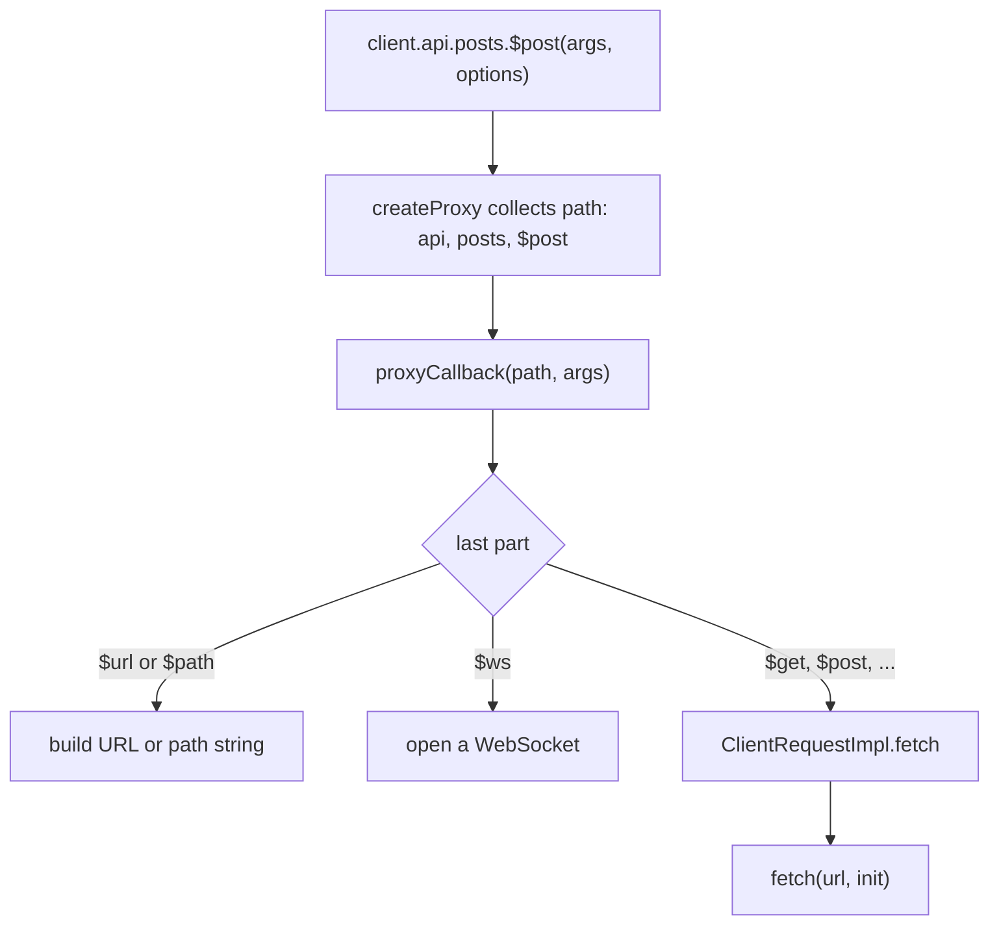

## Overview

`hc` (from `hono/client`) creates a client whose shape mirrors an app's routes. Given the type of a `Hono` app and a base URL, a call such as `client.api.posts[':id'].$get({ param: { id: '1' } })` builds and sends the matching `fetch` request. The mirroring is done entirely in types, from the schema that route registration accumulates (see [[Type System and Typed Routes]]); at run time the client is one `Proxy` that records the property path you walk and, on the call, turns that path into a URL and method.

Sources: [src/client/client.ts:15-31](repo://src/client/client.ts#L15-L31), [src/client/client.ts:133-140](repo://src/client/client.ts#L133-L140), [src/client/types.ts:294-320](repo://src/client/types.ts#L294-L320)

## From property access to a request

Sources: [src/client/client.ts:15-31](repo://src/client/client.ts#L15-L31), [src/client/client.ts:133-232](repo://src/client/client.ts#L133-L232)

`createProxy(callback, path)` returns a function-shaped `Proxy`. Reading a string property returns a new proxy with that key appended to `path`, except `then`, which returns `undefined` so that awaiting a proxy does not hang. Calling the proxy invokes `callback({ path, args })`.

Sources: [src/client/client.ts:15-31](repo://src/client/client.ts#L15-L31)

`hc(baseUrl, options)` supplies the callback. It first lets `toString()` and `valueOf()` work on the proxy, so `client.a.b.name.toString()` yields the name. Then, if the last path part starts with `$`, that part is removed and its text (without `$`) is the method: `get`, `post`, `url`, `path` or `ws`. The remaining parts are joined with `/` and merged onto `baseUrl`.

Sources: [src/client/client.ts:133-170](repo://src/client/client.ts#L133-L170), [src/client/utils.ts:11-16](repo://src/client/utils.ts#L11-L16)

## URL helpers and WebSockets

`$url(arg)` and `$path(arg)` return a `URL` or a path string without sending anything. Path parameters from `arg.param` are substituted and `arg.query` is serialised, then a trailing `/index` segment is removed; `$path` returns only the part after the base URL.

Sources: [src/client/client.ts:171-186](repo://src/client/client.ts#L171-L186), [src/client/utils.ts:18-24](repo://src/client/utils.ts#L18-L24), [src/client/utils.ts:55-60](repo://src/client/utils.ts#L55-L60)

`$ws(arg)` changes the URL scheme from `http` to `ws`, applies params and query, and opens a socket with `new WebSocket(url)` or with `options.webSocket` when you provide one, which is the hook for runtimes that need their own constructor. It pairs with the server-side [[WebSocket Support]].

Sources: [src/client/client.ts:187-212](repo://src/client/client.ts#L187-L212), [src/client/utils.ts:46-53](repo://src/client/utils.ts#L46-L53)

## Building and sending the request

For an HTTP method, `hc` creates a `ClientRequestImpl(url, method)`, merges per-call options over the options given to `hc`, and calls its `fetch(args, options)`. Header options are merged specially: when both levels give headers (objects or functions) they are combined into one async function, the per-call values winning. The rest of the options go through `deepMerge`.

Sources: [src/client/client.ts:214-232](repo://src/client/client.ts#L214-L232), [src/client/utils.ts:62-82](repo://src/client/utils.ts#L62-L82)

`ClientRequestImpl.fetch` turns `args` into a request, using the same names as the server's validation targets (see [[Request Parsing and Validation]]):

Sources: [src/client/client.ts:53-58](repo://src/client/client.ts#L53-L58)

| Argument | Effect |
| --- | --- |
| `query` | Serialised with `buildSearchParams` (arrays become repeated keys, `undefined` values are skipped) and appended after `?` |
| `form` | Appended to a `FormData` body; arrays append each item, `undefined` values are skipped |
| `json` | `JSON.stringify` body, with `Content-Type: application/json` |
| `param` | Replaces `:name` segments in the URL, including `:name{pattern}` and optional `:name?` forms |
| `header` | Becomes request headers, together with any `headers` option (a function may be async) |
| `cookie` | Serialised with `serialize` and joined into one `Cookie` header |

Sources: [src/client/client.ts:53-110](repo://src/client/client.ts#L53-L110), [src/client/utils.ts:18-44](repo://src/client/utils.ts#L18-L44)

The final call is `(opt?.fetch || fetch)(url, { body, method, headers, ...opt?.init })`. The body is omitted for `GET` and `HEAD`. A custom `fetch` option may also be a Hono app's `request` method, which is how a client talks to an app in the same process in tests. The result is a plain `Response`, typed as a `ClientResponse` so that `.json()` and `.text()` follow the route's output format.

Sources: [src/client/client.ts:111-130](repo://src/client/client.ts#L111-L130), [src/client/types.ts:28-41](repo://src/client/types.ts#L28-L41), [src/client/types.ts:128-154](repo://src/client/types.ts#L128-L154)

## Types of the client

`Client<T, Prefix>` takes the schema `S` of the app type and, for each path key, `PathToChain` splits the path at `/` into nested objects; an empty final segment becomes `index`. At the leaf, `ClientRequest` maps every method in the schema to a function: `args` is required when the endpoint's input has required keys, optional otherwise, and the return is a promise of the `ClientResponse` built from the endpoint's output, format and status. A route registered with `app.all` is expanded to all standard methods. `$url` and `$path` are added to every leaf, and `$ws` only when the `$get` endpoint has the output format `ws`.

Sources: [src/client/types.ts:11-26](repo://src/client/types.ts#L11-L26), [src/client/types.ts:67-118](repo://src/client/types.ts#L67-L118), [src/client/types.ts:294-320](repo://src/client/types.ts#L294-L320)

`InferRequestType` and `InferResponseType` pull the argument type and the output type (optionally by status code) out of one of those client functions, so application code can name them without repeating route types.

Sources: [src/client/types.ts:240-280](repo://src/client/types.ts#L240-L280)

## Parsing responses

`parseResponse(fetchRes)` awaits a client response, reads its body, and returns the data or throws. It reads nothing for null-body statuses (101, 204, 205, 304) or bodies that are absent. The body is read as JSON when the content type matches the JSON pattern (`application/json`, or a `+json` suffix) and as text otherwise. A non-`ok` response throws `DetailedError` with message `<status> <statusText>`, a `statusCode`, and the parsed body in `detail.data`. The return type removes error statuses, so a successful call is typed as the success body.

Sources: [src/client/fetch-result-please.ts:7-44](repo://src/client/fetch-result-please.ts#L7-L44), [src/client/fetch-result-please.ts:46-95](repo://src/client/fetch-result-please.ts#L46-L95), [src/client/utils.ts:91-114](repo://src/client/utils.ts#L91-L114)
