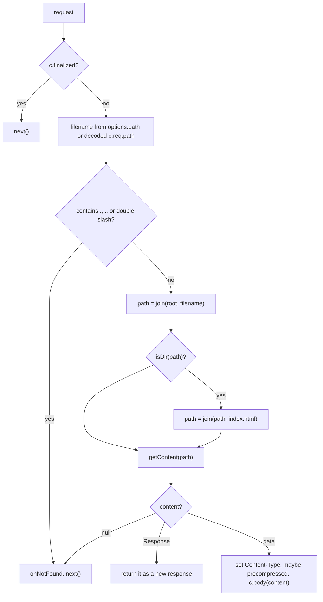

## Overview

`serveStatic` in `src/middleware/serve-static/index.ts` is a runtime-neutral middleware: it decides which file a request means, asks a `getContent` function for it, and builds the response. It cannot read files itself, because the runtimes differ. Each runtime therefore has a small wrapper, imported from its adapter, that supplies `getContent`, and sometimes `join` and `isDir`, and then calls the shared middleware. Choose the wrapper that matches where the app runs.

Sources: [src/middleware/serve-static/index.ts:35-54](repo://src/middleware/serve-static/index.ts#L35-L54), [src/adapter/bun/serve-static.ts:1-32](repo://src/adapter/bun/serve-static.ts#L1-L32)

## One request through the middleware

Sources: [src/middleware/serve-static/index.ts:54-125](repo://src/middleware/serve-static/index.ts#L54-L125)

1. If something earlier already produced a response (`c.finalized`), the middleware calls `next()` and does nothing else.
2. The file name is `options.path` when given; otherwise it is `c.req.path` decoded with `tryDecodeURI`. A name containing a `.` or `..` segment, repeated slashes, or a backslash is refused: `onNotFound` is called and the request moves on to `next()`.
3. The path is `join(root, name)`; `root` defaults to `./`. With `rewriteRequestPath` the name is rewritten first (not when a fixed `path` was given). The default `join` collapses duplicate slashes and resolves `.` and `..`.
4. If `isDir` exists and reports a directory, `index.html` is appended.
5. `getContent(path, c)` returns a `Response`, content, or `null`. A `Response` is copied through `c.newResponse`. `null` calls `onNotFound` and `next()`, so a later route can answer.

Sources: [src/middleware/serve-static/index.ts:54-87](repo://src/middleware/serve-static/index.ts#L54-L87), [src/middleware/serve-static/path.ts:5-25](repo://src/middleware/serve-static/path.ts#L5-L25)

## Content type and precompressed files

For content, the type comes from `options.mimes` first, then the built-in `getMimeType`, falling back to `application/octet-stream`.

Sources: [src/middleware/serve-static/index.ts:93-95](repo://src/middleware/serve-static/index.ts#L93-L95)

With `precompressed: true` and a compressible type (or an unknown one), it reads `Accept-Encoding` and tries `br` (`.br`), `zstd` (`.zst`) and `gzip` (`.gz`) in that order. The first accepted encoding for which `path + extension` exists replaces the content, sets `Content-Encoding` and appends `Accept-Encoding` to `Vary`. Finally `onFound(path, c)` runs and the body is returned with `c.body(content)`.

Sources: [src/middleware/serve-static/index.ts:23-28](repo://src/middleware/serve-static/index.ts#L23-L28), [src/middleware/serve-static/index.ts:96-120](repo://src/middleware/serve-static/index.ts#L96-L120)

## Options

| Option | Effect |
| --- | --- |
| `root` | Directory prefix, default `./` |
| `path` | Serve this fixed file for every request, ignoring the URL |
| `precompressed` | Look for `.br`, `.zst` and `.gz` siblings |
| `mimes` | Extra extension to type mapping |
| `rewriteRequestPath` | Change the request path before joining it to `root` |
| `onFound`, `onNotFound` | Hooks called with the path and the context |

Sources: [src/middleware/serve-static/index.ts:13-21](repo://src/middleware/serve-static/index.ts#L13-L21)

## Runtime wrappers

| Wrapper | `getContent` reads from | Extras |
| --- | --- | --- |
| Bun | `Bun.file(path)` when it exists | `isDir` through `node:fs` `stat`; `join` from `node:path` |
| Deno | `Deno.open(path).readable`; returns `null` for a directory or a missing file and logs other errors | `isDir` through `lstatSync`; `join` from `node:path` |
| Cloudflare Workers | the KV asset namespace, through `getContentFromKVAsset` | `namespace` and `manifest` options; no `isDir` |

Sources: [src/adapter/bun/serve-static.ts:9-32](repo://src/adapter/bun/serve-static.ts#L9-L32), [src/adapter/deno/serve-static.ts:8-42](repo://src/adapter/deno/serve-static.ts#L8-L42), [src/adapter/cloudflare-workers/serve-static.ts:6-42](repo://src/adapter/cloudflare-workers/serve-static.ts#L6-L42)

On Cloudflare Workers, `getContentFromKVAsset` looks the path up in an asset manifest (the `manifest` option, else the global `__STATIC_CONTENT_MANIFEST`) to get a key, then reads that key from the KV namespace (the `namespace` option, `c.env.__STATIC_CONTENT`, or the global) as a stream. A missing manifest entry or missing value returns `null`. Another file exports the same middleware without the `namespace` option for ES module Workers.

Sources: [src/adapter/cloudflare-workers/utils.ts:11-50](repo://src/adapter/cloudflare-workers/utils.ts#L11-L50), [src/adapter/cloudflare-workers/serve-static-module.ts:1-12](repo://src/adapter/cloudflare-workers/serve-static-module.ts#L1-L12)

A file that is not found never produces a 404 on its own: the middleware calls `next()`, so the usual not-found handler (see [[Application and Request Dispatch]]) or a later route decides.

Sources: [src/middleware/serve-static/index.ts:122-125](repo://src/middleware/serve-static/index.ts#L122-L125)
