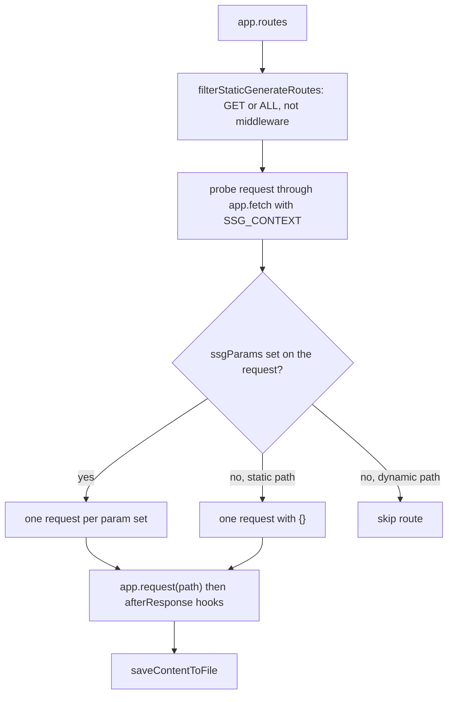

## Overview

The SSG helper (`hono/ssg`) turns an app into files. It reads the app's own route list, requests each static `GET` route through `app.fetch` / `app.request`, and writes each response body to a file. No server is started. The core, `toSSG(app, fsModule, options)`, is runtime-neutral and receives a small `FileSystemModule` (`writeFile` and `mkdir`); the Bun and Deno adapters provide ones and re-export `toSSG` with the module bound.

Sources: [src/helper/ssg/ssg.ts:34-48](repo://src/helper/ssg/ssg.ts#L34-L48), [src/helper/ssg/ssg.ts:368-470](repo://src/helper/ssg/ssg.ts#L368-L470), [src/adapter/bun/ssg.ts:13-27](repo://src/adapter/bun/ssg.ts#L13-L27), [src/adapter/deno/ssg.ts:9-27](repo://src/adapter/deno/ssg.ts#L9-L27)

## Generating one page

Sources: [src/helper/ssg/ssg.ts:205-302](repo://src/helper/ssg/ssg.ts#L205-L302), [src/helper/ssg/utils.ts:57-75](repo://src/helper/ssg/utils.ts#L57-L75)

1. `toSSG` collects hooks from `options` and from each plugin (the default plugin when none are given) and creates a request generator with `fetchRoutesContent`.
2. `filterStaticGenerateRoutes` walks `app.routes`, a list the dispatcher keeps in registration order (see [[Application and Request Dispatch]]). A route is kept if its method is `GET` or `ALL` and its handler, after unwrapping any `COMPOSED_HANDLER` from `route()`, is not middleware (a function taking more than one argument).
3. For each route, a probe `Request` to `http://localhost<path>` goes through `beforeRequestHook`, which may replace it or return `false` to skip the route. It is sent to `app.fetch` with `{ HONO_SSG_CONTEXT: true }` as env, throttled by a pool (`concurrency`, default 2).
4. The probe lets the `ssgParams` middleware attach parameter sets to the request object. If none were attached, a dynamic route (any `:` or `*` segment) is skipped and a static one gets `[{}]`.
5. For each parameter set the path is built with `replaceUrlParam` from the client utilities and requested again with `app.request`. A response carrying `x-hono-disable-ssg` is skipped; otherwise `afterResponseHook` may replace the response or return `false`. The MIME type comes from `Content-Type` (default `text/plain`) and the body is read as text for `text` or `json` types and as an `ArrayBuffer` otherwise.
6. `saveContentToFile` computes the path, creates its directory once and writes the file.

Sources: [src/helper/ssg/ssg.ts:368-450](repo://src/helper/ssg/ssg.ts#L368-L450), [src/helper/ssg/utils.ts:57-75](repo://src/helper/ssg/utils.ts#L57-L75), [src/utils/handler.ts:8-15](repo://src/utils/handler.ts#L8-L15), [src/helper/ssg/ssg.ts:205-302](repo://src/helper/ssg/ssg.ts#L205-L302), [src/helper/ssg/ssg.ts:74-88](repo://src/helper/ssg/ssg.ts#L74-L88), [src/helper/ssg/ssg.ts:310-334](repo://src/helper/ssg/ssg.ts#L310-L334)

The result is `{ success, files, error? }`. Any failure while requesting or saving is caught and reported as `success: false` with an empty `files` list; after-generate hooks then run with that result.

Sources: [src/helper/ssg/ssg.ts:450-470](repo://src/helper/ssg/ssg.ts#L450-L470)

## File paths

`generateFilePath(routePath, outDir, mimeType)` picks the extension from the MIME type: the default map covers `text/html`, the XML types and `application/yaml`, otherwise the shared `getExtension` lookup is used, with `html` as the last resort. It then places the file:

Sources: [src/helper/ssg/ssg.ts:56-71](repo://src/helper/ssg/ssg.ts#L56-L71)

| Route path | File |
| --- | --- |
| already ends with `.<extension>` | the path as is |
| `/` | `index.<ext>` |
| ends with `/` | `<path>index.<ext>` |
| anything else | `<path>.<ext>` |

Sources: [src/helper/ssg/ssg.ts:50-72](repo://src/helper/ssg/ssg.ts#L50-L72), [src/helper/ssg/ssg.ts:90-108](repo://src/helper/ssg/ssg.ts#L90-L108)

`ensureWithinOutDir` throws `Path traversal detected` when the final path is outside the output directory (default `./static`), using path joins that resolve `..` first.

Sources: [src/helper/ssg/utils.ts:50-87](repo://src/helper/ssg/utils.ts#L50-L87), [src/helper/ssg/ssg.ts:27](repo://src/helper/ssg/ssg.ts#L27-L27)

## Middleware that shapes generation

These run inside the app when it is requested by the generator:

Sources: [src/helper/ssg/middleware.ts:5-12](repo://src/helper/ssg/middleware.ts#L5-L12)

| Middleware | Effect |
| --- | --- |
| `ssgParams(params or fn)` | On a dynamic route, store the parameter list (a list or a function of the context) on the raw request and return `c.notFound()` so the handler does not run during the probe |
| `disableSSG()` | In generation, set the `x-hono-disable-ssg` header and return not found, so the route is left out |
| `onlySSG()` | Return not found unless the request is a generation request |
| `isSSGContext(c)` | `true` when `c.env` has `HONO_SSG_CONTEXT` |

Sources: [src/helper/ssg/middleware.ts:5-83](repo://src/helper/ssg/middleware.ts#L5-L83)

## Hooks and plugins

`beforeRequestHook`, `afterResponseHook` and `afterGenerateHook` can each be one function or an array. Arrays are combined: the first two run in sequence, each result replacing the current request or response unless it is `false`, which stops the chain and skips the route; `afterGenerateHook` functions all run with the result, the file system module and the options. Plugins are objects with those three hooks, and hooks from `options` come before plugin hooks.

Sources: [src/helper/ssg/ssg.ts:110-198](repo://src/helper/ssg/ssg.ts#L110-L198), [src/helper/ssg/ssg.ts:368-419](repo://src/helper/ssg/ssg.ts#L368-L419)

Two plugins ship in `plugins.ts`. `defaultPlugin()` (used when `plugins` is not passed) drops every response whose status is not 200. `redirectPlugin()` turns 301, 302, 303, 307 and 308 responses into a 200 page with a meta refresh to the `Location` value (or skips it when there is none); when you pass `plugins` yourself you take over responsibility for such filtering.

Sources: [src/helper/ssg/plugins.ts:11-72](repo://src/helper/ssg/plugins.ts#L11-L72), [src/helper/ssg/ssg.ts:372](repo://src/helper/ssg/ssg.ts#L372-L372)

## Options and runtime wrappers

`ToSSGOptions` has `dir` (output directory), the three hooks, `concurrency`, `extensionMap` (replaces the default MIME-to-extension map) and `plugins`.

Sources: [src/helper/ssg/ssg.ts:181-198](repo://src/helper/ssg/ssg.ts#L181-L198)

The Bun module writes with `Bun.write` and its `mkdir` does nothing; the Deno module encodes strings and uses `Deno.writeFile` and `Deno.mkdir` with `recursive`. A custom runtime can call `toSSG` from `hono/ssg` with its own `FileSystemModule`. The SSG middleware relies on the env argument that `app.fetch` receives, as described in [[Platform Adapters and Connection Info]].

Sources: [src/adapter/bun/ssg.ts:13-27](repo://src/adapter/bun/ssg.ts#L13-L27), [src/adapter/deno/ssg.ts:9-27](repo://src/adapter/deno/ssg.ts#L9-L27), [src/helper/ssg/ssg.ts:341-348](repo://src/helper/ssg/ssg.ts#L341-L348)
