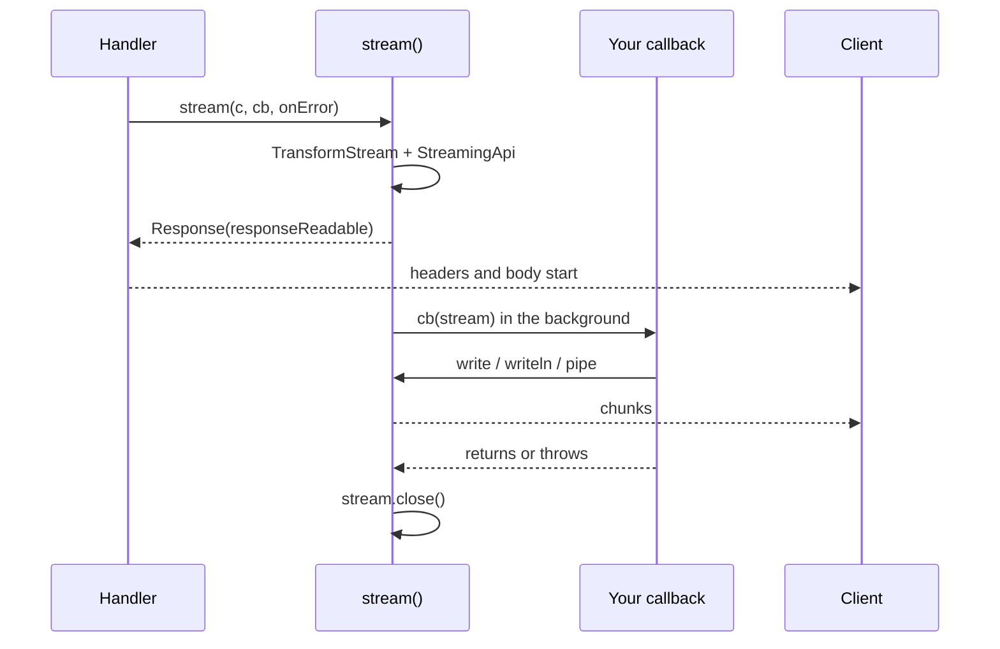

## Overview

The streaming helpers send a response whose body is written over time. All three (`stream`, `streamText`, `streamSSE`) share one pattern: create a `TransformStream`, wrap its two ends in a `StreamingApi`, return a `Response` built from the readable end at once, and run your callback in the background to write into the writable end. `streamText` and `streamSSE` only add headers and message framing on top of that. Import them from `hono/streaming`.

Sources: [src/helper/streaming/stream.ts:7-45](repo://src/helper/streaming/stream.ts#L7-L45), [src/helper/streaming/index.ts:6-9](repo://src/helper/streaming/index.ts#L6-L9)

## StreamingApi

`StreamingApi` in `src/utils/stream.ts` is what your callback receives. Its public surface:

Sources: [src/utils/stream.ts:6-21](repo://src/utils/stream.ts#L6-L21)

| Member | Behaviour |
| --- | --- |
| `write(input)` | Encodes strings as UTF-8 and writes the bytes; a write error is swallowed |
| `writeln(input)` | `write` with a trailing newline |
| `sleep(ms)` | A promise resolved by `setTimeout` |
| `pipe(body)` | Releases the writer lock, pipes a `ReadableStream` into the writable with `preventClose`, then takes the writer back |
| `close()` | Sets `closed` and closes the writer; errors are swallowed |
| `onAbort(listener)` | Registers a function to run when the client goes away |
| `abort()` | Sets `aborted` and calls every listener once |
| `aborted`, `closed` | Flags |

Sources: [src/utils/stream.ts:6-97](repo://src/utils/stream.ts#L6-L97)

The `responseReadable` it exposes is a new `ReadableStream` that pulls from the transform's readable end. If the consumer cancels it (the client disconnects) and the stream is not already closed, the `cancel` handler calls `abort()`. One of the abort subscribers registered in the constructor cancels the reader, so a write that would otherwise wait for a slow consumer ends too.

Sources: [src/utils/stream.ts:21-46](repo://src/utils/stream.ts#L21-L46)

## Following one streamed response

Sources: [src/helper/streaming/stream.ts:7-45](repo://src/helper/streaming/stream.ts#L7-L45)

1. `stream(c, cb, onError)` creates the `TransformStream` and the `StreamingApi`.
2. It remembers the `Context` in a `WeakMap` keyed by the readable stream. The comment explains why: in Bun, `c` would otherwise be destroyed when the request returns.
3. It starts an async function that awaits `cb(stream)`. On an exception: `undefined` (a cancelled pipe) is ignored; an `Error` goes to `onError(e, stream)` when one is given; anything else is logged with `console.error`. A `finally` always calls `stream.close()`.
4. It returns `c.newResponse(stream.responseReadable)` immediately, so status and headers set on `c` before the call apply to the response.

Sources: [src/helper/streaming/stream.ts:5-45](repo://src/helper/streaming/stream.ts#L5-L45), [src/context.ts:641](repo://src/context.ts#L641-L641)

On Bun releases up to 1.1.x, `Response` streams from `Bun.serve()` do not call `cancel()`, so `isOldBunVersion()` (cached after the first call) makes the helper listen for the request's `abort` signal and call `abort()` instead.

Sources: [src/helper/streaming/utils.ts:1-11](repo://src/helper/streaming/utils.ts#L1-L11), [src/helper/streaming/stream.ts:15-22](repo://src/helper/streaming/stream.ts#L15-L22)

## streamText

`streamText` sets `Content-Type` to `text/plain; charset=UTF-8`, `X-Content-Type-Options: nosniff` and `Transfer-Encoding: chunked`, then calls `stream`. The callback and error handling are the same.

Sources: [src/helper/streaming/text.ts:6-15](repo://src/helper/streaming/text.ts#L6-L15)

## streamSSE

`streamSSE` follows the same steps with `SSEStreamingApi`, sets `Content-Type: text/event-stream`, `Cache-Control: no-cache`, `Connection: keep-alive` and chunked transfer, and runs the callback through its own `run` function.

Sources: [src/helper/streaming/sse.ts:47-100](repo://src/helper/streaming/sse.ts#L47-L100)

The one difference in error handling is that when you pass `onError`, after it runs the helper writes an SSE message with `event: error` and the error's message as data, so the client sees the failure. Without `onError` the error is only logged. The stream is closed afterwards in both cases.

Sources: [src/helper/streaming/sse.ts:47-68](repo://src/helper/streaming/sse.ts#L47-L68)

`SSEStreamingApi.writeSSE({ data, event, id, retry })` formats one message. `data` may be a promise; it is resolved with `resolveCallback`, so JSX output (see [[JSX Server Rendering]]) can be sent directly. The data is split on line breaks (`\r\n`, `\r` or `\n`) and every line is prefixed with `data: `. `event`, `id` or `retry` containing a line break throws an error (`... must not contain "\r" or "\n"`). The parts are joined with `\n` in the order event, data, id, retry and ended by a blank line, then written with `write`.

Sources: [src/helper/streaming/sse.ts:6-45](repo://src/helper/streaming/sse.ts#L6-L45)

## Related

`renderToReadableStream` in the JSX package is a separate streaming path for HTML with `Suspense`, used by `jsxRenderer` and not by these helpers; both end up in `c.body` or `c.newResponse`. See [[Context and Responses]].

Sources: [src/jsx/streaming.ts:146-220](repo://src/jsx/streaming.ts#L146-L220), [src/middleware/jsx-renderer/index.ts:66-77](repo://src/middleware/jsx-renderer/index.ts#L66-L77)
