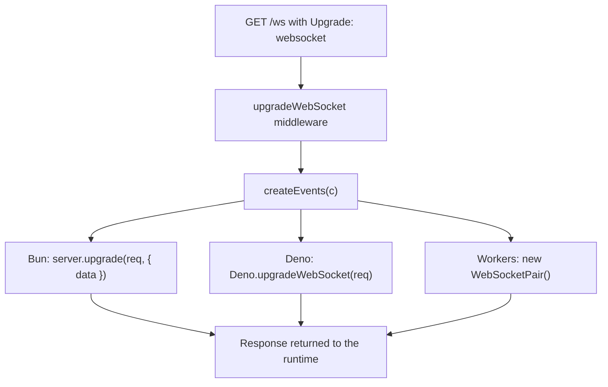

## Overview

`src/helper/websocket/index.ts` defines a runtime-neutral way to accept WebSocket connections. The helper supplies the shared types (`WSEvents`, `WSContext`, `UpgradeWebSocket`) and a factory, `defineWebSocketHelper`, that turns a runtime-specific upgrade function into the `upgradeWebSocket` function an app calls. The Bun, Deno and Cloudflare Workers adapters each export an `upgradeWebSocket` built that way. Application code looks the same on all three, apart from which adapter it imports from.

Sources: [src/helper/websocket/index.ts:14-48](repo://src/helper/websocket/index.ts#L14-L48), [src/helper/websocket/index.ts:111-140](repo://src/helper/websocket/index.ts#L111-L140)

## Events and the WSContext

An app supplies `WSEvents`: optional `onOpen`, `onMessage`, `onClose` and `onError` callbacks, each receiving a standard event and a `WSContext`. `WSContext` wraps what a runtime's socket can do: `send(data, { compress })`, `close(code, reason)`, `readyState`, `url` (a `URL` or `null`), `protocol`, `binaryType` and the underlying `raw` socket. The runtime adapter provides the implementation through a `WSContextInit` object. `createWSMessageEvent` builds a `MessageEvent` for runtimes that deliver a bare payload.

Sources: [src/helper/websocket/index.ts:14-22](repo://src/helper/websocket/index.ts#L14-L22), [src/helper/websocket/index.ts:50-100](repo://src/helper/websocket/index.ts#L50-L100)

## Two ways to call upgradeWebSocket

`UpgradeWebSocket` has two call forms, and `defineWebSocketHelper` implements both. When the first argument is a function, `upgradeWebSocket(createEvents, options)` returns a middleware: it calls `createEvents(c)` to get the events, runs the adapter's handler, returns the handler's response if there is one, and otherwise calls `next()`. When the first argument is a `Context`, `upgradeWebSocket(c, events, options)` runs the handler directly and throws `Failed to upgrade WebSocket` if it returns nothing.

Sources: [src/helper/websocket/index.ts:24-48](repo://src/helper/websocket/index.ts#L24-L48), [src/helper/websocket/index.ts:111-140](repo://src/helper/websocket/index.ts#L111-L140)

Because a failed upgrade returns nothing, a request that is not a WebSocket request falls through to `next()` and the following handler answers it, for example with a plain HTTP response. The client side of this, `$ws` in the RPC client, is described in [[RPC Client (hc)]].

Sources: [src/helper/websocket/index.ts:121-128](repo://src/helper/websocket/index.ts#L121-L128)

## How each runtime upgrades

### Upgrade flow

Sources: [src/adapter/bun/websocket.ts:48-75](repo://src/adapter/bun/websocket.ts#L48-L75), [src/adapter/deno/websocket.ts:4-38](repo://src/adapter/deno/websocket.ts#L4-L38), [src/adapter/cloudflare-workers/websocket.ts:5-53](repo://src/adapter/cloudflare-workers/websocket.ts#L5-L53)

### Deno

The Deno handler returns nothing unless the `upgrade` header is `websocket`. It echoes the first requested `Sec-WebSocket-Protocol` value back, because browsers reject a connection when a requested subprotocol is missing from the response. It calls `Deno.upgradeWebSocket(c.req.raw, options)`, wraps the socket in a `WSContext` and assigns the four events to `onopen`, `onmessage`, `onclose` and `onerror`. It returns the `response` from Deno.

Sources: [src/adapter/deno/websocket.ts:4-38](repo://src/adapter/deno/websocket.ts#L4-L38)

### Cloudflare Workers

The Workers handler also requires `Upgrade: websocket`. It creates a `WebSocketPair`, keeps the server end and wraps it in a `WSContext`. Listeners are added only for the events the app defined, and the type omits `onOpen` because the runtime has no `open` event. It calls `server.accept()` and returns a `101` response carrying the client end as `webSocket`.

Sources: [src/adapter/cloudflare-workers/websocket.ts:5-53](repo://src/adapter/cloudflare-workers/websocket.ts#L5-L53)

### Bun

Bun separates the upgrade from the socket callbacks, so the adapter has two parts. `upgradeWebSocket` gets the server with `getBunServer(c)`, throws `env has to include the 2nd argument of fetch.` when it is missing, and calls `server.upgrade(c.req.raw, { data })` with the events, the request URL and the first requested subprotocol. On success it returns an empty `Response`; on failure it returns nothing so the middleware falls through.

Sources: [src/adapter/bun/websocket.ts:48-75](repo://src/adapter/bun/websocket.ts#L48-L75), [src/adapter/bun/server.ts:1-4](repo://src/adapter/bun/server.ts#L1-L4)

The second part is a `websocket` object that must be given to `Bun.serve`. Its `open`, `message` and `close` callbacks read the events back from `ws.data.events`, wrap the socket with `createWSContext` and call the matching `WSEvents` callback; string messages and buffers are normalised before `createWSMessageEvent` builds the event. `createBunWebSocket()` returns both `upgradeWebSocket` and `websocket` together.

Sources: [src/adapter/bun/websocket.ts:33-47](repo://src/adapter/bun/websocket.ts#L33-L47), [src/adapter/bun/websocket.ts:76-113](repo://src/adapter/bun/websocket.ts#L76-L113)

> [!NOTE]
> On Bun the server object reaches the app through the second argument of `fetch` (`getBunServer` reads `c.env.server`, or `c.env` itself), the same mechanism `getConnInfo` uses. See [[Platform Adapters and Connection Info]].

Sources: [src/adapter/bun/server.ts:1-4](repo://src/adapter/bun/server.ts#L1-L4), [src/adapter/bun/conninfo.ts:6-20](repo://src/adapter/bun/conninfo.ts#L6-L20)
