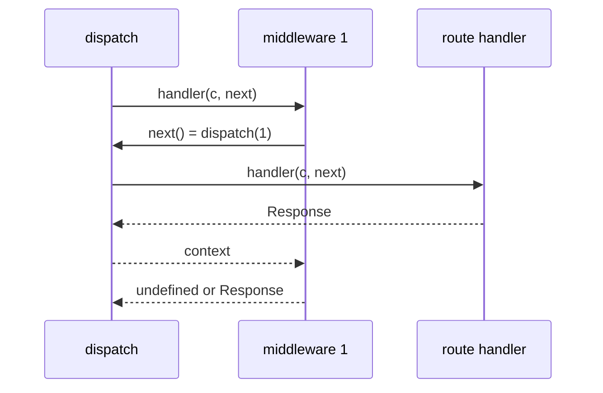

## Overview

When a request matches more than one handler — typically middleware registered with `app.use` followed by a route handler — `compose` in `src/compose.ts` turns the list into one function that runs them in order. It is a small adaptation of `koa-compose`: each handler receives the context and a `next` function, and awaiting `next()` runs everything after it. The same function also decides where thrown errors go. How the list is built and when `compose` is called is on [[Application and Request Lifecycle]].

Sources: [src/compose.ts:4-19](repo://src/compose.ts#L4-L19)

## Handler types

A plain handler is `(c, next) => response`, and a middleware is `(c, next) => Promise<Response | void>`; the combined type `H` accepts either. `Next` is `() => Promise<void>`. `ErrorHandler` receives an `Error` (or an object with `getResponse`) and the context and returns a `Response`. These are the types `compose` operates on.

Sources: [src/types.ts:35](repo://src/types.ts#L35), [src/types.ts:76-95](repo://src/types.ts#L76-L95), [src/types.ts:107-120](repo://src/types.ts#L107-L120)

## The dispatch loop

`compose(middleware, onError?, onNotFound?)` returns a function `(context, next?)`. Each call keeps its own `index` starting at `-1` and starts with `dispatch(0)`. `dispatch(i)` first refuses to move backwards: if `i <= index` it throws `next() called multiple times`. It then records `index = i`.

Sources: [src/compose.ts:15-36](repo://src/compose.ts#L15-L36)

The handler for step `i` is `middleware[i][0][0]` — each entry is `[[handler, route], params]` as the router returned it — and `context.req.routeIndex` is set to `i`, which is how `c.req.param()` later picks the parameters that belong to the currently running route ([[HonoRequest and Body Parsing]]). Past the end of the array, the handler is the outer `next` argument when `i === middleware.length`, otherwise there is none.

Sources: [src/compose.ts:38-47](repo://src/compose.ts#L38-L47), [src/request.ts:106-124](repo://src/request.ts#L106-L124)

The handler is awaited with `() => dispatch(i + 1)` as its `next`. That is the whole onion model: code before `await next()` runs on the way in, code after it on the way out.

Sources: [src/compose.ts:49-52](repo://src/compose.ts#L49-L52)

```ts
res = await handler(context, () => dispatch(i + 1))
```

Sources: [src/compose.ts:49-52](repo://src/compose.ts#L49-L52)



Sources: [src/compose.ts:32-71](repo://src/compose.ts#L32-L71)

## Setting the response

After a handler returns, `compose` stores its result with `if (res && (context.finalized === false || isError)) context.res = res`. So a returned `Response` is only applied if no earlier step already finalized the context — the response that is set first by an inner handler wins — except when the value came from the error handler. The `res` setter on `Context` marks the context finalized and merges headers; see [[Context and Responses]].

Sources: [src/compose.ts:67-70](repo://src/compose.ts#L67-L70)

When there is no handler left (the chain ran off the end) and the context is still not finalized and `onNotFound` was given, the not-found handler's response becomes the result. That is how an unmatched path ends with `404 Not Found`, and why a route handler that calls `await next()` without returning anything reaches the not-found handler.

Sources: [src/compose.ts:61-65](repo://src/compose.ts#L61-L65)

## Error handling

Each handler call is wrapped in `try/catch`. If the error is an `Error` and `onError` was provided, `compose` sets `context.error = err`, calls `onError(err, context)`, and marks `isError` so the result overrides any earlier response. Anything else is rethrown. Because `context.error` is set before the middleware above this one resumes after its `await next()`, an outer middleware can inspect `c.error` after the inner one failed.

Sources: [src/compose.ts:49-59](repo://src/compose.ts#L49-L59), [src/context.ts:318-333](repo://src/context.ts#L318-L333)

The default error handler lives in `src/hono-base.ts`. If the error has a `getResponse` method it returns `c.newResponse(res.body, res)` built from that response; otherwise it logs with `console.error` and returns `Internal Server Error` with status 500. Applications replace it with `app.onError(handler)`.

Sources: [src/hono-base.ts:35-42](repo://src/hono-base.ts#L35-L42), [src/hono-base.ts:271-274](repo://src/hono-base.ts#L271-L274)

`HTTPException` is the error class meant for failures such as authentication. It extends `Error` with a `status` (default 500) and an optional `res`, `message` and `cause`. `getResponse()` returns a new `Response` with the exception's status — reusing the body and headers of `res` if one was given, otherwise using the message as the body.

Sources: [src/http-exception.ts:46-77](repo://src/http-exception.ts#L46-L77)

```ts
throw new HTTPException(401, { message: 'Custom error message' })
```

Sources: [src/http-exception.ts:46-77](repo://src/http-exception.ts#L46-L77)

## Errors from mounted sub-apps

`route(path, app)` copies the sub-app's routes into the parent. If the sub-app installed its own `onError` handler (its `errorHandler` is not the module default), each copied handler is replaced by one that runs `compose([], app.errorHandler)` around the original, so exceptions raised inside the sub-app are handled by the sub-app's handler rather than the parent's. The wrapper stores the original handler under the `COMPOSED_HANDLER` key so tooling can find it again; `findTargetHandler` in `src/utils/handler.ts` follows that chain, and `isMiddleware` treats any function with more than one parameter as middleware.

Sources: [src/hono-base.ts:219-230](repo://src/hono-base.ts#L219-L230), [src/utils/handler.ts:8-15](repo://src/utils/handler.ts#L8-L15), [src/utils/constants.ts:1-4](repo://src/utils/constants.ts#L1-L4)

## Single-handler path

When only one handler matched, `#dispatch` does not call `compose` at all; it calls the handler with a `next` that sets the not-found response, and handles its sync and async errors itself. The differences from the composed path are in [[Application and Request Lifecycle]].

Sources: [src/hono-base.ts:429-448](repo://src/hono-base.ts#L429-L448)
