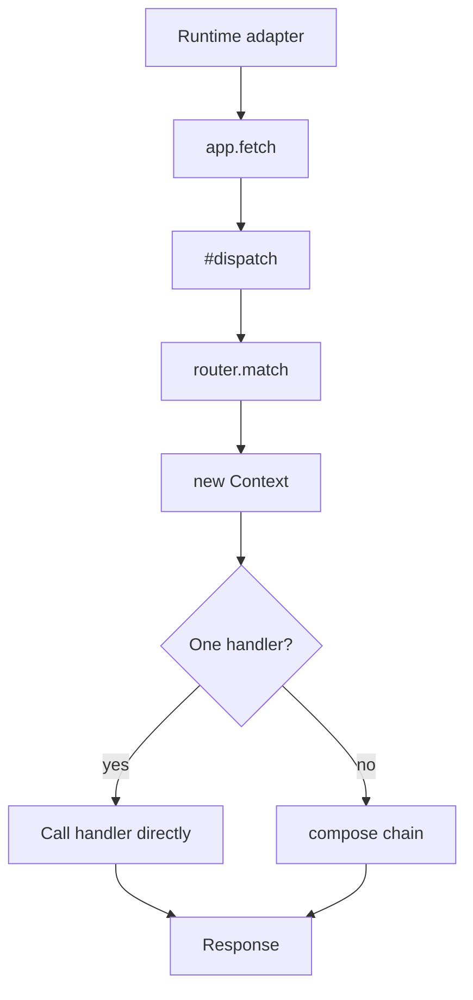

## Overview

Hono is a web framework written against the Web Standard `Request` and `Response` objects, so one app runs unchanged on Cloudflare Workers, Fastly Compute, Deno, Bun, Vercel, AWS Lambda, Lambda@Edge and Node.js. The package has no runtime dependencies and ships many small entry points (`hono`, `hono/tiny`, `hono/jsx`, `hono/cors`, …) so an application imports only what it uses.

Sources: [README.md:23-25](repo://README.md#L23-L25), [package.json:1-8](repo://package.json#L1-L8)

An app is a `Hono` instance. You register handlers with `app.get(...)`, `app.use(...)` and friends, and the runtime calls `app.fetch(request, env, executionCtx)`, which returns a `Response`. That single function is the whole integration surface, which is why adapters are only a few lines each (see [[Runtime Adapters]]).

Sources: [src/index.ts:6-15](repo://src/index.ts#L6-L15), [src/hono-base.ts:479-485](repo://src/hono-base.ts#L479-L485)

## Parts of the library

| Area | What it does | Page |
| --- | --- | --- |
| App class | Registers routes, groups sub-apps, mounts foreign handlers, dispatches requests | [[Application and Request Lifecycle]] |
| Composition | Runs the matched handlers as a chain with `next()` and routes errors | [[Middleware Composition and Error Handling]] |
| Context | Per-request object that holds the request, variables and builds responses | [[Context and Responses]] |
| Request | Path params, query, headers and cached body parsing | [[HonoRequest and Body Parsing]] |
| Routers | Match a method and path to handlers | [[Router Interface and SmartRouter]], [[RegExpRouter Internals]], [[TrieRouter, LinearRouter and PatternRouter]] |
| Validation | Typed input validation middleware | [[Validator and Typed Routes]] |
| RPC client | `hc()` typed client derived from the app type | [[RPC Client (hc)]] |
| JSX | Server string rendering with streaming, and a client DOM runtime | [[JSX Server Rendering and Streaming]], [[JSX DOM Runtime and Hooks]] |
| Adapters | Turn each runtime's entry event into `app.fetch` | [[Runtime Adapters]] |
| Middleware | Built-in auth, security and utility middleware | [[Authentication and Security Middleware]], [[Utility and Response Middleware]] |
| Helpers | Cookies, streaming, factories, testing and more | [[Helpers Catalogue]], [[Static Site Generation]] |
| Build | esbuild pipeline, exports map, tests | [[Build, Exports and Testing]] |

Sources: [src/hono-base.ts:98-173](repo://src/hono-base.ts#L98-L173), [src/hono.ts:16-34](repo://src/hono.ts#L16-L34)

## Request flow

Sources: [src/hono-base.ts:406-466](repo://src/hono-base.ts#L406-L466)

1. The runtime or an adapter calls `fetch` ([[Runtime Adapters]]).
2. `#dispatch` computes the path and asks the router for the matching handlers ([[Application and Request Lifecycle]], [[Router Interface and SmartRouter]]).
3. A `Context` is built around the request and the match result ([[Context and Responses]]).
4. With a single matched handler it is called directly; otherwise `compose` runs the chain ([[Middleware Composition and Error Handling]]).
5. Handlers read input through `c.req` ([[HonoRequest and Body Parsing]]) and return a `Response`, usually built with `c.text`, `c.json` or `c.html`.

Sources: [src/hono-base.ts:418-466](repo://src/hono-base.ts#L418-L466)

## Design decisions

**Only Web Standards.** `fetch` takes a `Request` and returns a `Response`; runtime specifics such as Cloudflare bindings arrive as the opaque `env` argument and an `ExecutionContext`, and `Context` exposes them as `c.env` and `c.executionCtx`.

Sources: [src/hono-base.ts:479-485](repo://src/hono-base.ts#L479-L485), [src/context.ts:352-397](repo://src/context.ts#L352-L397)

**`HonoBase` has no router; presets choose one.** The class comment says it is "like an abstract class" that needs a router assigned in the constructor. The default `Hono` assigns a `SmartRouter` over `RegExpRouter` and `TrieRouter`, the `quick` preset uses `LinearRouter` then `TrieRouter`, and the `tiny` preset uses only `PatternRouter`, trading speed for a smaller bundle. The choice is made per entry point (`hono`, `hono/quick`, `hono/tiny`).

Sources: [src/hono-base.ts:114-118](repo://src/hono-base.ts#L114-L118), [src/hono.ts:26-33](repo://src/hono.ts#L26-L33), [src/preset/quick.ts:18-23](repo://src/preset/quick.ts#L18-L23), [src/preset/tiny.ts:15-20](repo://src/preset/tiny.ts#L15-L20), [package.json:59-68](repo://package.json#L59-L68)

**Skip composition when it is not needed.** `#dispatch` comments "Do not `compose` if it has only one handler" and calls the handler straight away, handing it a `next` that sets the not-found response. A request with several handlers goes through `compose`.

Sources: [src/hono-base.ts:429-466](repo://src/hono-base.ts#L429-L466)

**Routes are stored twice.** `#addRoute` sends each route to the router and also records it in `app.routes`, so `route()` can replay a sub-app's routes onto a parent under a new base path.

Sources: [src/hono-base.ts:208-232](repo://src/hono-base.ts#L208-L232), [src/hono-base.ts:385-397](repo://src/hono-base.ts#L385-L397)

**Types follow the routes.** The class carries `Env`, `Schema` and base-path type parameters, and `route()` merges a sub-app's schema into the parent's, which is what the typed client in [[RPC Client (hc)]] reads.

Sources: [src/hono-base.ts:98-103](repo://src/hono-base.ts#L98-L103), [src/hono-base.ts:208-217](repo://src/hono-base.ts#L208-L217)
