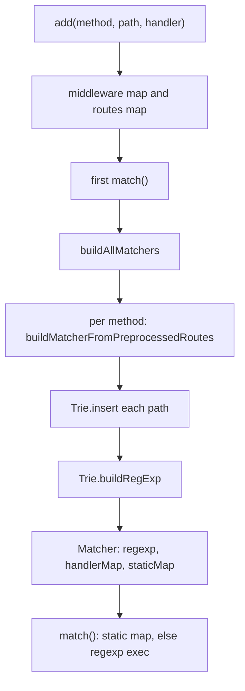

## Overview

`RegExpRouter` is the default first choice in `hono` ([[Router Interface and SmartRouter]]). Instead of walking routes per request, it compiles all routes for a method into a single regular expression the first time `match` is called, then answers each request with one `RegExp` execution plus a lookup. It accepts only path patterns it can express as one deterministic expression; for anything else it throws `UnsupportedPathError` so `SmartRouter` falls back to `TrieRouter`.

Sources: [src/router/reg-exp-router/router.ts:122-130](repo://src/router/reg-exp-router/router.ts#L122-L130), [src/router/reg-exp-router/matcher.ts:10-33](repo://src/router/reg-exp-router/matcher.ts#L10-L33), [src/router/reg-exp-router/router.ts:62-65](repo://src/router/reg-exp-router/router.ts#L62-L65)



Sources: [src/router/reg-exp-router/router.ts:140-251](repo://src/router/reg-exp-router/router.ts#L140-L251), [src/router/reg-exp-router/matcher.ts:10-33](repo://src/router/reg-exp-router/matcher.ts#L10-L33)

## Collecting routes in add

`add` keeps two maps keyed by method then path: `#middleware` (wildcard paths such as `*` or `/api/*`) and `#routes` (everything else). Each leaf is a list of `[handler, paramCount]`. The first time a method is seen, its maps are seeded with a copy of what `ALL` already holds, so `app.use` handlers registered earlier are included for the new method.

Sources: [src/router/reg-exp-router/router.ts:122-147](repo://src/router/reg-exp-router/router.ts#L122-L147)

A path ending in `*` is turned into a wildcard regex by `buildWildcardRegExp` (`/api/*` becomes `^/api(?:|/.*)$`, so it matches `/api` too) and cached. Its handler is then appended to every existing middleware and route entry for the method (or for all methods when the method is `ALL`) whose path matches that wildcard. So a wildcard registered after a route is still added to that route's list, at the position of its registration: each list holds handlers in the order they were added.

Sources: [src/router/reg-exp-router/router.ts:19-28](repo://src/router/reg-exp-router/router.ts#L19-L28), [src/router/reg-exp-router/router.ts:149-187](repo://src/router/reg-exp-router/router.ts#L149-L187)

A non-wildcard path is expanded first with `checkOptionalParameter` (so `/animals/:type?` registers both `/animals` and `/animals/:type`). A new route entry starts as a copy of the handlers of the longest matching wildcard middleware (`findMiddleware` sorts keys by length, longest first), so middleware that applies to the path is already in the list before the route's own handler is pushed.

Sources: [src/router/reg-exp-router/router.ts:105-120](repo://src/router/reg-exp-router/router.ts#L105-L120), [src/router/reg-exp-router/router.ts:189-204](repo://src/router/reg-exp-router/router.ts#L189-L204)

## Building the matcher

The first `match` call runs `buildAllMatchers`, builds one matcher per method found in either map, then discards the working maps and the wildcard cache. After this `add` throws the matcher-already-built error. The shared `match` function also replaces `this.match` with a closure over the built matchers, so later calls skip the build.

Sources: [src/router/reg-exp-router/router.ts:206-222](repo://src/router/reg-exp-router/router.ts#L206-L222), [src/router/reg-exp-router/matcher.ts:10-33](repo://src/router/reg-exp-router/matcher.ts#L10-L33)

For a given method, `#buildMatcher` collects the method's own routes from both maps; for a map where the method has none, it falls back to the `ALL` entries. A method with no routes of its own gets `null` and later uses the `ALL` matcher.

Sources: [src/router/reg-exp-router/router.ts:224-251](repo://src/router/reg-exp-router/router.ts#L224-L251)

`buildMatcherFromPreprocessedRoutes` then prepares the list. It marks each path as static (no `*` or `/:`) and sorts so dynamic routes come first, shorter paths before longer ones, and static routes last. Static routes are also put in a `staticMap` keyed by path, so exact-path requests can skip the regex. Each path goes into a `Trie` with `trie.insert(path, j, pathErrorCheckOnly)`; for static paths the insert is only a check that the path would not conflict.

Sources: [src/router/reg-exp-router/router.ts:34-69](repo://src/router/reg-exp-router/router.ts#L34-L69)

## Trie, Node and the regular expression

`Trie.insert` splits a path into tokens: `:label`, a trailing `/*`, or single characters, first protecting `{...}` custom regexes. `Node.insert` walks the tokens, one `Node` per distinct token. A parameter token (`:id` or `:id{[0-9]+}`) becomes a child keyed by its regex string (default `[^/]+`) and gets a capture-group index from a shared counter; the parameter name and index are recorded in `paramAssoc`.

Sources: [src/router/reg-exp-router/trie.ts:10-47](repo://src/router/reg-exp-router/trie.ts#L10-L47), [src/router/reg-exp-router/node.ts:50-133](repo://src/router/reg-exp-router/node.ts#L50-L133)

The constraint that keeps the single regex unambiguous lives in `Node.insert`. It throws `PATH_ERROR` when two routes would need different branches at the same position: registering a second, different pattern next to an existing parameter child, mixing a literal with a longer special child, inserting the same terminal twice, using `:name{.*}`, or using a capturing group in a custom regex (`(a|b)` is rewritten to `(?:a|b)`, a nested capture is refused). `buildMatcherFromPreprocessedRoutes` translates `PATH_ERROR` into `UnsupportedPathError`.

Sources: [src/router/reg-exp-router/node.ts:57-60](repo://src/router/reg-exp-router/node.ts#L57-L60), [src/router/reg-exp-router/node.ts:80-130](repo://src/router/reg-exp-router/node.ts#L80-L130), [src/router/reg-exp-router/router.ts:60-65](repo://src/router/reg-exp-router/router.ts#L60-L65)

`buildRegExpStr` emits the alternation of children. Keys are ordered by `compareKey`: literals first, then special patterns, then the common `[^/]+` label, then wildcards. A node that ends a route contributes a marker `#index`, a parameter contributes `(regex)@varIndex`. `Trie.buildRegExp` then rewrites the markers: each `#n` becomes an empty capture group `$()` and records which capture index maps to which handler set; each `@n` is removed and records which capture index holds parameter `n`; the result is anchored with `^`.

Sources: [src/router/reg-exp-router/node.ts:13-43](repo://src/router/reg-exp-router/node.ts#L13-L43), [src/router/reg-exp-router/node.ts:135-161](repo://src/router/reg-exp-router/node.ts#L135-L161), [src/router/reg-exp-router/trie.ts:49-73](repo://src/router/reg-exp-router/trie.ts#L49-L73)

After the regex is built, each handler's `ParamIndexMap` is rewritten from trie variable numbers to real capture indexes, and `handlerMap` is indexed by the capture group that identifies the route. The final `Matcher` is `[regexp, handlerMap, staticMap]`.

Sources: [src/router/reg-exp-router/router.ts:82-102](repo://src/router/reg-exp-router/router.ts#L82-L102), [src/router/reg-exp-router/matcher.ts:4-7](repo://src/router/reg-exp-router/matcher.ts#L4-L7)

## Matching a request

`match(method, path)` picks `matchers[method]` or the `ALL` matcher. It returns the `staticMap` entry directly when the path is exactly a static route. Otherwise it runs `path.match(matcher[0])`; no match gives `[[], emptyParam]`. With a match, `match.indexOf('', 1)` finds the first empty capture group, the marker that was injected for the route, and its position selects the handler list. The raw match array is returned as the parameter stash, which `HonoRequest.param` indexes into ([[HonoRequest and Body Parsing]]).

Sources: [src/router/reg-exp-router/matcher.ts:14-30](repo://src/router/reg-exp-router/matcher.ts#L14-L30)

```ts
const index = match.indexOf('', 1)
return [matcher[1][index], match]
```

Sources: [src/router/reg-exp-router/matcher.ts:14-30](repo://src/router/reg-exp-router/matcher.ts#L14-L30)

## PreparedRegExpRouter

`PreparedRegExpRouter` skips the build step at start-up. Its constructor takes pre-built matchers and a `relocateMap`; `add` only attaches each handler into the existing handler lists (or the wildcard lists) using that map, throwing `Path ... is not registered` for a path that was not in the prepared set. `buildInitParams({ paths })` creates the matchers by running a `RegExpRouter` over the known paths and empties the handler lists, and `serializeInitParams` turns the result (regular expressions included) into a JavaScript source string that can be embedded in a bundle.

Sources: [src/router/reg-exp-router/prepared-router.ts:9-93](repo://src/router/reg-exp-router/prepared-router.ts#L9-L93), [src/router/reg-exp-router/prepared-router.ts:95-165](repo://src/router/reg-exp-router/prepared-router.ts#L95-L165)
