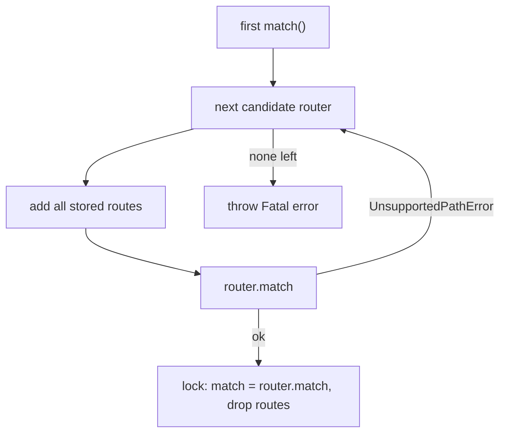

## Overview

A router stores every `(method, path, handler)` registered on an app and, given a method and a request path, returns the handlers that match, in order. Hono ships five implementations behind one small interface, and `SmartRouter` picks among them at runtime. The app talks only to the interface, so swapping routers is a constructor option ([[Application and Request Lifecycle]]).

Sources: [src/router.ts:24-52](repo://src/router.ts#L24-L52), [src/hono-base.ts:55-65](repo://src/hono-base.ts#L55-L65)

## The Router contract

A `Router<T>` has a `name`, `add(method, path, handler)` and `match(method, path)`. Constants name the methods: `METHOD_NAME_ALL` is `'ALL'` (used by `app.use` and `app.all`), and `METHODS` lists `get`, `post`, `put`, `delete`, `options` and `patch`.

Sources: [src/router.ts:9-17](repo://src/router.ts#L9-L17), [src/router.ts:29-52](repo://src/router.ts#L29-L52)

`HonoBase` registers `[handler, route]` pairs, so the router's `T` is `[H, RouterRoute]`. `match` returns a `Result<T>`, which has one of two shapes: `[[handler, paramIndexMap][], paramStash]`, or `[[handler, params][]]`. In the first form each handler carries a map from parameter name to an index in a shared stash (the form `RegExpRouter` produces from a single regex match); in the second each handler carries the parameter values directly (used by the other routers). Handlers appear in registration order, as the comment's example shows for `'*'`, `'/user/:id/*'` and `'/user/:id/:action'`.

Sources: [src/router.ts:54-98](repo://src/router.ts#L54-L98), [src/request.ts:106-128](repo://src/request.ts#L106-L128)

Two failure modes are defined in the module. `UnsupportedPathError` is thrown by a router that cannot represent a path pattern; `SmartRouter` uses it as the signal to try the next router. `MESSAGE_MATCHER_IS_ALREADY_BUILT` is the message routers throw when `add` is called after matching has started and the matcher is frozen.

Sources: [src/router.ts:19-22](repo://src/router.ts#L19-L22), [src/router.ts:100-103](repo://src/router.ts#L100-L103)

## How SmartRouter chooses

`SmartRouter` is constructed with a list of candidate routers. `add` does not forward anything: it only appends `[method, path, handler]` to its own `#routes`, and throws the already-built error if `#routes` has been cleared.

Sources: [src/router/smart-router/router.ts:4-19](repo://src/router/smart-router/router.ts#L4-L19)

The first call to `match` does the selection. For each candidate in order it replays every stored route into the candidate with `router.add(...)` and then calls `router.match(method, path)`. If either step throws `UnsupportedPathError`, that candidate is skipped and the next is tried with the same routes. Any other error is rethrown. If every candidate fails, it throws `Fatal error`.

Sources: [src/router/smart-router/router.ts:21-45](repo://src/router/smart-router/router.ts#L21-L45)

```ts
for (let i = 0, len = routes.length; i < len; i++) {
  router.add(...routes[i])
}
res = router.match(method, path)
```

Sources: [src/router/smart-router/router.ts:21-55](repo://src/router/smart-router/router.ts#L21-L55)

On success it locks in the winner: `this.match` is replaced with the winner's bound `match`, `#routers` is reduced to that one router, and `#routes` is set to `undefined`. From then on a request goes straight to the chosen router with no wrapper cost, and a later `add` fails with the already-built error. The name becomes `SmartRouter + RegExpRouter` (or whichever won), and `activeRouter` returns the winner or throws if none has been chosen yet.

Sources: [src/router/smart-router/router.ts:46-69](repo://src/router/smart-router/router.ts#L46-L69)



Sources: [src/router/smart-router/router.ts:21-55](repo://src/router/smart-router/router.ts#L21-L55)

Because selection waits for the first request, all routes are known by then, and a candidate that cannot handle one of them, even a late one, is rejected as a whole rather than half-registered.

Sources: [src/router/smart-router/router.ts:13-19](repo://src/router/smart-router/router.ts#L13-L19), [src/router/smart-router/router.ts:32-45](repo://src/router/smart-router/router.ts#L32-L45)

## Which routers each entry point uses

| Entry point | Router | Source |
| --- | --- | --- |
| `hono` | `SmartRouter` over `RegExpRouter`, then `TrieRouter` | `src/hono.ts` |
| `hono/quick` | `SmartRouter` over `LinearRouter`, then `TrieRouter` | `src/preset/quick.ts` |
| `hono/tiny` | `PatternRouter` alone | `src/preset/tiny.ts` |
| any | the `router` option of `HonoOptions` | `src/hono-base.ts` |

Sources: [src/hono.ts:26-33](repo://src/hono.ts#L26-L33), [src/preset/quick.ts:18-23](repo://src/preset/quick.ts#L18-L23), [src/preset/tiny.ts:15-20](repo://src/preset/tiny.ts#L15-L20), [src/hono-base.ts:55-65](repo://src/hono-base.ts#L55-L65)

The ordering matters: `TrieRouter` is the last candidate in both smart configurations and is the one that never throws `UnsupportedPathError` (its `add` and `match` have no such check), so it acts as the fallback for paths the first router rejects. Details of each algorithm are on [[RegExpRouter Internals]] and [[TrieRouter, LinearRouter and PatternRouter]].

Sources: [src/router/trie-router/router.ts:5-28](repo://src/router/trie-router/router.ts#L5-L28), [src/hono.ts:28-32](repo://src/hono.ts#L28-L32)
