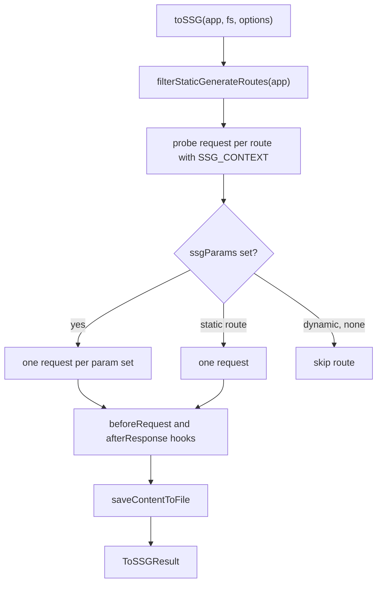

## Overview

`toSSG` in `src/helper/ssg` renders an app's `GET` routes into files. It does this by calling the app itself: it asks `app.routes` which routes exist, requests each one through `app.request` as if a browser had, and writes each response body to a path derived from the route and content type. Because it goes through the normal request path ([[Application and Request Lifecycle]]), middleware and handlers run unchanged; the SSG context flag is how they can tell they are in a build. Writing files is delegated to a `FileSystemModule` that each runtime supplies ([[Runtime Adapters]]).

Sources: [src/helper/ssg/ssg.ts:34-37](repo://src/helper/ssg/ssg.ts#L34-L37), [src/helper/ssg/ssg.ts:368-372](repo://src/helper/ssg/ssg.ts#L368-L372), [src/helper/ssg/ssg.ts:205-243](repo://src/helper/ssg/ssg.ts#L205-L243)



Sources: [src/helper/ssg/ssg.ts:205-302](repo://src/helper/ssg/ssg.ts#L205-L302), [src/helper/ssg/ssg.ts:420-470](repo://src/helper/ssg/ssg.ts#L420-L470)

## Which routes are generated

`filterStaticGenerateRoutes(app)` walks `hono.routes` and keeps routes whose method is `GET` or `ALL` and whose handler is not middleware. It first resolves the real handler with `findTargetHandler`, since `route()` may have wrapped it, and `isMiddleware` treats any function with more than one parameter as middleware ([[Middleware Composition and Error Handling]]).

Sources: [src/helper/ssg/utils.ts:61-71](repo://src/helper/ssg/utils.ts#L61-L71), [src/utils/handler.ts:8-15](repo://src/utils/handler.ts#L8-L15)

A route is dynamic if any path segment starts with `:` or contains `*`. For each route, `fetchRoutesContent` first sends a probe `GET` to `http://localhost` plus the route path, with the env `{ HONO_SSG_CONTEXT: true }`. That is a way for the route to declare its parameters: the `ssgParams` middleware, when it sees a dynamic path, stores the parameter sets on the raw request (`request.ssgParams`) and returns `c.notFound()` so the real handler does not run. After the probe, a static route with no params gets `[{}]`, a dynamic route with none is skipped, and otherwise every param object is substituted into the path with `replaceUrlParam` (the same function the RPC client uses, see [[RPC Client (hc)]]) and requested.

Sources: [src/helper/ssg/utils.ts:73-75](repo://src/helper/ssg/utils.ts#L73-L75), [src/helper/ssg/ssg.ts:222-269](repo://src/helper/ssg/ssg.ts#L222-L269), [src/helper/ssg/middleware.ts:43-49](repo://src/helper/ssg/middleware.ts#L43-L49)

`ssgParams` accepts an array of param objects or a function of the context returning one, sync or async.

Sources: [src/helper/ssg/middleware.ts:24-49](repo://src/helper/ssg/middleware.ts#L24-L49)

```ts
app.get('/post/:id', ssgParams([{ id: '1' }, { id: '2' }]), (c) => c.html(page(c.req.param('id'))))
```

Sources: [src/helper/ssg/middleware.ts:24-49](repo://src/helper/ssg/middleware.ts#L24-L49)

## Controlling SSG from handlers

During a build the env carries `HONO_SSG_CONTEXT`, which `isSSGContext(c)` tests. Two middleware use it: `disableSSG()` makes a route answer `404` with header `x-hono-disable-ssg` during a build, and the generator drops any response carrying that header; `onlySSG()` does the reverse and returns `404` outside a build.

Sources: [src/helper/ssg/middleware.ts:5-22](repo://src/helper/ssg/middleware.ts#L5-L22), [src/helper/ssg/middleware.ts:56-83](repo://src/helper/ssg/middleware.ts#L56-L83), [src/helper/ssg/ssg.ts:270-273](repo://src/helper/ssg/ssg.ts#L270-L273)

## Requests, concurrency and hooks

All requests, including probes, run through a pool created with `createPool({ concurrency })`; `concurrency` defaults to 2 and is set by the option of that name. Requests are produced lazily by generators, and `toSSG` starts saving each content generator as it resolves.

Sources: [src/helper/ssg/ssg.ts:17](repo://src/helper/ssg/ssg.ts#L17), [src/helper/ssg/ssg.ts:222-223](repo://src/helper/ssg/ssg.ts#L222-L223), [src/helper/ssg/ssg.ts:436-449](repo://src/helper/ssg/ssg.ts#L436-L449)

Three hook types adjust the process. A `beforeRequestHook` may return a modified `Request` or `false` to skip; an `afterResponseHook` may return a modified `Response` or `false` to skip; an `afterGenerateHook` receives the final `ToSSGResult`, the file-system module and the options. Hooks can come from the options and from `plugins`, and each type is combined in order, with the first `false` stopping the chain.

Sources: [src/helper/ssg/ssg.ts:110-173](repo://src/helper/ssg/ssg.ts#L110-L173), [src/helper/ssg/ssg.ts:175-198](repo://src/helper/ssg/ssg.ts#L175-L198), [src/helper/ssg/ssg.ts:373-419](repo://src/helper/ssg/ssg.ts#L373-L419)

Two plugins are provided. `defaultPlugin()` is used when no `plugins` option is passed and drops every response whose status is not 200. `redirectPlugin()` converts redirects (301, 302, 303, 307, 308) with a `Location` header into a small HTML page with a `meta refresh`, a canonical link and `noindex`, so redirects survive as static files; a redirect without `Location` is dropped.

Sources: [src/helper/ssg/plugins.ts:11-20](repo://src/helper/ssg/plugins.ts#L11-L20), [src/helper/ssg/plugins.ts:22-72](repo://src/helper/ssg/plugins.ts#L22-L72), [src/helper/ssg/ssg.ts:372](repo://src/helper/ssg/ssg.ts#L372)

## Writing files

A successful response is read as text if its content type contains `text` or `json`, otherwise as an `ArrayBuffer`. The content type, defaulting to `text/plain` when the header is missing, picks the extension: `defaultExtensionMap` maps HTML, several XML types and YAML, a user `extensionMap` replaces that map, and other types fall back to `getExtension(mimeType)` and finally `html`.

Sources: [src/helper/ssg/ssg.ts:74-108](repo://src/helper/ssg/ssg.ts#L74-L108), [src/helper/ssg/ssg.ts:282-284](repo://src/helper/ssg/ssg.ts#L282-L284)

`generateFilePath` turns the route into a file inside the output directory (default `./static`): a route that already ends in the extension is kept as is, `/` becomes `index.<ext>`, a trailing-slash route becomes `<route>/index.<ext>`, and anything else gets `.<ext>` appended. `ensureWithinOutDir` then normalises both paths and throws `Path traversal detected` if the result is outside the output directory, so a crafted route or param cannot write elsewhere.

Sources: [src/helper/ssg/ssg.ts:27](repo://src/helper/ssg/ssg.ts#L27), [src/helper/ssg/ssg.ts:50-72](repo://src/helper/ssg/ssg.ts#L50-L72), [src/helper/ssg/utils.ts:50-55](repo://src/helper/ssg/utils.ts#L50-L55), [src/helper/ssg/utils.ts:77-87](repo://src/helper/ssg/utils.ts#L77-L87)

`saveContentToFile` creates the directory once (tracked in a module-level set) with `mkdir({ recursive: true })` and writes strings directly or `ArrayBuffer`s as `Uint8Array`. `toSSG` waits for all saves; the first error makes the result `{ success: false, files: [], error }`, otherwise it is `{ success: true, files }`. The `afterGenerateHook`s run in both cases.

Sources: [src/helper/ssg/ssg.ts:309-334](repo://src/helper/ssg/ssg.ts#L309-L334), [src/helper/ssg/ssg.ts:450-470](repo://src/helper/ssg/ssg.ts#L450-L470)

## Runtime wrappers

`hono/bun` and `hono/deno` export `toSSG(app, options)`, which calls the shared `toSSG` with that runtime's file-system module: Bun's uses `Bun.write` and a no-op `mkdir`, and Deno's uses `Deno.writeFile` and `Deno.mkdir`. Any other runtime can call `toSSG` from `hono/ssg` with its own `FileSystemModule`.

Sources: [src/adapter/bun/ssg.ts:13-27](repo://src/adapter/bun/ssg.ts#L13-L27), [src/adapter/deno/ssg.ts:9-27](repo://src/adapter/deno/ssg.ts#L9-L27), [src/helper/ssg/index.ts:6-14](repo://src/helper/ssg/index.ts#L6-L14)
