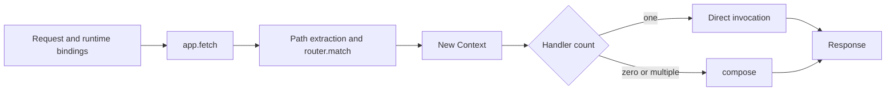

# Request dispatch and middleware composition

Hono's core boundary is a Web `Request` becoming a Web `Response`. [HonoBase](../../src/hono-base.ts) owns registration and dispatch; the concrete [Hono class](../../src/hono.ts) supplies the default router. Runtime servers and event conversion sit outside this boundary.

## Registration and dispatch

The HTTP methods, `on()`, and `use()` all reach the same registration function. It uppercases the method, merges the base path, adds a handler plus route metadata to the router, and appends that metadata to `app.routes`. Middleware registered with `use()` uses the all-method marker and defaults to `*`.



`fetch(request, env, executionCtx)` dispatches using the request method. HEAD is special: dispatch runs the GET path, then constructs a response with the same response initialization and no body. Path extraction and router matching occur before the handler error-catching blocks; a broken custom router is not equivalent to an exception thrown by a route handler.

Exactly one matching handler uses a direct fast path. A returned response wins; an asynchronous handler resolving without a response can fall back to an already-finalized context or the not-found handler. The synchronous return path uses the return value or not-found directly. Exercise both paths when changing dispatch.

## Middleware ordering and finalization

[compose](../../src/compose.ts) walks matching handlers by index. Calling `await next()` enters the next handler; code after that await runs while the stack unwinds. A handler returning a response without calling next short-circuits downstream handlers.

```ts
app.use('*', async (c, next) => {
  c.set('started', Date.now())
  await next()
  c.header('X-Elapsed', String(Date.now() - c.get('started')))
})
app.get('/health', (c) => c.text('ok'))
```

The composer sets `c.req.routeIndex` before each handler so request parameters refer to that match. It rejects a second dispatch to an already-entered index with `next() called multiple times`. When a handler supplies a response, the composer assigns it to `c.res` if the context is not finalized, or when handling an error.

At the end of the stack, an unfinalized context can receive the not-found response. If composition returns without finalizing a response, dispatch raises the diagnostic asking whether a response or `await next()` was forgotten. Returning or awaiting the next promise is therefore part of the middleware contract.

## Errors and application boundaries

The composer catches `Error` instances, records `c.error`, and invokes the configured error handler. Non-Error thrown values propagate. The default handler recognizes an error exposing `getResponse()`, wraps its response through the context, and otherwise logs the error and returns a 500 text response. The default not-found handler returns 404 text.

[HTTPException](../../src/http-exception.ts) carries a status, optional response, message, and cause. Its response conversion uses the exception's status even when a response was supplied. Set `app.onError()` to implement application error policy and `app.notFound()` to customize unmatched requests.

Three composition tools have different ownership:

| Tool | Behavior |
| --- | --- |
| `basePath(prefix)` | Returns a clone sharing the router and route list, with a merged registration prefix. |
| `route(prefix, child)` | Copies the child's currently registered routes into the parent; wraps handlers when the child has a custom error handler. Register child routes before grouping. |
| `mount(prefix, fetchHandler)` | Registers an all-method wildcard bridge to another fetch-style app; by default strips the mounted prefix and passes environment and execution context. A falsy result continues downstream. |

## Where to investigate

[compose.test.ts](../../src/compose.test.ts) covers response mutation during unwind, short-circuiting, missing responses, errors, and repeated next calls. [hono.test.ts](../../src/hono.test.ts) covers grouping, base paths, error scopes, HEAD, and mounted applications.

Continue with [routing engines](routing.md), [request and response state](../concepts/request-and-context.md), or [middleware policies](../concepts/middleware-and-security.md).
