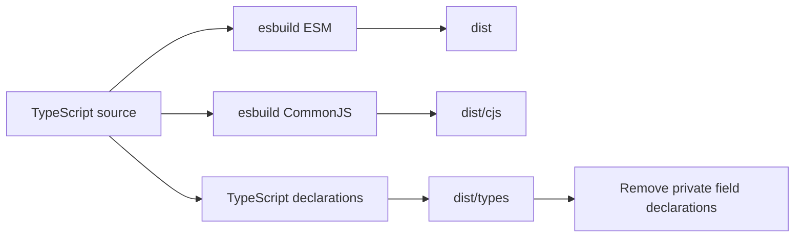

# Package exports, builds and releases

Hono's npm package resolves public imports to generated files under `dist`; its JSR manifest maps exports to TypeScript source. A feature can work in source tests yet fail as a package if these surfaces drift.

## Artifact flow



The [build command](../../package.json) removes dist, runs [build/build.ts](../../build/build.ts) with Bun, then copies the CommonJS package marker into dist/cjs and dist/types. The postbuild script is publint. Run from the repository root after installing dependencies:

```bash
bun install --frozen-lockfile
bun run build
```

The build script scans `src/**/*.ts` with explicit exclusions for test and legacy entry paths. It runs ESM, CommonJS, and declaration generation concurrently. ESM output uses an import-resolution plugin that adds .js or /index.js and marks imports external, preserving the module layout despite bundle mode. CommonJS emits to dist/cjs.

Type declarations come from `tsc --emitDeclarationOnly --declaration --project tsconfig.build.json`. The build config excludes tests, sets the source root, and writes to dist/types. A postprocessor parses emitted declarations with oxc-parser and replaces private-identifier property declarations with whitespace. It operates on declaration artifacts, not source implementations.

The npm manifest publishes dist while excluding tsbuildinfo files. Root fields and conditional exports provide types/import/require targets; `typesVersions` supplies additional declaration routing. The root package is ESM, while [package.cjs.json](../../package.cjs.json) sets type: commonjs for copied nested markers.

## Export consistency

Before compiling, the build reads the export keys in package.json and jsr.json and invokes [validateExports](../../build/validate-exports.ts) in both directions. It checks coverage of export names, including wildcard relationships. It does not compare the target implementation contents or prove that each exported file behaves identically.

JSR maps public entries to source and explicitly lists utility modules where npm uses a wildcard. Its publish configuration includes source TypeScript and excludes test files. Some JSR entries point directly to implementations while npm points to index modules; check both when adding or changing a public surface.

For a new public module:

1. Implement and export the source API at the appropriate entrypoint.
2. Add npm types/import/require targets and appropriate typesVersions mapping.
3. Add the corresponding JSR source export.
4. Run focused source/type tests and the build, then inspect the emitted entry and declaration.
5. Exercise any affected runtime boundary using [runtime tests](testing.md).

The [export validation tests](../../build/validate-exports.test.ts) cover missing names and wildcard coverage. [Private-field tests](../../build/remove-private-fields.test.ts) verify the declaration transformation.

## Release and preview automation

The local release script invokes `np --no-publish`; prerelease runs Deno tests and the build. Publication is specified separately in [.github/workflows/release.yml](../../.github/workflows/release.yml), which triggers on pushed tags.

The npm job installs toolchain versions from .tool-versions, installs dependencies, builds, and runs the configured `npm stage publish --provenance --access public` command. The JSR job installs Deno and runs publish-on-tag. Both jobs request identity-token permission. These are repository workflow definitions, not a report that a release has been performed.

The [continuous-release workflow](../../.github/workflows/cr.yml) builds and publishes through pkg.pr.new for the upstream main branch or eligible pull requests carrying the cr-tracked label. It is separate from tag-triggered releases.

Use [testing](testing.md) for CI checks and performance investigation, [adapters](../integrations/runtime-adapters.md) for package/runtime seams, and [quickstart](../quickstart.md) for the repository task map.
